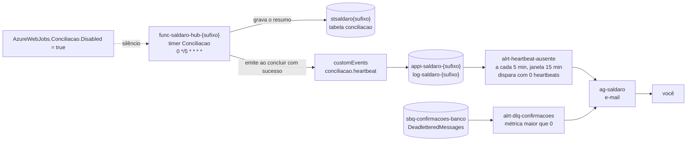

# Desafio 3.6 — "O agendador que morreu em silêncio": heartbeat, KQL e alerta por ausência de sinal

> **Version-anchor:** Q4-2026 · **Tipo:** desafio para casa, com entrega (cerca de 2h, boa parte esperando o alerta) · **Estado inicial:** `./scripts/deploy.ps1 -Cenario 6` · **Estado pronto:** `./scripts/deploy.ps1 -Cenario 6 -Pronto -EmailAlerta <seu-email>`
>
> Empresa, pessoas, números e incidentes são fictícios; qualquer semelhança é coincidência. Os serviços, os limites e os preços citados são reais e foram conferidos no Microsoft Learn e na tabela de preços da Microsoft em 2026-10-14. Os resultados de referência dos passos vêm do primeiro deploy real do kit, também em 2026-10-14 (Flex Consumption, Brazil South); os seus vão variar um pouco.

> **CUSTO E FREE TRIAL**
> | Item | Valor |
> |------|-------|
> | Custo mensal (se deixar o ambiente ligado) | ~R$ 70 (Service Bus Standard ~R$ 55 + alerta de log a cada 5 min ~R$ 8 + centavos) |
> | Custo real deste desafio (subir, praticar e apagar no mesmo dia) | ~R$ 1 a 2 |
> | Compatível com Azure Free Trial (US$ 200)? | **Sim** |
> | Base dos valores | Preços de lista da Microsoft para Brazil South consultados em 2026-10-14, convertidos a ~R$ 5,50/US$ e arredondados; confira na calculadora no dia |
>
> **Regra de ouro:** apague o Resource Group (`rg-saldaro-lab`) assim que entregar, com `./scripts/limpar.ps1`. O Service Bus cobra por hora e a regra de alerta de log cobra por mês, proporcional ao tempo ligada.

## Tabela de Recursos

O kit é criado pelo `deploy.ps1` a partir do Bicep em `infra/`. Os alertas e o Action Group só existem no estado pronto (`alertas = true`); o workbook é opcional e criado por você.

| Recurso | Tipo | SKU / Tier | Custo estimado (mensal, se ficar ligado) |
|---------|------|------------|------------------------------------------|
| `rg-saldaro-lab` | Resource Group | — | Gratuito |
| `sb-saldaro-<sufixo>` (filas `sbq-faturas-recebidas`, `sbq-confirmacoes-banco`, `sbq-notificacoes-parceiro`) | Service Bus namespace | Standard | ~R$ 55 (US$ 10 de base, com 13 milhões de operações incluídas) |
| `func-saldaro-hub-<sufixo>` e plano `asp-saldaro-hub-<sufixo>` | Function App (o hub, com o timer `Conciliacao`) | Flex Consumption (FC1) | ~R$ 0 dentro da franquia mensal |
| `func-saldaro-banco-<sufixo>` e plano `asp-saldaro-banco-<sufixo>` | Function App (banco parceiro simulado) | Flex Consumption (FC1) | ~R$ 0 |
| `apim-saldaro-<sufixo>` | API Management | Consumption | ~R$ 0 (1 milhão de chamadas/mês grátis) |
| `stsaldaro<sufixo>` (tabela `conciliacao`, entre outras) | Storage Account | Standard LRS | centavos |
| `kv-saldaro-<sufixo>` | Key Vault | Standard | centavos |
| `evgt-saldaro-faturas-<sufixo>` | Event Grid custom topic | Basic | ~R$ 0 |
| `log-saldaro-<sufixo>` / `appi-saldaro-<sufixo>` | Log Analytics / Application Insights | Pay-as-you-go | ~R$ 0 (5 GB/mês grátis) |
| `ag-saldaro` (só no estado pronto) | Action Group, e-mail = `-EmailAlerta` | — | ~R$ 0 (1.000 e-mails/mês grátis) |
| `alrt-heartbeat-ausente` (só no estado pronto) | Alerta de log (scheduled query), a cada 5 min, janela de 15 min | — | ~R$ 8 (US$ 1,50/mês por regra nessa frequência) |
| `alrt-dlq-confirmacoes` (só no estado pronto) | Alerta de métrica (`DeadletteredMessages` em `sbq-confirmacoes-banco`) | — | ~R$ 0 (as 10 primeiras séries monitoradas são grátis; depois US$ 0,10 por série/mês) |
| Workbook (opcional, criado por você) | Azure Monitor Workbook | — | Gratuito |

> **Custo total estimado:** ~R$ 70/mês se ficar ligado; ~R$ 1 a 2 se você fizer o desafio e apagar no mesmo dia.

---

## O incidente

O timer da conciliação parou depois de uma reciclagem da instância. Como o "próximo horário" era avançado antes de o trabalho terminar, nada parecia atrasado, e os painéis mostravam zero erros, porque não havia nada rodando para dar erro. Levou meses para alguém notar, numa auditoria.

Noutro dia, uma falha transiente no armazenamento, no começo da manhã, só foi percebida por um humano depois do almoço: só existiam alertas de erro, e quando alguém olhou, o erro já tinha passado.

## O que você vai entregar

Este é o desafio da aula. A entrega tem duas peças obrigatórias e uma opcional:

1. **Print do alerta `alrt-heartbeat-ausente` disparando:** o e-mail de "Fired" ou a tela **Monitor → Alerts** com o alerta no estado **Fired**, mostrando o nome da regra e o horário. Mascare o seu e-mail e o ID da assinatura antes de enviar.
2. **Post-mortem de cinco linhas** preenchido a partir de `templates/post-mortem.md` (uma cópia sua), com os horários da linha do tempo do Passo 5.1.
3. (Opcional) Print do `alrt-dlq-confirmacoes` disparando e do seu workbook.

Envie no canal indicado pelo professor. O que conta: o print mostra o alerta disparado pela **ausência** de heartbeat (não o disparo de logo depois do deploy, ver Passo 4.5), e a causa raiz do post-mortem nomeia uma decisão de arquitetura, não uma pessoa.

## O que você vai provar

Ao final do desafio (critério de feito):

1. `kql/heartbeat-ultimo.kql` mostra um `conciliacao.heartbeat` a cada 5 minutos, com `faturasVerificadas`, `divergencias` e `duracaoMs`.
2. Com o timer desabilitado (`AzureWebJobs.Conciliacao.Disabled = true`), o `alrt-heartbeat-ausente` dispara e o e-mail chega (com o endereço verificado no Passo 4.2); ao reabilitar, o alerta resolve sozinho.
3. Uma mensagem envenenada em `sbq-confirmacoes-banco` dispara o `alrt-dlq-confirmacoes`, que resolve depois da triagem.
4. `kql/erros-transientes-por-operacao.kql` acha a primeira falha transiente, com `operation_Id` e `faturaId`, em menos de 5 minutos.
5. (Opcional) Um workbook com o último heartbeat, a DLQ por motivo e o volume de faturas.

## Pré-requisitos

- Lab 0 feito: VS Code, .NET 10 SDK, Azure CLI com Bicep e PowerShell 7 (`pwsh`) instalados, e `az login` feito numa assinatura que você controla (o Free Trial serve).
- Repositório da aula clonado; todos os comandos rodam na raiz do repositório.
- Um e-mail seu para receber os alertas, com a caixa de entrada aberta durante o Passo 4.2: o Azure manda para ele um código de verificação que vale 30 minutos, e sem a verificação nenhum alerta chega por e-mail (confira também o spam).
- O Incidente 3 (DLQ) feito ou lido: o alerta de DLQ reaproveita a mensagem envenenada de lá.

## Diagrama da arquitetura



---

## Parte 1 — Estado inicial

### Passo 1.1 — Suba o cenário 6

```powershell
./scripts/deploy.ps1 -Cenario 6
```

O estado inicial do cenário 6 é o `cenario-4-pronto`: tudo o que os três incidentes ao vivo consertaram, com `heartbeat = false` e `alertas = false`. O timer `Conciliacao` roda a cada 5 minutos, conta as faturas por status, marca como divergência as `cobranca-emitida` há mais de 10 minutos sem confirmação e grava um resumo na tabela `conciliacao`. Mas ninguém avisa se ele parar. Costuma levar de 10 a 20 minutos (no primeiro deploy real do kit, vindo do estado pronto da 3.5, 7,1 minutos). Se você vem da 3.5, este deploy desfaz a identidade gerenciada: os app settings do hub voltam às connection strings, e o `disableLocalAuth` do namespace volta a `false`.

### Passo 1.2 — Carregue as variáveis do ambiente

```powershell
$cfg = Get-Content ./scripts/.env.local | ConvertFrom-StringData
$rg  = $cfg.SALDARO_RG
$suf = $cfg.SALDARO_SUFIXO
$hub = "func-saldaro-hub-$suf"
```

### Passo 1.3 — Gere tráfego para a conciliação ter o que contar

```powershell
./scripts/erp-simulado.ps1 -Faturas 20 -Cliente cliente-a -ReqPorMin 60
```

---

## Parte 2 — Sintomas: o silêncio

### Passo 2.1 — Confirme que o timer está vivo

1. No Application Insights `appi-saldaro-<sufixo>` → **Logs**, rode:

```kusto
// ILUSTRATIVO: últimas execuções do timer Conciliacao (cada execução vira um request).
requests
| where timestamp > ago(1h) and operation_Name == "Conciliacao"
| project timestamp, success, duration
| order by timestamp desc
```

2. No Storage Account `stsaldaro<sufixo>` → **Storage browser** → **Tables** → `conciliacao`: cada execução grava uma linha (PartitionKey = data no formato `yyyyMMdd`).
3. Confira que o heartbeat está desligado neste estado:

```powershell
az functionapp config appsettings list -g $rg -n $hub --query "[?name=='Cenario__Heartbeat'].value" -o tsv
```

Resultado esperado: `false`. E `kql/heartbeat-ultimo.kql` volta uma linha só, com `heartbeatsNoPeriodo = 0` e o resto vazio: o hub ainda não emite `conciliacao.heartbeat`.

### Passo 2.2 — Mate o agendador em silêncio

Pelo Portal: Function App `func-saldaro-hub-<sufixo>` → **Overview** → aba **Functions** → `Conciliacao` (abre o **Overview** da função) → **Disable**. Ou pela CLI:

```powershell
az functionapp config appsettings set -g $rg -n $hub --settings AzureWebJobs.Conciliacao.Disabled=true -o none
```

Os dois caminhos fazem a mesma coisa: criam o app setting `AzureWebJobs.Conciliacao.Disabled = true`, e o runtime passa a ignorar o gatilho do timer. O `-o none` é importante: o comando devolve **todos** os app settings, e neste estado alguns deles são connection strings.

> **Fato verificado no Microsoft Learn:** mudar app settings reinicia o app em todos os planos. No Linux, onde o Flex Consumption roda, a documentação avisa que funções com hífen no nome não podem ser desabilitadas por app setting; `Conciliacao` não tem hífen.

### Passo 2.3 — Espere 15 minutos e olhe para tudo o que está "verde"

- Exceções: rode `exceptions | where timestamp > ago(15m) | count`. Zero, ou só o que os outros fluxos já tinham.
- Requisições com falha: nenhuma do `Conciliacao`, porque ele não roda.
- **Monitor → Alerts**: nada. Neste estado o kit não tem nenhuma regra de alerta.
- **Overview** do Function App: tudo saudável.
- A tabela `conciliacao` simplesmente parou de crescer, e a consulta do Passo 2.1 mostra a última execução cada vez mais velha.

Esse é o incidente inteiro: zero erros porque nada roda.

---

## Parte 3 — Hipóteses

| Hipótese | Como testar | Resultado esperado |
|----------|-------------|--------------------|
| Não havia faturas para conciliar | Passo 1.3: há faturas | Descartada |
| O timer roda, mas falha | Exceções e requests com falha do `Conciliacao` | Descartada: não há execução, nem com falha |
| O timer não roda | Última execução antiga, tabela parada, app setting `AzureWebJobs.Conciliacao.Disabled` | **Confirmada** |
| Ninguém percebeu porque os alertas eram de erro | Ausência de execução não gera erro nenhum | **Confirmada** |
| Bastaria um heartbeat no **início** da execução | Releia a história: o "próximo horário" avançava antes de o trabalho terminar | Descartada: "comecei" não é "terminei" |

O conserto é um sinal **positivo** emitido só quando o trabalho termina bem, e um alerta que dispara quando esse sinal **some**: o dead man's switch. Confira no código que o heartbeat do kit está no lugar certo, procurando a chamada que emite o evento:

```powershell
Get-ChildItem ./03_Aplicações/Saldaro.Hub -Recurse -Filter *.cs | Select-String -SimpleMatch -Pattern '.ConciliacaoHeartbeat(' | Select-Object Path, LineNumber
```

O resultado aponta para `Aplicacao/ServicoDeConciliacao.cs`, onde a conciliação chama `telemetria.ConciliacaoHeartbeat(...)` (o nome do evento, `conciliacao.heartbeat`, fica em `Aplicacao/Telemetria.cs`). Abra esse arquivo e confirme duas coisas: o evento é emitido **depois** da contagem e da gravação na tabela `conciliacao`, e só no caminho de sucesso (uma exceção no meio do trabalho não emite heartbeat). É isso que diferencia "o processo está agendado" de "o processo está entregando".

---

## Parte 4 — Conserto

### Passo 4.1 — Reabilite o timer antes do deploy

```powershell
az functionapp config appsettings delete -g $rg -n $hub --setting-names AzureWebJobs.Conciliacao.Disabled -o none
```

O deploy do próximo passo reaplica a lista **inteira** de app settings declarada no Bicep, e um setting criado à mão, como este, some junto. Apague assim mesmo: o estado fica explícito e você não depende de um efeito colateral do deploy. A mesma regra vale ao contrário, e ela importa no Passo 5.1: qualquer `deploy.ps1` apaga o `AzureWebJobs.Conciliacao.Disabled` que você criou.

### Passo 4.2 — Ligue o heartbeat e os alertas

```powershell
./scripts/deploy.ps1 -Cenario 6 -Pronto -EmailAlerta <seu-email>
```

`cenario-6-pronto` é o `cenario-4-pronto` com `heartbeat = true` e `alertas = true` (no primeiro deploy real do kit, este deploy levou 6,4 minutos). O que muda:

- O app setting `Cenario__Heartbeat` vira `true`, e o `Conciliacao` passa a emitir `conciliacao.heartbeat` ao concluir com sucesso, com as propriedades `faturasVerificadas`, `divergencias` e `duracaoMs`.
- Nascem o Action Group `ag-saldaro` (com o e-mail do `-EmailAlerta`; sem ele, o da conta logada na Azure CLI), a regra `alrt-heartbeat-ausente` e a regra `alrt-dlq-confirmacoes`, todos declarados no Bicep em `infra/modules/alertas.bicep`.

**Verifique o seu e-mail antes de seguir.** Enquanto o deploy roda, o Azure Monitor manda ao endereço do Action Group um e-mail com o assunto **Action required: Verify your email for Azure Monitor action group**. Ele traz um botão **Verify my email** e um código de uso único (one-time password) que vale **30 minutos**. Abra esse e-mail e confirme o endereço; se ele não estiver na caixa de entrada, procure no spam. Sem a verificação, os alertas disparam, mas ficam só no Portal, em **Monitor → Alerts**: nenhum e-mail chega, nem o de "Fired", nem o de "Resolved". Foi o que aconteceu no primeiro deploy real do kit: ninguém verificou o endereço, e os dois alertas do desafio dispararam sem mandar e-mail nenhum. E não conte com o `az` para avisar: o destinatário `email-aluno` continua aparecendo como `Enabled`, sem nenhum sinal da pendência. Se o código expirar, abra o Action Group `ag-saldaro` (**Monitor** → **Alerts** → **Action groups**) e selecione **Resend**.

> **Fato verificado no Microsoft Learn:** um endereço de e-mail num Action Group precisa ser verificado com um código de uso único em até 30 minutos depois de o Action Group ser salvo: *"Email addresses must be verified through a one-time passcode (OTP) within 30 minutes of saving the action group."* A verificação vale para todos os Action Groups, passados e futuros, do mesmo tenant, e um endereço já verificado recebe só o aviso de que entrou no Action Group. Com a exigência ativa, um destinatário não verificado não recebe nem alerta nem notificação de teste. A notificação **Email Azure Resource Manager role**, que manda e-mail aos membros de uma role da assinatura, não exige a verificação. Fonte: [Create and manage action groups](https://learn.microsoft.com/en-us/azure/azure-monitor/alerts/action-groups) (tabela "Notification types").

### Passo 4.3 — Leia as duas regras no Portal

1. **Monitor** → **Alerts** → **Alert rules** → `alrt-heartbeat-ausente` (severidade 1):
   - Tipo de sinal: **Log search** (sinal **Custom log search**), com escopo no `appi-saldaro-<sufixo>`.
   - **Frequency of evaluation**: 5 minutos; janela de 15 minutos (no Portal, **Aggregation granularity**).
   - Condição: **Measure** = **Table rows**, **Operator** = **Less than**, **Threshold value** = 1. Ou seja, dispara quando a contagem de heartbeats na janela é **zero**.
   - Compare a consulta da regra com `kql/heartbeat-ausente-alerta.kql`: a regra usa só as duas primeiras linhas (`customEvents | where name == "conciliacao.heartbeat"`), porque a janela vem da própria regra; o arquivo acrescenta o filtro de 15 minutos e as colunas, para dar o mesmo resultado quando você roda à mão.
2. **Alert rules** → `alrt-dlq-confirmacoes` (severidade 2):
   - Sinal: a métrica **Count of dead-lettered messages in a Queue/Topic** (`DeadletteredMessages`) do namespace, filtrada pela dimensão `EntityName` = `sbq-confirmacoes-banco`.
   - Condição: máximo maior que 0, avaliado a cada minuto numa janela de 5 minutos.
3. As duas apontam para o Action Group `ag-saldaro` e estão com **Automatically resolve alerts** ligado (`autoMitigate` no Bicep).

> **Fato verificado no Microsoft Learn:** com a opção **Automatically resolve alerts**, um alerta de log com frequência entre 5 e 15 minutos resolve quando a condição deixa de valer por **três** períodos de avaliação seguidos. Guarde isso para a linha do tempo do Passo 5.1.

### Passo 4.4 — Veja os heartbeats chegando

Espere dois ciclos do timer (até 10 minutos) e rode `kql/heartbeat-ultimo.kql` em **Logs** do `appi-saldaro-<sufixo>`. Resultado esperado: o horário do último `conciliacao.heartbeat`, há quantos minutos ele aconteceu e as propriedades da execução.

> As consultas de `kql/` usam o escopo do recurso Application Insights (`customEvents`, coluna `timestamp`). Cada arquivo comenta o equivalente no workspace do Log Analytics (tabela `AppEvents`, coluna `TimeGenerated`).

### Passo 4.5 — Não confunda o primeiro disparo com a prova

Se o `alrt-heartbeat-ausente` disparar logo depois do deploy, antes do primeiro heartbeat, é a janela de 15 minutos ainda vazia. Ele resolve sozinho alguns ciclos depois que os heartbeats começam. Esse disparo **não** vale como entrega: a prova é o disparo provocado no Passo 5.1, com heartbeats acontecendo antes. No primeiro deploy real do kit, ele não aconteceu: o primeiro heartbeat veio 7 s depois do fim do deploy, e nenhum alerta disparou.

---

## Parte 5 — Prova

### Passo 5.1 — O alerta por ausência (entrega 1)

Preencha esta linha do tempo enquanto executa; ela alimenta o post-mortem. A última coluna traz o primeiro deploy real do kit, em tempos relativos, como referência:

| Marco | Horário | Primeiro deploy real do kit |
|-------|---------|-----------------------------|
| T0 — último heartbeat antes de desligar (`kql/heartbeat-ultimo.kql`) | | — |
| T1 — timer desabilitado | | 54 s depois de T0 |
| T2 — `alrt-heartbeat-ausente` em **Fired** (Monitor → Alerts) e e-mail recebido | | 19 min depois de T0 (18 min depois de T1), só no Portal: o e-mail não tinha sido verificado |
| T3 — timer reabilitado | | — |
| T4 — primeiro heartbeat depois de reabilitar | | 4 min 20 s depois de T3, o do ciclo seguinte: o da execução atrasada se perdeu (item 5) |
| T5 — alerta em **Resolved** | | 15 min depois de T4 (19 min 22 s depois de T3) |

> **Não rode o `deploy.ps1` entre T1 e T3.** Ele reaplica a lista inteira de app settings e apagaria o `AzureWebJobs.Conciliacao.Disabled`: o timer voltaria a rodar e a prova se perderia.

1. Logo depois de um heartbeat (T0), desabilite o timer (T1):

```powershell
az functionapp config appsettings set -g $rg -n $hub --settings AzureWebJobs.Conciliacao.Disabled=true -o none
```

2. Espere. A conta do tempo até o alerta: a regra olha os últimos 15 minutos e roda a cada 5. Enquanto o heartbeat de T0 estiver dentro da janela, a contagem é 1 e nada acontece. A primeira avaliação depois de T0 + 15 minutos encontra zero e dispara: entre T0 + 15 e T0 + 20 minutos, mais o tempo de entrega do e-mail. Na prática, **entre 15 e 25 minutos depois do último heartbeat** (no primeiro deploy real do kit, 19 minutos).
3. Quando o alerta disparar (T2), tire o print: o e-mail de "Fired" ou **Monitor → Alerts** com `alrt-heartbeat-ausente` no estado **Fired**. Mascare e-mail e ID da assinatura. Sem o endereço verificado (Passo 4.2), o disparo aparece só no Portal, e o print de **Monitor → Alerts** vale do mesmo jeito.
4. Reabilite o timer (T3):

```powershell
az functionapp config appsettings set -g $rg -n $hub --settings AzureWebJobs.Conciliacao.Disabled=false -o none
```

5. Ao reabilitar, o app reinicia, e o timer roda na hora a execução que ficou atrasada, sem esperar o próximo horário (no primeiro deploy real do kit, 16 s depois de T3, com `Timer fired` e `Succeeded` nos traces do host). Se o heartbeat dela chegar, ele é o seu T4. Mas ele pode se perder (veja a linha "Contagens de `customEvents` menores que o esperado" no Troubleshooting), e então T4 é o heartbeat do ciclo seguinte, até 5 minutos depois. Foi o que aconteceu no primeiro deploy real: a execução atrasada não gravou heartbeat nenhum no App Insights, e T4 veio 4 min 20 s depois de T3. A partir de T4, a condição deixa de valer, e o alerta resolve depois de três avaliações seguidas sem condição, cerca de 15 minutos (T5; no primeiro deploy real, 15 minutos depois de T4). Com o endereço verificado, chega também o e-mail de "Resolved".

   Se a fatura com vírgula do Passo 5.2 já estiver parada em `cobranca-emitida`, com as confirmações na DLQ, o heartbeat de T4 traz `divergencias = 1`. No primeiro deploy real, veio assim: é a conciliação achando exatamente o que a história do desafio diz que ela existe para achar.

### Passo 5.2 — O alerta de DLQ

1. Mande uma fatura cujo banco devolve o `valor` como texto pt-BR (a mensagem envenenada do Incidente 3):

```powershell
./scripts/erp-simulado.ps1 -Faturas 1 -Cliente cliente-a -Caos "valorComVirgula=true"
```

2. Os eventos do banco caem na DLQ de `sbq-confirmacoes-banco` na primeira entrega, com motivo `SchemaInvalida`. Em alguns minutos (a métrica é agregada por minuto), o `alrt-dlq-confirmacoes` dispara e o e-mail chega. No primeiro deploy real do kit, a DLQ ficou com 2 mensagens `SchemaInvalida`, as duas da fatura com vírgula, e o alerta disparou uns 4,5 minutos depois do envio, só no Portal (o e-mail não tinha sido verificado).
3. Rode `kql/dlq-por-motivo.kql`: aparece `SchemaInvalida`.
4. Faça a triagem e o reprocessamento, como no Incidente 3:

```powershell
./scripts/triagem-dlq.ps1
./scripts/triagem-dlq.ps1 -Reprocessar
```

Conte uns 2 minutos por comando: o `dotnet run` compila antes de rodar. No primeiro deploy real, a triagem achou as 2 mensagens corrigíveis, e o `-Reprocessar` corrigiu as duas.

5. Com a DLQ vazia, o alerta resolve sozinho, mas não na hora: a janela de 5 minutos ainda enxerga as mensagens que estavam na DLQ, e depois vêm as avaliações sem condição. No primeiro deploy real do kit, a métrica `DeadletteredMessages` zerou no minuto seguinte ao fim do `-Reprocessar`, e o **Resolved** veio uns 9 minutos depois: cerca de 10 minutos depois de a DLQ esvaziar.

### Passo 5.3 — A falha transiente achada em minutos, não depois do almoço

1. Anote o horário e solte faturas com metade das chamadas ao banco falhando de forma transiente:

```powershell
./scripts/erp-simulado.ps1 -Faturas 20 -Cliente cliente-b -Caos "falhaTransiente=50"
```

2. Rode `kql/erros-transientes-por-operacao.kql` até a primeira falha aparecer. Neste estado ela costuma ser do `EmitirCobranca`: o banco respondeu 503 (`BancoIndisponivelException`, "O banco respondeu 503 ao emitir a cobrança da fatura ...") e o Service Bus reentregou a mensagem. Anote o `operation_Id`, o `faturaId` (se `faturaIdDaPrimeira` vier vazio, ele está no texto da `mensagem`) e quantos minutos se passaram desde o início (o critério é menos de 5). No primeiro deploy real do kit, a consulta trouxe a primeira falha em `EmitirCobranca`, 7 s depois do início da rajada, com a `BancoIndisponivelException` e o `faturaIdDaPrimeira` preenchido. A tabela `exceptions` tinha 28 linhas do worker e 84 do host para a mesma rajada: a consulta conta só as do worker.
3. No Application Insights, abra **Investigate** → **Search** (o antigo **Transaction search**), cole o `operation_Id` e abra o **End-to-end transaction details**: a execução do `EmitirCobranca`, a dependência que falhou (o `POST` ao banco com 503) e a exceção. Para seguir a fatura inteira, filtre por `faturaId`, não por `operation_Id`: a fila de storage do banco e o Event Grid iniciam operações novas no meio da jornada. No primeiro deploy real do kit, o End-to-end da primeira falha mostrou a cadeia inteira em uns 3 s: APIM 202 → `PostFatura` 202 → `EmitirCobranca`, com a dependência `POST /api/cobrancas` em 503 (success **False**) → 7 abandons seguidos → a 8ª entrega com 201 e o Complete da mensagem. Repare em dois detalhes:
   - **A reentrega do Service Bus é imediata.** Os 7 abandons vieram um atrás do outro, sem backoff: as oito entregas couberam em 3 s.
   - **O 503 aparece com success True no banco.** O request `PostCobranca` do banco tem resultCode 503 e success **True**, porque a execução do banco terminou bem (o 503 foi a resposta que o botão de caos pediu). Quem falhou foi a chamada do hub: a dependência, com success **False**.
4. O outro efeito do `falhaTransiente` não gera exceção nenhuma: as confirmações `cobranca.paga` marcadas com `simulaTransiente` viram retries agendados (10, 20 e 40 segundos), resolvidos sem humano. Veja-os com a consulta comentada no próprio `kql/erros-transientes-por-operacao.kql` (evento `mensagem.retry.agendado`, por `tentativa`). Essa contagem pode vir menor que a real, ou até zerada: na rajada, o Flex escala o hub para dezenas de instâncias, e uma instância que vive poucos segundos pode ser desligada antes de mandar a telemetria do worker (veja o Troubleshooting). No primeiro deploy real do kit, a rajada escalou o hub para cerca de 30 instâncias, e várias viveram uns 20 s, gravando só linhas do host: `fatura.baixada` deu 11 de 20, `notificacao.enviada` deu 13 de 20, e `mensagem.retry.agendado` e `mensagem.deadletter` vieram zerados. Mesmo assim, tudo foi processado: as filas terminaram com ativas 0 e agendadas 0, e na DLQ só estavam as 2 mensagens da fatura com vírgula (nesse deploy, ela saiu junto com a rajada). Para confirmar os retries, use os traces do host, que chegam: cada cópia agendada tem `MessageId` = `{idEvento}-t<n>`, e o host registra o `MessageId` de cada mensagem que entrega à Function.

```kusto
// ILUSTRATIVO: retries agendados vistos pelo host do Functions (a cópia n tem MessageId terminando em -t<n>).
traces
| where timestamp > ago(30m)
| where message startswith "Trigger Details: MessageId:"
| extend messageId = extract(@"MessageId: ([^,\s]+)", 1, message)
| extend tentativa = toint(extract(@"-t(\d+)$", 1, messageId))
| where isnotnull(tentativa)
| summarize copias = count() by tentativa
| order by tentativa asc
```

No primeiro deploy real, ela mostrou 11 cópias `-t1` e 11 `-t2`, enquanto o `mensagem.retry.agendado` estava zerado. No Incidente 3, no mesmo deploy, as contagens de `customEvents` bateram: a perda é um comportamento observado, não uma regra.

### Passo 5.4 (opcional) — Monte o workbook

1. **Monitor** → **Workbooks** → **+ New**.
2. **Add** → **Add query**: cole `kql/heartbeat-ultimo.kql`. Repita com `kql/dlq-por-motivo.kql` e com esta consulta de volume:

```kusto
// ILUSTRATIVO: faturas recebidas por hora.
customEvents
| where timestamp > ago(24h) and name == "fatura.recebida"
| summarize faturas = count() by bin(timestamp, 1h)
| render columnchart
```

3. **Add** → **Add metric**: recurso `sb-saldaro-<sufixo>`, métricas **Count of active messages in a Queue/Topic** e **Count of dead-lettered messages in a Queue/Topic**, divididas por `EntityName`.
4. **Done Editing** → **Save**, no `rg-saldaro-lab`, com o nome que quiser.
5. Para guardar a definição no seu fork: **Edit** → **Advanced Editor** → **Gallery Template**, copie o JSON. O workbook some junto com o Resource Group.

### Passo 5.5 — Marque o critério de feito

- [ ] `kql/heartbeat-ultimo.kql` mostra heartbeats a cada 5 minutos (Passo 4.4).
- [ ] O `alrt-heartbeat-ausente` disparou pela ausência de heartbeat e resolveu ao reabilitar o timer (Passo 5.1), com a linha do tempo preenchida.
- [ ] O `alrt-dlq-confirmacoes` disparou com a mensagem envenenada e resolveu após a triagem (Passo 5.2).
- [ ] A primeira falha transiente foi achada em menos de 5 minutos, com `operation_Id` e `faturaId` (Passo 5.3).
- [ ] (Opcional) Workbook salvo (Passo 5.4).

---

## Post-mortem de cinco linhas (entrega 2)

Copie `templates/post-mortem.md` e preencha, sem culpados, usando os horários do Passo 5.1:

1. **O que aconteceu:** o que parou, desde quando (T1) e como foi descoberto (T2).
2. **Impacto:** o que deixou de ser feito durante o silêncio (conciliações, divergências não marcadas).
3. **Causa raiz:** a decisão de arquitetura. "Alguém desabilitou o timer" é o gatilho; a causa é o que deixava um processo agendado parar sem que nada avisasse.
4. **O que consertamos:** o heartbeat ao concluir com sucesso e o alerta por ausência, versionados no Bicep.
5. **O que impede de repetir:** o tempo de detecção que você mediu (T2 − T1), quem recebe o alerta e o que essa pessoa faz quando ele chega (o embrião de um runbook).

## Lições para produção

- **Heartbeat no fim, no caminho de sucesso**, com conteúdo: as propriedades da execução permitem um segundo alerta, para "rodou, mas não fez nada" (por exemplo, `faturasVerificadas = 0` por tempo demais em horário de pico).
- **Janela de pelo menos duas a três vezes o período** do processo: a janela de 15 minutos tolera um ciclo perdido do timer de 5 minutos sem alarme falso.
- **O tempo até o alerta é escolha, e tem preço.** Na lista de Brazil South (2026-10-14), uma regra de log custa US$ 3/mês a cada 1 minuto, US$ 1,50 a cada 5 e US$ 0,50 a cada 15. Alerta de métrica: as 10 primeiras séries são grátis, depois US$ 0,10 por série por mês.
- **Alertas como código.** As duas regras e o Action Group vivem no Bicep; um alerta criado à mão no Portal é drift (guia 3.7).
- **Um alerta precisa de um dono e de um runbook de uma página:** "quando este alerta dispara, faça isto". E-mail serve para o laboratório; em produção, o Action Group chama o plantão.
- **Destinatário de e-mail precisa ser verificado.** Um endereço novo no Action Group só recebe alertas depois de confirmado por código, e a confirmação vale para o tenant inteiro. Em produção, o receptor não pode depender da caixa pessoal de alguém: o plantão (webhook, ITSM) ou uma caixa do time.
- **App settings `AzureWebJobs.<função>.Disabled` são assassinos silenciosos:** inclua essa lista na sua checagem de drift.
- **Watchdog com lease** (uma linha `ultimaExecucao` numa tabela, verificada por outro processo) é a alternativa quando o sinal não pode depender da telemetria.
- **Sampling desligado** (ou com exclusão para `customEvents` críticos): um heartbeat amostrado para fora é um alarme falso.
- **Telemetria em buffer some com a instância.** O SDK do Application Insights no worker junta os eventos e envia em lotes, e uma instância desligada antes do envio leva o lote junto. Para sinal crítico, como o heartbeat, faça flush depois de emitir ou no encerramento do host: a [documentação do SDK clássico do Application Insights](https://learn.microsoft.com/en-us/previous-versions/azure/azure-monitor/app/classic-api) (o 2.x, que o hub usa), no exemplo de console app do Worker Service, pede `Flush()` seguido de uma espera, *"to ensure that even if application terminates, telemetry is sent to the back-end"*. E não dependa de um evento só: a janela de três ciclos é o que impede o alarme falso.
- **Correlação em duas camadas:** o `operation_Id` liga a falha à execução e à dependência que falhou; o `faturaId`, a correlação de negócio, liga a execução à fatura e ao resto da jornada. Juntos, transformam "uma falha às 7h" em "esta fatura, esta chamada, este retry".

## Troubleshooting

| Problema | Causa provável | Solução |
|----------|----------------|---------|
| Nenhum heartbeat depois do `-Pronto` | `Cenario__Heartbeat` ainda `false` (o deploy não terminou ou foi de outro estado), o timer foi desabilitado de novo depois do deploy ou o primeiro ciclo ainda não rodou | Confira os dois settings (Passo 2.1); espere 5 minutos mais a ingestão; veja os requests do `Conciliacao` |
| O alerta nunca dispara | O timer não foi desabilitado de verdade (nome do setting com letra trocada), um `deploy.ps1` rodou depois e apagou o setting, a regra está desabilitada ou você não esperou 15 minutos desde o último heartbeat | Confira o setting com `--query "[?name=='AzureWebJobs.Conciliacao.Disabled']"`; em Alert rules, confira **Enabled**; refaça a conta do Passo 5.1 |
| O alerta disparou logo depois do deploy | Janela de 15 minutos ainda sem nenhum heartbeat | Esperado (Passo 4.5); não vale como entrega |
| O alerta disparou, mas o e-mail não chegou | Primeiro suspeito: o endereço não foi verificado. O Azure manda um código de uso único que vale 30 minutos (Passo 4.2), e sem a verificação nenhum alerta sai por e-mail, mesmo com o destinatário aparecendo como `Enabled` no `az`. Depois: sem `-EmailAlerta`, o deploy usa o e-mail da conta logada na Azure CLI (que pode não ser uma caixa que você lê) e, se a conta não tiver e-mail, o Action Group fica sem destinatário; e-mail digitado errado; spam | Procure o e-mail **Action required: Verify your email for Azure Monitor action group** e confirme o endereço; se o código expirou, abra o Action Group `ag-saldaro` e selecione **Resend**. Confira o `ag-saldaro` → **Notifications**; se o e-mail estiver errado, redeploy com `-EmailAlerta <seu-email>`, nunca entre T1 e T3 (Passo 5.1); o estado **Fired** em Monitor → Alerts também vale como print |
| O alerta não resolve | **Automatically resolve alerts** desligado ou heartbeats ainda não voltaram (o da execução atrasada, logo depois de reabilitar, pode se perder) | Confira a regra; espere três avaliações (cerca de 15 minutos) depois do primeiro heartbeat que chegou |
| Contagens de `customEvents` menores que o esperado (`fatura.baixada`, `mensagem.retry.agendado`), ou um heartbeat que não chegou | Telemetria do worker perdida. O SDK do Application Insights no worker guarda os eventos em buffer e envia em lotes; uma instância desligada antes do envio leva o lote junto. No primeiro deploy real do kit, apareceu em dois momentos: na rajada do Passo 5.3, com instâncias que viveram uns 20 s, e logo depois do restart por app setting do Passo 5.1. As linhas do host chegam. Não é sampling: `itemCount = 1` em tudo, e o sampling está desligado no hub | Confirme pela fila (ativas e agendadas em 0, DLQ só com o esperado) e pela tabela (`faturas` para o status de cada fatura, `conciliacao` para as execuções do timer); para os retries, use os traces do host (Passo 5.3, item 4). Um heartbeat perdido isolado não dispara o alerta: a janela de 15 minutos cobre três ciclos |
| O `alrt-dlq-confirmacoes` não dispara | Atraso da métrica ou a mensagem não foi para a DLQ | Espere alguns minutos; rode `./scripts/triagem-dlq.ps1` para ver se há mensagens na DLQ |
| KQL não devolve nada | Intervalo de tempo curto, escopo errado (workspace em vez de Application Insights) ou latência de ingestão | Rode em `appi-saldaro-<sufixo>` → **Logs**; amplie o intervalo; espere alguns minutos |
| O comando `appsettings set` imprimiu connection strings | Faltou o `-o none` | Feche o terminal, não cole a saída em lugar nenhum; use sempre `-o none` |
| `deploy.ps1` falha dizendo que o nome do APIM está em uso | APIM apagado pelo Portal fica em soft-delete por 48 horas com o nome reservado | `./scripts/limpar.ps1 -Sufixo <sufixo>` purga a sobra (ou `az apim deletedservice purge --location brazilsouth --service-name apim-saldaro-<sufixo>`); ou use outro `-Sufixo` |

## Limpeza

```powershell
./scripts/limpar.ps1
```

O script apaga o `rg-saldaro-lab` (com o Action Group, as duas regras de alerta e o workbook, que estão dentro dele), purga o Key Vault e o APIM, que ficam em soft-delete com o nome reservado, e apaga o `scripts/.env.local`. Pelo Portal, o equivalente é **Resource groups** → `rg-saldaro-lab` → **Delete resource group**, digitar o nome e confirmar.

> **Atenção:** se apagar pelo Portal, o Key Vault (7 dias) e o APIM (48 horas) ficam em soft-delete e reservam os nomes `kv-saldaro-<sufixo>` e `apim-saldaro-<sufixo>`; rode `./scripts/limpar.ps1 -Sufixo <sufixo>` depois para purgar as sobras, ou use outro sufixo.
>
> **Custo se esquecer ligado:** ~R$ 2 por dia (Service Bus Standard mais a regra de alerta de log).

## O que fazer a seguir

- **Leitura 3.7:** `01_Aulas/Leitura_3.7_Bicep_Drift_Guia.md`. Os alertas deste desafio vivem no Bicep; o que acontece quando alguém muda a infraestrutura à mão.
- **Leitura 3.5:** `01_Aulas/Leitura_3.5_ManagedIdentity_Guia.md`. Os eventos `SecretNearExpiry` e `SecretExpired` são o próximo sinal que merece um alerta com dono.
- **Desafio extra:** acrescente ao workbook o p95 do `POST /faturas` e um segundo alerta de log para `divergencias` acima de zero por mais de 30 minutos.
