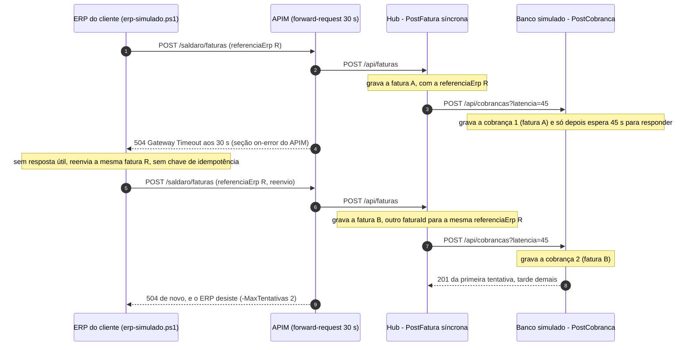
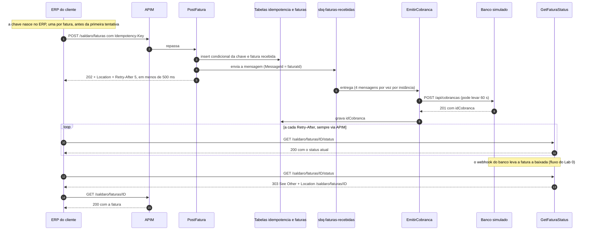

# Incidente 1 — "O timeout de sexta às 18h": request-reply assíncrono com fila

> **CUSTO E FREE TRIAL**
> | Item | Valor |
> |------|-------|
> | Custo mensal (se deixar rodando) | ~R$ 56 (quase tudo é o Service Bus Standard, cobrado por hora: ~R$ 0,07/h) |
> | Custo real deste incidente (~50 min, sobre o ambiente do Lab 0) | ~R$ 1 (na prática, centavos) |
> | Compatível com Azure Free Trial (US$ 200)? | **Sim**: APIM Consumption, Functions Flex Consumption e Service Bus Standard cabem no crédito |
>
> **Regra de ouro:** apague o Resource Group `rg-saldaro-lab` ao terminar. Na aula ao vivo, **não apague agora**: o Incidente 2 continua deste ambiente e a turma apaga junta no fim do encontro (ver [Limpeza](#limpeza)).
> **Câmbio e preços:** ~R$ 5,50/US$ e preços de lista da Microsoft; confirme na calculadora do Azure na data da aula.

| Campo | Valor |
|---|---|
| Version-anchor | **Q4-2026** (fatos revalidados no Microsoft Learn em 2026-10-13) |
| Cenário | 3.2 do briefing: Asynchronous Request-Reply + Queue-Based Load Leveling |
| Formato | Ao vivo, ~50 min (bloco 0:30–1:20 do encontro; slides 7 a 10) |
| Estado inicial | Baseline do Lab 0 (`cenario-0`), o mesmo estado de `./scripts/deploy.ps1 -Cenario 2` |
| Estado pronto | `cenario-2-pronto` (baseline + `asyncRequestReply = true`) |
| Plano B | `./scripts/deploy.ps1 -Cenario 2 -Pronto` (ver [Plano B](#plano-b-estado-pronto)) |
| Ficção | Empresa, pessoas, números e incidentes são fictícios; qualquer semelhança é coincidência |

---

## Como usar este guia ao vivo

Cada passo traz o **modo** e o **tempo**:

- **Professor demonstra**: só o professor executa, na tela; você assiste e anota.
- **Turma repete**: o professor faz primeiro e você repete no seu ambiente logo em seguida.
- **Turma executa**: você executa direto; o professor acompanha e ajuda quem travar.

**Portal primeiro.** O conserto deste incidente acontece no Portal, clique a clique (Passo 4.2): é o caminho que o professor usa ao vivo, porque a aula é para entender onde cada peça mora. O `deploy.ps1` é o plano B: ele aplica o arquivo de parâmetros inteiro e, de quebra, desfaz qualquer mudança feita à mão que o arquivo não declare (o drift da Leitura 3.7).

Use **um único terminal PowerShell 7**, aberto na raiz do repositório, do começo ao fim: os passos reaproveitam variáveis (`$cfg`, `$corpo`, `$cabecalhos`, `$faturaId`).

**Logs numa aba própria.** Abra o **Logs** do `appi-saldaro-<sufixo>` numa aba só dele do navegador (Passo 2.3) e deixe-a aberta até o fim do incidente; navegue pelos outros recursos em outra aba. No ensaio, sair do **Logs** com uma consulta não salva travou a aba do navegador.

**Segredos no telão.** Em **Environment variables**, os valores vêm ocultos. Para ver um, clique em **Show value** só na linha do setting que interessa; nunca no **Show values** da barra, que revela de uma vez todas as chaves e connection strings do app.

### Roteiro dos 50 minutos

| Parte | Tempo | Quem faz | Slide |
|---|---|---|---|
| 1. Incidente: a história e o terminal pronto | 5 min | Professor conta; turma prepara o terminal e aquece o ambiente (Passos 1.1 a 1.3) | 7 |
| 2. Sintomas: reproduzir o timeout e a cobrança em dobro | 8 min | Professor demonstra; turma repete | 8 |
| 3. Hipóteses: onde o tempo foi parar | 7 min | Professor demonstra (KQL e APIM); turma acompanha | 8 |
| 4. Conserto: ligar o 202 | 10 min | Professor explica o padrão e mostra o código; turma muda a setting | 9 |
| 5. Prova: cinco checagens | 15 min | Turma executa; professor acompanha na tela | 10 |
| 6. Post-mortem de cinco linhas | 3 min | Turma escreve | 10 (lido no slide 20) |
| 7. Lições para produção | 2 min | Professor | 10 |
| **Total** | **50 min** | | |

> **Se o tempo apertar:** o professor faz o Passo 3.1 sozinho na tela e o Passo 5.6 vira leitura para casa. Não pule os Passos 5.3 e 5.4: são eles que provam que a fila resolveu.
> **Travou?** Não depure ao vivo: rode o [Plano B](#plano-b-estado-pronto) e volte para a turma no passo seguinte.

---

## Pré-requisitos

- Lab 0 concluído (`01_Aulas/Lab0_Fundacao_Guia.md`): o smoke test passou e o arquivo `scripts/.env.local` existe na sua máquina.
- PowerShell 7 (`pwsh`) aberto na raiz do repositório clonado; Azure CLI logado (`az login`) na mesma assinatura do Lab 0.
- Portal do Azure aberto no Resource Group `rg-saldaro-lab`.
- Quem não fez o Lab 0: rode `./scripts/deploy.ps1 -Cenario 2` (sobe o baseline, estado inicial deste incidente). Num ambiente novo, leva uns 8 a 10 minutos, quase tudo esperando o APIM ativar; acompanhe pela tela do professor enquanto isso e, no fim, faça o aquecimento do Passo 1.3.

---

## Tabela de Recursos

Todos os recursos já existem desde o Lab 0; este incidente não cria nada novo, só muda uma app setting.

| Recurso | Tipo | SKU/Tier | Custo estimado (mensal) | Papel neste incidente |
|---|---|---|---|---|
| `rg-saldaro-lab` | Resource Group | N/A | Gratuito | Agrupa tudo; apagado no fim do encontro |
| `apim-saldaro-<sufixo>` (APIs `saldaro` e `saldaro-webhooks`) | API Management | Consumption | ~R$ 0 (1 milhão de chamadas/mês grátis; o lab usa poucos milhares) | Porta de entrada; corta o backend aos 30 s (`forward-request timeout="30"`) e devolve 504 pela seção `on-error` |
| `func-saldaro-hub-<sufixo>` + `asp-saldaro-hub-<sufixo>` | Function App + plano | Flex Consumption (FC1), ou Consumption Windows (Y1) se você usou `-Plano Consumption` | ~R$ 0 (franquia gratuita mensal) | `PostFatura`, `GetFaturaStatus`, `GetFatura`, `EmitirCobranca`, `Saude` |
| `func-saldaro-banco-<sufixo>` + `asp-saldaro-banco-<sufixo>` | Function App + plano | Flex Consumption (FC1) ou Consumption Windows (Y1) | ~R$ 0 | Banco simulado: `PostCobranca` (com o botão de caos `latencia`) e `GetCobrancasPorFatura` |
| `sb-saldaro-<sufixo>` | Service Bus namespace | Standard | ~R$ 55 | Hospeda a fila do conserto |
| `sbq-faturas-recebidas` | Service Bus queue | — | Incluída no namespace | Amortecedor entre o `PostFatura` e o banco (queue-based load leveling) |
| `stsaldaro<sufixo>` | Storage account | Standard LRS | ~R$ 1 | Tabelas `faturas` e `idempotencia` (hub) e `cobrancas` (banco) |
| `appi-saldaro-<sufixo>` / `log-saldaro-<sufixo>` | Application Insights / Log Analytics | Pay-as-you-go | ~R$ 0 (5 GB/mês grátis) | KQL das hipóteses e da prova |
| `kv-saldaro-<sufixo>`, `evgt-saldaro-faturas-<sufixo>` | Key Vault / Event Grid topic | Standard / — | Centavos | Seguem do Lab 0; não mudam neste incidente |

> **Custo total estimado:** ~R$ 56/mês se o ambiente ficar ligado, dominado pelo Service Bus Standard. Apagando no mesmo dia, centavos.

---

## Diagrama: do timeout ao 202

### Antes: POST síncrono (baseline do Lab 0)



### Depois: Asynchronous Request-Reply com fila



---

## Parte 1 — Incidente (5 min)

> Slide 7 · o professor conta a história enquanto a turma prepara o terminal e aquece o ambiente (Passos 1.1 a 1.3).

**Sexta-feira, 18h02.** O banco parceiro avisou às 17h55, numa caixa de e-mail que ninguém monitorava, que entraria em janela de manutenção "com degradação". Na prática, o `POST /cobrancas` do banco passou a levar de 40 a 90 segundos.

O `POST /faturas` da Saldaro era **síncrono**: só respondia ao ERP depois que o banco devolvia o id da cobrança. O APIM desistia aos 30 segundos e devolvia 504. O ERP da empresa cliente, sem resposta, reenviava a mesma fatura, sem nada que dissesse "isto é um reenvio". O hub tratava cada reenvio como uma fatura nova, com outro `faturaId`; e o banco, que **grava a cobrança antes de responder**, registrava uma cobrança para cada uma.

Às 19h10, quando o banco voltou ao normal, cerca de 800 faturas dos ERPs tinham virado duas ou três faturas no hub, cada uma com a sua cobrança no banco. O suporte passou a noite atendendo pagadores com dois boletos para a mesma fatura, alguns já pagos em dobro. No legado (a "Saldaro 1.0"), um worker único lia a tabela de cobranças pendentes a cada poucos segundos e também não deu conta da fila que se formou.

Você está de plantão. A missão: **reproduzir** no laboratório, **provar a causa**, **consertar** sem reescrever o hub e **provar que consertou**.

### Passo 1.1 — Carregue as variáveis do ambiente

**Modo:** turma executa · **Tempo:** ~1 min

O `deploy.ps1` do Lab 0 gravou as URLs e os nomes do seu ambiente em `scripts/.env.local` (sem segredos; o arquivo não vai para o git). Carregue-o uma vez:

```powershell
# Na raiz do repositório clonado (a pasta que tem scripts/ e 03_Aplicações/)
$cfg = Get-Content ./scripts/.env.local -Raw | ConvertFrom-StringData
$cfg.SALDARO_APIM_URL    # https://apim-saldaro-<sufixo>.azure-api.net/saldaro
$cfg.SALDARO_HUB_URL     # https://<host do hub>/api
$cfg.SALDARO_BANCO_URL   # https://<host do banco>/api
```

> As URLs dos apps vêm do `defaultHostName` que o Azure gerou; nunca monte o endereço à mão.

### Passo 1.2 — Confirme que você está no baseline

**Modo:** turma executa · **Tempo:** ~1 min

```powershell
(Invoke-RestMethod "$($cfg.SALDARO_HUB_URL)/saude").toggles | Format-List
```

A Function `Saude` mostra os toggles que o hub leu da configuração. Procure `AsyncRequestReply`: **tem que estar `False`**. O professor mostra o mesmo valor no Portal: Function App `func-saldaro-hub-<sufixo>` → **Settings** → **Environment variables** → aba **App settings** → `Cenario__AsyncRequestReply` = `false` (o valor vem oculto: **Show value** só na linha desse setting; o **Show values** da barra projetaria todos os segredos do app).

> **Apareceu `True`?** O ambiente já está consertado (alguém rodou um `-Pronto` ou mudou a setting à mão). Para reproduzir o incidente:
>
> - **Pelo Portal (o caminho da aula):** o Passo 4.2 ao contrário. Na mesma tela (**Environment variables** → aba **App settings**), `Cenario__AsyncRequestReply` = `false` → **Apply** → **Apply** (rodapé) → **Confirm** (aviso **Save changes**); de 5 a 35 s depois, o comando acima mostra `False`.
> - **Pelo script (plano B):** `./scripts/deploy.ps1 -Cenario 2 -Sufixo $cfg.SALDARO_SUFIXO` reaplica o baseline do Lab 0 inteiro em uns 6 a 7 minutos, porque também publica o código.

### Passo 1.3 — Aqueça o ambiente antes de reproduzir

**Modo:** turma executa · **Tempo:** ~1 min

O APIM Consumption acorda devagar: logo depois de um `deploy.ps1`, as primeiras chamadas podem passar dos 35 s e estourar o timeout do ERP simulado. No primeiro deploy de teste do kit, foram 6 timeouts na primeira rajada de 10 faturas do Incidente 3, e nenhuma dessas chamadas chegou ao hub. Aqui seria pior: um timeout do cliente no lugar do 504 do Passo 2.1 esconderia o sintoma. Antes de reproduzir, mande três sondas pelo APIM, numa fatura que não existe:

```powershell
# Aquecimento: três GET pelo APIM numa fatura que não existe; o esperado é 404 nas três
function Aquecer-Ambiente {
    $sonda = "$($cfg.SALDARO_APIM_URL)/faturas/00000000-0000-0000-0000-000000000000"
    foreach ($n in 1..3) {
        $relogio = [System.Diagnostics.Stopwatch]::StartNew()
        try   { $resposta = 'HTTP {0}' -f (Invoke-WebRequest $sonda -SkipHttpErrorCheck -TimeoutSec 60).StatusCode }
        catch { $resposta = 'sem resposta' }
        'sonda {0}: {1} em {2:N1} s' -f $n, $resposta, $relogio.Elapsed.TotalSeconds
    }
}
Aquecer-Ambiente
```

**Resultado esperado:** `HTTP 404` nas três: o `GetFatura` não acha a fatura, e é isso que se espera. A primeira pode levar alguns segundos (no teste do kit, 1,9 s logo depois de um deploy); as outras, uns 0,1 s. Se alguma passar de 5 s ou vier `sem resposta`, rode `Aquecer-Ambiente` de novo antes de seguir. O `./scripts/smoke-test.ps1` também aquece, mas leva mais tempo e cria uma fatura.

> A função fica neste terminal: o Passo 5.1 usa de novo, depois do reinício do hub.

---

## Parte 2 — Sintomas (8 min)

> Slide 8 · o professor demonstra cada passo e a turma repete em seguida.

### Passo 2.1 — Reproduza: banco a 45 segundos

**Modo:** professor demonstra, turma repete · **Tempo:** ~3 min (o comando leva cerca de 1 min: duas tentativas de ~30 s)

```powershell
./scripts/erp-simulado.ps1 -Faturas 1 -MaxTentativas 2 -Caos "latencia=45"
```

> Dica: `Get-Help ./scripts/erp-simulado.ps1 -Detailed` lista todos os parâmetros do ERP simulado. O `-MaxTentativas 2` deixa a reprodução determinística: uma tentativa e um reenvio.

O que acontece (acompanhe pelo diagrama "Antes"):

1. O ERP envia `POST {SALDARO_APIM_URL}/faturas` com o header `x-cliente-id` e a `referenciaErp` da fatura no corpo. O `-Caos` vira o campo `caos` do corpo, e o hub repassa ao banco como query string: `?latencia=45`.
2. O `PostFatura`, no modo síncrono, grava a fatura com um `faturaId` novo e chama `POST {BancoBaseUrl}/cobrancas?latencia=45`. O banco **grava a cobrança primeiro** e só depois espera 45 s para responder.
3. Aos **30 s**, o APIM desiste e devolve **504** ao ERP, com o corpo `{"erro":"o gateway esperou 30 s e desistiu"}` (a seção `on-error` da API, Passo 3.2). No primeiro deploy de teste do kit, o 504 chegou aos 30,3 s.
4. O ERP trata 5xx como falha transiente e **reenvia** a mesma fatura, com a mesma `referenciaErp`. Como nada no reenvio diz "esta fatura já foi enviada", o hub cria **outra fatura** (outro `faturaId`) e o banco registra **outra cobrança**.

**Resultado esperado no relatório do ERP:** 1 fatura, **2 tentativas**, as duas com **504** (em **Resultado final por fatura**, ela conta como 5xx). Na lista **Por fatura**, a linha da `referenciaErp` mostra `faturaId devolvido` = `(nenhum)` (o ERP nunca soube qual `faturaId` o hub criou) e os códigos `504|504`; o relatório ainda avisa que houve reenvio depois de 5xx sem `Idempotency-Key` e aponta a `kql/faturas-por-referencia-erp.kql`. O CSV em `scripts/saida/` traz a mesma linha (`tentativas` = `2`, `statusFinal` = `504`, `codigos` = `504|504` e `faturaId` vazio). O timeout HTTP do próprio ERP é de 35 s; quem responde antes é o APIM.

> **Pergunta para a turma:** o que o ERP deveria fazer quando não recebe resposta? E o que o hub precisaria garantir para que reenviar fosse seguro?

### Passo 2.2 — Veja as faturas no Portal

**Modo:** professor demonstra · **Tempo:** ~1 min

1. Portal → Storage account `stsaldaro<sufixo>` → **Storage browser** → **Tables** → `faturas`.
2. Procure as linhas mais recentes com a coluna `caos` = `latencia=45` (role a grade para a direita para ver `referenciaErp` e `status`): são **duas**, com o **mesmo** `referenciaErp` e `PartitionKey` (o `faturaId`) **diferentes**. Uma fatura do ERP virou duas faturas no hub.
3. Olhe `status` e `idCobranca` de cada uma. **Pergunta:** o hub terminou o trabalho? Compare com o que o ERP recebeu (504 nas duas tentativas).

> **O hub não desiste quando o ERP desiste.** O APIM corta aos 30 s, mas o `PostFatura` do baseline segue esperando o banco: aos 45 s grava o `idCobranca`, muda o status para `cobranca-emitida` e responde 201 para ninguém (no Application Insights, essa execução fica com `resultCode` 499, Passo 3.1). É de propósito: o código ingênuo não repassa ao banco o cancelamento da requisição (procure `CONCEITO` em `Aplicacao/ServicoDeFaturas.cs`). Os webhooks, que o banco já tinha enfileirado, chegam depois e baixam as duas faturas.

### Passo 2.3 — Conte faturas e cobranças por `referenciaErp`

**Modo:** turma repete · **Tempo:** ~3 min

A duplicata que importa é **de negócio**: a mesma fatura do ERP (`referenciaErp`) virou N faturas no hub e N cobranças no banco. Cada `faturaId`, sozinho, tem uma cobrança só; por isso a contagem é por `referenciaErp`.

1. Copie a consulta do kit para a área de transferência (ou abra o arquivo no VS Code e copie):

```powershell
Get-Content ./kql/faturas-por-referencia-erp.kql -Raw | Set-Clipboard
```

2. Numa aba própria do navegador, que fica aberta até o fim do incidente: Portal → Application Insights `appi-saldaro-<sufixo>` → **Monitoring** → **Logs**. No primeiro acesso, feche a janela **Welcome to Log Analytics**. Se a página abrir num chat (**Observability Agent**), desligue o toggle **Agent**, no canto superior direito, e clique em **Discard** no aviso **Discard changes**. Se a barra mostrar **Simple mode**, troque para **KQL mode** no seletor à direita. Cole a consulta e clique em **Run**.

**Resultado esperado:** a `referenciaErp` da reprodução aparece com **2 faturas** e **2 cobranças**. A coluna `cobrancas` conta os eventos `cobranca.emitida`, que o hub emite quando recebe a resposta do banco, aos 45 s, mesmo depois do 504 (Passo 2.2). A checagem complementar abaixo conta direto no banco e também mostra **2**. Para o pagador, isso significa dois boletos ou dois QR codes para a mesma fatura. Os dados levam de 2 a 5 minutos para chegar ao Application Insights: se ainda aparecer 1 fatura, espere e rode de novo. O sampling está desligado no kit, então as contagens são exatas.

Checagem complementar, direto nas fontes da verdade (a tabela `faturas` do hub e o banco), sem esperar a ingestão:

```powershell
# Faturas da reprodução (caos = latencia=45) agrupadas por referenciaErp; o banco conta as cobranças de cada faturaId
$faturas = az storage entity query --account-name $cfg.SALDARO_STORAGE --table-name faturas `
    --auth-mode login --select PartitionKey referenciaErp caos --query items -o json | ConvertFrom-Json

$faturas | Where-Object caos -like '*latencia=45*' | Group-Object referenciaErp | ForEach-Object {
    $cobrancas = 0
    foreach ($f in $_.Group) { $cobrancas += (Invoke-RestMethod "$($cfg.SALDARO_BANCO_URL)/cobrancas/$($f.PartitionKey)").quantidade }
    [pscustomobject]@{ referenciaErp = $_.Name; faturasNoHub = $_.Count; cobrancasNoBanco = $cobrancas }
} | Format-Table -AutoSize
```

A chamada ao banco é `GET {SALDARO_BANCO_URL}/cobrancas/{faturaId}` (Function `GetCobrancasPorFatura`, sem chave), que devolve `{ faturaId, quantidade, cobrancas }`; para um `faturaId` sem cobrança, `quantidade = 0` (nunca 404). Aqui ela dá `quantidade = 1` para cada `faturaId`: é a soma por `referenciaErp` que mostra a duplicata (`faturasNoHub = 2` e `cobrancasNoBanco = 2`).

### Resumo dos sintomas

| Sintoma | Onde você viu | O que ele indica |
|---|---|---|
| O ERP recebe 504 em ~30 s | Terminal do `erp-simulado.ps1` | Quem respondeu foi o APIM, não o hub |
| O ERP reenvia a mesma fatura | Relatório do ERP: 2 tentativas para 1 fatura | Reenviar é o certo; o problema é o reenvio não carregar nada que o identifique como reenvio |
| 1 fatura do ERP virou 2 faturas e 2 cobranças | Passo 2.3: `kql/faturas-por-referencia-erp.kql` e a checagem no banco (e o Storage browser do Passo 2.2) | Para o hub, cada POST era uma fatura nova; e o banco grava antes de responder |
| O trabalho do hub não bate com a resposta do ERP | Passo 2.2: `status` e `idCobranca` na tabela `faturas` | Depois que o cliente desiste, o resultado do trabalho não chega a ninguém |

---

## Parte 3 — Hipóteses (7 min)

> Slide 8 · o professor demonstra; a turma repete o Passo 3.1 se der tempo.

| # | Hipótese | Como testar | Resultado esperado |
|---|---|---|---|
| H1 | O hub caiu ou está com erro de código | Passo 3.1: o `PostFatura` tem falha? | **Não.** O hub estava esperando o banco, com duração muito acima do normal; o 499 só diz que o APIM fechou a conexão antes da resposta |
| H2 | Quem devolveu o 504 foi o APIM, aos 30 s | Passo 3.2: política de backend da API `saldaro` | **Sim.** `<forward-request timeout="30" />` e linhas do APIM com 504 em ~30 s |
| H3 | O hub não reconhece o reenvio (cada POST vira uma fatura nova) e o banco grava antes de responder | Passos 2.2 e 2.3, e o Passo 3.1: um `PostCobranca` por tentativa | **Sim.** Dois `faturaId` com a mesma `referenciaErp`, uma cobrança cada |
| H4 | "É só aumentar o timeout" | Passo 3.3: os relógios de cada camada | **Não resolve**, por três motivos |

### Passo 3.1 — Onde o tempo foi parar (KQL)

**Modo:** professor demonstra, turma repete se der tempo · **Tempo:** ~3 min

1. Volte à aba do **Logs** do Passo 2.3 (em **KQL mode**; se precisar abri-lo de novo, siga o item 2 de lá).
2. Cole a consulta e clique em **Run**:

```kusto
// Incidente 1: quem respondeu o quê, e em quanto tempo (últimos 30 min).
// No Log Analytics (log-saldaro-<sufixo>), o equivalente usa AppRequests e AppDependencies,
// com TimeGenerated, AppRoleName, Name, ResultCode e DurationMs.
union requests, dependencies
| where timestamp > ago(30m)
| where name contains "fatura" or name contains "cobranca"
| project timestamp, itemType, quem = cloud_RoleName, name, resultCode,
          segundos = round(duration / 1000.0, 1)
| order by timestamp asc
```

As linhas da reprodução ficam no fim da lista: antes delas, a janela de 30 min pode trazer as do smoke test do Lab 0 (no ensaio, a consulta devolveu 90 linhas).

O que procurar:

- `request` com `resultCode` **504** e ~**30 s**: é o APIM respondendo ao ERP (a coluna `quem` mostra o APIM). Uma linha por tentativa.
- `dependency` do APIM para o hub e do hub para o banco (`/api/cobrancas`), na casa de 30 a 45 s.
- `request` `PostCobranca` no banco (`func-saldaro-banco-<sufixo>`): **uma por tentativa do ERP**, cada uma para um `faturaId` diferente. É a evidência da H3.
- `request` `PostFatura` no hub com uns **45 s**, mais longa que os 30 s do APIM: o hub estava **esperando** o banco, não quebrado (H1 descartada), e continuou esperando depois que o APIM desistiu. O `resultCode` dela é **499**, o código que fica registrado quando quem chamou (aqui, o APIM) fecha a conexão antes da resposta: o hub terminou o trabalho e respondeu para ninguém. No primeiro deploy de teste do kit, as duas execuções levaram 47,2 s e 45,3 s, as duas com 499.

> Os dados levam de 2 a 5 minutos para chegar ao Application Insights. Se vier vazio, espere e rode de novo.

### Passo 3.2 — Quem cortou aos 30 s: a política do APIM

**Modo:** professor demonstra · **Tempo:** ~2 min

1. Noutra aba do navegador (a do **Logs** fica como está), Portal → API Management `apim-saldaro-<sufixo>` → **APIs** → **APIs** → **Saldaro Hub - faturas** (a API `saldaro`).
2. Aba **Design** → **All operations**.
3. Na seção **Backend**, clique no ícone **</>** (code editor).
4. Veja `<forward-request timeout="30" />`: o gateway espera no máximo 30 s pelos headers de resposta do hub; depois disso, o erro tem motivo `Timeout` (origem `forward-request`). A política vale para as três operações da API `saldaro` (`post-fatura`, `get-fatura`, `get-fatura-status`); a API **Saldaro Hub - webhooks** (`saldaro-webhooks`, operação `post-webhook-banco`) tem o mesmo corte.
5. Veja a seção `<on-error>`: o kit devolve **504** de forma determinística quando o `forward-request` estoura, com o corpo `{"erro":"o gateway esperou 30 s e desistiu"}`. Sem uma seção `on-error`, a documentação do APIM diz que o chamador recebe uma resposta 400 ou 500 numa condição de erro; o kit fixa o 504 para o ERP enxergar um "gateway timeout" inequívoco. Se a seção não aparecer neste escopo, clique em **Calculate effective policy** para ver a política efetiva.
6. **Não altere nada** e saia sem salvar. Por quê? Passo 3.3.

### Passo 3.3 — E se a gente só aumentasse o timeout?

**Modo:** professor demonstra (discussão) · **Tempo:** ~2 min

Cada camada tem o seu relógio:

| Camada | Relógio | De onde vem |
|---|---|---|
| ERP (`erp-simulado.ps1`) | Timeout HTTP de 35 s; reenvio com backoff e jitter, teto de 5 tentativas (ajustável com `-MaxTentativas`) e 30 s de espera | Script do kit |
| APIM (`apim-saldaro-<sufixo>`) | `forward-request timeout="30"` (o padrão do produto é 300 s, mas no tier Consumption a duração total da requisição já tem teto de 30 s pela plataforma, então ali não dá para subir; nos outros tiers, valores acima de 240 s podem não ser honrados pela infraestrutura de rede) | Política da API `saldaro` |
| Hub → banco | `HttpClient` com `Timeout = 120 s` | Código do hub |
| Azure Functions, qualquer plano | **230 s** para responder uma requisição HTTP, independentemente do `functionTimeout`, por causa do idle timeout do Azure Load Balancer | Microsoft Learn |
| Banco simulado | `latencia` segundos (máximo 200), contados **depois** de gravar a cobrança | Botão de caos |

Aumentar o timeout do APIM não conserta, por três motivos:

1. **O ERP desiste aos 35 s de qualquer jeito** e reenvia. Subir o APIM para 120 s não muda nada para ele (e no Consumption nem é possível: a plataforma corta a requisição aos 30 s).
2. **Sempre existe um teto.** O banco da história chegou a 90 s; nada impede 240 s amanhã. Acima de 230 s, nem a plataforma segura uma resposta HTTP de Function: o limite de 230 s é o teto da plataforma, e não há configuração que o remova.
3. **O reenvio continua criando fatura e cobrança novas.** O problema não é o número do timeout: é a API **segurar a conexão** enquanto um parceiro lento trabalha e **não ter como reconhecer um reenvio**.

Conclusão: a API precisa responder **já** e terminar o trabalho **depois**, com um endereço para o cliente acompanhar. É o padrão **Asynchronous Request-Reply**.

---

## Parte 4 — Conserto (10 min)

> Slide 9 · o professor explica o padrão e mostra o código; a turma muda a setting (Passo 4.2).

### O padrão em quatro peças

1. **202 Accepted + `Location` + `Retry-After`.** O `PostFatura` valida a requisição (sem `x-cliente-id`, continua 400 imediato), grava a fatura com status `recebida`, envia a mensagem para `sbq-faturas-recebidas` e responde na hora: **202** com `{ faturaId, status: "recebida" }`, `Location: {UrlBasePublica}/faturas/{id}/status` (o endereço para acompanhar) e `Retry-After: 5` (de quanto em quanto tempo perguntar). Como `UrlBasePublica` é a URL do APIM, o cliente nunca enxerga o host interno do hub.
2. **Status 200 × 303.** O `GetFaturaStatus` responde **200** `{ faturaId, status }` enquanto a fatura não chegou a `baixada`, e **303 See Other** com `Location: {UrlBasePublica}/faturas/{id}` quando ela chega a `baixada` ou `notificada` (404 se o id não existe). Por que 303 e não 302: o 303 manda o cliente fazer **GET** no recurso de resultado; o 302 não garante a troca de método, e alguns clientes repetiriam o POST.
3. **`Idempotency-Key` com insert condicional.** Se o ERP manda o header `Idempotency-Key`, o `PostFatura` tenta **inserir** a chave na tabela `idempotencia` (`PartitionKey` = `clienteId`, `RowKey` = a chave). O Table Storage só aceita a primeira entidade com aquele par; a segunda recebe **409 Conflict**. Quem perde lê o `faturaId` gravado e devolve o **mesmo** `faturaId`, sem enfileirar de novo. É atômico: diferente de "consultar e depois gravar", duas requisições simultâneas com a mesma chave não passam juntas. A outra metade é a **compensação**: se gravar a fatura ou enfileirar falhar depois de a chave estar reservada, o hub apaga a fatura e a reserva antes de responder o erro, e o reenvio do ERP recomeça do zero, em vez de receber o `faturaId` de uma fatura que nunca entrou na fila.
4. **Queue-based load leveling.** Quem conversa com o banco agora é o `EmitirCobranca`, consumidor da fila, no ritmo dele: 4 mensagens por vez por instância (`maxConcurrentCalls = 4` no `host.json`), com a plataforma acrescentando instâncias conforme a fila cresce (no kit, até 10 no hub). O banco pode levar 60 s: ninguém está segurando conexão HTTP. Se o banco responder 503, o `EmitirCobranca` lança exceção e o Service Bus entrega a mensagem de novo.

### Por que a chave vem do ERP, e não do hub

A `Idempotency-Key` só protege se for **do cliente** e **a mesma em todos os reenvios**:

- **Só o cliente sabe que duas requisições são a mesma intenção.** Para o hub, o reenvio da sexta-feira era um POST como outro qualquer, e virou outro `faturaId`. Comparar corpos não resolve: duas faturas legítimas podem ter o mesmo valor, vencimento e pagador (parcelas, por exemplo).
- **O id do servidor chega tarde demais.** O `faturaId` só existe na resposta, e foi exatamente a resposta que se perdeu no 504. O cliente não consegue distinguir uma resposta perdida de uma requisição que nunca chegou; por isso ele **precisa** reenviar, e o reenvio só é seguro se carregar uma identidade que o próprio cliente já tinha antes de enviar.
- **Estável entre reenvios.** A chave nasce **uma vez por fatura**, antes da primeira tentativa, e é guardada junto com a fatura no ERP: todo reenvio, inclusive depois de o ERP reiniciar, manda a mesma chave. Gerar uma chave nova a cada tentativa (dentro do laço de retry) não protege nada: cada tentativa parece uma fatura nova. É isso que o `erp-simulado.ps1 -IdempotencyKey` faz: uma chave por fatura, reusada nos reenvios.
- **Escopo por empresa cliente.** No hub, a chave vive com `PartitionKey` = `clienteId`: duas empresas clientes podem usar o mesmo valor sem colidir.
- **E a `referenciaErp`?** Ela é a identidade de negócio da fatura no ERP e é ótima para **detectar** a duplicata (é o que a `kql/faturas-por-referencia-erp.kql` faz). Usá-la como trava acopla o hub à numeração de cada ERP (formatos diferentes, reuso de numeração, reemissões); a `Idempotency-Key` diz no próprio protocolo "esta é a mesma requisição". Em produção, os dois convivem: a chave protege o reenvio, e uma regra de unicidade de negócio protege contra erro do próprio ERP.

### Passo 4.1 — Leia o código que já está publicado

**Modo:** professor demonstra (VS Code) · **Tempo:** ~3 min

O kit já traz os dois caminhos no mesmo código: o hub lê `Cenario:AsyncRequestReply` com o padrão Options e escolhe o ramo. Hoje não há código para escrever nem deploy para fazer: o conserto é ligar o caminho certo. No VS Code, abra `03_Aplicações/Saldaro.Hub/` e localize as Functions `PostFatura`, `GetFaturaStatus` e `EmitirCobranca`, além de `Aplicacao/ServicoDeFaturas.cs`, a classe que escolhe o ramo; os comentários `// CONCEITO:` marcam os pontos citados neste guia.

> **Trecho ilustrativo, simplificado: não é o código do kit.** No kit, o insert condicional e o envio para a fila estão em `03_Aplicações/Saldaro.Hub/Aplicacao/ServicoDeFaturas.cs`, no método `ReceberAssincronoAsync` (procure o comentário `CONCEITO: Idempotency-Key`; o `AddEntity` com o `catch` do 409 está no repositório, em `Infraestrutura/Armazenamento/RepositoriosAuxiliares.cs`); a Function `PostFatura` (`Functions/PostFatura.cs`) valida a requisição e monta o 202. Aqui, o ramo consertado num bloco só, para enxergar o insert condicional e o 202.

```csharp
// ILUSTRATIVO: ramo com Cenario:AsyncRequestReply = true (o real está em ServicoDeFaturas.ReceberAssincronoAsync e na Function PostFatura)
var chave = req.Headers["Idempotency-Key"].FirstOrDefault();
var faturaId = Guid.NewGuid().ToString();

if (!string.IsNullOrEmpty(chave))
{
    try
    {
        // Insert condicional: só a primeira requisição com esta chave consegue gravar
        await idempotencia.AddEntityAsync(new TableEntity(clienteId, chave)
        {
            ["faturaId"] = faturaId,
            ["criadaEm"] = DateTimeOffset.UtcNow
        });
    }
    catch (RequestFailedException ex) when (ex.Status == 409)
    {
        // Chave repetida: devolve o MESMO faturaId e não enfileira de novo
        var existente = await idempotencia.GetEntityAsync<TableEntity>(clienteId, chave);
        return Aceita(existente.Value.GetString("faturaId"));
    }
}

await faturas.AddEntityAsync(new TableEntity(faturaId, "fatura") { ["status"] = "recebida" /* demais colunas */ });
await remetente.SendMessageAsync(new ServiceBusMessage(corpoDaMensagem) { MessageId = faturaId });
return Aceita(faturaId);

IActionResult Aceita(string id)
{
    req.HttpContext.Response.Headers.RetryAfter = "5";
    return new AcceptedResult($"{urlBasePublica}/faturas/{id}/status",   // vira o header Location
                              new { faturaId = id, status = "recebida" });
}
```

> **Trecho ilustrativo, simplificado: não é o código do kit.** O código real é a Function `GetFaturaStatus`, em `03_Aplicações/Saldaro.Hub/`.

```csharp
// ILUSTRATIVO: endpoint de status (o real está na Function GetFaturaStatus)
var fatura = await faturas.GetEntityIfExistsAsync<TableEntity>(id, "fatura"); // point read: PK + RK, barato
if (!fatura.HasValue) return new NotFoundResult();

var status = fatura.Value!.GetString("status");
if (status is "baixada" or "notificada")
{
    req.HttpContext.Response.Headers.Location = $"{urlBasePublica}/faturas/{id}";
    return new StatusCodeResult(StatusCodes.Status303SeeOther);   // "o resultado está ali"
}
return new OkObjectResult(new { faturaId = id, status });          // 200: ainda processando
```

O `EmitirCobranca` (trigger de Service Bus em `sbq-faturas-recebidas`) faz a mesma chamada que o baseline fazia dentro do HTTP: `POST {BancoBaseUrl}/cobrancas?{caos}` com `x-api-key`, depois grava o `idCobranca` e o status `cobranca-emitida`.

### Passo 4.2 — Ligue o `Cenario__AsyncRequestReply` no Portal

**Modo:** turma executa · **Tempo:** ~2 min (no ensaio, os cliques levaram ~1,5 min)

> **Antes:** confirme que o `erp-simulado.ps1` do Passo 2.1 terminou. Mudar uma app setting **reinicia o app**, e o reinício encerra as execuções em andamento.

**Pelo Portal (o caminho que o professor usa ao vivo):**

1. Portal → Function App `func-saldaro-hub-<sufixo>`.
2. No menu lateral, expanda **Settings** → **Environment variables** → aba **App settings**.
3. Clique na setting `Cenario__AsyncRequestReply` (edite a existente; não crie outra).
4. Em **Value** (o campo vem mascarado, `•••••`; o ícone de olho à direita mostra o valor), apague o conteúdo e digite `true`.
5. Clique em **Apply** no painel da setting.
6. Clique em **Apply** na parte de baixo da página **Environment variables** (ele só fica azul depois do **Apply** do painel) e, no aviso **Save changes** ("Your app may restart if you are updating app settings. Are you sure you want to continue?"), clique em **Confirm**.

**Confira:** de volta à aba **App settings**, a linha `Cenario__AsyncRequestReply` mostra `true`. Os valores vêm ocultos: clique em **Show value** na linha do `Cenario__AsyncRequestReply`. Não use o **Show values** da barra: ele revela também `BancoApiKey`, `WebhookSecret`, `AzureWebJobsStorage` e `APPLICATIONINSIGHTS_CONNECTION_STRING`, e no telão isso é segredo projetado. O código só enxerga o valor novo depois do reinício, e quem confere isso é o `/saude`, no Passo 4.3.

> **Por que dois underscores?** No .NET, `__` no nome da variável de ambiente vira `:` na configuração: `Cenario__AsyncRequestReply` chega ao código como `Cenario:AsyncRequestReply`.
> **Isto é drift, e é de propósito.** O Portal agora diverge do Bicep do Lab 0, que aplicou `asyncRequestReply = false`. A versão declarada do mesmo conserto é `infra/parameters/cenario-2-pronto.bicepparam` (`asyncRequestReply = true`); um `deploy.ps1 -Cenario 2` sem `-Pronto` reaplicaria o baseline e desfaria a sua mudança, sem perguntar. Guarde a pergunta "quem manda, o Portal ou o arquivo?": a Leitura 3.7 responde.

**Pelo script (plano B), só se o Portal travar:** `./scripts/deploy.ps1 -Cenario 2 -Pronto -Sufixo $cfg.SALDARO_SUFIXO` aplica o mesmo conserto pelo Bicep, em uns 6 a 7 minutos, porque também republica os apps (detalhes no [Plano B](#plano-b-estado-pronto)). Pelo Portal, são uns 2 minutos, e nada além da setting muda.

### Passo 4.3 — Espere o restart e confirme

**Modo:** turma executa · **Tempo:** ~2 min (o professor fala da Parte 4 enquanto o app volta)

```powershell
# Pergunta à Function Saude a cada 5 s, por até 2 min
for ($i = 1; $i -le 24; $i++) {
    Start-Sleep -Seconds 5
    try { $saude = Invoke-RestMethod "$($cfg.SALDARO_HUB_URL)/saude" } catch { "reiniciando... ($i)"; continue }
    if ($saude.toggles.AsyncRequestReply -eq $true) { 'Hub de volta, no modo 202:'; $saude.toggles | Format-List; break }
    "ainda no modo antigo... ($i)"
}
```

**Resultado esperado:** alguns "reiniciando..." ou "ainda no modo antigo..." e, depois, `AsyncRequestReply` = `True`. O valor novo costuma valer de 5 a 35 s depois do **Confirm**: no ensaio pelo Portal, as trocas de setting levaram de 7 a 19 s (esta, 19 s); no primeiro deploy de teste do kit, o `/saude` mostrou `True` aos 34 s. Passaram 2 minutos e nada? Veja o [Troubleshooting](#troubleshooting).

---

## Parte 5 — Prova (15 min)

> Slide 10 · a turma executa; o professor acompanha na tela e mostra a fila no Portal durante a rajada.

Critérios de feito:

- [ ] **Passo 5.1:** o POST responde **202 em menos de 500 ms** com o banco a 60 s (`latencia=60`), com `Location` e `Retry-After: 5`.
- [ ] **Passo 5.2:** o status responde **200** enquanto processa e vira **303** com `Location` para a fatura.
- [ ] **Passo 5.3:** **1.000 faturas** com `-Paralelismo 20 -IdempotencyKey`, **nenhum 5xx**.
- [ ] **Passo 5.4:** a `kql/faturas-por-referencia-erp.kql` mostra **1 fatura e 1 cobrança por `referenciaErp`** nas 1.000 faturas; como checagem complementar, **`quantidade = 1`** no banco para cada `faturaId`.
- [ ] **Passo 5.5:** a **mesma `Idempotency-Key`** devolve o **mesmo `faturaId`**.

### Passo 5.1 — 202 em menos de 500 ms com o banco a 60 s

**Modo:** turma executa · **Tempo:** ~2 min

```powershell
# 1) Aquecimento: acorda o APIM e o hub depois do restart (404 aqui é esperado; a função vem do Passo 1.3)
Aquecer-Ambiente

# 2) Uma fatura com o banco a 60 s, medida do lado do cliente
# CNPJ de teste gerado na hora, com o algoritmo do New-CnpjTeste do erp-simulado.ps1: raiz aleatória
# de 8 dígitos + filial 0001 + 2 dígitos verificadores (módulo 11). Nunca use um CNPJ fixo ou real.
do { $cnpj = @(1..8 | ForEach-Object { Get-Random -Maximum 10 }) } while (@($cnpj | Select-Object -Unique).Count -eq 1)
$cnpj += 0, 0, 0, 1
foreach ($pesos in @(5, 4, 3, 2, 9, 8, 7, 6, 5, 4, 3, 2), @(6, 5, 4, 3, 2, 9, 8, 7, 6, 5, 4, 3, 2)) {
    $soma = 0
    for ($i = 0; $i -lt $pesos.Count; $i++) { $soma += $cnpj[$i] * $pesos[$i] }
    $cnpj += $(if ($soma % 11 -lt 2) { 0 } else { 11 - $soma % 11 })
}

$corpo = @{
    valor         = 1250.00
    vencimento    = '2026-11-10'
    pagadorCnpj   = (-join $cnpj)   # o CNPJ de teste gerado acima, como texto de 14 dígitos
    referenciaErp = "ERP-A-MANUAL-$(Get-Date -Format 'HHmmss')"   # uma referência nova a cada execução do bloco
    caos          = 'latencia=60'
} | ConvertTo-Json
$cabecalhos = @{ 'x-cliente-id' = 'cliente-a'; 'Idempotency-Key' = [guid]::NewGuid().ToString() }

$relogio = [System.Diagnostics.Stopwatch]::StartNew()
$r = Invoke-WebRequest -Method Post -Uri "$($cfg.SALDARO_APIM_URL)/faturas" -ContentType 'application/json' `
    -Body $corpo -Headers $cabecalhos -SkipHttpErrorCheck
$relogio.Stop()

$faturaId  = ($r.Content | ConvertFrom-Json).faturaId
$statusUrl = $r.Headers.Location | Select-Object -First 1
"HTTP {0} em {1} ms" -f $r.StatusCode, $relogio.ElapsedMilliseconds
"Location:    $statusUrl"
"Retry-After: $($r.Headers.'Retry-After' | Select-Object -First 1)"
"faturaId:    $faturaId"
```

> **O corpo é o contrato real do `POST /faturas`**, o mesmo formato que o `erp-simulado.ps1` envia: `valor` (número maior que zero) e `vencimento` são obrigatórios; `pagadorCnpj`, `referenciaErp`, `callbackUrl` e `caos` são opcionais. O `faturaId` quem gera é o hub, e o `clienteId` vem do header `x-cliente-id`.
>
> **Simplificação de laboratório:** esse header identifica a empresa cliente, mas não autentica ninguém; a API `saldaro` do APIM não exige subscription e os HTTP triggers do hub são anônimos, então o `POST` e o endereço de status respondem a quem souber a URL. Em produção, o APIM autenticaria cada empresa cliente (subscription própria ou OAuth 2.0) e tiraria dela o `clienteId`, e o hub só aceitaria tráfego vindo do APIM (ADR-0007, em `docs/adr/`).

**Resultado esperado:** `HTTP 202` em poucas centenas de milissegundos, `Location` apontando para `.../saldaro/faturas/<faturaId>/status` e `Retry-After: 5`. Passou de 500 ms? A primeira chamada depois do restart leva uns 2 s (no primeiro deploy de teste do kit, 2,2 s), porque também abre a conexão com o Service Bus: rode o bloco 2 de novo. O critério vale para o sistema aquecido; no teste, as chamadas seguintes responderam em 449, 191 e 94 ms.

Opcional, para ver a troca de modo nos eventos do hub (`fatura.recebida` carrega `modo = sync|async`):

```kusto
// As faturas da reprodução entraram como sync; as de agora, como async.
// No Log Analytics: AppEvents, com Name e Properties.
customEvents
| where timestamp > ago(1h) and name == "fatura.recebida"
| summarize faturas = count() by modo = tostring(customDimensions.modo)
```

> **Pergunta para a turma:** o banco vai levar 60 s para responder a esta cobrança. Quem está esperando por ele agora?

### Passo 5.2 — Status: 200 até virar 303

**Modo:** turma executa · **Tempo:** ~2 min

Aqui usamos o `curl.exe` porque ele **não segue redirects** sem `-L`: você enxerga o 303 cru, como o protocolo manda. (No macOS ou no Linux, troque `curl.exe` por `curl`.)

```powershell
# $statusUrl veio do Location do 202 (Passo 5.1)
do {
    Start-Sleep -Seconds 5   # o Retry-After que o 202 pediu
    $linha = curl.exe -s -w " | HTTP %{http_code} %{redirect_url}" $statusUrl
    "{0:HH:mm:ss}  {1}" -f (Get-Date), $linha
} while ($linha -match 'HTTP 200')

# O 303 aponta para o recurso da fatura: siga o Location
Invoke-RestMethod "$($cfg.SALDARO_APIM_URL)/faturas/$faturaId" | Format-List
```

**Resultado esperado:** linhas `{"faturaId":"…","status":"recebida"} | HTTP 200` (pode aparecer outro status intermediário), até uma linha ` | HTTP 303 https://apim-saldaro-<sufixo>.azure-api.net/saldaro/faturas/<faturaId>`. Com `latencia=60`, o 303 chega uns 75 a 90 s depois do POST (no primeiro deploy de teste do kit, entre 77 e 87 s). O `GET` final devolve a fatura com `status` `baixada` ou `notificada`.

> **Pergunta para a turma:** quanto tempo levou até o 303? Compare com os 60 s de latência do banco e explique o que você vê.

### Passo 5.3 — Rajada de 1.000 faturas sem 5xx

**Modo:** turma executa; o professor mostra a fila no Portal · **Tempo:** ~5 min

```powershell
./scripts/erp-simulado.ps1 -Faturas 1000 -Paralelismo 20 -IdempotencyKey
```

Com `-IdempotencyKey`, o ERP gera **uma chave por fatura** antes da primeira tentativa e a reusa se precisar reenviar (por exemplo, um POST que pegou o hub escalando do zero): o reenvio devolve o mesmo `faturaId` em vez de criar outra fatura.

**Resultado esperado no relatório final:** 202 = 1.000; 5xx = 0; timeout = 0; 429 = 0; média de tentativas = 1, ou muito perto disso (um reenvio ocasional é inofensivo: a chave segura). O CSV da execução fica em `scripts/saida/`. No primeiro deploy de teste do kit, a rajada levou 47 s no total, com latência das respostas 2xx de p50 220 ms, p95 639 ms e máximo de 8,4 s.

Enquanto a rajada roda, o professor abre o Portal: Service Bus namespace `sb-saldaro-<sufixo>` → **Queues** → `sbq-faturas-recebidas` → **Overview**, e mostra a contagem de mensagens ativas (seção **Message Counts**, **Active**) subir e descer, clicando em **Refresh** na barra da fila, porque a **Overview** não se atualiza sozinha (em **Metrics**, a métrica é *Count of active messages in a Queue/Topic.*, filtrada por `EntityName`). É o queue-based load leveling ao vivo: o ERP termina em segundos; o banco é atendido no ritmo do `EmitirCobranca`.

Quando o ERP terminar, espere a fila drenar (no teste do kit, as filas zeraram uns 2 minutos depois do início da rajada, sem nada na DLQ e sem esbarrar na cota do Flex Consumption):

```powershell
do {
    $contagem = az servicebus queue show --resource-group $cfg.SALDARO_RG --namespace-name $cfg.SALDARO_SB_NAMESPACE `
        --name sbq-faturas-recebidas --query countDetails -o json | ConvertFrom-Json
    "{0:HH:mm:ss}  mensagens ativas em sbq-faturas-recebidas: {1}" -f (Get-Date), $contagem.activeMessageCount
    if ($contagem.activeMessageCount -gt 0) { Start-Sleep -Seconds 15 }
} while ($contagem.activeMessageCount -gt 0)
```

> Ler contadores de fila custa caro para o broker: 15 s de intervalo é suficiente. Em produção, acompanhe a **métrica**, não um laço de polling.

Opcional, segunda opinião pelo lado do APIM (rode logo depois da rajada):

```kusto
// Respostas das operações de fatura nos últimos 15 min, por quem respondeu e código
requests
| where timestamp > ago(15m)
| where name contains "fatura" or url contains "/faturas"
| summarize total = count() by quem = cloud_RoleName, name, resultCode
| order by quem asc, name asc
```

Nenhum `resultCode` começando com 5 durante a rajada.

### Passo 5.4 — Uma fatura e uma cobrança por `referenciaErp`

**Modo:** turma executa · **Tempo:** ~2 min

Rode de novo a consulta do Passo 2.3 (`kql/faturas-por-referencia-erp.kql`) no **Logs** do `appi-saldaro-<sufixo>` (a aba do Passo 2.3, em **KQL mode**), depois que a fila drenar.

**Resultado esperado:** com o **Time range** restrito aos minutos da rajada, o resultado fica **vazio**. A consulta só lista as referências com mais de uma fatura ou mais de uma cobrança (a linha `where faturas > 1 or cobrancas > 1`), e cada `referenciaErp` da rajada tem 1 fatura e 1 cobrança. Para ver as 1.000 com `faturas = 1` e `cobrancas = 1`, apague essa linha. Com um intervalo maior, a `referenciaErp` da reprodução da Parte 2 continua aparecendo com 2: é o histórico do incidente, não uma falha do conserto.

Checagem complementar, direto no banco (a fonte da verdade das cobranças), usando os `faturaId` que o ERP recebeu nos 202:

```powershell
$csv = Get-ChildItem ./scripts/saida/*.csv | Sort-Object LastWriteTime | Select-Object -Last 1
$ids = Import-Csv $csv.FullName | Where-Object faturaId | Select-Object -ExpandProperty faturaId -Unique
$banco = $cfg.SALDARO_BANCO_URL

if (-not $ids) {
    "Nenhum faturaId encontrado em $($csv.Name): confira o nome da coluna e o separador (Import-Csv -Delimiter)."
} else {
    $foraDoEsperado = $ids | ForEach-Object -ThrottleLimit 20 -Parallel {
        try { $q = (Invoke-RestMethod "$using:banco/cobrancas/$_").quantidade } catch { $q = 'erro' }
        if ($q -ne 1) { [pscustomobject]@{ faturaId = $_; quantidade = $q } }
    }
    "Faturas verificadas: {0} | com quantidade diferente de 1: {1}" -f $ids.Count, @($foraDoEsperado).Count
    $foraDoEsperado | Select-Object -First 10
}
```

**Resultado esperado:** `Faturas verificadas: 1000 | com quantidade diferente de 1: 0`. Apareceu `quantidade = 0`? A fila ainda não drenou: espere e rode de novo.

### Passo 5.5 — Mesma `Idempotency-Key`, mesmo `faturaId`

**Modo:** turma executa · **Tempo:** ~2 min

Simule o reenvio que derrubou a sexta-feira, agora do jeito certo: o mesmo corpo, com a **mesma chave** que o "ERP" (você, no Passo 5.1) gerou antes da primeira tentativa. Por que a chave tem de ser essa, e não uma nova: [Por que a chave vem do ERP, e não do hub](#por-que-a-chave-vem-do-erp-e-não-do-hub).

```powershell
$repeticao = Invoke-RestMethod -Method Post -Uri "$($cfg.SALDARO_APIM_URL)/faturas" -ContentType 'application/json' `
    -Body $corpo -Headers $cabecalhos
"faturaId da primeira chamada: $faturaId"
"faturaId da repetição:        $($repeticao.faturaId)"
"cobranças no banco:           $((Invoke-RestMethod "$($cfg.SALDARO_BANCO_URL)/cobrancas/$faturaId").quantidade)"
```

**Resultado esperado:** os dois `faturaId` iguais e `cobranças no banco: 1`: a chave repetida não enfileirou de novo.

Contraprova (opcional): o mesmo corpo com uma chave **nova** cria outra fatura, porque a identidade é a chave, não o conteúdo.

```powershell
$outraChave = @{ 'x-cliente-id' = 'cliente-a'; 'Idempotency-Key' = [guid]::NewGuid().ToString() }
(Invoke-RestMethod -Method Post -Uri "$($cfg.SALDARO_APIM_URL)/faturas" -ContentType 'application/json' `
    -Body $corpo -Headers $outraChave).faturaId
```

Rode a `kql/faturas-por-referencia-erp.kql` de novo daqui a 2 a 5 minutos: a `referenciaErp` `ERP-A-MANUAL-…` do Passo 5.1 agora aparece com **2 faturas**. É o incidente de volta, agora com o 202: uma chave que muda a cada tentativa não protege nada.

### Passo 5.6 — O mesmo padrão no Durable da Disciplina 04

**Modo:** professor demonstra (comparação) · **Tempo:** ~2 min

No Hands-on 3 da Disciplina 04 (`Hands-on_3_Durable_Functions_Guia_Portal.md`, Passos 3.2 e 3.3, repositório `azure-retail`), o HTTP Starter devolveu 202 com o `statusQueryGetUri` "de graça". Hoje você fez o mesmo padrão à mão:

| Aspecto | Hands-on 3 da D04 (Durable Functions) | Saldaro (feito à mão hoje) |
|---|---|---|
| Resposta do POST | 202 + `Location` (igual ao `statusQueryGetUri`) + `Retry-After: 10` (padrão), e um corpo com `statusQueryGetUri`, `sendEventPostUri`, `terminatePostUri`, `purgeHistoryDeleteUri` | 202 + `Location: {UrlBasePublica}/faturas/{id}/status` + `Retry-After: 5`; corpo `{ faturaId, status: "recebida" }` |
| Status enquanto processa | **202**, com `runtimeStatus` `Pending` ou `Running` | **200**, com `{ faturaId, status }` |
| Status quando termina | **200**, com o `output` da orquestração | **303** com `Location` para `/faturas/{id}` |
| Onde fica o estado | Task Hub no Storage (histórico e replay) | Tabela `faturas` e fila `sbq-faturas-recebidas` |
| Quem escreve o padrão | A extensão (`CreateCheckStatusResponse`) | Você: `PostFatura`, `GetFaturaStatus`, `EmitirCobranca` |
| Segurança da URL de status | Carrega a chave de sistema (`code=`), que dá acesso a todas as APIs HTTP do Durable, inclusive terminate | Só leitura, atrás do APIM (anônima no lab, por simplificação de laboratório) |
| Reenvio do mesmo pedido | `instanceId` próprio + checagem antes de iniciar (padrão singleton; a documentação avisa da corrida entre a checagem e o início) | `Idempotency-Key` + insert condicional, atômico na tabela `idempotencia` |
| Quando escolher | Fluxo com vários passos, timers, espera de evento externo, compensação | Um passo assíncrono, contrato HTTP sob seu controle |

Repare na diferença de semântica: o Durable usa **202 enquanto processa e 200 no fim**; a Saldaro usa **200 enquanto processa e 303 no fim** (a variante do Azure Architecture Center). As duas são válidas, mas o cliente precisa saber qual é a sua: ver a lição 6 da Parte 7.

---

## Parte 6 — Post-mortem de cinco linhas (3 min)

> **Modo:** turma escreve · o professor lê dois ou três em voz alta no fechamento do encontro (slide 20).

Use o template `templates/post-mortem.md`: cinco linhas, **sem culpados**. Copie as linhas para o seu caderno ou para um arquivo seu e preencha com o que **você** observou hoje.

| Linha | Pergunta-guia |
|---|---|
| O que aconteceu | Em uma frase, com horário e o sintoma visível: o que o ERP recebeu e o que o banco registrou. |
| Impacto | Quem sentiu e quanto: cobranças em dobro, pagadores, empresas clientes. Use os seus números do Passo 2.3. |
| Causa raiz | Uma decisão de arquitetura, não uma pessoa nem um sistema "culpado". |
| O que consertamos | O que mudou no contrato da API e onde: setting, Functions, fila, tabela. |
| O que impede de repetir | O que garante que não volta: a prova da Parte 5 automatizada, um alerta, uma regra de revisão. |

> "O ERP reenviou" não é causa raiz: reenviar é o comportamento correto de um cliente sem resposta. "A API era síncrona e não tinha chave de idempotência" é.

---

## Parte 7 — Lições para produção (2 min)

> **Modo:** professor · fechamento do incidente (slide 10).

1. **Não segure a conexão esperando um parceiro lento.** Quando o relógio de fora (APIM, 30 s) é menor que o trabalho de dentro (banco, 45 s), o trabalho continua sem ninguém para ouvir a resposta, e o cliente reenvia. Alinhar timeouts ajuda no diagnóstico; não conserta. Acima de 230 s, nem a plataforma segura.
2. **A chave de idempotência é do cliente.** O ERP a gera uma vez por fatura, antes da primeira tentativa, guarda junto com a fatura e a reusa em todo reenvio; o servidor não tem como inventá-la depois, porque o id dele se perde junto com a resposta. Em operações que criam cobrança, considere exigir o header (o rascunho do IETF sugere 400 quando ele falta) e meça a duplicata pela identidade de negócio (`referenciaErp`), não pelo id técnico.
3. **Idempotência é de ponta a ponta.** O 202 protege o ERP, mas a fila entrega *at-least-once*: o `EmitirCobranca` também precisa ser idempotente com o banco. O kit confere o `idCobranca` antes de chamar (uma reentrega depois de uma emissão já gravada não chama o banco de novo), mas sobra a janela entre o banco registrar e o hub gravar o `idCobranca`; só uma chave de idempotência enviada ao parceiro (por exemplo, o próprio `faturaId`) fecha essa janela. A mesma ideia, do lado de quem recebe, é o assunto do Incidente 2.
4. **A chave e o efeito nascem juntos.** No kit, a chave é gravada antes do envio para a fila: se o envio falhar, um reenvio com a mesma chave devolve um `faturaId` que nunca foi enfileirado. Em produção, guarde o estado na própria chave (reservada → aceita) ou use Transactional Outbox, defina a validade das chaves (retenção da tabela `idempotencia`) e trate o reuso da mesma chave com outro corpo (o rascunho do IETF para o header `Idempotency-Key` sugere 422).
5. **Endpoint de status barato e honesto.** Point read por `PartitionKey` + `RowKey`, `Retry-After` realista, 404 para id desconhecido e uma política de retenção para o status.
6. **Combine a semântica com quem consome.** Clientes como a ação HTTP do Logic Apps (workflows stateful) e o `CallHttpAsync` do Durable (com o polling automático ligado) seguem o `Location` enquanto recebem **202** e param no primeiro não-202. Se o consumidor for um deles, o status pendente precisa ser 202, não 200. Documente o contrato.
7. **Nivelar carga exige teto.** A fila só protege o banco porque o consumo tem limite: `maxConcurrentCalls = 4` por instância e o máximo de instâncias do plano (no kit, até 10 no hub: no máximo 40 chamadas simultâneas ao banco). Autoscaling sem teto só empurra a sobrecarga para o parceiro. Monitore a profundidade da fila e alerte quando ela não drenar.
8. **Toggle de cenário é configuração viva.** Mudar uma app setting reinicia o app e encerra execuções em andamento; e o que você mudou no Portal é drift até o Bicep (`cenario-2-pronto`) dizer o mesmo.
9. **Callback, quando der.** Polling é o mínimo que todo cliente consegue fazer; o kit já tem a `NotificarParceiro`, que faz POST no `callbackUrl` da fatura quando ela baixa. Para casa: desenhe como o ERP trocaria o polling pelo callback.

---

## Troubleshooting

| Problema | Causa provável | Solução |
|---|---|---|
| `Get-Content: Cannot find path ... .env.local` ou `$cfg` vazio | O Lab 0 não rodou nesta máquina (o arquivo é gravado pelo `deploy.ps1` e não vai para o git) | Rode `./scripts/deploy.ps1 -Cenario 2` e carregue o arquivo de novo (Passo 1.1) |
| O Passo 2.1 responde rápido (201 ou 202), sem 504 | O ambiente já está consertado, ou o `-Caos` não chegou ao banco | Refaça o Passo 1.2; volte a setting para `false`; confira as aspas em `-Caos "latencia=45"` |
| O Passo 2.1 mostra `timeout` no lugar do 504 | O APIM Consumption ainda estava frio: logo depois de um `deploy.ps1`, as primeiras chamadas podem passar dos 35 s do ERP | Rode `Aquecer-Ambiente` (Passo 1.3) até as três sondas voltarem 404 em menos de 1 s e repita o Passo 2.1 |
| `Aquecer-Ambiente` não é reconhecido | O terminal é outro, ou o Passo 1.3 não rodou nele | Rode o bloco do Passo 1.3 de novo, depois do Passo 1.1 |
| A consulta do Passo 2.3 mostra 1 fatura para a `referenciaErp` da reprodução | A ingestão ainda não trouxe a segunda tentativa, ou o ERP não precisou reenviar (o ambiente já estava consertado ou o `-Caos` não chegou ao banco) | Espere de 2 a 5 min e rode de novo; confira no relatório do ERP as 2 tentativas com 504; refaça o Passo 1.2 |
| A consulta do Passo 2.3 mostra 2 faturas e `cobrancas` menor que 2 | Os eventos `cobranca.emitida` ainda não chegaram (o hub só emite depois dos 45 s do banco, e a ingestão leva de 2 a 5 min) ou a execução do `PostFatura` foi interrompida no meio, por exemplo num reinício da instância | Espere e rode de novo. O banco registrou as cobranças de qualquer jeito: confira com a checagem complementar do Passo 2.3 (`cobrancasNoBanco = 2`) |
| A consulta do Passo 2.3 mostra 3 ou mais faturas para a mesma `referenciaErp` | O ERP rodou sem `-MaxTentativas 2` (o padrão é até 5 tentativas) | É o mesmo incidente, com mais estrago; para a turma comparar números, repita com `-MaxTentativas 2` |
| `Get-Content` não encontra `./kql/faturas-por-referencia-erp.kql` | O terminal não está na raiz do repositório, ou o clone está desatualizado | Volte para a raiz do repositório (a pasta que tem `kql/` e `scripts/`) e atualize o clone |
| `az storage entity query` falha com erro de autorização | A role `Storage Table Data Contributor` do Lab 0 não foi atribuída ou ainda não propagou | Troque `--auth-mode login` por `--auth-mode key` (você é Owner da assinatura) ou use o Storage browser do Passo 2.2 |
| A consulta KQL do Passo 3.1 volta vazia | A ingestão do Application Insights atrasa de 2 a 5 min, ou a consulta rodou em outro recurso | Espere e rode de novo, em `appi-saldaro-<sufixo>` → **Logs** |
| Depois do Passo 4.2, o `/saude` continua com `AsyncRequestReply = False` | Faltou o segundo **Apply** (na página **Environment variables**) ou o **Confirm**, ou o valor ficou com espaço | Reabra a setting `Cenario__AsyncRequestReply`; o valor é exatamente `true` |
| O Passo 5.1 passa de 500 ms | Cold start depois do restart: o hub escala do zero e a primeira mensagem abre a conexão com o Service Bus (a primeira chamada leva uns 2 s) | Rode o bloco 2 do Passo 5.1 de novo; o critério vale para o sistema aquecido |
| O Passo 5.1 devolve 400 | Header `x-cliente-id` ausente ou corpo fora do formato da `PostFatura` | Confira `$cabecalhos`; compare o corpo com o que o `erp-simulado.ps1` envia |
| O Passo 5.2 fica em 200 para sempre | O `EmitirCobranca` não está consumindo, ou o banco não mandou o webhook | Veja se há mensagens ativas paradas em `sbq-faturas-recebidas`, a tabela `exceptions` no Application Insights e `GET {SALDARO_BANCO_URL}/cobrancas/{faturaId}` |
| Depois do 303, uma nova consulta volta a 200 com `registrada` | Os dois webhooks chegaram fora de ordem (com o banco simulado frio, eles podem sair juntos e em qualquer ordem) e, sem a guarda de estado do Incidente 2, o `cobranca.registrada` atrasado "desbaixou" a fatura. A gravação do `idCobranca` não causa isso: o `EmitirCobranca` só avança a fatura que ainda está `recebida`, e o banco nunca confirma antes de responder | A prova vale no primeiro 303. É a classe de problema do Incidente 2 (máquina de estados sem guarda): anote no post-mortem |
| A rajada do Passo 5.3 recebe 429, ou as chamadas manuais recebem 401 do APIM | O ambiente está no `cenario-1-pronto` (`rateLimit = true`): a API `saldaro` exige subscription key e limita a 60 chamadas por minuto | Pelo Portal: `apim-saldaro-<sufixo>` → **APIs** → **APIs** → **Saldaro Hub - faturas** → aba **Settings** → desmarque **Subscription required** → **Save**; depois, aba **Design** → **post-fatura** → **Inbound processing** → `</>` → apague a linha `<rate-limit calls="60" renewal-period="60" />` → **Save**. Pelo script (plano B): `./scripts/deploy.ps1 -Cenario 2 -Pronto -Sufixo $cfg.SALDARO_SUFIXO`, que reaplica o estado pronto deste incidente inteiro |
| A rajada demora a drenar, ou aparecem 5xx e timeouts | Apps escalando do zero, ou a cota regional do Flex Consumption no Free Trial (15 núcleos, 30.720 MB, somando todos os apps da região) segurando o scale-out | Não aumente o `-Paralelismo`; espere 1 min e repita; veja `exceptions` no Application Insights |
| A consulta do Passo 5.4 mostra uma `referenciaErp` com 2 faturas | É a da reprodução da Parte 2 (histórico), ou a rajada rodou sem `-IdempotencyKey` e algum POST foi reenviado | Restrinja o **Time range** aos minutos da rajada; repita a rajada com `-IdempotencyKey` |
| O Passo 5.4 mostra `quantidade = 0` em várias faturas | A fila ainda não drenou | Espere a contagem ativa zerar (Passo 5.3) e rode de novo |
| O Passo 5.4 mostra "Nenhum faturaId encontrado" | Nome de coluna ou separador diferente no CSV do ERP | Abra o CSV em `scripts/saida/` e ajuste o nome da coluna ou o `-Delimiter` do `Import-Csv` |
| `curl.exe` não é reconhecido | macOS ou Linux | Troque `curl.exe` por `curl` |

---

## Plano B: estado pronto

Travou em qualquer passo do conserto? Não depure ao vivo: suba o estado pronto e siga para a Prova (Parte 5) junto com a turma.

```powershell
./scripts/deploy.ps1 -Cenario 2 -Pronto -Sufixo $cfg.SALDARO_SUFIXO
# Plano e região: o script reaproveita os do ambiente que já existe (não precisa repetir -Plano nem -Location).
$cfg = Get-Content ./scripts/.env.local -Raw | ConvertFrom-StringData   # o deploy regrava o arquivo
```

O que ele faz: aplica o `cenario-2-pronto.bicepparam` (baseline + `asyncRequestReply = true`), republica os dois apps, regrava `scripts/.env.local` e imprime a tabela de recursos. Leva uns 6 a 7 minutos (no primeiro deploy de teste do kit, aplicar o `cenario-2-pronto` levou 6 min). Depois, confirme com o Passo 4.3 e continue no Passo 5.1, que começa pelo aquecimento: o deploy acabou de reaplicar o APIM. Se o Passo 1.3 não rodou neste terminal, rode-o antes, para criar a função `Aquecer-Ambiente`.

- **Passe `-Sufixo $cfg.SALDARO_SUFIXO`**: deixa explícito qual ambiente você atualiza. Sem ele, o script reaproveita o sufixo do `rg-saldaro-lab` que já existe (ou do `.env.local`); com um sufixo diferente do ambiente existente, ele para em vez de criar outro.
- **Chegou sem ambiente?** Rode `./scripts/deploy.ps1 -Cenario 2` para ver o incidente com a turma, ou direto o `-Pronto` se o tempo só der para a prova.

---

## Limpeza

- **Na aula ao vivo: não apague agora.** O Incidente 2 começa deste estado (`cenario-2-pronto`), e a turma apaga o ambiente junta no fim do encontro.
- **Estudando sozinho e vai parar por aqui:**

```powershell
./scripts/limpar.ps1 -Sufixo $cfg.SALDARO_SUFIXO
```

O `limpar.ps1` pede confirmação, apaga o `rg-saldaro-lab`, purga o Key Vault `kv-saldaro-<sufixo>` e o APIM `apim-saldaro-<sufixo>` (que, apagados, ficam em soft-delete e segurariam os nomes) e apaga o `scripts/.env.local`. Pelo Portal: **Resource groups** → `rg-saldaro-lab` → **Delete resource group** → digite o nome para confirmar → **Delete**. Nesse caminho o Key Vault e o APIM continuam em soft-delete; rode depois `./scripts/limpar.ps1 -Sufixo <sufixo>` para purgá-los.

> **Atenção:** isso apaga **todos** os recursos do grupo. O Service Bus Standard cobra por hora mesmo parado.

---

## O que fazer a seguir

- **Incidente 2** (`01_Aulas/Incidente2_Webhook_Guia.md`, cenário 3.3): o webhook que chegou duas vezes e antes da hora. A idempotência que hoje protegeu o POST precisa proteger também o consumidor.
- **Leitura 3.1** (`01_Aulas/Leitura_3.1_RateLimit_Guia.md`): o outro lado do retry do ERP: backoff, jitter, teto e o 429 com `Retry-After`.
- **Leitura 3.7** (`01_Aulas/Leitura_3.7_Bicep_Drift_Guia.md`): a mudança que você fez no Portal, vista como drift.
- **Para casa (opcional):** desenhe a troca do polling pelo callback (`NotificarParceiro` e `callbackUrl`) e escreva em que caso você ainda manteria o polling.

---

## Referências

- [Asynchronous Request-Reply pattern](https://learn.microsoft.com/azure/architecture/patterns/asynchronous-request-reply) (202, `Location`, `Retry-After`, 200 enquanto processa, 303 no fim, `Idempotency-Key`)
- [Queue-Based Load Leveling pattern](https://learn.microsoft.com/azure/architecture/patterns/queue-based-load-leveling)
- [Azure Functions hosting options: function app timeout duration](https://learn.microsoft.com/azure/azure-functions/functions-scale#function-app-timeout-duration) (o limite de 230 s para respostas HTTP)
- [API Management: política `forward-request`](https://learn.microsoft.com/azure/api-management/forward-request-policy) (atributo `timeout`)
- [API Management: tratamento de erros nas políticas](https://learn.microsoft.com/azure/api-management/api-management-error-handling-policies) (motivo `Timeout` em `forward-request`; sem seção `on-error`, o chamador recebe 400 ou 500)
- [Durable Functions: HTTP APIs](https://learn.microsoft.com/azure/durable-task/durable-functions/durable-functions-http-api) e [async operation tracking](https://learn.microsoft.com/azure/durable-task/durable-functions/durable-functions-http-features#async-operation-tracking)
- [Configurar app settings de uma function app](https://learn.microsoft.com/azure/azure-functions/functions-how-to-use-azure-function-app-settings) (Environment variables e reinício)
- [API Management: subscriptions](https://learn.microsoft.com/azure/api-management/api-management-subscriptions) (a opção **Subscription required** na aba **Settings** da API, usada no troubleshooting do 429)
- [Flex Consumption: cotas regionais de memória](https://learn.microsoft.com/azure/azure-functions/flex-consumption-plan#regional-subscription-memory-quotas)
- [Logic Apps: comportamento assíncrono da ação HTTP](https://learn.microsoft.com/azure/connectors/connectors-native-http#asynchronous-request-response-behavior)
- [Service Bus: contagem de mensagens](https://learn.microsoft.com/azure/service-bus-messaging/message-counters)
- [IETF: rascunho do header `Idempotency-Key`](https://datatracker.ietf.org/doc/draft-ietf-httpapi-idempotency-key-header/)
- [RFC 9110, seção 15.4.4: 303 See Other](https://www.rfc-editor.org/rfc/rfc9110#section-15.4.4)
