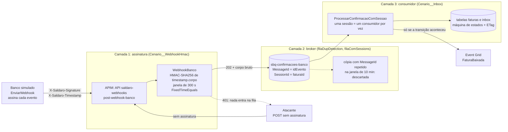
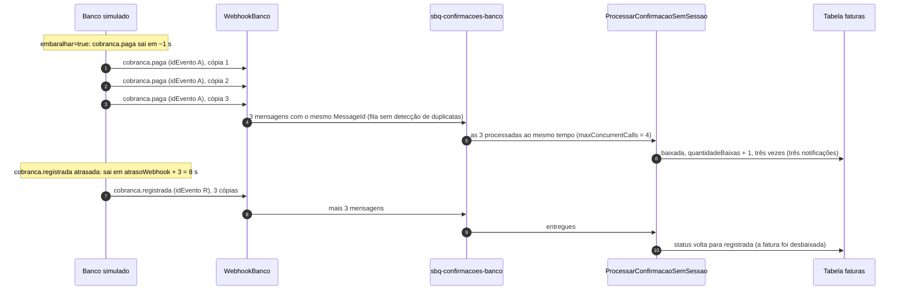

# Incidente 2 — "O webhook que chegou duas vezes (e antes da hora)"

> **CUSTO E FREE TRIAL**
> | Item | Valor |
> |------|-------|
> | Custo mensal (se deixar o `rg-saldaro-lab` ligado) | ~R$ 60 (quase tudo é o Service Bus Standard: ~US$ 10/mês, ou ~R$ 0,07/h) |
> | Custo real deste incidente (o ambiente já existe desde o Lab 0) | menos de R$ 1 (centavos de operações e de horas do Service Bus) |
> | Custo do encontro inteiro (Lab 0 na véspera, Resource Group apagado no fim da aula) | ~R$ 2 a 3 |
> | Compatível com Azure Free Trial (US$ 200)? | **Sim** |
>
> **Regra de ouro:** apague o Resource Group `rg-saldaro-lab` ao terminar, com `./scripts/limpar.ps1` (que também purga o Key Vault e o APIM, que ficam em soft-delete). Na aula, apagamos todos juntos no fim do encontro (3:55 no roteiro). **Não apague agora** se vai seguir para o Incidente 3: ele começa deste mesmo ambiente.
> **Por que Standard?** O tier Basic do Service Bus não tem sessions nem duplicate detection, que são o conserto da camada 2 deste incidente.
> Valores com ~R$ 5,50/US$ e preços de lista da Microsoft; confirme na [calculadora de preços](https://azure.microsoft.com/pricing/calculator/) na data da aula.

## Guia passo a passo (Portal Azure + PowerShell)

**Aula:** Integração e Mensageria no Azure, hands-on 100% ao vivo (pós-graduação TFTEC + Anhanguera)
**Cenário:** 3.3, idempotência, assinatura HMAC e sessions · **Slides:** 11 a 15 · **Duração:** ~75 min (1:30–2:45 no roteiro do encontro)
**Estado inicial:** `infra/parameters/cenario-2-pronto.bicepparam` · **Estado pronto:** `infra/parameters/cenario-3-pronto.bicepparam` · **Plano B:** `./scripts/deploy.ps1 -Cenario 3 -Pronto`
**Version-anchor: Q4-2026**

> Empresa, pessoas, números e incidentes são fictícios; qualquer semelhança é coincidência.

Neste incidente você reproduz um banco que manda confirmações de pagamento repetidas, em triplicado e fora de ordem, vê um POST forjado ser aceito pelo hub e conserta o fluxo em três camadas: a **assinatura** (só o banco confirma pagamento), o **broker** (o Service Bus descarta as cópias e entrega cada fatura a um consumidor por vez) e o **consumidor** (a baixa acontece uma vez, na ordem de negócio, mesmo quando o resto falha). No caminho, você esbarra numa propriedade imutável da fila e precisa drenar, apagar e recriar a fila, no Portal ou pelo Bicep.

---

## Como usar este guia ao vivo

| Marca | O que significa |
|---|---|
| **[Demonstração]** | O professor faz no telão e explica; a turma acompanha sem digitar. |
| **[Demonstração → Turma]** | O professor faz primeiro; a turma repete logo em seguida, no próprio ambiente. |
| **[Turma]** | Cada aluno faz no próprio ambiente; o professor circula e tira dúvidas. |

**Portal primeiro.** Cada conserto deste guia tem um caminho **Pelo Portal**, clique a clique, e é ele que o professor usa ao vivo: a aula é para entender onde cada peça mora (app setting, fila, trigger). Onde existe, o caminho **Pelo script** (`deploy.ps1`) é o plano B, para quem travou ou ficou para trás. O que você muda à mão deixa o Azure diferente do Bicep até o arquivo de parâmetros dizer o mesmo (Passos 5.4 e 6.4), e o próximo `deploy.ps1` reaplica o arquivo e desfaz o que ele não declara. É o drift da Leitura 3.7, e este guia usa isso de propósito.

**Logs numa aba própria.** Abra o **Logs** do `appi-saldaro-<sufixo>` numa aba só dele do navegador (Passo 2.2) e deixe-a aberta até o fim do incidente; navegue pelos outros recursos em outra aba. No ensaio, sair do **Logs** com uma consulta não salva travou a aba do navegador.

**Segredos no telão.** Em **Environment variables**, os valores vêm ocultos. Para ver um, clique em **Show value** só na linha do setting que interessa; nunca no **Show values** da barra, que revela de uma vez todas as chaves e connection strings do app.

### Roteiro de tempo

| Parte | Relógio do encontro | Tempo | Modo | Slides |
|---|---|---|---|---|
| 0. Estado inicial | antes da aula ou na pausa | 5–10 min | [Turma] | — |
| 1. Incidente | 1:30–1:33 | 3 min | [Demonstração] | 11–12 |
| 2. Sintomas | 1:33–1:44 | 11 min | [Demonstração → Turma] | 12 |
| 3. Hipóteses | 1:44–1:49 | 5 min | [Demonstração] | 12 |
| 4. Conserto, camada 1: assinatura | 1:49–2:01 | 12 min | [Demonstração → Turma] | 13 |
| 5. Conserto, camada 2: broker | 2:01–2:21 | 20 min | [Demonstração → Turma] | 14 |
| 6. Conserto, camada 3: consumidor | 2:21–2:31 | 10 min | [Demonstração → Turma] | 14 |
| 7. Prova | 2:31–2:42 | 11 min | [Turma] | 15 |
| 8. Post-mortem | 2:42–2:45 | 3 min | [Turma] | 15 |

**Pontos de controle (para ninguém ficar para trás):**

- **2:01**: se o seu POST forjado ainda não recebe 401, siga para a Parte 5 assim mesmo e confira o `Cenario__WebhookHmac` (Passo 4.2) quando der; quem for pelo script no Passo 5.5 tem o HMAC religado pelo arquivo do Passo 5.4 (e o Plano B também liga).
- **2:10**: se você ainda não começou a recriar a fila no Passo 5.5 (pelo Portal ou pelo script), rode o [Plano B](#plano-b) agora; ele entrega o ambiente pronto para a Parte 7.
- **2:31**: quem estiver no Plano B entra direto na Parte 7.

---

## Pré-requisitos

- [Lab 0](Lab0_Fundacao_Guia.md) feito: o `rg-saldaro-lab` existe e o `scripts/.env.local` foi gravado pelo `deploy.ps1`.
- [Incidente 1](Incidente1_Timeout_Guia.md) concluído, ou o estado inicial aplicado (Passo 0.3).
- PowerShell 7 (`pwsh`) aberto na raiz do repositório e Azure CLI logado na assinatura do lab (`az account show`).
- VS Code com o repositório aberto, para ler o código do hub e editar um arquivo `.bicepparam`.
- As roles que o `deploy.ps1` atribui ao aluno logado: `Azure Service Bus Data Owner` no namespace (Service Bus Explorer com Microsoft Entra ID) e `Storage Table Data Contributor` no storage (consultas com `--auth-mode login`).

---

## Tabela de Recursos

| Recurso | Tipo | SKU/Tier | Papel neste incidente | Custo estimado (mensal) |
|---|---|---|---|---|
| `rg-saldaro-lab` | Resource Group | N/A | contém tudo | Gratuito |
| `sb-saldaro-<sufixo>` | Service Bus Namespace | Standard | o broker da camada 2 | ~R$ 55 (US$ 10 de base) |
| `sbq-confirmacoes-banco` | Service Bus Queue | — | a fila que vamos drenar, apagar e recriar | Incluído no namespace |
| `sbq-faturas-recebidas`, `sbq-notificacoes-parceiro` | Service Bus Queues | — | resto do fio condutor (não mexemos) | Incluído no namespace |
| `func-saldaro-hub-<sufixo>` (plano `asp-saldaro-hub-<sufixo>`) | Function App | Flex Consumption (FC1) | `WebhookBanco`, `ProcessarConfirmacaoSemSessao`, `ProcessarConfirmacaoComSessao` | ~R$ 0 (franquia gratuita) |
| `func-saldaro-banco-<sufixo>` (plano `asp-saldaro-banco-<sufixo>`) | Function App | Flex Consumption (FC1) | banco simulado: `EnviarWebhook` assina e envia as confirmações | ~R$ 0 (franquia gratuita) |
| `stsaldaro<sufixo>` | Storage Account | Standard LRS | tabelas `faturas` e `inbox`; fila `banco-pagamentos` do banco | ~R$ 1 |
| `apim-saldaro-<sufixo>` | API Management | Consumption | API `saldaro-webhooks`, operação `post-webhook-banco` (URL final `{SALDARO_APIM_URL}/webhooks/banco`, sem subscription key) | ~R$ 0 (1 milhão de chamadas/mês grátis) |
| `evgt-saldaro-faturas-<sufixo>` | Event Grid Topic | — | `FaturaBaixada` → `sbq-notificacoes-parceiro` | ~R$ 0 (100 mil operações/mês grátis) |
| `kv-saldaro-<sufixo>` | Key Vault | Standard | vazio neste cenário; o `WebhookSecret` só vai para lá no 3.5 | ~R$ 0 |
| `appi-saldaro-<sufixo>` / `log-saldaro-<sufixo>` | Application Insights / Log Analytics | workspace-based | KQL dos sintomas e da prova | ~R$ 0 (5 GB/mês grátis) |

> **Custo total estimado:** ~R$ 60/mês se ficar ligado, quase tudo do Service Bus Standard. Quem subiu com `-Plano Consumption` (Y1, Windows) no lugar do Flex tem o mesmo custo.

---

## Diagrama: as três camadas de defesa



Cada camada pega o que as outras deixam passar: a assinatura barra quem não é o banco; o broker corta as cópias legítimas e serializa cada fatura; o consumidor aplica a regra de negócio e garante uma baixa só, mesmo quando as outras duas falham. A tabela do Passo 3.3 mostra o que cada uma resolve.

---

## Parte 0 — Estado inicial (antes da aula ou na pausa)

### Passo 0.1: Preparar o terminal [Turma]

Rode na raiz do repositório, no PowerShell 7. Os passos seguintes usam estas variáveis; se abrir outro terminal no meio do caminho, rode de novo este bloco, as funções `Aquecer-Ambiente` (Passo 0.4) e `Send-ConfirmacaoForjada` (Passo 2.5) e o `$faturaId` (Passo 2.3).

```powershell
$cfg = Get-Content ./scripts/.env.local -Raw | ConvertFrom-StringData
$rg  = $cfg.SALDARO_RG                              # rg-saldaro-lab
$sb  = $cfg.SALDARO_SB_NAMESPACE                    # sb-saldaro-<sufixo>
$hub = "func-saldaro-hub-$($cfg.SALDARO_SUFIXO)"    # Function App do hub
function Get-Agora { (Get-Date).ToUniversalTime().ToString('yyyy-MM-ddTHH:mm:ssZ') }
$cfg.SALDARO_APIM_URL                               # deve terminar em /saldaro
```

### Passo 0.2: Conferir o ponto de partida [Turma]

```powershell
Invoke-RestMethod "$($cfg.SALDARO_HUB_URL)/saude" | ConvertTo-Json -Depth 5
az servicebus queue show -g $rg --namespace-name $sb -n sbq-confirmacoes-banco `
    --query "{sessions:requiresSession, dupDetection:requiresDuplicateDetection, maxDelivery:maxDeliveryCount, lock:lockDuration}" -o table
```

Resultado esperado:

| Onde | O que você deve ver |
|---|---|
| `toggles` do `/saude` | `AsyncRequestReply` = `true` (o 202 do Incidente 1); `WebhookHmac`, `Inbox` e `WorkerComSessao` = `false` |
| fila `sbq-confirmacoes-banco` | `sessions` = `False`, `dupDetection` = `False`, `maxDelivery` = `10`, `lock` = `PT1M` |

### Passo 0.3: Se o ponto de partida não bate [Turma]

**Pelo Portal (o caminho da aula, quando a diferença é pequena):** corrija só o que o Passo 0.2 mostrou diferente.

| O que não bate | Onde corrigir no Portal |
|---|---|
| `AsyncRequestReply` = `false` (o conserto do Incidente 1 não está no ar) | `func-saldaro-hub-<sufixo>` → **Settings** > **Environment variables** → aba **App settings** → `Cenario__AsyncRequestReply` = `true` (é o Passo 4.2 do Incidente 1) |
| `WebhookHmac`, `Inbox`, `DlqComMotivo` ou `RetryAgendado` = `true` | a mesma página: `Cenario__WebhookHmac`, `Cenario__Inbox`, `Cenario__DlqComMotivo` e `Cenario__RetryAgendado` = `false` |
| `WorkerComSessao` = `true` | a mesma página: `AzureWebJobs.ProcessarConfirmacaoSemSessao.Disabled` = `false` e `AzureWebJobs.ProcessarConfirmacaoComSessao.Disabled` = `true` (o Passo 5.8 ao contrário; se a fila também veio com sessions, recrie a fila antes, na última linha) |
| `maxDelivery` diferente de `10`, ou `lock` diferente de `PT1M` | `sb-saldaro-<sufixo>` → **Entities** > **Queues** → `sbq-confirmacoes-banco` → **Overview** → na seção **Settings**, logo abaixo de **Essentials**, **(change)** sob **Max delivery count** (`10`) ou sob **Message lock duration** (1 minuto) → **OK** |
| `sessions` ou `dupDetection` = `True` | a fila veio de um estado consertado e só volta apagando e recriando: drene e apague (Passos 5.2 e 5.3) e crie de novo pelo Portal, como no Passo 5.5, mas com **Enable sessions** e **Enable duplicate detection** desmarcados. As mensagens que estavam nela se perdem |

Nas app settings, edite todas as que precisar (**Apply** no painel de cada uma; para ver um valor, o **Show value** da linha, nunca o **Show values** da barra) e só no fim clique em **Apply** no rodapé e em **Confirm**, no aviso **Save changes**: cada confirmação reinicia o hub. Depois, rode de novo o Passo 0.2. Se o `/saude` mostrar `IdentidadeGerenciada` = `true` (o ambiente veio da Leitura 3.5 em diante), não corrija à mão: use o script.

**Pelo script (plano B, ou quando a diferença é grande):**

```powershell
./scripts/deploy.ps1 -Cenario 3 -Sufixo $cfg.SALDARO_SUFIXO
```

O `-Cenario 3` sem `-Pronto` aplica o `cenario-2-pronto.bicepparam`: o Incidente 1 consertado e nada deste incidente ligado. Leva uns 6 minutos (foi o tempo no primeiro deploy de teste do kit), porque também publica o código; faça na pausa. De quebra, ele desfaz tudo o que tiver sido mudado à mão: quem manda é o arquivo. Se a fila tiver sessions ou duplicate detection, o script para antes do what-if e pede para apagá-la primeiro (Passos 5.2 e 5.3).

### Passo 0.4: Aquecer o ambiente [Turma]

O APIM Consumption acorda devagar: logo depois de um `deploy.ps1`, as primeiras chamadas podem passar dos 35 s e estourar o timeout do ERP simulado (no primeiro deploy de teste do kit, foram 6 timeouts na primeira rajada de 10 faturas do Incidente 3, e nenhuma dessas chamadas chegou ao hub). Três sondas pelo APIM, numa fatura que não existe, acordam o caminho antes de cada rajada:

```powershell
# Aquecimento: três GET pelo APIM numa fatura que não existe; o esperado é 404 nas três
function Aquecer-Ambiente {
    $sonda = "$($cfg.SALDARO_APIM_URL)/faturas/00000000-0000-0000-0000-000000000000"
    foreach ($n in 1..3) {
        $relogio = [System.Diagnostics.Stopwatch]::StartNew()
        try   { $resposta = 'HTTP {0}' -f (Invoke-WebRequest $sonda -SkipHttpErrorCheck -TimeoutSec 60).StatusCode }
        catch { $resposta = 'sem resposta' }
        'sonda {0}: {1} em {2:N1} s' -f $n, $resposta, $relogio.Elapsed.TotalSeconds
    }
}
Aquecer-Ambiente
```

Resultado esperado: `HTTP 404` nas três (o hub não acha a fatura, e é isso que se espera). A primeira pode levar alguns segundos (no teste do kit, 1,9 s logo depois de um deploy); as outras, uns 0,1 s. Se alguma passar de 5 s ou vier `sem resposta`, rode `Aquecer-Ambiente` de novo. Os Passos 2.1, 5.9 e 7.1 chamam a função antes de cada rajada: o `deploy.ps1` do Passo 5.5, para quem for pelo script, e o do Plano B reaplicam o APIM. Pelo Portal, o aquecimento continua valendo como garantia barata.

---

## Parte 1 — Incidente (1:30–1:33)

> **Terça-feira, dia 10, 9h30.** Pico de vencimentos do mês. O banco parceiro da Saldaro tem um soluço: um timeout interno faz o sistema dele repetir, de uma vez, 1.200 webhooks de confirmação da última hora. Parte chega em dobro ou em triplo; parte chega fora de ordem, com o "paga" antes do "cobrança registrada".
>
> Às 9h50 o suporte recebe as primeiras ligações. Uma distribuidora recebeu três avisos de "fatura paga" para a mesma cobrança e liberou o pedido duas vezes. Outra empresa cliente vê no portal faturas pagas de manhã que "voltaram" para aguardando pagamento. Às 10h20 a conciliação acha o pior: uma baixa sem nenhum pagamento correspondente no extrato do banco. Alguém mandou uma confirmação forjada, e a Saldaro 1.0 aceitou, porque a "assinatura" do webhook era o próprio segredo copiado num header: quem viu uma requisição, viu o segredo.
>
> Na investigação, mais uma surpresa: dois workers processavam a mesma confirmação ao mesmo tempo, e nenhum dos dois sabia que o outro existia.

**Sua missão** (as três garantias que a diretoria pediu até o fim do dia):

1. Só o banco consegue confirmar um pagamento.
2. Cada pagamento baixa a fatura uma única vez, por mais que o banco repita.
3. Uma confirmação atrasada nunca desfaz uma baixa.

**O que existe hoje no seu ambiente** (estado inicial do cenário 3):

| Peça | Como está | Quem controla |
|---|---|---|
| `WebhookBanco` | aceita qualquer POST e põe o corpo na fila | `Cenario__WebhookHmac = false` |
| `sbq-confirmacoes-banco` | sem sessions e sem duplicate detection | parâmetros `filaComSessions = false` e `filaDupDetection = false` |
| Consumidor ativo | `ProcessarConfirmacaoSemSessao`, com até 4 mensagens ao mesmo tempo | `AzureWebJobs.ProcessarConfirmacaoComSessao.Disabled = true`; `host.json` |
| Lógica de baixa | sem guarda de estado, sem ETag e sem inbox: cada `cobranca.paga` baixa e publica de novo | `Cenario__Inbox = false` |

> No lab, o banco simulado reproduz o soluço com dois botões de caos: `duplicar=3` (cada evento sai três vezes, sempre com o mesmo `idEvento`) e `embaralhar=true` (`cobranca.paga` em ~1 s e `cobranca.registrada` em `atrasoWebhook + 3` = 8 s). Os 1.200 webhooks da história viram 120: 20 faturas × 2 eventos × 3 cópias.

---

## Parte 2 — Sintomas (1:33–1:44)

### Passo 2.1: Reproduzir: 20 faturas com o banco "soluçando" [Demonstração → Turma] · 2 min

```powershell
Aquecer-Ambiente                                  # Passo 0.4: 404 nas três sondas
$inicioBaseline = Get-Agora
"| where timestamp > datetime($inicioBaseline)"   # guarde esta linha: é o filtro das consultas desta parte
./scripts/erp-simulado.ps1 -Faturas 20 -Caos "duplicar=3;embaralhar=true"
```

No relatório do script: 20 respostas 202 (o 202 assíncrono do Incidente 1 está ligado) e nenhum 5xx. O ERP fez tudo certo e mandou cada fatura uma vez. O estrago acontece depois, entre o banco e o hub:



Espere cerca de 1 minuto antes de consultar: a telemetria chega ao Application Insights em lotes.

### Passo 2.2: Contar as baixas por fatura [Turma] · 3 min

1. No Portal, numa aba própria do navegador, que fica aberta até o fim do incidente, abra `appi-saldaro-<sufixo>` → **Monitoring** > **Logs**. No primeiro acesso, feche a janela **Welcome to Log Analytics**. Se a página abrir num chat (**Observability Agent**), desligue o toggle **Agent**, no canto superior direito, e clique em **Discard** no aviso **Discard changes**. Se a barra mostrar **Simple mode**, troque para **KQL mode** no seletor à direita. (O escopo é o recurso Application Insights: tabelas `customEvents`, `requests`, `traces` e `exceptions`.)
2. No VS Code, abra `kql/baixa-duplicada.kql`, copie tudo e cole no editor do Logs.
3. Logo abaixo da linha `customEvents`, cole a linha de filtro que o Passo 2.1 imprimiu (`| where timestamp > datetime(...)`), para olhar só esta execução.
4. Clique em **Run**.

Resultado esperado: perto de 20 linhas, uma por fatura, cada uma com 3 eventos `fatura.baixada` (`baixas = 3`); no primeiro deploy de teste do kit, foram as 20, todas com 3. A consulta procura exatamente isso: `fatura.baixada` com mais de uma ocorrência por `faturaId`. Copie um `faturaId` do resultado; ele é a sua fatura de estudo.

### Passo 2.3: Olhar uma fatura de perto [Turma] · 2 min

```powershell
$faturaId = '<cole aqui o faturaId do Passo 2.2>'
Invoke-RestMethod "$($cfg.SALDARO_APIM_URL)/faturas/$faturaId" | Format-List
Invoke-RestMethod "$($cfg.SALDARO_BANCO_URL)/cobrancas/$faturaId"
```

| O que olhar | O que você deve ver | O que significa |
|---|---|---|
| `quantidadeBaixas` | maior que 1: em geral 3, uma por cópia da `cobranca.paga` | o mesmo pagamento baixou a fatura mais de uma vez |
| `status` | `registrada` em algumas faturas, mesmo com `baixadaEm` preenchido (no primeiro deploy de teste do kit, 2 das 20); as outras terminam `notificada` | a `cobranca.registrada` atrasada "desbaixou" uma fatura paga. Sem guarda de estado, vale quem grava por último: o evento atrasado (que desbaixa) ou a notificação (que grava `notificada` por cima) |
| banco: `quantidade` | `1` | só existe uma cobrança: a duplicação não veio do ERP nem do problema do Incidente 1 |

Opcional: para ver as 20 de uma vez e achar as que regrediram, consulte a tabela `faturas` (é o comando do Passo 7.3, com o filtro do `$inicioBaseline`):

```powershell
az storage entity query --account-name $cfg.SALDARO_STORAGE --auth-mode login --table-name faturas `
    --filter "Timestamp ge datetime'$inicioBaseline'" `
    --select PartitionKey status quantidadeBaixas `
    --query "items[].{fatura:PartitionKey, status:status, baixas:quantidadeBaixas}" -o table
```

> Se alguma fatura mostrar `quantidadeBaixas` menor que o número de `fatura.baixada` do Passo 2.2, você achou uma **atualização perdida**: dois processamentos leram a fatura ao mesmo tempo, somaram 1 ao mesmo valor e um escreveu por cima do outro (no teste do kit, uma das faturas que regrediram ficou com `quantidadeBaixas = 2` e três `fatura.baixada`). Guarde esse caso para a hipótese H4.

### Passo 2.4: Contar as notificações [Turma] · 1 min

```kusto
customEvents
| where timestamp > datetime(<cole o valor de $inicioBaseline>)
| where name == "notificacao.enviada"
| summarize notificacoes = count() by faturaId = tostring(customDimensions.faturaId)
| order by notificacoes desc
```

Resultado esperado: 3 notificações por fatura. Cada `fatura.baixada` publicou um `FaturaBaixada` no Event Grid, e o `NotificarParceiro` avisou o ERP do cliente três vezes: é o "notificou em dobro" da história.

> No lab, as faturas do `erp-simulado.ps1` não têm `callbackUrl`: o `NotificarParceiro` não chega a fazer o POST no ERP, só marca a fatura como `notificada` e registra `notificacao.enviada`. Com `callbackUrl`, seriam três POSTs no ERP do cliente, cada um com o CloudEvent `FaturaBaixada` no corpo.

### Passo 2.5: A confirmação forjada [Demonstração → Turma] · 3 min

O hub expõe `POST /webhooks/banco` pelo APIM (API `saldaro-webhooks`, que nunca exige subscription key) para o banco avisar pagamentos. Vamos fingir que somos alguém que não é o banco. A função abaixo monta um corpo **fictício**, no mesmo formato do evento que o banco envia, e manda **sem assinatura nenhuma**:

```powershell
function Send-ConfirmacaoForjada {
    param([Parameter(Mandatory)][string]$FaturaId)
    $corpo = [ordered]@{
        idEvento         = [guid]::NewGuid().ToString()   # um idEvento que o banco nunca usou
        tipo             = 'cobranca.paga'
        faturaId         = $FaturaId
        idCobranca       = 'COB-00000000'                 # cobrança inventada
        valor            = 1.00                           # "paguei R$ 1,00"
        ocorridoEm       = (Get-Date).ToUniversalTime().ToString('yyyy-MM-ddTHH:mm:ssZ')
        simulaTransiente = $false
        transienteAte    = $null
    } | ConvertTo-Json
    Invoke-RestMethod -Method Post -Uri "$($cfg.SALDARO_APIM_URL)/webhooks/banco" `
        -ContentType 'application/json' -Body $corpo `
        -SkipHttpErrorCheck -StatusCodeVariable codigo | Out-Null
    "POST forjado para a fatura $FaturaId -> HTTP $codigo"
}

Send-ConfirmacaoForjada -FaturaId $faturaId
```

Resultado esperado: `HTTP 202`. Espere uns 25 segundos e olhe a fatura de novo:

```powershell
Invoke-RestMethod "$($cfg.SALDARO_APIM_URL)/faturas/$faturaId" | Format-List
```

O `quantidadeBaixas` subiu mais um (no primeiro deploy de teste do kit, de 3 para 4 em uns 25 s) e o ERP do cliente recebeu mais um aviso de pagamento. O `status` pode aparecer `baixada`, `notificada` ou até `registrada`, como no teste do kit: sem guarda de estado, vale a última gravação, e nada garante a ordem delas. Ninguém pagou nada, o corpo diz que o valor era R$ 1,00, e o hub nem perguntou quem estava falando.

> O mesmo POST também passaria direto na URL da Function (`SALDARO_HUB_URL`): os HTTP triggers do lab são anônimos, uma simplificação de laboratório comentada no código. Em produção, o backend só aceita tráfego que veio do APIM, e o APIM soma à assinatura da Parte 4 uma lista de IPs do banco (`ip-filter`) ou mTLS, conforme o contrato com o parceiro (ADR-0007, em `docs/adr/`).

> **Pare e pense:** qual destas defesas pararia este POST: descartar cópias pelo `idEvento`, processar uma fatura por vez ou conferir quem assinou? (Resposta no Passo 3.3.)

---

## Parte 3 — Hipóteses (1:44–1:49)

### Passo 3.1: Testar as hipóteses [Demonstração] · 3 min

| # | Hipótese | Como testar | Resultado no baseline |
|---|---|---|---|
| H1 | O ERP mandou a mesma fatura duas vezes (o problema do Incidente 1) | `GET /cobrancas/{faturaId}` no banco (Passo 2.3) | `quantidade = 1`: **descartada** |
| H2 | O banco entregou o mesmo evento várias vezes | consulta H2 | 3 cópias por `idEvento`: **confirmada** |
| H3 | Os eventos chegaram fora da ordem de negócio | consulta H3 | `cobranca.paga` antes de `cobranca.registrada`: **confirmada** |
| H4 | O consumidor processa cópias da mesma fatura ao mesmo tempo | consulta H4 + `host.json` | baixas a milissegundos uma da outra: **confirmada** |
| H5 | O webhook aceita qualquer remetente | POST forjado (Passo 2.5) | 202: **confirmada** |

**Consulta H2: cópias por evento.**

```kusto
customEvents
| where timestamp > datetime(<cole o valor de $inicioBaseline>)
| where name == "confirmacao.recebida"
| summarize copias = count() by idEvento = tostring(customDimensions.idEvento), tipo = tostring(customDimensions.tipo)
| summarize eventos = count() by tipo, copias
```

Esperado: 20 eventos de cada `tipo` com `copias = 3` (mais o forjado, com `copias = 1`).

**Consulta H3: a linha do tempo da sua fatura de estudo.**

```kusto
customEvents
| where timestamp > datetime(<cole o valor de $inicioBaseline>)
| where tostring(customDimensions.faturaId) == "<faturaId do Passo 2.2>"
| project timestamp, name, tipo = tostring(customDimensions.tipo), idEvento = tostring(customDimensions.idEvento)
| order by timestamp asc
```

Esperado: `fatura.recebida`, `cobranca.emitida`, as três `confirmacao.recebida` do tipo `cobranca.paga`, as três `fatura.baixada`, as notificações e só depois as três `cobranca.registrada`: o "registrada" chegou por último e desfez a baixa.

**Consulta H4: quanto tempo separa as baixas da mesma fatura.**

```kusto
customEvents
| where timestamp > datetime(<cole o valor de $inicioBaseline>)
| where name == "fatura.baixada"
| summarize baixas = count(), primeira = min(timestamp), ultima = max(timestamp) by faturaId = tostring(customDimensions.faturaId)
| where baixas > 1
| extend intervaloMs = datetime_diff('millisecond', ultima, primeira)
| order by intervaloMs asc
```

Esperado: baixas da mesma fatura a poucos milissegundos uma da outra. Agora abra `03_Aplicações/Saldaro.Hub/host.json` (trecho):

```json
{
  "version": "2.0",
  "extensions": {
    "serviceBus": {
      "maxConcurrentCalls": 4,
      "maxConcurrentSessions": 8,
      "prefetchCount": 0,
      "autoCompleteMessages": false,
      "sessionIdleTimeout": "00:00:10"
    }
  }
}
```

O `maxConcurrentCalls = 4` deixa uma única instância processar até quatro mensagens ao mesmo tempo. As três cópias da mesma `cobranca.paga` chegam juntas e são processadas juntas: é o "dois workers disputando a mesma fatura" da história, sem precisar escalar instâncias (e, se a plataforma escalar, a disputa só aumenta). Sem ETag, cada processamento lê a fatura, soma 1 e grava por cima: daí as baixas repetidas e as atualizações perdidas.

### Passo 3.2: Ver as cópias dentro da fila (opcional) [Demonstração] · 3 min

Estes 3 minutos não estão no roteiro de tempo: faça só se a turma estiver adiantada. Se o relógio apertou, pule; a Parte 5 mostra a mesma coisa pelo outro lado.

1. `func-saldaro-hub-<sufixo>` → **Settings** > **Environment variables** → aba **App settings**: troque `AzureWebJobs.ProcessarConfirmacaoSemSessao.Disabled` para `true` → **Apply** → **Apply** (rodapé) → **Confirm**. Sem consumidor, as mensagens ficam na fila.
2. Rode `./scripts/erp-simulado.ps1 -Faturas 1 -Caos "duplicar=3;embaralhar=true"` e espere uns 15 segundos.
3. `sbq-confirmacoes-banco` → **Service Bus Explorer** → **Peek Mode** → subfila **Queue** (não a **Dead-letter**) → **Peek from start**. Seis mensagens: três com o mesmo `MessageId` (o `idEvento` da `cobranca.paga`) e três com outro (o da `cobranca.registrada`). Selecione uma e abra a aba **Message Properties**: o `SessionId` já vem preenchido com o `faturaId`, e a propriedade personalizada `tipo` diz o tipo do evento.
4. Volte `AzureWebJobs.ProcessarConfirmacaoSemSessao.Disabled` para `false` (**Apply** → **Confirm**); o consumidor processa as seis, do jeito ingênuo.

> **O que a demonstração prova:** o `WebhookBanco` já manda `MessageId = idEvento` e `SessionId = faturaId` desde o baseline. O produtor está pronto; é a fila que ignora os dois campos. Guarde isso para a Parte 5.

### Passo 3.3: As três camadas [Demonstração] · 2 min

| Sintoma | Camada 1: assinatura | Camada 2: broker | Camada 3: consumidor |
|---|---|---|---|
| Confirmação forjada aceita | **resolve** (401) | não: o atacante inventa um `idEvento` novo | não: idem |
| O mesmo evento entregue 3 vezes | não: as cópias são legítimas e assinadas | **resolve** dentro da janela (duplicate detection) | **resolve** sempre (máquina de estados + ETag; inbox como atalho) |
| Dois processamentos da mesma fatura ao mesmo tempo | não | **resolve** (uma sessão, um consumidor por vez) | **resolve** (ETag: quem perde relê) |
| `cobranca.registrada` atrasada desfaz a baixa | não | não: a sessão preserva a ordem de chegada, que já veio errada | **resolve** (máquina de estados) |

Resposta do "Pare e pense" do Passo 2.5: **só a assinatura** para o POST forjado. Ele traz um `idEvento` que ninguém viu antes, então nenhuma deduplicação o reconhece, e a sessão só o põe na fila da fatura certa.

O conserto vai de fora para dentro: assinatura (Parte 4), broker (Parte 5) e consumidor (Parte 6).

---

## Parte 4 — Conserto, camada 1: assinatura (1:49–2:01)

### Passo 4.1: Como o hub valida a assinatura [Demonstração] · 4 min

No VS Code, abra `03_Aplicações/Saldaro.Hub/` e procure (Ctrl+Shift+F) por `WebhookBanco` e por `CONCEITO:`. O combinado entre o banco e o hub:

| Item | Valor |
|---|---|
| Headers | `X-Saldaro-Timestamp: <unix seconds>` e `X-Saldaro-Signature: sha256=<hex minúsculo>` |
| Conteúdo assinado | a string `"{timestamp}.{corpo}"`, com o corpo bruto exatamente como enviado (UTF-8) |
| Algoritmo e chave | HMAC-SHA256 com chave `UTF8(WebhookSecret)` (a string do app setting, sem decodificar base64) |
| Validação | recalcular, comparar com `CryptographicOperations.FixedTimeEquals` e exigir \|agora − timestamp\| ≤ 300 s, tudo **antes** de desserializar |
| Se falhar | **401** e nada vai para a fila |

Por que cada detalhe:

- **HMAC, não segredo no header.** Segredo no header é senha em texto: quem vê uma requisição (log, proxy, print de tela) passa a "assinar" o que quiser, para sempre. Com HMAC, o segredo nunca viaja; o que viaja é a prova de que quem enviou conhece o segredo e de que o corpo não mudou no caminho.
- **Corpo bruto.** A assinatura vale para bytes. Desserializar e serializar de novo muda espaços, ordem de campos e formato de número (`1250.00` vira `1250`), e a conta não bate mais. Por isso o `WebhookBanco` lê o corpo uma vez, valida esses bytes e manda **os mesmos bytes** para a fila.
- **Antes de desserializar.** Não se interpreta conteúdo de quem ainda não provou quem é.
- **Timestamp dentro do conteúdo assinado.** Quem capturar uma requisição válida não consegue trocar o timestamp sem invalidar a assinatura, e o hub recusa timestamps com mais de 5 minutos de diferença. Uma captura só pode ser repetida (replay) dentro dessa janela, e aí entram as camadas 2 e 3, porque a repetição tem o mesmo `idEvento`.
- **Comparação em tempo constante.** Uma comparação comum para no primeiro caractere diferente; medindo o tempo de resposta, um atacante descobre a assinatura caractere por caractere. `FixedTimeEquals` leva o mesmo tempo para qualquer conteúdo e só encurta quando os tamanhos diferem (Microsoft Learn).

Trecho **ilustrativo** (não é o código do kit; o real está na Function `WebhookBanco`):

```csharp
// ILUSTRATIVO. O código real está na Function WebhookBanco, em 03_Aplicações/Saldaro.Hub/.
byte[] corpo = await LerCorpoBrutoAsync(req);                  // bytes exatamente como chegaram
string? ts = req.Headers["X-Saldaro-Timestamp"];
string? assinatura = req.Headers["X-Saldaro-Signature"];       // "sha256=<hex minúsculo>"

if (!long.TryParse(ts, out var unix) ||
    Math.Abs(DateTimeOffset.UtcNow.ToUnixTimeSeconds() - unix) > 300)
    return Recusar401();                                        // fora da janela de ±300 s

byte[] chave = Encoding.UTF8.GetBytes(webhookSecret);          // a string do setting, sem decodificar base64
byte[] assinado = [.. Encoding.UTF8.GetBytes(ts + "."), .. corpo];
string esperada = "sha256=" + Convert.ToHexString(HMACSHA256.HashData(chave, assinado)).ToLowerInvariant();

if (!CryptographicOperations.FixedTimeEquals(
        Encoding.ASCII.GetBytes(esperada), Encoding.ASCII.GetBytes(assinatura ?? "")))
    return Recusar401();                                        // e nada vai para a fila

// Só agora o corpo é lido como JSON (JsonDocument), para extrair idEvento, faturaId e tipo.
```

### Passo 4.2: Ligar a validação [Demonstração → Turma] · 3 min

1. No Portal, abra `func-saldaro-hub-<sufixo>` → **Settings** > **Environment variables** → aba **App settings**.
2. Clique em `Cenario__WebhookHmac` (o Bicep já criou o setting, com `false`). No painel, o **Value** vem mascarado (o ícone de olho mostra o valor): apague o conteúdo, digite `true` e clique em **Apply**.
3. Clique em **Apply** no rodapé da página e, no aviso **Save changes**, em **Confirm**. Mudar app setting reinicia o Function App: o valor novo costuma valer de 5 a 35 segundos depois do **Confirm** (no ensaio pelo Portal, 13 s).
4. Confira no terminal:

```powershell
Invoke-RestMethod "$($cfg.SALDARO_HUB_URL)/saude" | ConvertTo-Json -Depth 5
```

Em `toggles`, `WebhookHmac` deve aparecer `true`.

Equivalente no CLI: `az functionapp config appsettings set -g $rg -n $hub --settings Cenario__WebhookHmac=true`

> Os dois underscores de `Cenario__WebhookHmac` viram `:` para o .NET: o código lê `Cenario:WebhookHmac` pelo padrão Options.
>
> **Telão:** para conferir um valor na página **Environment variables**, use o **Show value** da linha do setting. O **Show values** da barra revela também `BancoApiKey`, `WebhookSecret`, `AzureWebJobsStorage` e `APPLICATIONINSIGHTS_CONNECTION_STRING`.

### Passo 4.3: O forjado de novo [Turma] · 2 min

```powershell
Send-ConfirmacaoForjada -FaturaId $faturaId
Invoke-RestMethod "$($cfg.SALDARO_APIM_URL)/faturas/$faturaId" | Format-List
```

Resultado esperado: `HTTP 401`, e a fatura não muda (`quantidadeBaixas` igual ao do fim do Passo 2.5). O 401 sai antes de qualquer coisa ir para a fila. O motivo vai no campo `erro` do corpo da resposta (`Assinatura do webhook recusada: CabecalhosAusentes.`) e no log do hub (`Webhook recusado com 401: CabecalhosAusentes.`): sem os dois headers, não há nem o que conferir.

### Passo 4.4: O banco de verdade continua passando [Turma] · 3 min

Uma defesa que barra o atacante e também o banco não serve. Rode o smoke test: uma fatura ponta a ponta, agora com o banco assinando de verdade.

```powershell
./scripts/smoke-test.ps1
```

Resultado esperado: a fatura chega a `baixada`/`notificada` dentro do prazo, e o script imprime o `faturaId` e o `operation_Id`. O banco assinou com o mesmo `WebhookSecret` que o hub usa para validar.

> **Para quem terminou antes** (opcional, fora do tempo da aula):
>
> 1. **Assine você mesmo.** É a prova de que só quem tem o segredo assina, e de que um segredo em texto num app setting é um risco (assunto da Leitura 3.5). Rode o bloco abaixo e veja `HTTP 202`. Depois repita só o `Invoke-RestMethod`, com o mesmo `$ts`, passados 5 minutos: `HTTP 401`, porque o timestamp saiu da janela (motivo `ForaDaJanela`). Repetido antes dos 5 minutos, o replay passaria pela assinatura; quem segura são as camadas 2 e 3, que você liga a seguir.
>
>    ```powershell
>    $segredo = az functionapp config appsettings list -g $rg -n $hub --query "[?name=='WebhookSecret'].value" -o tsv
>    $corpo = [ordered]@{ idEvento = [guid]::NewGuid().ToString(); tipo = 'cobranca.paga'; faturaId = $faturaId
>        idCobranca = 'COB-00000000'; valor = 1.00; ocorridoEm = (Get-Date).ToUniversalTime().ToString('yyyy-MM-ddTHH:mm:ssZ')
>        simulaTransiente = $false; transienteAte = $null } | ConvertTo-Json -Compress
>    $ts = [DateTimeOffset]::UtcNow.ToUnixTimeSeconds().ToString()
>    $hmac = [System.Security.Cryptography.HMACSHA256]::HashData(
>        [Text.Encoding]::UTF8.GetBytes($segredo), [Text.Encoding]::UTF8.GetBytes("$ts.$corpo"))
>    $assinatura = 'sha256=' + [Convert]::ToHexString($hmac).ToLowerInvariant()
>    Invoke-RestMethod -Method Post -Uri "$($cfg.SALDARO_APIM_URL)/webhooks/banco" -ContentType 'application/json' -Body $corpo `
>        -Headers @{ 'X-Saldaro-Timestamp' = $ts; 'X-Saldaro-Signature' = $assinatura } -SkipHttpErrorCheck -StatusCodeVariable codigo | Out-Null
>    "HTTP $codigo"
>    ```
>
> 2. **O próprio banco assinando errado.** `./scripts/erp-simulado.ps1 -Faturas 1 -Caos "assinatura=invalida"`: o hub responde 401 aos webhooks e a fatura fica parada em `cobranca-emitida`. O banco simulado trata 4xx (exceto 408 e 429) como rejeição definitiva: o `EnviarWebhook` registra um aviso no log e não tenta de novo.

---

## Parte 5 — Conserto, camada 2: broker (2:01–2:21)

### Passo 5.1: Tentar ligar sessions na fila existente [Demonstração → Turma] · 2 min

1. No Portal, abra `sb-saldaro-<sufixo>` → **Entities** > **Queues** → `sbq-confirmacoes-banco` → **Overview**.
2. Em **Essentials**, **Duplicate detection** (coluna da esquerda) e **Sessions** (coluna da direita) aparecem como **Disabled**, sem nada para mudar. Não procure em **Settings** > **Properties**: essa página hoje é genérica ("This view has been generated from known ARM metadata") e só lista Id, Name, Type, Tags e Location. Ao contrário de **Max delivery count** e **Lock duration**, que mudam numa fila existente (o Incidente 3 muda o primeiro na própria **Overview** da fila), sessions e duplicate detection só se escolhem na criação.
3. Para ver onde a opção existe: volte para **Queues** e clique em **+ Queue**. No painel de criação aparecem **Enable duplicate detection** (com o tamanho da janela) e **Enable sessions**. Feche o painel **sem criar** nada.
4. Pelo CLI, a API responde com todas as letras:

```powershell
az servicebus queue update -g $rg --namespace-name $sb -n sbq-confirmacoes-banco --enable-session true
```

Resultado esperado: o erro `(MessagingGatewayBadRequest) SubCode=40000. The value for the RequiresSession property of an existing Queue cannot be changed.` Para a deduplicação, a mensagem equivalente, segundo o Microsoft Learn, é `The value for the 'requiresDuplicateDetection' property of an existing Queue(or Topic) can't be changed.`

> **Imutável, por quê?** O Microsoft Learn é direto: "You can't enable or disable message sessions after the queue or subscription is created", e a mesma regra vale para duplicate detection. Ligar sessions muda o contrato da fila com quem envia e com quem recebe: depois disso, "client applications can no longer send or receive regular messages". O caminho é uma fila nova: no lab, drenar, apagar e recriar; em produção, criar outra fila e migrar (veja Lições para produção).

### Passo 5.2: Drenar a fila [Turma] · 2 min

Apagar a fila apaga as mensagens dela e a DLQ junto. Antes, garanta que não sobrou nada:

1. Não rode o ERP nem o POST forjado até o fim do Passo 5.5. Espere uns 30 segundos depois da última execução (o evento atrasado sai em até 8 s).
2. Confira os contadores:

```powershell
az servicebus queue show -g $rg --namespace-name $sb -n sbq-confirmacoes-banco --query countDetails -o jsonc
```

`activeMessageCount` e `deadLetterMessageCount` precisam estar em `0`. No Portal, os mesmos números aparecem na **Overview** da fila, na seção **Message Counts** (**Active** e **Dead-letter**; clique em **Refresh**, porque a **Overview** não se atualiza sozinha), e também na lista **Queues** do namespace (colunas **Active messages** e **Dead-letter messages**).

3. Se a DLQ não estiver vazia: **Service Bus Explorer** → **Peek Mode** → aba **Dead-letter** → **Peek from start**, e leia o motivo na coluna **Dead Letter Reason** (ou selecione a mensagem e abra **Message Properties**). Num incidente de verdade, você exportaria (**Export messages**) ou reprocessaria antes de apagar; é o tema do Incidente 3. Aqui, anote o motivo e siga.

> **Drenar, em produção:** parar os produtores (ou pôr a fila em `SendDisabled`), deixar os consumidores esvaziarem a fila, decidir o destino de cada mensagem da DLQ e só então apagar.

### Passo 5.3: Apagar a fila [Turma] · 1 min

No Portal, abra `sbq-confirmacoes-banco` e, na barra de ferramentas da página **Overview**, clique em **Delete** e, no aviso **Delete queue** ("Are you sure you want to delete queue "sbq-confirmacoes-banco"?"), clique em **Yes**. O Portal volta sozinho para a lista **Queues** do namespace, já sem a fila (notificação "Successfully deleted...").

Equivalente no CLI:

```powershell
az servicebus queue delete -g $rg --namespace-name $sb -n sbq-confirmacoes-banco
```

> A partir daqui, até o fim do Passo 5.5, o `WebhookBanco` não tem para onde mandar, e um webhook que chegar falha (o hub responde 500; o banco simulado tenta de novo, de 10 em 10 s, até 5 vezes, e desiste). Essa janela de indisponibilidade é o preço da simplificação de laboratório.

### Passo 5.4: Mudar os parâmetros do Bicep [Turma] · 2 min

Faça este passo nos dois caminhos do Passo 5.5. Pelo script, é este arquivo que recria a fila; pelo Portal, é ele que registra o que você vai criar à mão, para o Bicep continuar dizendo a verdade sobre o ambiente. O `deploy.ps1 -Cenario 3` (sem `-Pronto`) usa o arquivo `infra/parameters/cenario-2-pronto.bicepparam`. Abra esse arquivo no VS Code: ele tem uma linha por toggle, todas já com valor. Troque para `true` estas três (no arquivo, os comentários de cada linha são outros; o que muda é só o valor):

```bicep
param webhookHmac = true        // camada 1: o que você ligou no Portal no Passo 4.2
param filaComSessions = true    // camada 2: requiresSession da sbq-confirmacoes-banco
param filaDupDetection = true   // camada 2: requiresDuplicateDetection (janela de 10 min)
```

Não mexa em `workerComSessao` nem em `inbox` agora; eles ficam para os Passos 5.8 e 6.3.

> **Por que `webhookHmac` também?** O Bicep é a fonte da verdade. O `deploy.ps1` reaplica todos os app settings a partir dos parâmetros, e o que você mudou só no Portal volta ao valor do arquivo. Sem essa linha, o redeploy desligaria o HMAC em silêncio. Esse "o Portal diz uma coisa, o Bicep diz outra" é o drift do cenário 3.7.

### Passo 5.5: Recriar a fila com sessions e duplicate detection [Turma] · 7 min

Dois caminhos para o mesmo resultado. **Ao vivo, o professor usa o Portal** e a turma repete: cada caixa marcada é um conceito da camada 2, e o professor explica um por um enquanto a turma cria a fila (o bloco [Demonstração] no fim deste passo). O script é o plano B.

Nos dois caminhos, a fila nova nasce vazia: o que estava na antiga, inclusive a DLQ, foi embora no Passo 5.3. Por isso o Passo 5.2 drenou antes.

**Pelo Portal (o caminho da aula), uns 3 minutos:**

1. Abra `sb-saldaro-<sufixo>` → **Entities** > **Queues**. A `sbq-confirmacoes-banco` não pode estar na lista; se ainda estiver, espere uns segundos e clique em **Refresh** (a exclusão do Passo 5.3 não é instantânea).
2. Clique em **+ Queue** e preencha o painel **Create queue** com os valores que o Bicep declara para esta fila (a `var filas` de `infra/modules/service-bus.bicep`):

| Campo | Valor | Por quê |
|---|---|---|
| **Name** | `sbq-confirmacoes-banco` | o nome exato que o `WebhookBanco` e os dois triggers usam |
| **Max queue size** | 1 GB (o padrão) | o Bicep não declara; vale o padrão |
| **Max delivery count** | `10` | o `maxDeliveryCount` do `cenario-2-pronto` (o Incidente 3 baixa para 3) |
| **Message time to live** | o máximo: **Days** `10675199`, **Hours** `2`, **Minutes** `48`, **Seconds** `5` (o painel vem com 14 dias) | o Bicep não declara TTL, e a fila fica com o padrão do serviço, o maior valor possível (`az` mostra `P10675199DT2H48M5.4775807S`; a **Overview** da fila antiga mostrava **UNBOUNDED**). Com os 14 dias do painel, o lab funciona igual (as mensagens vivem segundos), mas a fila fica diferente do Bicep |
| **Lock duration** | 1 minuto | o `lockDuration: 'PT1M'` do Bicep; é o padrão do painel |
| **Enable auto-delete on idle queue** | desmarcado | a fila não é temporária |
| **Enable duplicate detection** | **marcado**; o campo **Duplicate detection window**, que aparece ao marcar, já vem com 10 minutos | camada 2a: `requiresDuplicateDetection` e `duplicateDetectionHistoryTimeWindow: 'PT10M'` |
| **Enable dead lettering on message expiration** | **marcado** | o `deadLetteringOnMessageExpiration: true` do Bicep |
| **Enable partitioning** | desmarcado | também só se escolhe na criação, e o Bicep não liga |
| **Enable sessions** | **marcado** | camada 2b: `requiresSession` |
| **Forward messages to queue/topic** | desmarcado | esta fila não repassa mensagens para outra |

3. Clique em **Create**.

**Confira:** a `sbq-confirmacoes-banco` volta à lista **Queues**. Na **Overview** dela, em **Essentials**, **Sessions** e **Duplicate detection** não aparecem mais como **Disabled**: é exatamente o que você não conseguiu mudar no Passo 5.1. O Passo 5.6 confere o resto.

> **Esqueceu uma caixa?** Sessions e duplicate detection não se ligam numa fila existente, nem pelo Portal: apague a fila de novo (Passo 5.3) e repita, uns 2 minutos a mais. **Lock duration** e **Max delivery count** você acerta depois, no **(change)** sob cada um, na seção **Settings** da **Overview**.
>
> **O Azure e o Bicep agora discordam, e é de propósito.** A fila nova veio do Portal, não de um deploy. O arquivo do Passo 5.4 diz o mesmo que ela, mas o último deployment do seu ambiente declarou a fila sem sessions e sem duplicate detection. Se quiser ver (opcional), rode `./scripts/check-drift.ps1`, que compara o Azure com o último deployment: as duas propriedades aparecem como **divergente** até um deploy aplicar o arquivo editado. O arquivo dos Passos 5.4 e 6.4 garante que esse próximo deploy confirme a fila, em vez de parar na propriedade imutável ou de desfazer o conserto; a Leitura 3.7 explica a conta inteira. Repare também que nada reiniciou o hub: pelo Portal, você só criou uma fila.

**Pelo script (plano B), uns 4 minutos de deploy:**

```powershell
./scripts/deploy.ps1 -Cenario 3 -Sufixo $cfg.SALDARO_SUFIXO -SemPublicar
```

> **Um aviso amarelo é esperado.** Logo no começo, no passo `Lendo os toggles do estado pedido`, o script imprime:
>
> ```text
>     ATENÇÃO: filaComSessions = true e workerComSessao = false: o trigger de confirmação ativo não combina com a fila (um receptor sem sessão numa fila com sessão falha). Confira o arquivo de parâmetros.
> ```
>
> É de propósito: o consumidor com sessão só entra no Passo 5.8, e o Passo 5.7 mostra o erro que esse aviso antecipa. Não interrompa o deploy nem mexa no arquivo: deixe o script seguir até o fim.

- `-Sufixo` garante que o script use o seu ambiente, e não crie outro.
- `-SemPublicar` pula o `dotnet publish`: o código não mudou, porque o comportamento das camadas muda por app settings. (Se o seu último deploy não publicou o código, rode sem essa opção.)
- O script mostra o what-if no formato `ResourceIdOnly`: só a lista de recursos, sem valores (os app settings do baseline têm segredos). Procure a única linha de criação (`+`), a da `.../queues/sbq-confirmacoes-banco`: é a fila que você apagou voltando. Os outros recursos aparecem todos como **Deploy** (`!`), porque nesse formato o what-if não diz o que muda num recurso que já existe (no primeiro deploy de teste do kit, o resumo foi `1 to create, 40 to deploy`). Quem confirma o HMAC depois do deploy é o `/saude` (Passo 5.6).
- Se a fila ainda existir (você pulou o Passo 5.3), o script para no passo 11, antes do what-if (no teste do kit, uns 50 s depois de começar), com `A sbq-confirmacoes-banco existe e o estado pedido muda uma propriedade IMUTÁVEL (requiresSession false -> true; requiresDuplicateDetection false -> true)`, mostra quantas mensagens ela tem e indica o caminho: apague a fila e rode de novo, ou use o Plano B.

O deploy leva uns 3 a 4 minutos (no teste do kit, 3,3 min, com a fila recriada).

**Enquanto a turma marca as caixas no Portal, ou enquanto o deploy roda [Demonstração]:**

> **Duplicate detection (camada 2a).** Com `requiresDuplicateDetection = true`, o Service Bus registra o `MessageId` de tudo o que entra durante a janela de detecção (`duplicateDetectionHistoryTimeWindow`: padrão de 10 minutos para filas e tópicos, mínimo de 20 segundos, máximo de 7 dias; o kit usa 10 minutos). Uma mensagem com `MessageId` já registrado na janela é aceita (o envio dá sucesso) e descartada na hora; nenhuma outra parte da mensagem é comparada. Como o `WebhookBanco` usa `MessageId = idEvento`, as três cópias do banco viram uma. Os limites: a cópia que chegar depois da janela passa; um `idEvento` novo (como o do POST forjado) passa; e janela maior custa throughput, porque cada envio é comparado com todos os IDs guardados.
>
> **Sessions (camada 2b).** Com `requiresSession = true`, toda mensagem precisa de `SessionId` (aqui, `SessionId = faturaId`). Um receptor que aceita uma sessão segura um lock exclusivo sobre todas as mensagens dela, inclusive as que ainda vão chegar: **um consumidor por sessão**, e as mensagens da sessão saem na ordem em que entraram. Faturas diferentes continuam em paralelo: até 8 sessões por instância (`maxConcurrentSessions = 8` no `host.json`; o `maxConcurrentCalls = 4` só vale para o trigger sem sessão).
>
> **O que a sessão não faz.** Ela preserva a ordem de **chegada**. O `SequenceNumber` sozinho já garante a ordem de enfileiramento e de retirada; a sessão acrescenta a ordem de **processamento** (uma mensagem de cada vez por fatura). Nenhuma das duas conhece a ordem de negócio, e o banco mandou fora de ordem.
>
> **O custo da sessão.** O consumidor segura a sessão esperando a próxima mensagem dela por até `sessionIdleTimeout` antes de passar para outra. O padrão é o `tryTimeout`, de 1 minuto: com 8 sessões por instância, 20 faturas levariam alguns minutos para drenar. O kit usa `sessionIdleTimeout = 00:00:10` no `host.json`, e a fila drena em cerca de um minuto. Em produção, isso se calibra: curto demais, o consumidor larga a sessão antes do próximo evento da fatura; longo demais, as outras faturas esperam.

### Passo 5.6: Conferir a fila nova [Turma] · 1 min

```powershell
az servicebus queue show -g $rg --namespace-name $sb -n sbq-confirmacoes-banco `
    --query "{sessions:requiresSession, dupDetection:requiresDuplicateDetection, janela:duplicateDetectionHistoryTimeWindow, maxDelivery:maxDeliveryCount, lock:lockDuration}" -o table
```

Resultado esperado: `True`, `True`, `PT10M`, `10` e `PT1M` (pelo Portal, um `lock` diferente de `PT1M` ou um `maxDelivery` diferente de `10` é um campo mudado no painel de criação, cujo padrão já é 1 minuto e 10: acerte no **(change)** da seção **Settings** da **Overview**). No `/saude` (o comando do Passo 0.2), `WebhookHmac` continua `true`: pelo Portal, é o valor que você ligou no Passo 4.2; pelo script, agora ele vem do arquivo do Passo 5.4. No Portal, na página **Overview** da fila, **Sessions** e **Duplicate detection** deixaram de aparecer como **Disabled** em **Essentials**, e há um **Change** ao lado de **Duplicate detection window**: a janela você pode mudar depois (até 7 dias); ligar ou desligar a detecção, não.

> **Pare e pense:** o `WebhookBanco` precisou de alguma mudança para a fila nova? Não: ele já mandava `MessageId = idEvento` e `SessionId = faturaId` (Passo 3.2). Uma fila com sessions rejeita envio sem `SessionId`; um produtor que já preenche o campo nem percebe a troca. Trecho **ilustrativo** de como a Function `WebhookBanco` monta a mensagem:
>
> ```csharp
> // ILUSTRATIVO: o real está na Function WebhookBanco, em 03_Aplicações/Saldaro.Hub/
> var mensagem = new ServiceBusMessage(BinaryData.FromBytes(corpo))   // o corpo bruto, como o banco assinou
> {
>     MessageId = idEvento,          // a duplicate detection compara só este campo
>     SessionId = faturaId,          // uma sessão por fatura
>     ContentType = "application/json"
> };
> mensagem.ApplicationProperties["tipo"] = tipo;
> await sender.SendMessageAsync(mensagem);
> ```

### Passo 5.7: O consumidor errado na fila certa [Demonstração] · 3 min (quase tudo espera pela telemetria)

A fila nova tem sessions (venha ela do Portal ou do redeploy), mas o consumidor ativo ainda é o `ProcessarConfirmacaoSemSessao`. O erro só aparece quando chega mensagem à fila: com a fila vazia, o consumidor não tenta receber nada, e a consulta abaixo volta vazia (no ensaio, 3,5 min de fila vazia sem nenhum registro). Por isso, mande uma fatura antes:

```powershell
Aquecer-Ambiente                                  # pelo script, o deploy do Passo 5.5 reaplicou o APIM
./scripts/erp-simulado.ps1 -Faturas 1
```

As duas confirmações dela entram na fila nova uns 30 s depois e ficam paradas, porque o consumidor ativo não sabe ler sessões: na **Overview** da fila, clique em **Refresh** e veja **Active** = 2 em **Message Counts**. Espere uns 2 minutos (a ingestão do Application Insights) e rode, na aba do **Logs**:

```kusto
union traces, exceptions
| where timestamp > ago(15m)
| where tostring(message) has "sessionful" or tostring(outerMessage) has "sessionful"
| project timestamp, itemType, message, outerMessage
| order by timestamp desc
| take 20
```

Algo como `It is not possible for an entity that requires sessions to create a non-sessionful message receiver.` É por isso que o kit tem dois triggers para a mesma fila e só um fica ligado de cada vez.

> O `has` do KQL compara palavras inteiras: `has "session"` não acharia "sessions" nem "non-sessionful". Se nada aparecer, confira primeiro se há mensagem parada na fila (**Active** na **Overview**): sem mensagem, não há erro. Com mensagem parada e nada em 2 minutos, lembre que o erro vem do host do Functions e o texto pode mudar com a versão: troque o filtro do `has` por `| where severityLevel >= 3`.
>
> Não deixe o consumidor errado ligado muito tempo: enquanto houver mensagem parada, o host repete o erro umas 10 vezes por segundo (no ensaio, 978 registros em 100 s). Siga para o Passo 5.8.

### Passo 5.8: Trocar o consumidor [Turma] · 3 min

1. No Portal, abra `func-saldaro-hub-<sufixo>` → **Settings** > **Environment variables** → aba **App settings** e mude os dois valores (os dois settings são sempre opostos). A grade corta os nomes, e os dois ficam quase iguais (`AzureWebJobs.ProcessarConfirmacaoComSessao.Disab…`): filtre com a caixa **Search** da página, digitando `Processar`, e confira o campo **Name** no painel antes de trocar o **Value**, que vem mascarado.

| Name | Value |
|---|---|
| `AzureWebJobs.ProcessarConfirmacaoSemSessao.Disabled` | `true` |
| `AzureWebJobs.ProcessarConfirmacaoComSessao.Disabled` | `false` |

2. **Apply** no painel de cada um → **Apply** (rodapé) → **Confirm**, no aviso **Save changes**. O app reinicia (no ensaio pelo Portal, o `/saude` mostrou `WorkerComSessao` = `true` 7 s depois do **Confirm**).
3. Confira na página **Overview** do Function App, rolando a página até a lista **Functions**: `ProcessarConfirmacaoComSessao` **Enabled** e `ProcessarConfirmacaoSemSessao` **Disabled**. (Os botões **Enable** e **Disable** da página de cada Function mudam exatamente esses settings.)
4. Na **Overview** da fila, clique em **Refresh**: as duas mensagens paradas do Passo 5.7 saem da **Active** em menos de um minuto (no ensaio, ~26 s), consumidas pelo `ProcessarConfirmacaoComSessao`, e a fatura chega a `baixada`.

Equivalente no CLI:

```powershell
az functionapp config appsettings set -g $rg -n $hub --settings `
    "AzureWebJobs.ProcessarConfirmacaoSemSessao.Disabled=true" "AzureWebJobs.ProcessarConfirmacaoComSessao.Disabled=false"
```

No Bicep, quem decide esses dois settings é o parâmetro `workerComSessao`, e até o Passo 6.4 o arquivo ainda diz `false`: um `deploy.ps1` agora religaria o consumidor errado. As duas Functions chamam a mesma lógica de baixa; o que muda é o trigger. Trecho **ilustrativo**:

```csharp
// ILUSTRATIVO. As Functions reais são ProcessarConfirmacaoSemSessao e ProcessarConfirmacaoComSessao,
// em 03_Aplicações/Saldaro.Hub/, e compartilham a mesma lógica de baixa.
[Function("ProcessarConfirmacaoComSessao")]
public async Task ComSessao(
    [ServiceBusTrigger("sbq-confirmacoes-banco", Connection = "ServiceBusConnection",
        IsSessionsEnabled = true, AutoCompleteMessages = false)]
    ServiceBusReceivedMessage mensagem,
    ServiceBusMessageActions acoes,              // completar ou mandar para a DLQ
    ServiceBusSessionMessageActions sessao)      // ações da sessão (estado, lock, liberar)
{
    _logger.LogInformation("SessionId={SessionId} SequenceNumber={SequenceNumber} MessageId={MessageId}",
        mensagem.SessionId, mensagem.SequenceNumber, mensagem.MessageId);
    await _baixa.ProcessarAsync(mensagem, acoes);
}
```

### Passo 5.9: Teste parcial [Turma] · 1 min

```powershell
Aquecer-Ambiente                                  # pelo script, o deploy do Passo 5.5 reaplicou o APIM
$inicioCamada2 = Get-Agora
"| where timestamp > datetime($inicioCamada2)"
./scripts/erp-simulado.ps1 -Faturas 20 -Caos "duplicar=3;embaralhar=true"
```

Deixe rodando e acompanhe o Passo 6.1; o resultado fica para o Passo 6.2.

---

## Parte 6 — Conserto, camada 3: consumidor (2:21–2:31)

### Passo 6.1: O que o broker não resolve [Demonstração] · 4 min

Depois da camada 2, cada evento entra uma vez e cada fatura tem um consumidor por vez. Ainda sobram três buracos:

1. A `cobranca.registrada` atrasada continua chegando depois da `cobranca.paga`, e o baseline aplica qualquer evento que chega.
2. A duplicate detection tem janela: uma confirmação repetida uma hora depois passa.
3. Uma reentrega (lock expirado, app reiniciado no meio do processamento) passa, porque é a mesma mensagem, e não uma cópia.

O conserto mora no consumidor, e no kit as três peças entram juntas com `Cenario__Inbox = true` (no baseline, a lógica de baixa não tem guarda de estado nem ETag):

- **Máquina de estados.** `recebida` → `cobranca-emitida` → `registrada` → `baixada` → `notificada`. A `cobranca.paga` leva a `baixada` a partir de `cobranca-emitida` ou `registrada` (e também de `recebida`: um banco lento pode confirmar o pagamento antes de responder à emissão, e o pagamento é real); a `cobranca.registrada` depois de `baixada` ou `notificada` é ignorada. Com essa regra, a ordem de chegada deixa de importar.
- **ETag (concorrência otimista).** A baixa lê a fatura junto com o ETag dela, decide pela máquina de estados e grava com a condição "só se o ETag ainda for o que eu li". Se outro processamento mudou a fatura no meio, o Table Storage responde **412 (Precondition Failed)**; quem perdeu relê e reavalia, e na releitura a fatura já está `baixada`. É isso que garante uma transição só, mesmo sem sessão e com quatro chamadas concorrentes. A **idempotência de verdade** é esta: baixar uma fatura já baixada não muda nada.
- **Inbox (atalho e auditoria).** Antes de tudo, o consumidor procura a linha (PartitionKey = `faturaId`, RowKey = `idEvento`) na tabela `inbox`. Se achar, completa a mensagem sem efeito e emite `confirmacao.duplicada.ignorada`; se não achar, segue e, no fim, grava a linha (`tipo`, `processadoEm`). É um **atalho** (nem relê a fatura) e um **registro de auditoria** (o que foi processado e quando). Sozinha, porém, ela tem corrida: dois processamentos simultâneos podem consultar a inbox ao mesmo tempo, não achar nada e seguir os dois. Quem fecha a porta é o ETag somado à regra de transição.
- **A notificação também.** A entrega do Event Grid é pelo menos uma vez: um `FaturaBaixada` pode chegar duas vezes à `sbq-notificacoes-parceiro`. Com `Cenario__Inbox = true`, a `NotificarParceiro` ignora o `FaturaBaixada` repetido de uma fatura já `notificada` (evento `notificacao.duplicada.ignorada`), e o ERP do cliente recebe um aviso só. Se as duas cópias chegarem ao mesmo tempo, as duas podem chamar o callback antes de alguma marcar `notificada`: a notificação é **pelo menos uma vez**, e o ERP também precisa ser idempotente.

Trecho **ilustrativo** (os nomes `ProximoStatus` e `tabelaFaturas` são do exemplo, não do kit):

```csharp
// ILUSTRATIVO: o coração da lógica de baixa com Cenario:Inbox = true (03_Aplicações/Saldaro.Hub/)
while (true)
{
    TableEntity fatura = (await tabelaFaturas.GetEntityAsync<TableEntity>(faturaId, "fatura")).Value;
    string? novo = ProximoStatus(fatura.GetString("status"), tipo);    // a máquina de estados
    if (novo is null) break;                                           // ex.: cobranca.registrada depois de baixada
    fatura["status"] = novo;
    if (novo == "baixada")
        fatura["quantidadeBaixas"] = (fatura.GetInt32("quantidadeBaixas") ?? 0) + 1;
    try
    {
        await tabelaFaturas.UpdateEntityAsync(fatura, fatura.ETag, TableUpdateMode.Replace);   // If-Match: o ETag lido
        break;   // a transição aconteceu: grava a inbox, publica FaturaBaixada e emite fatura.baixada
    }
    catch (RequestFailedException e) when (e.Status == 412)
    {
        // outro processamento mudou a fatura entre a leitura e a escrita: relê e reavalia
    }
}
```

### Passo 6.2: O resultado do teste parcial [Turma] · 3 min

1. Espere a fila zerar: `az servicebus queue show -g $rg --namespace-name $sb -n sbq-confirmacoes-banco --query countDetails.activeMessageCount -o tsv` precisa responder `0`. Com sessions, pode levar alguns minutos (veja Troubleshooting).
2. Rode `kql/baixa-duplicada.kql` com o filtro do `$inicioCamada2`: **nenhuma linha**. A duplicate detection transformou as três cópias em uma.
3. Compare quantas vezes o webhook foi chamado com quantas mensagens o consumidor processou:

```kusto
requests
| where timestamp > datetime(<cole o valor de $inicioCamada2>)
| where name in ("WebhookBanco", "ProcessarConfirmacaoComSessao")
| summarize execucoes = count() by name
```

Resultado esperado: cerca de 120 execuções de `WebhookBanco` (20 faturas × 2 eventos × 3 cópias) e 40 de `ProcessarConfirmacaoComSessao` (20 × 2). O broker aceitou os 120 envios e descartou 80 cópias em silêncio.

4. Pegue um `faturaId` desta execução e olhe a fatura:

```kusto
customEvents
| where timestamp > datetime(<cole o valor de $inicioCamada2>)
| where name == "fatura.recebida"
| project timestamp, faturaId = tostring(customDimensions.faturaId)
| take 5
```

```powershell
Invoke-RestMethod "$($cfg.SALDARO_APIM_URL)/faturas/<faturaId desta execução>" | Format-List
```

Resultado esperado: `quantidadeBaixas = 1`, mas `status = registrada`. **A duplicata sumiu; a desordem, não.**

> **Pare e pense:** por que a sessão não salvou a fatura? Porque ela entregou as mensagens na ordem em que entraram, e o banco mandou a `cobranca.paga` antes da `cobranca.registrada`. O broker não sabe que "registrada" depois de "paga" não faz sentido; isso é regra de negócio, e regra de negócio mora no consumidor.

### Passo 6.3: Ligar a camada do consumidor [Demonstração → Turma] · 2 min

1. No Portal, abra `func-saldaro-hub-<sufixo>` → **Settings** > **Environment variables** → aba **App settings**, troque `Cenario__Inbox` para `true` (o **Value** vem mascarado: apague e digite) → **Apply** → **Apply** (rodapé) → **Confirm**, no aviso **Save changes** (no ensaio, `Inbox` = `true` no `/saude` 13 s depois).
2. Confira os `toggles` em `/saude`, como no Passo 4.2.

Equivalente no CLI: `az functionapp config appsettings set -g $rg -n $hub --settings Cenario__Inbox=true`

> Mudar app setting reinicia o app. Se havia mensagem em processamento, ela volta para a fila e é entregue de novo (o `DeliveryCount` sobe). Isso é normal, e é mais um motivo para o consumidor ser idempotente.

### Passo 6.4: Alinhar o Bicep com o que está no ar [Turma] · 1 min

Em `infra/parameters/cenario-2-pronto.bicepparam`, troque para `true` as duas linhas que faltam:

```bicep
param workerComSessao = true    // o consumidor com sessão (Passo 5.8)
param inbox = true              // a camada do consumidor (Passo 6.3)
```

Não precisa redeployar: o ambiente já está assim. Para quem foi pelo Portal, é este passo que fecha a conta do drift: o arquivo passa a dizer o que está no ar, e um `deploy.ps1 -Cenario 3` agora só confirmaria o ambiente, sem desfazer nada (o `check-drift.ps1` só fica limpo depois desse deploy, porque compara o Azure com o último deployment, e não com o arquivo). Abra `infra/parameters/cenario-3-pronto.bicepparam` ao lado: os valores dos parâmetros agora são os mesmos. O estado pronto deste incidente é exatamente o `cenario-3-pronto`, e é dele que o Incidente 3 parte.

---

## Parte 7 — Prova (2:31–2:42)

### Passo 7.1: A mesma tempestade, e o forjado no meio dela [Turma] · 4 min

```powershell
Aquecer-Ambiente                                     # 404 nas três sondas (Passo 0.4)
$inicioProva = Get-Agora
"| where timestamp > datetime($inicioProva)"
./scripts/erp-simulado.ps1 -Faturas 20 -Caos "duplicar=3;embaralhar=true"
Send-ConfirmacaoForjada -FaturaId $faturaId          # P1: tem que responder HTTP 401
Start-Sleep -Seconds 30
do {
    $ativas = [int](az servicebus queue show -g $rg --namespace-name $sb -n sbq-confirmacoes-banco --query countDetails.activeMessageCount -o tsv)
    "$(Get-Date -Format HH:mm:ss)  mensagens ativas na sbq-confirmacoes-banco: $ativas"
    if ($ativas -gt 0) { Start-Sleep -Seconds 15 }
} while ($ativas -gt 0)
Invoke-RestMethod "$($cfg.SALDARO_APIM_URL)/faturas/$faturaId" | Format-List   # P1: a fatura de estudo não mudou
```

**P1, confirmação forjada recusada:** o POST forjado respondeu `HTTP 401` e a sua fatura de estudo continua com o mesmo `quantidadeBaixas` da última vez que você olhou (Passo 4.3, ou o exercício opcional do Passo 4.4, se você assinou um evento; para quem veio pelo Plano B, o do Passo 2.5). Quando a fila zerar, espere mais 1 minuto pela telemetria; nos passos seguintes, use o filtro do `$inicioProva`.

### Passo 7.2: P2, nenhuma baixa duplicada [Turma] · 1 min

Rode `kql/baixa-duplicada.kql` com o filtro do `$inicioProva` logo abaixo da linha `customEvents`. Resultado esperado: **nenhuma linha**.

### Passo 7.3: P3, uma baixa por fatura e nenhuma desbaixa [Turma] · 2 min

```powershell
az storage entity query --account-name $cfg.SALDARO_STORAGE --auth-mode login --table-name faturas `
    --filter "Timestamp ge datetime'$inicioProva'" `
    --select PartitionKey status quantidadeBaixas `
    --query "items[].{fatura:PartitionKey, status:status, baixas:quantidadeBaixas}" -o table
```

Resultado esperado: as 20 faturas desta execução com `quantidadeBaixas = 1` e `status = notificada`. Se alguma ainda estiver `baixada`, espere alguns segundos e repita: no primeiro deploy de teste do kit, 19 das 20 estavam `notificada` aos 51 s, e a última chegou depois. Para olhar uma delas pelo hub: `Invoke-RestMethod "$($cfg.SALDARO_APIM_URL)/faturas/<faturaId>" | Format-List`.

### Passo 7.4: P4, ordem por fatura e um consumidor por vez [Turma] · 2 min

```kusto
let inicio = datetime(<cole o valor de $inicioProva>);
let fatura = "<um faturaId da execução da prova>";
traces
| where timestamp > inicio
| where tostring(customDimensions["prop__SessionId"]) =~ fatura
| project timestamp, operation_Name,
          sessionId      = tostring(customDimensions["prop__SessionId"]),
          sequenceNumber = tolong(customDimensions["prop__SequenceNumber"]),
          deliveryCount  = toint(customDimensions["prop__DeliveryCount"]),
          message
| order by timestamp asc
```

Os logs do worker chegam ao Application Insights com as chaves do log estruturado prefixadas por `prop__`: o `SessionId` do código vira `customDimensions["prop__SessionId"]`, e o mesmo vale para `SequenceNumber` e `DeliveryCount`. Resultado esperado: as linhas de log da `ProcessarConfirmacaoComSessao` para essa fatura, cada uma com `sessionId` igual ao `faturaId`, um `sequenceNumber` e o `deliveryCount`; na `message`, aparece também o `SessionLockedUntil` (até quando o worker segura a sessão). Primeiro a `cobranca.paga` (número menor, porque chegou antes), depois a `cobranca.registrada`, uma depois da outra, sem sobreposição. A segunda foi ignorada pela máquina de estados: a fatura continuou `notificada`.

> Se a consulta não trouxer nada, troque o filtro do `prop__SessionId` por `| where message contains fatura` e veja tudo o que foi registrado para a fatura: aparecem também a linha "Trigger Details" do host, que traz o `SessionId` no texto, e a linha `... sem transição na fatura ...: 'cobranca.registrada' chegou depois da baixa: não desbaixa a fatura.`, que é a máquina de estados trabalhando. Use `contains`, e não `has`, para procurar pedaço de texto: o `has` só acha termos inteiros, e o KQL não quebra nome camelCase em termos (`has "Session"` não encontra `SessionId`).

### Passo 7.5: P5, uma notificação por fatura e o broker trabalhando [Turma] · 1 min

1. Notificações: a consulta do Passo 2.4 com o filtro do `$inicioProva`. Resultado esperado: `notificacoes = 1` para todas as faturas.
2. Envios × processamentos, agora separando o 401 do forjado:

```kusto
requests
| where timestamp > datetime(<cole o valor de $inicioProva>)
| where name in ("WebhookBanco", "ProcessarConfirmacaoComSessao")
| summarize execucoes = count() by name, resultCode
```

Resultado esperado: cerca de 120 `WebhookBanco` com sucesso, 1 `WebhookBanco` com `401` (o forjado do Passo 7.1) e 40 `ProcessarConfirmacaoComSessao`. No primeiro deploy de teste do kit, foram exatamente 40 execuções do consumidor, todas sem falha: a duplicate detection descartou 80 das 120 cópias antes de qualquer uma chegar ao worker.

3. A inbox de uma fatura da prova:

```powershell
az storage entity query --account-name $cfg.SALDARO_STORAGE --auth-mode login --table-name inbox `
    --filter "PartitionKey eq '<faturaId>'" `
    --query "items[].{idEvento:RowKey, tipo:tipo, processadoEm:processadoEm}" -o table
```

Resultado esperado: duas linhas, uma por `idEvento`: a da `cobranca.paga` e a da `cobranca.registrada` (a inbox registra o evento processado mesmo quando a máquina de estados o ignora). Cópia nenhuma: a chave da linha é PartitionKey = `faturaId` + RowKey = `idEvento`. E `confirmacao.duplicada.ignorada` provavelmente zero nesta execução: o broker já tinha descartado as cópias, e a inbox ficou como rede de segurança e registro de auditoria.

### Passo 7.6: P6, o Bicep descreve o consertado [Turma] · 1 min

- O `cenario-2-pronto.bicepparam` editado tem `webhookHmac`, `filaComSessions`, `filaDupDetection`, `workerComSessao` e `inbox` em `true`: os valores do `cenario-3-pronto`.
- O `az servicebus queue show` do Passo 5.6 mostra `requiresSession` e `requiresDuplicateDetection` em `true`.

### Critério de feito

O incidente está consertado quando os seis critérios estão marcados:

| # | Critério | Como medir | Esperado | OK? |
|---|---|---|---|---|
| P1 | Confirmação forjada recusada | POST forjado no meio da tempestade (Passo 7.1) | 401, e nada muda na fatura | [ ] |
| P2 | Nenhuma baixa duplicada | `kql/baixa-duplicada.kql` desde `$inicioProva` (Passo 7.2) | nenhuma linha | [ ] |
| P3 | Uma baixa por fatura, nenhuma desbaixa | `az storage entity query` na tabela `faturas` (Passo 7.3) | `quantidadeBaixas = 1` e `status = notificada` nas 20 | [ ] |
| P4 | Ordem por fatura, um consumidor por vez | `traces` da `ProcessarConfirmacaoComSessao` (Passo 7.4) | mesmo `SessionId`, `SequenceNumber` crescente, sem sobreposição | [ ] |
| P5 | Uma notificação por fatura; o broker descartando cópias | `notificacao.enviada`, `requests` e tabela `inbox` (Passo 7.5) | 1 por fatura; ~120 × 40; uma linha por `idEvento` (duas por fatura) | [ ] |
| P6 | O Bicep descreve o consertado | arquivo de parâmetros e `az servicebus queue show` (Passo 7.6) | os cinco parâmetros e as duas propriedades em `true` | [ ] |

---

## Parte 8 — Post-mortem de cinco linhas (2:42–2:45)

Copie `templates/post-mortem.md` para um arquivo seu, fora do repositório (por exemplo, `post-mortem-incidente-2.md`), e preencha as cinco linhas, sem culpados:

1. **O que aconteceu**
2. **Impacto**
3. **Causa raiz**
4. **O que consertamos**
5. **O que impede de repetir**

<details>
<summary>Exemplo de post-mortem (abra só depois de escrever o seu)</summary>

1. **O que aconteceu:** na terça, dia 10, das 9h30 às 10h20, o banco parceiro repetiu 1.200 confirmações da última hora, em dobro ou em triplo e fora de ordem; o hub baixou faturas mais de uma vez, notificou os ERPs em dobro, "desbaixou" faturas pagas e aceitou uma confirmação forjada.
2. **Impacto:** empresas clientes liberaram pedidos em dobro, faturas pagas apareceram em aberto e uma fatura foi baixada sem pagamento.
3. **Causa raiz:** o hub tratava cada entrega como verdade: não autenticava o remetente (o segredo viajava no header), não deduplicava (fila sem duplicate detection, consumidor sem idempotência) e aplicava qualquer evento sem regra de transição de estado.
4. **O que consertamos:** HMAC do corpo bruto com timestamp e comparação em tempo constante; fila recriada com sessions (`SessionId = faturaId`) e duplicate detection (`MessageId = idEvento`); consumidor com máquina de estados, ETag e inbox.
5. **O que impede de repetir:** as propriedades da fila e os app settings `Cenario__*` declarados no Bicep; `kql/baixa-duplicada.kql` como alerta; o caos `duplicar=3;embaralhar=true` no teste de regressão.

</details>

---

## Lições para produção

- **Assine o corpo bruto, com timestamp, e compare em tempo constante.** Valide antes de interpretar o conteúdo e recuse com 401 sem pôr nada na fila. Cuidado com proxies e gateways que reformatam o corpo: qualquer byte mudado quebra a assinatura (no kit, o APIM só repassa).
- **Segredo de webhook não mora em app setting em texto.** Key Vault, identidade gerenciada e rotação com dois segredos válidos durante a troca (Leitura 3.5).
- **Responda rápido ao parceiro e processe depois.** O `WebhookBanco` só valida e enfileira (202). Webhook que processa tudo antes de responder estoura o timeout do parceiro, e a repetição em massa de confirmações que começou este incidente nasceu justamente de um timeout.
- **Planeje sessions e duplicate detection na criação da fila.** São imutáveis. Se errar, a migração sem janela de indisponibilidade é uma fila nova com as propriedades certas, os produtores apontando para ela e a fila antiga encaminhando (auto-forward) para a nova enquanto drena; é a recomendação do próprio Microsoft Learn para ligar duplicate detection numa entidade existente. O "apaga e recria" deste lab é simplificação de laboratório.
- **Escolha o `SessionId` pelo que precisa de ordem.** Por fatura, você tem ordem por fatura e paralelismo entre faturas; um `SessionId` fixo serializa a fila inteira. Calibre `maxConcurrentSessions` e `sessionIdleTimeout`.
- **Duplicate detection é economia, não garantia.** Ela só olha o `MessageId`, só dentro da janela, e custa throughput. A garantia é a transição de estado condicional no consumidor (ETag + máquina de estados); a inbox é atalho e auditoria.
- **Teste a concorrência de propósito.** Um `maxConcurrentCalls` maior que 1 numa única instância já expõe as corridas que duas instâncias teriam em produção.
- **Idempotência ponta a ponta.** A entrega do Event Grid é pelo menos uma vez, então quem consome o `FaturaBaixada` também precisa ser idempotente (a `NotificarParceiro` ignora repetidos com `Cenario__Inbox = true`). E o evento leva o `idEvento`: o ERP do cliente consegue deduplicar o callback do lado dele.
- **Transforme o sintoma em alerta.** A consulta `kql/baixa-duplicada.kql` vira um alerta de log; é a ponte para o desafio 3.6.
- **Mantenha o Bicep como fonte da verdade.** Toda mudança feita no Portal durante um incidente precisa voltar para o código (você fez isso nos Passos 5.4 e 6.4); senão, o próximo deploy desfaz o conserto.

---

## Troubleshooting

| Problema | Causa provável | Solução |
|---|---|---|
| `Get-Content ./scripts/.env.local` falha | o arquivo não existe neste clone, ou o terminal não está na raiz do repositório | rode na raiz; quem grava o `.env.local` é o `deploy.ps1` (Lab 0) |
| O relatório do ERP mostra `timeout` (35 s) logo depois de um deploy | o APIM Consumption ainda estava frio | rode `Aquecer-Ambiente` (Passo 0.4) até as três sondas voltarem 404 em menos de 1 s e repita a rajada |
| `Aquecer-Ambiente` não é reconhecido | o terminal é outro, ou o Passo 0.4 não rodou nele | rode o bloco do Passo 0.1 e o do Passo 0.4 de novo |
| O POST forjado continua recebendo 202 depois do Passo 4.2 | o app ainda não reiniciou; o nome do setting foi digitado errado (são dois underscores); ou um redeploy voltou o valor | confira os `toggles` em `/saude`; corrija `Cenario__WebhookHmac`; inclua `webhookHmac = true` no `.bicepparam` (Passo 5.4) |
| `Invoke-RestMethod` dá erro em vez de imprimir `HTTP 401` | Windows PowerShell 5.1, que não tem `-SkipHttpErrorCheck` | use o PowerShell 7 (`pwsh`) |
| O smoke test falha depois de ligar o HMAC | o `WebhookSecret` do hub e o do banco ficaram diferentes (alguém editou um deles) | compare os dois em **Environment variables**, com o **Show value** só da linha `WebhookSecret` de cada app. Pelo Portal: copie o valor do `WebhookSecret` do banco (`func-saldaro-banco-<sufixo>`) para o mesmo setting do hub → **Apply** → **Apply** → **Confirm** (no seu computador, sem projetar: é segredo). Pelo script: o `deploy.ps1` reaplica o mesmo segredo nos dois apps |
| `deploy.ps1` para antes do what-if com `A sbq-confirmacoes-banco existe e o estado pedido muda uma propriedade IMUTÁVEL (...)` | a fila não foi apagada antes do redeploy (ou, no Passo 0.3, ela veio de um estado com sessions) | drene e apague (Passos 5.2 e 5.3) e rode de novo, ou use o Plano B, que recria a fila sozinho (e perde as mensagens dela) |
| Depois do redeploy do Passo 5.5, o `/saude` mostra `WebhookHmac` = `false` | o `.bicepparam` ficou sem `webhookHmac = true` | corrija o arquivo (Passo 5.4) e rode o `deploy.ps1` de novo, ou religue no Portal (Passo 4.2) |
| Logs com `It is not possible for an entity that requires sessions to create a non-sessionful message receiver` | o `ProcessarConfirmacaoSemSessao` ainda está ligado na fila com sessions | faça o Passo 5.8 |
| A consulta do Passo 5.7 volta vazia | a fila está vazia: o consumidor errado só falha quando chega mensagem | mande uma fatura (`./scripts/erp-simulado.ps1 -Faturas 1`), espere uns 2 minutos e rode de novo |
| Webhooks falhando entre o Passo 5.3 e o fim do 5.5 | a fila não existe nesse intervalo (o host registra `Function 'ProcessarConfirmacaoSemSessao' warning: ServiceBus queue 'sbq-confirmacoes-banco' was not found.`) | esperado; não rode o ERP nessa janela |
| No Passo 5.5 pelo Portal, o **Create** recusa o nome `sbq-confirmacoes-banco` | a fila antiga ainda existe: o Passo 5.3 foi pulado ou a exclusão ainda não terminou | apague a fila (Passo 5.3), clique em **Refresh** até ela sumir da lista **Queues** e crie de novo |
| Depois do Passo 5.5 pelo Portal, o Passo 5.6 mostra `sessions` ou `dupDetection` = `False` | faltou marcar **Enable sessions** ou **Enable duplicate detection** no painel de criação | não há como ligar numa fila existente: drene, apague (Passos 5.2 e 5.3) e crie de novo, com as duas caixas marcadas |
| O Passo 5.6 mostra `lock` diferente de `PT1M` ou `maxDelivery` diferente de `10` | a fila foi criada pelo Portal com um desses campos mudado (o padrão do painel é 1 minuto e 10) | fila → **Overview** → seção **Settings** → **(change)** sob o valor → **OK**; essas duas propriedades mudam numa fila existente |
| A fila demora minutos para zerar depois de ligar sessions | cada instância segura até 8 sessões e espera até 10 s (`sessionIdleTimeout` do `host.json`) pela próxima mensagem de cada uma; num cold start, demora mais | espere e acompanhe o `activeMessageCount` |
| `ProcessarConfirmacaoComSessao` não aparece como **Enabled** | erro de digitação no nome do setting (os pontos fazem parte do nome) ou os dois settings em `true` | confira os dois settings do Passo 5.8 |
| A fatura ainda volta para `registrada` depois do Passo 6.3 | o app ainda não reiniciou, ou a execução começou antes da mudança | confira os `toggles` em `/saude` e rode a Parte 7 de novo |
| `baixa-duplicada.kql` ainda mostra linhas na prova | a consulta pegou execuções anteriores | filtre com o `$inicioProva` logo abaixo da linha `customEvents` |
| Uma consulta KQL não retorna nada | a telemetria ainda não chegou, ou o recurso aberto é outro | espere 1 a 2 minutos; use o `appi-saldaro-<sufixo>` |
| O Service Bus Explorer não recebe mensagens da fila nova | o Service Bus Explorer não suporta sessions na fila principal (Microsoft Learn); a DLQ ele lê, e o peek da DLQ funcionou no teste do kit | use os logs (Passo 7.4) |
| O Service Bus Explorer dá erro de autorização | o tipo de autenticação escolhido | troque em **Settings** do Explorer (**Access Key** ou **Microsoft Entra ID**); com Entra ID, você precisa da role `Azure Service Bus Data Owner`, que o `deploy.ps1` atribui. Se ela faltar, atribua pelo Portal: `sb-saldaro-<sufixo>` → **Access control (IAM)** → **Add** → **Add role assignment** → `Azure Service Bus Data Owner` → **Next** → **Select members** (o seu usuário) → **Select** → **Review + assign** |
| `az storage entity query --auth-mode login` responde 403 | a role `Storage Table Data Contributor` ainda não propagou, ou não foi atribuída | espere alguns minutos. Se ela faltar, atribua pelo Portal, no storage `stsaldaro<sufixo>` → **Access control (IAM)**, com o mesmo caminho da linha acima e a role `Storage Table Data Contributor`; pelo script, o `deploy.ps1` atribui as roles do aluno de novo |
| O `deploy.ps1` desfez algo que você mudou no Portal | o Bicep reaplica os app settings a partir dos parâmetros | leve a mudança para o `.bicepparam` (Passos 5.4 e 6.4) |

---

## Plano B

Se travar em qualquer ponto das Partes 4 a 6, ou passar do ponto de controle das 2:10:

```powershell
./scripts/deploy.ps1 -Cenario 3 -Pronto -Sufixo $cfg.SALDARO_SUFIXO
```

- Aplica o `cenario-3-pronto.bicepparam`: o `cenario-2-pronto` mais `webhookHmac`, `inbox`, `filaComSessions`, `filaDupDetection` e `workerComSessao` em `true`. As três camadas de uma vez.
- Se a `sbq-confirmacoes-banco` ainda existir sem sessions ou sem duplicate detection, o script detecta a divergência, avisa no terminal e recria a fila sozinho. As mensagens que estiverem nela se perdem: drene antes, se der (Passo 5.2).
- Se o código já está publicado, acrescente `-SemPublicar` para ganhar alguns minutos.
- Depois, confira os `toggles` em `/saude` e a fila com o `az servicebus queue show` do Passo 5.6, e vá para a Parte 7. O Passo 7.1 começa pelo aquecimento, que agora é obrigatório: o deploy acabou de reaplicar o APIM.
- Em casa, refaça as Partes 4 a 6 com calma: o aprendizado está no caminho (a opção desabilitada, o erro do consumidor errado, a desbaixa que o broker não resolve).

---

## Limpeza

**Vai seguir para o Incidente 3 agora?** Não apague nada. Só desfaça a edição do arquivo de parâmetros, para o `cenario-2-pronto` voltar a ser o que o nome diz:

```powershell
git restore infra/parameters/cenario-2-pronto.bicepparam
```

**Vai parar por aqui?**

```powershell
./scripts/limpar.ps1 -Sufixo $cfg.SALDARO_SUFIXO
```

O script apaga o `rg-saldaro-lab` e purga o Key Vault e o APIM, que ficam em soft-delete e prenderiam o nome. Pelo Portal: **Resource groups** → `rg-saldaro-lab` → **Delete resource group** → digite o nome → **Delete**; depois, rode `./scripts/limpar.ps1 -Sufixo $cfg.SALDARO_SUFIXO`, que só purga as sobras (o Key Vault também pode ser purgado em **Key vaults** → **Manage deleted vaults**).

> **Atenção:** apagar o Resource Group apaga tudo: Service Bus, Function Apps, Storage, APIM, Event Grid e Application Insights. **Custo se esquecer ligado:** ~R$ 2/dia, quase todo do Service Bus Standard; em uma semana esquecida, ~R$ 14.

---

## O que fazer a seguir

- **[Incidente 3](Incidente3_DLQ_Guia.md)**, "A mensagem que ninguém conseguia processar": DLQ com motivo, retry agendado e triagem. Começa do `cenario-3-pronto`, o estado em que você terminou.
- **[Leitura 3.5](Leitura_3.5_ManagedIdentity_Guia.md)**: o `WebhookSecret` sai do app setting em texto e vira referência do Key Vault, com identidade gerenciada.
- **[Leitura 3.7](Leitura_3.7_Bicep_Drift_Guia.md)**: o que acontece quando o Portal e o Bicep discordam, como você viu no Passo 5.4.
- **Desafio (Resequencer):** se a regra de negócio exigisse processar a `cobranca.registrada` antes da `cobranca.paga` (por exemplo, para guardar dados do registro), o consumidor poderia adiar a "paga" com defer (`DeferMessageAsync`) e buscá-la de volta pelo `SequenceNumber` quando a "registrada" chegasse. Esboce como ficaria dentro de uma sessão.
- **Desafio (alerta):** transforme `kql/baixa-duplicada.kql` num alerta de log a cada 5 minutos, a mesma ideia do [Desafio 3.6](Desafio_3.6_Heartbeat_Guia.md).

---

## Referências

- [Duplicate detection](https://learn.microsoft.com/azure/service-bus-messaging/duplicate-detection) e [Enable duplicate detection](https://learn.microsoft.com/azure/service-bus-messaging/enable-duplicate-detection): janela padrão de 10 minutos (mínimo de 20 segundos, máximo de 7 dias); não liga nem desliga depois de criar a fila.
- [Message sessions](https://learn.microsoft.com/azure/service-bus-messaging/message-sessions) e [Enable message sessions](https://learn.microsoft.com/azure/service-bus-messaging/enable-message-sessions): FIFO por sessão, lock exclusivo, imutabilidade.
- [Criar uma fila pelo Portal](https://learn.microsoft.com/azure/service-bus-messaging/service-bus-quickstart-portal), [Enable dead lettering](https://learn.microsoft.com/azure/service-bus-messaging/enable-dead-letter) e [Enable partitioning](https://learn.microsoft.com/azure/service-bus-messaging/enable-partitions-basic-standard): **+ Queue**, **Create** e as caixas do painel de criação do Passo 5.5 (partitioning também só se escolhe na criação).
- [Service Bus Resource Manager exceptions](https://learn.microsoft.com/azure/service-bus-messaging/service-bus-resource-manager-exceptions): os erros 40000 de propriedade imutável.
- [Service Bus Explorer](https://learn.microsoft.com/azure/service-bus-messaging/explorer): Peek Mode, Receive Mode, DeadLetter e a limitação com sessions.
- [Azure Service Bus trigger for Azure Functions](https://learn.microsoft.com/azure/azure-functions/functions-bindings-service-bus-trigger): `IsSessionsEnabled`, `AutoCompleteMessages` e `ServiceBusMessageActions` no isolated worker.
- [Service Bus host.json settings](https://learn.microsoft.com/azure/azure-functions/functions-bindings-service-bus#hostjson-settings): `maxConcurrentCalls`, `maxConcurrentSessions` e `sessionIdleTimeout`.
- [How to disable functions](https://learn.microsoft.com/azure/azure-functions/disable-function): `AzureWebJobs.<FUNCTION_NAME>.Disabled`.
- [Configure function app settings](https://learn.microsoft.com/azure/azure-functions/functions-how-to-use-azure-function-app-settings): **Environment variables** e o reinício a cada mudança.
- [Atribuir roles pelo Portal](https://learn.microsoft.com/azure/role-based-access-control/role-assignments-portal): **Access control (IAM)** → **Add** → **Add role assignment** (o troubleshooting das roles do aluno).
- [CryptographicOperations.FixedTimeEquals](https://learn.microsoft.com/dotnet/api/system.security.cryptography.cryptographicoperations.fixedtimeequals) e [HMACSHA256.HashData](https://learn.microsoft.com/dotnet/api/system.security.cryptography.hmacsha256.hashdata).
- [Update Entity (Table service)](https://learn.microsoft.com/rest/api/storageservices/update-entity2): ETag, `If-Match` e 412 (Precondition Failed).
- Enterprise Integration Patterns: [Idempotent Receiver](https://www.enterpriseintegrationpatterns.com/patterns/messaging/IdempotentReceiver.html), [Resequencer](https://www.enterpriseintegrationpatterns.com/patterns/messaging/Resequencer.html) e [Competing Consumers](https://www.enterpriseintegrationpatterns.com/patterns/messaging/CompetingConsumers.html).
