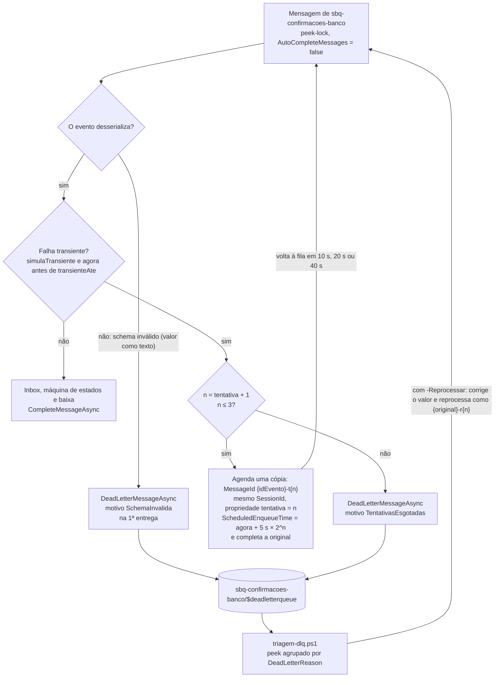
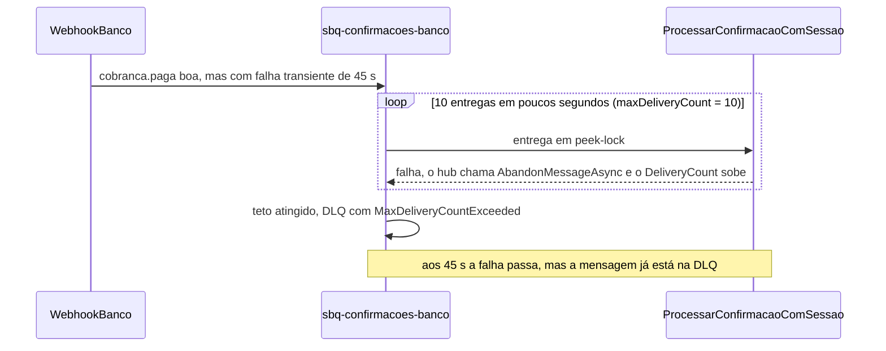

# Incidente 3: "A mensagem que ninguém conseguia processar"

> **CUSTO E FREE TRIAL**
> | Item | Valor |
> |------|-------|
> | Custo mensal (se deixar o `rg-saldaro-lab` ligado) | ~R$ 60 (Service Bus Standard ≈ US$ 10/mês ≈ R$ 55; Storage, Key Vault e Log Analytics em centavos; APIM Consumption, Functions e Event Grid dentro das franquias) |
> | Custo real deste incidente (~50 min, 60 faturas de teste) | ~R$ 1 ou menos |
> | Compatível com Azure Free Trial (US$ 200)? | **Sim**. Nada novo é criado: o conserto muda dois app settings e uma propriedade da fila |
>
> **Regra de ouro:** apague o Resource Group `rg-saldaro-lab` ao terminar. Na aula ao vivo, apagamos juntos às 3h55; em casa, rode `./scripts/limpar.ps1`. O Service Bus Standard cobra por hora (≈ R$ 0,07/h), com ou sem mensagens na fila.
> **Cotação usada:** ~R$ 5,50/US$ e preços de lista da Microsoft; confirme na [calculadora de preços](https://azure.microsoft.com/pricing/calculator/) na data da aula.

## Guia passo a passo (aula ao vivo)

**Aula:** Integração e Mensageria no Azure, hands-on ao vivo da pós-graduação TFTEC + Anhanguera
**Cenário:** 3.4, Incidente 3 do encontro de 4h (o último do trio timeout → duplicata → envenenada)
**Version-anchor:** Q4-2026
**Duração:** ~50 min ao vivo (2:45–3:35 no roteiro da aula)
**Estado inicial:** `cenario-3-pronto` (é o que `./scripts/deploy.ps1 -Cenario 4` aplica) · **Estado pronto (plano B):** `./scripts/deploy.ps1 -Cenario 4 -Pronto`
**Padrões praticados:** Dead Letter Channel e Invalid Message Channel (Enterprise Integration Patterns); Retry com backoff por mensagem agendada (Cloud Design Patterns)

> Empresa, pessoas, números e incidentes são fictícios; qualquer semelhança é coincidência. A Saldaro Pagamentos S.A. e o banco parceiro não existem, e o banco simulado do kit não reproduz a API de nenhum banco real.

---

## O incidente

**Quarta-feira, 14h.** O banco parceiro da Saldaro publica uma atualização da API de webhooks. Entre as mudanças, uma linha discreta na nota de versão: o campo `valor` "passa a seguir o formato monetário brasileiro". A partir dali, as confirmações de pagamento chegam com `"valor": "1.250,00"`, um texto, onde antes vinha o número `1250.00`.

O worker de baixa da Saldaro não consegue ler o evento, falha e devolve a mensagem para a fila. O Service Bus reentrega na hora, o worker falha de novo e, depois da décima entrega, a mensagem vai para a dead-letter queue (DLQ). No mesmo começo de tarde, o armazenamento do hub oscila por menos de um minuto: confirmações perfeitas também falham, são reentregues dez vezes em poucos segundos e caem na mesma DLQ, misturadas com as outras.

Às 16h, a conciliação aponta centenas de faturas pagas no banco e abertas no hub. A DLQ tem 3.800 mensagens, todas com o mesmo `DeadLetterReason`: `MaxDeliveryCountExceeded`. Ninguém sabe quais são pagamentos legítimos que deram azar com a oscilação e quais estão no formato novo. Alguém propõe reprocessar tudo; outra pessoa propõe purgar a fila. As duas ideias estão erradas. Nos próximos 50 minutos você vai descobrir por quê, consertar o consumidor e esvaziar a DLQ sem perder nem inventar nenhum pagamento.

> **O que muda em relação à Disciplina 04.** No Hands-on 4 da D04, um timer lia a DLQ e gravava as mensagens numa tabela. Aqui a DLQ deixa de ser depósito: cada mensagem chega lá com motivo, o erro transiente espera e tenta de novo sem passar pela DLQ, e a saída da DLQ é uma triagem por motivo seguida de reprocesso controlado.

---

## Roteiro da aula (50 min)

Convenção usada em todo o guia: **[Professor]** o professor mostra no telão antes; **[Turma]** cada aluno repete no próprio ambiente; **[Juntos]** discussão com a turma.

| Bloco | Tempo | Relógio da aula | Quem | Entrega |
|---|---|---|---|---|
| O incidente | 2 min | 2:45–2:47 | [Professor] | a história (slides 16 e 17) |
| Parte 1 — Preparação | 3 min | 2:47–2:50 | [Turma] | estado inicial conferido, ferramenta de triagem compilada e ambiente aquecido |
| Parte 2 — Sintomas | 8 min | 2:50–2:58 | [Professor] demonstra, [Turma] repete | DLQ cheia de `MaxDeliveryCountExceeded`, boas e envenenadas misturadas |
| Parte 3 — Hipóteses | 7 min | 2:58–3:05 | [Juntos] | diagnóstico: o consumidor trata todo erro do mesmo jeito |
| Parte 4 — Conserto | 12 min | 3:05–3:17 | [Professor] mostra o código, [Turma] aplica | `Cenario__DlqComMotivo` e `Cenario__RetryAgendado` ligados e `maxDeliveryCount = 3`, pelo Portal e declarados no Bicep |
| Parte 5 — Prova | 13 min | 3:17–3:30 | [Turma] | os cinco critérios de feito, com a DLQ vazia no fim |
| Parte 6 — Post-mortem | 3 min | 3:30–3:33 | [Turma] | cinco linhas, sem culpados |
| Lições e ponte para o 3.6 | 2 min | 3:33–3:35 | [Professor] | o alerta de `DeadletteredMessages` que faltou |

> **Plano B (vale o tempo todo):** travou em qualquer ponto? Rode `./scripts/deploy.ps1 -Cenario 4 -Pronto` e siga da Parte 5. Detalhes na seção [Plano B](#plano-b).

> **Portal primeiro.** Os dois consertos de configuração (os toggles do Passo 4.2 e o `maxDeliveryCount` do Passo 4.3) têm um caminho **Pelo Portal**, e é ele que o professor usa ao vivo: a aula é para ver onde cada coisa mora. O `deploy.ps1` é o plano B. O que você muda à mão fica diferente do último deploy até um deploy aplicar o arquivo que diz o mesmo (o `cenario-4-pronto`): é o drift da Leitura 3.7, e o Passo 4.3 usa isso de propósito.

---

## Pré-requisitos

- Incidente 2 concluído (`01_Aulas/Incidente2_Webhook_Guia.md`) ou o plano B dele (`./scripts/deploy.ps1 -Cenario 3 -Pronto`). O estado pronto do Incidente 2 é o estado inicial deste.
- PowerShell 7 (`pwsh`) aberto na raiz do repositório do kit, com `az login` feito na assinatura do lab (confira com `az account show`). Todos os comandos do guia rodam dali.
- `scripts/.env.local` gravado pelo `deploy.ps1` (sem segredos; o guia lê dele os nomes do seu ambiente).
- .NET 10 SDK: o `triagem-dlq.ps1` roda o console `03_Aplicações/Saldaro.Ferramentas` com `dotnet run`.
- Seu usuário com a role `Azure Service Bus Data Owner` no namespace (o `deploy.ps1` atribui; a triagem autentica com o seu `az login`).
- VS Code aberto na raiz do kit (vamos ler `03_Aplicações/Saldaro.Hub/` e `infra/`).
- Portal Azure com duas abas: a fila `sbq-confirmacoes-banco` do namespace `sb-saldaro-<sufixo>` e o **Logs** do Application Insights `appi-saldaro-<sufixo>` (Passo 3.1). Deixe o **Logs** na aba dele até o fim do incidente: no ensaio, sair do **Logs** com uma consulta não salva travou a aba do navegador.

---

## Tabela de Recursos

Nenhum recurso novo. O incidente usa o ambiente que existe desde o Lab 0; o conserto altera configuração.

| Recurso | Tipo | SKU/Tier | Papel neste incidente | Custo estimado (mensal) |
|---|---|---|---|---|
| `rg-saldaro-lab` | Resource Group | N/A | contém tudo | Gratuito |
| `sb-saldaro-<sufixo>` | Service Bus Namespace | Standard | o broker | ~R$ 55 (US$ 10 de base, 13 milhões de operações incluídas) |
| `sbq-confirmacoes-banco` | Service Bus Queue | — | sessions, detecção de duplicatas (10 min), lock de 1 min; `maxDeliveryCount` 10 → 3; **a DLQ deste incidente** | Incluída no namespace |
| `sbq-faturas-recebidas` | Service Bus Queue | — | entrada das faturas; absorve os 503 do banco simulado | Incluída no namespace |
| `sbq-notificacoes-parceiro` | Service Bus Queue | — | destino do Event Grid (`FaturaBaixada`) | Incluída no namespace |
| `func-saldaro-hub-<sufixo>` | Function App (.NET 10 isolated) | Flex Consumption (FC1) | `ProcessarConfirmacaoComSessao` e os toggles `Cenario__*` | Centavos |
| `func-saldaro-banco-<sufixo>` | Function App (.NET 10 isolated) | Flex Consumption (FC1) | banco simulado com `valorComVirgula` e `falhaTransiente` | Centavos |
| `asp-saldaro-hub-<sufixo>`, `asp-saldaro-banco-<sufixo>` | Planos dos Function Apps | FC1 (ou Y1, Consumption no Windows, com `-Plano Consumption`) | — | Incluídos acima |
| `apim-saldaro-<sufixo>` | API Management | Consumption | entrada do ERP e do webhook do banco | ~R$ 0 (1 milhão de chamadas/mês grátis) |
| `stsaldaro<sufixo>` | Storage Account | Standard LRS | tabelas `faturas`, `inbox` e `conciliacao` | ~R$ 1 |
| `kv-saldaro-<sufixo>` | Key Vault | Standard (RBAC) | vazio neste cenário | Centavos |
| `evgt-saldaro-faturas-<sufixo>` | Event Grid Topic | — | `FaturaBaixada` para a notificação | ~R$ 0 (100 mil operações/mês grátis) |
| `log-saldaro-<sufixo>` / `appi-saldaro-<sufixo>` | Log Analytics / Application Insights | Pay-as-you-go | KQL dos eventos `mensagem.deadletter` e `mensagem.retry.agendado` | ~R$ 0 (5 GB/mês grátis) |

> **Custo total estimado:** ~R$ 60/mês se o RG ficar ligado, quase tudo do Service Bus Standard. Para o incidente ao vivo, o custo real fica em torno de R$ 1.

**O que muda no conserto** (contrato do kit, seções 4 e 5.2):

| O que muda | Onde | Estado inicial | Depois do conserto | Efeito |
|---|---|---|---|---|
| `Cenario__DlqComMotivo` | app setting do `func-saldaro-hub-<sufixo>` (parâmetro Bicep `dlqComMotivo`) | `false` | `true` | schema inválido vai à DLQ na primeira entrega, com motivo `SchemaInvalida` |
| `Cenario__RetryAgendado` | app setting do `func-saldaro-hub-<sufixo>` (parâmetro Bicep `retryAgendado`) | `false` | `true` | transiente vira cópia agendada (10 s, 20 s, 40 s); passou de 3, `TentativasEsgotadas` |
| `maxDeliveryCount` | fila `sbq-confirmacoes-banco` (parâmetro Bicep `maxDeliveryCount`) | `10` | `3` | rede de segurança para o erro que o código não classificou |

---

## Diagrama da decisão do consumidor

Depois do conserto, cada mensagem de `sbq-confirmacoes-banco` passa por esta decisão antes da baixa (contrato, seção 5.3). É o fluxograma do slide 18.



Antes do conserto, o baseline não decide nada: toda falha vira abandono explícito (`AbandonMessageAsync`), e o abandono vira reentrega imediata. É por isso que mensagens boas morrem junto com as envenenadas:



---

## Parte 1 — Preparação

> **Tempo:** 3 min (2:47–2:50) · **Quem:** [Turma]

### Passo 1.1: Carregar os nomes do seu ambiente (1 min)

Cole no terminal, na raiz do kit. Se abrir outro terminal no meio do guia, rode este bloco de novo, e também o do Passo 1.4.

```powershell
$cfg  = Get-Content -Raw ./scripts/.env.local | ConvertFrom-StringData
$hub  = "func-saldaro-hub-$($cfg.SALDARO_SUFIXO)"
$fila = @('-g', $cfg.SALDARO_RG, '--namespace-name', $cfg.SALDARO_SB_NAMESPACE, '-n', 'sbq-confirmacoes-banco')

# Contagens da fila de confirmações (ativas, agendadas e DLQ), lidas pelo plano de controle
function Contar-Fila {
    $c = az servicebus queue show @fila --query countDetails | ConvertFrom-Json
    '{0:HH:mm:ss}  ativas={1}  agendadas={2}  DLQ={3}' -f (Get-Date), $c.activeMessageCount, $c.scheduledMessageCount, $c.deadLetterMessageCount
}
Contar-Fila
```

Esperado: `DLQ=0`. Se não for zero (sobra de um incidente anterior), anote o número; a triagem vai mostrar essas mensagens também.

### Passo 1.2: Conferir o estado inicial (1 min)

```powershell
# Configuração gravada no Function App
az functionapp config appsettings list -g $cfg.SALDARO_RG -n $hub `
  --query "[?starts_with(name, 'Cenario__') || starts_with(name, 'AzureWebJobs.Processar')].{nome:name, valor:value}" -o table

# O que o código está enxergando agora (Function Saude)
Invoke-RestMethod "$($cfg.SALDARO_HUB_URL)/saude" | ConvertTo-Json -Depth 5

# Propriedades da fila
az servicebus queue show @fila --query "{maxDeliveryCount:maxDeliveryCount, lockDuration:lockDuration, requiresSession:requiresSession, requiresDuplicateDetection:requiresDuplicateDetection}" -o table
```

Esperado (estado `cenario-3-pronto`):

| Item | Valor |
|---|---|
| `Cenario__AsyncRequestReply`, `Cenario__WebhookHmac`, `Cenario__Inbox` | `true` (Incidentes 1 e 2) |
| `Cenario__DlqComMotivo`, `Cenario__RetryAgendado`, `Cenario__Heartbeat` | `false` |
| `AzureWebJobs.ProcessarConfirmacaoComSessao.Disabled` / `AzureWebJobs.ProcessarConfirmacaoSemSessao.Disabled` | `false` / `true` (o consumidor ativo é o com sessão) |
| Fila `sbq-confirmacoes-banco` | `maxDeliveryCount = 10`, lock de 1 min (`PT1M`), `requiresSession` e `requiresDuplicateDetection` ligados |

Se algo estiver diferente:

| O que não bate | Pelo Portal (o caminho da aula) | Pelo script (plano B) |
|---|---|---|
| Os toggles deste incidente já estão ligados, ou o `maxDeliveryCount` já é 3 (você está num estado mais adiantado) | o Passo 4.2 ao contrário (`Cenario__DlqComMotivo` e `Cenario__RetryAgendado` = `false`) e, se preciso, o Passo 4.3 ao contrário (**Max delivery count** de volta a `10`); uns 2 minutos | `./scripts/deploy.ps1 -Cenario 4 -SemPublicar` volta ao estado inicial sem republicar o código |
| A fila ainda está sem sessão (Incidente 2 incompleto) | os Passos 5.2 a 5.5 do Incidente 2 (drenar, apagar e recriar a fila com **Enable sessions** e **Enable duplicate detection**), o 5.8 (consumidor com sessão) e, se faltarem, os toggles dos Passos 4.2 e 6.3 de lá; as mensagens da fila antiga se perdem. São uns 10 minutos: faça antes da aula ou na pausa | `./scripts/deploy.ps1 -Cenario 3 -Pronto`, que recria a fila e avisa no terminal (acrescente `-SemPublicar` se o código já estiver publicado); se isso aparecer na hora da aula, é o caminho para não ficar para trás |

### Passo 1.3: Aquecer a ferramenta de triagem (1 min seu; a ferramenta roda sozinha por ~2,5 min)

A triagem é lenta: no primeiro deploy de teste do kit, a primeira execução levou uns 2,5 min, porque compila o `Saldaro.Ferramentas`, e as seguintes, uns 2,2 min cada. Por isso ela ganha um terminal só dela. Abra um **segundo terminal** PowerShell 7 na raiz do kit (o "terminal da triagem"; o script lê o `scripts/.env.local` sozinho, sem as variáveis do Passo 1.1) e rode:

```powershell
./scripts/triagem-dlq.ps1
```

Enquanto ela roda, siga no primeiro terminal com o Passo 1.4. A primeira execução confirma que o seu usuário consegue ler a DLQ. O comando só faz **peek**: não trava, não move e não apaga nada. Esperado: `A DLQ está vazia.` no fim da saída. Rodar agora evita descobrir um problema de RBAC no meio do incidente. Nas outras vezes em que o guia pedir a triagem, rode-a no terminal da triagem e siga com o passo no primeiro.

### Passo 1.4: Aquecer o ambiente (30 s)

O APIM Consumption acorda devagar: logo depois de um `deploy.ps1`, as primeiras chamadas podem passar dos 35 s e estourar o timeout do ERP simulado. No primeiro deploy de teste do kit, a primeira rajada de 10 faturas do Passo 2.1 levou 107 s, com 6 timeouts, e nenhuma dessas chamadas chegou ao hub. Três sondas pelo APIM, numa fatura que não existe, acordam o caminho:

```powershell
# Aquecimento: três GET pelo APIM numa fatura que não existe; o esperado é 404 nas três
function Aquecer-Ambiente {
    $sonda = "$($cfg.SALDARO_APIM_URL)/faturas/00000000-0000-0000-0000-000000000000"
    foreach ($n in 1..3) {
        $relogio = [System.Diagnostics.Stopwatch]::StartNew()
        try   { $resposta = 'HTTP {0}' -f (Invoke-WebRequest $sonda -SkipHttpErrorCheck -TimeoutSec 60).StatusCode }
        catch { $resposta = 'sem resposta' }
        'sonda {0}: {1} em {2:N1} s' -f $n, $resposta, $relogio.Elapsed.TotalSeconds
    }
}
Aquecer-Ambiente
```

Esperado: `HTTP 404` nas três (o hub não acha a fatura, e é isso que se espera). A primeira pode levar alguns segundos (no teste do kit, 1,9 s logo depois de um deploy); as outras, uns 0,1 s. Se alguma passar de 5 s ou vier `sem resposta`, rode `Aquecer-Ambiente` de novo. Prefira as sondas ao `./scripts/smoke-test.ps1`: ele também aquece, mas cria uma fatura, que entraria na conta final do Passo 5.4.

---

## Parte 2 — Sintomas

> **Tempo:** 8 min (2:50–2:58) · **Quem:** [Professor] demonstra os Passos 2.1 e 2.3 no telão; [Turma] repete todos

### Passo 2.1: Reproduzir a atualização do banco e a oscilação (2 min)

Duas rajadas, uma logo depois da outra:

```powershell
$inicio = (Get-Date).ToUniversalTime().AddMinutes(-1).ToString('yyyy-MM-ddTHH:mm:ssZ'); "Início do incidente (UTC): $inicio"

# Rajada 1 (envenenadas): carteira que já recebe o formato novo do banco (valor como texto)
./scripts/erp-simulado.ps1 -Faturas 10 -Caos "valorComVirgula=true"

# Rajada 2 (boas, mas com falha transiente simulada de 45 s): carteira ainda no formato antigo, pega pela oscilação
./scripts/erp-simulado.ps1 -Faturas 20 -Caos "falhaTransiente=50"
```

Guarde o horário impresso em `$inicio`: ele delimita o incidente na consulta KQL do Passo 5.4.

O que cada botão de caos faz (contrato, seção 6):

- `valorComVirgula=true`: o banco simulado manda `valor` como texto pt-BR (`"1.250,00"`) nas **duas** confirmações de cada fatura, `cobranca.registrada` e `cobranca.paga`. As 10 faturas da rajada 1 geram 20 mensagens envenenadas.
- `falhaTransiente=50`: 50% das chamadas `POST /cobrancas` respondem 503 antes de registrar qualquer coisa (o `EmitirCobranca`, que o conserto do Incidente 1 pôs no caminho, absorve com a reentrega imediata de `sbq-faturas-recebidas`) e, num sorteio independente, 50% das confirmações `cobranca.paga` saem com `simulaTransiente = true` e `transienteAte = envio + 45 s`. Até esse horário, o hub trata a confirmação como falha transiente: é a oscilação do armazenamento da história, simulada pelo kit. Em produção esse campo não existe; o transiente de verdade é um timeout, um 503, um `ServiceBusy`.

> **Por que duas rajadas, e não uma com os dois botões?** Pela ordem da lógica de baixa (contrato, seção 5.3), o worker desserializa o evento antes de olhar a falha transiente. Com `valorComVirgula=true`, toda mensagem vira veneno logo na leitura, e nenhuma mensagem boa cairia na DLQ. Na história, o banco fez a atualização em etapas, por carteira de cobrança: uma carteira já recebe o formato novo (rajada 1), outra ainda recebe o antigo e só sofre a oscilação (rajada 2). No baseline, as duas acabam misturadas na DLQ como `MaxDeliveryCountExceeded`, e essa mistura é o ponto do incidente.

Esperado no relatório do `erp-simulado.ps1`: só respostas 202 (o request-reply assíncrono do Incidente 1), nenhum 5xx. Os 503 acontecem dentro do hub, longe do ERP. Apareceu `timeout`? O APIM ainda estava frio: o ERP reenvia sozinho e a rajada só demora mais (no teste do kit, as chamadas que estouraram nem chegaram ao hub, e cada fatura entrou uma vez só). Da próxima vez, rode o Passo 1.4 antes.

### Passo 2.2: Ver a DLQ encher (2 min)

```powershell
1..8 | ForEach-Object { Contar-Fila; Start-Sleep -Seconds 15 }
```

Esperado: em 1 a 2 minutos a DLQ chega perto de **30**: 20 da rajada 1 (as duas confirmações de cada uma das 10 faturas) e uns 10 da rajada 2 (as `cobranca.paga` sorteadas pela oscilação, metade das 20 em média). O número da rajada 2 varia de rodada para rodada, porque o sorteio é independente para cada `cobranca.paga`: no primeiro deploy de teste do kit, foram 12, e a DLQ ficou com 32. As ativas voltam a zero: a fila "esvaziou", mas as faturas das mensagens mortas continuam abertas.

Para ver o mesmo no Portal: namespace `sb-saldaro-<sufixo>` → **Monitoring** → **Metrics** → métricas **Abandoned Messages** e **Count of dead-lettered messages in a Queue/Topic.**, com filtro na dimensão `EntityName` = `sbq-confirmacoes-banco`. Os abandonos se concentram em um ou dois minutos: são as reentregas imediatas (no teste do kit, 204 abandonos em menos de 2 minutos).

### Passo 2.3: Olhar dentro da DLQ (3 min)

1. No Portal, abra a fila `sbq-confirmacoes-banco` e selecione **Service Bus Explorer** no menu lateral.
2. Escolha **Peek Mode**, selecione a aba **Dead-letter** (a contagem aparece ao lado, como **Dead-letter (32)**) e clique em **Peek from start** (o Explorer mostra até 100 mensagens por peek).
3. A lista já traz as colunas **Delivery Count**, **Session ID**, **Dead Letter Reason** e **Dead Letter Error Description**. Abra três ou quatro mensagens; veja o corpo e a aba **Message Properties**.

O que observar:

- **Dead Letter Reason** = `MaxDeliveryCountExceeded` e **Delivery Count** = 10 em todas. A **Dead Letter Error Description** é genérica (no primeiro deploy de teste do kit, `Message could not be consumed after 10 delivery attempts.`): a plataforma só sabe que as tentativas acabaram, não por quê.
- O corpo de uma mensagem da rajada 1 tem `valor` como texto. O de uma `cobranca.paga` da rajada 2 tem `valor` numérico e `simulaTransiente = true`: é um pagamento perfeito que morreu porque as 10 entregas acabaram antes da oscilação.
- A mensagem está inteira: corpo, a propriedade `tipo`, o `SessionId` (que é o `faturaId`) e o `MessageId` (que é o `idEvento`).

Corpos de exemplo (ilustrativos; os seus têm outros ids e valores):

```json
{ "idEvento": "3f2b8c1e-9d4a-4c7e-8a1b-2f6d5e4c3b2a", "tipo": "cobranca.paga",
  "faturaId": "9a7e1c52-0b3d-4f8e-a6c1-7d2e4b9f0a13", "idCobranca": "COB-1a2b3c4d",
  "valor": "1.250,00", "ocorridoEm": "2026-11-11T17:03:05Z",
  "simulaTransiente": false, "transienteAte": null }
```

```json
{ "idEvento": "...", "tipo": "cobranca.paga", "faturaId": "...", "idCobranca": "COB-...",
  "valor": 1250.00, "ocorridoEm": "2026-11-11T17:03:07Z",
  "simulaTransiente": true, "transienteAte": "2026-11-11T17:03:52Z" }
```

> **E as sessions?** O Microsoft Learn avisa que o Service Bus Explorer do Portal não trabalha com sessions, e a `sbq-confirmacoes-banco` exige sessão. A DLQ, porém, é lida sem sessão, e no primeiro deploy de teste do kit o peek da DLQ funcionou normalmente, com o **Session ID** de cada mensagem na lista. Se no seu Portal o Explorer recusar a operação, faça o mesmo peek com `./scripts/triagem-dlq.ps1` (Passo 3.3), que só lê.

**Pergunta para a turma:** quantas destas mensagens são pagamentos que vocês conseguiriam baixar agora mesmo, se soubessem quais são?

### Passo 2.4: Ver o sintoma no negócio (1 min)

Copie o `faturaId` de uma mensagem da rajada 1 (do corpo no Explorer ou de um exemplo da triagem) e consulte a fatura pelo APIM:

```powershell
$faturaId = '<cole aqui um faturaId da rajada 1>'
Invoke-RestMethod "$($cfg.SALDARO_APIM_URL)/faturas/$faturaId" | Format-List
```

Esperado: `status = cobranca-emitida` (na rajada 1, nem o `cobranca.registrada` passou) ou `registrada` (numa fatura da rajada 2, quando só o `cobranca.paga` caiu). Nunca `baixada`. O banco diz que o pagador pagou; o hub diz que a fatura está aberta.

> Se você esperar 10 minutos, a `Conciliacao` (timer a cada 5 min) começa a contar como divergência, na tabela `conciliacao`, as faturas que ficaram em `cobranca-emitida` (as da rajada 1). Na história, foi assim que a Saldaro descobriu o incidente: pela conciliação, não por um alerta.

> **Simplificação de laboratório:** esse `GET` pelo APIM e o `/saude` do Passo 1.2, direto no hub, respondem a quem souber a URL, sem chave nem subscription. Em produção, o APIM autenticaria quem chama (subscription por empresa cliente ou OAuth 2.0) e o hub só aceitaria tráfego vindo do APIM (ADR-0007, em `docs/adr/`).

---

## Parte 3 — Hipóteses

> **Tempo:** 7 min (2:58–3:05) · **Quem:** [Juntos]: o professor roda as consultas no telão, a turma acompanha no próprio Logs

Antes de mudar qualquer coisa, prove o diagnóstico. Quatro hipóteses, quatro testes:

| # | Hipótese | Como testar | Resultado esperado |
|---|---|---|---|
| H1 | O consumidor quebra com o formato novo do `valor` | KQL de exceções (Passo 3.1) e corpo das mensagens (Passo 2.3) | confirmada |
| H2 | Tudo o que está na DLQ é envenenado | corpos da rajada 2 (Passo 2.3) e ritmo das reentregas (Passo 3.2) | refutada: há pagamentos bons na DLQ |
| H3 | O motivo gravado na DLQ ajuda a separar | triagem só leitura (Passo 3.3) | refutada: um motivo só para tudo |
| H4 | Basta reprocessar tudo (ou purgar tudo) | discussão (Passo 3.4) | refutada |

### Passo 3.1: As exceções do consumidor (2 min)

Na aba do **Logs**: `appi-saldaro-<sufixo>` → **Monitoring** → **Logs**. No primeiro acesso, feche a janela **Welcome to Log Analytics**. Se a página abrir num chat (**Observability Agent**), desligue o toggle **Agent**, no canto superior direito, e clique em **Discard** no aviso **Discard changes**. Se a barra mostrar **Simple mode**, troque para **KQL mode** no seletor à direita. Cole a consulta e clique em **Run**:

```kusto
// Exceções do consumidor de confirmações nos últimos 15 min, por Function e por tipo.
// Em exceptions, operation_Name vem vazio: o nome da Function fica em customDimensions.
exceptions
| where timestamp > ago(15m)
| extend funcao = tostring(customDimensions.AzureFunctions_FunctionName)
| where funcao startswith "ProcessarConfirmacao"
| summarize ocorrencias = count(), exemplo = take_any(outerMessage) by funcao, type
| order by ocorrencias desc
```

Esperado em `ProcessarConfirmacaoComSessao`, duas famílias, com os tipos de exceção que o próprio hub lança na coluna `type`:

- `ConfirmacaoInvalidaException`: o erro de desserialização do JSON (a mensagem começa por "Corpo fora do schema do evento do banco:" e aponta `Path: $.valor`);
- `FalhaTransienteSimuladaException`: a falha transiente simulada (a mensagem começa por "Falha transiente simulada até").

As linhas vêm do worker do hub (`cloud_RoleName` = `func-saldaro-hub-<sufixo>`), o único que grava o nome da Function em `customDimensions`. Com o worker isolated, `operation_Name` vem vazio em `exceptions`, e um filtro por ele devolve zero linhas. O host do Functions registra a mesma falha de novo, em número maior, em linhas sem `cloud_RoleName` e sem o nome da Function. Por isso a consulta as deixa de fora e conta cada falha uma vez só. No primeiro deploy real do kit, as linhas do worker deram 134 `ConfirmacaoInvalidaException` e 68 `FalhaTransienteSimuladaException`, e as do host, 600 e 360. Nenhuma das contagens bate com mensagens × entregas: a consulta mostra que erros aconteceram e com que texto, e quem conta as entregas é o **Delivery Count** da DLQ. Troque o filtro por `| where isnotempty(funcao)` e aparecem também as `BancoIndisponivelException` (os 503 do banco) no `EmitirCobranca`. Elas não são o assunto aqui: a reentrega de `sbq-faturas-recebidas` já as absorveu. A versão comentada do kit para buscar transientes fica em `kql/erros-transientes-por-operacao.kql`: ela procura "transiente" (e 503, timeout...) no tipo ou na mensagem e deixa de fora, de propósito, o erro de schema, que é permanente.

Se a consulta vier vazia, espere 2 a 3 minutos: é a latência de ingestão do Application Insights. A mesma evidência está no corpo das mensagens (Passo 2.3).

### Passo 3.2: O ritmo das reentregas (2 min)

```kusto
// Execuções do consumidor em janelas de 10 s (cada entrega é uma execução)
requests
| where timestamp > ago(15m) and name startswith "ProcessarConfirmacao"
| summarize execucoes = count(), falhas = countif(success == false) by bin(timestamp, 10s)
| render timechart
```

Esperado: um pico de algumas centenas de execuções com falha, concentrado em menos de 2 minutos (no primeiro deploy de teste do kit, os 204 abandonos couberam em 1 min 51 s). Cada mensagem gastou as 10 entregas em poucos segundos; a oscilação durava 45 s. Quando ela passou, as mensagens boas já estavam na DLQ.

> **Por que a reentrega é imediata: abandon × expiração do lock.** Em peek-lock, uma mensagem que falhou volta para a fila de dois jeitos, e os dois contam uma entrega (`DeliveryCount` + 1): pelo `AbandonMessageAsync`, que devolve a mensagem **na hora**, ou pela expiração do lock, que só a devolve **depois** do lock (1 min nesta fila). No baseline, quando a baixa falha, o hub chama `AbandonMessageAsync` explicitamente; por isso as 10 entregas acontecem em poucos segundos, antes dos 45 s da falha transiente. Sem esse abandon, com `AutoCompleteMessages = false` ninguém definiria o destino da mensagem, e ela só voltaria quando o lock de 1 min vencesse. A mensagem boa até sobreviveria, por sorte (a segunda entrega já cairia depois dos 45 s), mas cada envenenada levaria uns 10 minutos para chegar à DLQ, segurando a sessão da fatura o tempo todo. Esperar o lock vencer não é estratégia de retry.
>
> O Service Bus não tem atraso configurável para reentrega, e o Functions não oferece retry policy para o trigger de Service Bus (só para Timer, Event Hubs, Kafka e Cosmos DB). Reentrega "com espera" só existe se o código agendar, que é o conserto da Parte 4.
>
> **Por que a fila não travou inteira.** Cada fatura é uma sessão (`SessionId = faturaId`, Incidente 2): uma envenenada segura só a sessão dela, e o hub processa até 8 sessões em paralelo (`maxConcurrentSessions = 8` no `host.json`).

### Passo 3.3: A triagem só leitura (2 min)

No terminal da triagem (Passo 1.3). Ela leva uns 2,2 min: dispare no começo da Parte 3 e leia a saída quando chegar aqui.

```powershell
./scripts/triagem-dlq.ps1
```

Por baixo, o atalho roda `dotnet run --project 03_Aplicações/Saldaro.Ferramentas -- triagem --namespace <SALDARO_SB_FQDN> --fila sbq-confirmacoes-banco`: faz peek na DLQ (`SubQueue.DeadLetter`), agrupa por `DeadLetterReason` e mostra exemplos. A DLQ de uma fila com sessão é lida sem sessão; as mensagens mantêm o `SessionId` original.

Saída de exemplo, com as contagens do primeiro deploy de teste do kit (os ids, as horas e a contagem da rajada 2 variam; o formato é o do `Saldaro.Ferramentas`, encurtado aqui nos exemplos):

```text
Triagem da DLQ de sbq-confirmacoes-banco em sb-saldaro-<sufixo>.servicebus.windows.net
Modo somente leitura (peek): nada é alterado. Para agir, use --reprocessar e/ou --descartar-motivo.

Mensagens lidas da DLQ: 32 (o namespace informa 32 na DLQ).

Motivo (DeadLetterReason)  Qtde  Corrigíveis  Sem correção  Não corrigíveis  Mais antiga     Mais recente
-------------------------  ----  -----------  ------------  ---------------  --------------  --------------
MaxDeliveryCountExceeded     32           20            12                0  11/11 14:03:06  11/11 14:03:41

  Corrigíveis: valor em texto pt-BR ("1.250,00"); o --reprocessar converte para número.
  Sem correção: valor já numérico ou ausente; o --reprocessar reprocessa como está.
  Não corrigíveis: o --reprocessar deixa na DLQ para análise.

Exemplos (até 3 por motivo):
  MaxDeliveryCountExceeded
    - 3f2b8c1e-9d4a-4c7e-8a1b-2f6d5e4c3b2a | sessão 9a7e1c52-0b3d-4f8e-a6c1-7d2e4b9f0a13 | tipo cobranca.registrada | valor "1.250,00" | entregas 10
      Message could not be consumed after 10 delivery attempts.
    - ...

Próximos passos:
  --reprocessar                corrige e reprocessa as corrigíveis e as sem correção (MessageId {original}-r{n})
  --descartar-motivo <motivo>  descarta as do motivo informado; combinado com --reprocessar, reprocessa as demais
```

Um grupo só. As colunas mostram que há dois tipos de mensagem lá dentro, 20 com `valor` em texto pt-BR (**Corrigíveis**) e umas 10 com `valor` numérico (**Sem correção**; 12 no teste do kit), mas isso é só o formato do campo, que a ferramenta lê no corpo: o motivo é o mesmo para todas e não diz por que cada uma falhou. Quem sabe por que a mensagem falhou é o consumidor, e ele não disse. A consulta abaixo, que conta os eventos `mensagem.deadletter` por motivo, também volta vazia agora: esse evento só existe quando o próprio código faz o dead-letter. Hoje quem moveu as mensagens foi a plataforma, e a telemetria da aplicação nem sabe que a DLQ existe.

```kusto
customEvents
| where timestamp > ago(15m) and name == "mensagem.deadletter"
| summarize mensagens = count() by motivo = tostring(customDimensions.motivo)
```

### Passo 3.4: Reprocessar tudo ou purgar tudo? (1 min de discussão)

**Pergunta para a turma:** se a diretoria pedir uma decisão agora, vocês reprocessam as ~30 mensagens ou purgam todas?

Nenhuma das duas. Três fatos sobre a DLQ e três tentações:

> **O que a DLQ é, e o que ela não faz**
>
> - **Não expira e não se limpa sozinha.** O time-to-live não vale dentro da DLQ, e não há limpeza automática: a mensagem fica lá até alguém recebê-la e completá-la.
> - **Ocupa o tamanho da fila.** A DLQ é uma subfila da mesma entidade e consome o mesmo tamanho máximo (Max queue size). DLQ esquecida é causa comum de `QuotaExceeded`: um dia os envios para a fila passam a ser rejeitados.
> - **Guarda a mensagem inteira**, mais `DeadLetterReason` e `DeadLetterErrorDescription`. Os motivos da plataforma são `MaxDeliveryCountExceeded`, `TTLExpiredException` (a `sbq-confirmacoes-banco` tem dead-letter na expiração ligado), `HeaderSizeExceeded`, `Session ID is null` e `MaxTransferHopCountExceeded`. Os motivos próprios do hub são `SchemaInvalida` e `TentativasEsgotadas` (contrato, seção 7.4).

> **Três tentações e por que resistir**
>
> 1. **Reprocessar tudo como está.** A envenenada falha de novo e volta para a DLQ depois de mais 10 entregas, gastando execuções e abandonos à toa. E a `sbq-confirmacoes-banco` tem detecção de duplicatas com janela de 10 min: uma cópia com o mesmo `MessageId` (o `idEvento`) dentro da janela é aceita pelo broker e descartada em silêncio. Se, achando que reprocessou, você completa a mensagem na DLQ, o pagamento some de vez.
> 2. **Reprocessar tudo com uma correção genérica.** A correção de `"1.250,00"` para `1250.00` serve para um formato. Aplicada às cegas em mensagens de outro formato (de outro parceiro, por exemplo), ela inventa um valor e baixa a fatura errada. A correção é por grupo, depois da triagem.
> 3. **Purgar tudo.** O **Purge messages** do Explorer apaga. As ~30 mensagens são eventos reais do banco: as 20 corrigíveis da rajada 1 (registros e pagamentos) e uns 10 pagamentos bons da rajada 2. O banco não vai repetir essas confirmações, a conciliação diverge para sempre e o pagador acaba cobrado de novo.
>
> E o **Re-send selected messages** do Explorer? Ele envia uma cópia (a original continua na DLQ) e permite editar o conteúdo antes. Serve para um caso isolado numa fila sem sessão; aqui, com sessions, detecção de duplicatas e dezenas de mensagens, o caminho controlado é a ferramenta de triagem.

**Diagnóstico** (anote para o post-mortem): o consumidor trata todo erro do mesmo jeito, com abandono, reentrega imediata e DLQ depois de 10 entregas. Erro permanente (schema) não melhora com repetição e deveria sair da fila na primeira entrega, com motivo. Erro transiente melhora com tempo, mas a reentrega imediata não dá tempo. E a DLQ não guarda o porquê, então não dá para triar.

---

## Parte 4 — Conserto

> **Tempo:** 12 min (3:05–3:17) · **Quem:** [Professor] mostra o código (Passo 4.1); [Turma] aplica os Passos 4.2 a 4.4

### Passo 4.1: Ler o conserto no código (4 min, [Professor])

O código do conserto já está no kit; o toggle decide qual caminho roda. Abra `03_Aplicações/Saldaro.Hub/` no VS Code. A lógica de baixa que as Functions `ProcessarConfirmacaoComSessao` e `ProcessarConfirmacaoSemSessao` compartilham fica em `Aplicacao/ProcessadorDeBaixa.cs`: procure `TOGGLE Cenario:DlqComMotivo`, `TOGGLE Cenario:RetryAgendado` e os comentários `// CONCEITO:` de dead-letter e de retry agendado. A classificação (schema inválido, transiente, tentativas esgotadas) está em `Dominio/ClassificadorDeConfirmacao.cs`, o cálculo do atraso em `Dominio/PoliticaDeRetry.cs` e o abandon explícito do baseline em `Aplicacao/AbandonExplicito.cs`, que envolve toda a lógica: qualquer exceção sem destino definido vira `AbandonMessageAsync` e é relançada.

> **Conceito: peek-lock e settlement explícito.** O trigger recebe a mensagem em peek-lock: ela fica travada (lock de 1 min nesta fila) e invisível para os outros consumidores até alguém decidir o destino dela. Essa decisão é o settlement: `CompleteMessageAsync` (sai da fila), `AbandonMessageAsync` (volta na hora, com `DeliveryCount` + 1), `DeadLetterMessageAsync` (vai para a DLQ com motivo e descrição) ou `DeferMessageAsync`. Se ninguém decide antes de o lock vencer, a mensagem volta sozinha, também com `DeliveryCount` + 1.
>
> Por padrão, o Functions completa quando a função termina bem e abandona quando ela lança exceção. Com `AutoCompleteMessages = false` no trigger (o `host.json` do hub também desliga o `autoCompleteMessages`) e o parâmetro `ServiceBusMessageActions` na função, quem decide é o código, e é isso que permite dizer "esta vai para a DLQ agora, com este motivo". No trigger com sessão, a função também recebe `ServiceBusSessionMessageActions` (lock e estado da sessão); o settlement da mensagem continua em `ServiceBusMessageActions`, que pede `Microsoft.Azure.Functions.Worker.Extensions.ServiceBus` 5.14.1 ou superior.
>
> A contrapartida: com o auto-complete desligado, o código tem de definir o destino de toda mensagem. Se não definir, a mensagem fica travada até o lock vencer (1 min) e só então volta; no limite, chega à DLQ com `MaxDeliveryCountExceeded` sem nenhuma exceção no log. Abandon e expiração do lock devolvem a mensagem e contam uma entrega; a diferença é quando: o `AbandonMessageAsync` devolve na hora, a expiração só depois do lock. Por isso o baseline do hub chama `AbandonMessageAsync` explicitamente quando a baixa falha, e as 10 entregas cabem em segundos.

Trecho ilustrativo da decisão (não copie para o projeto: o código real está em `03_Aplicações/Saldaro.Hub/`; os nomes de métodos e variáveis abaixo são ilustrativos, e os nomes que importam são os do contrato):

```csharp
// TRECHO ILUSTRATIVO: resume a seção 5.3 do contrato do kit.
[Function("ProcessarConfirmacaoComSessao")]
public async Task Processar(
    [ServiceBusTrigger("sbq-confirmacoes-banco", Connection = "ServiceBusConnection",
        IsSessionsEnabled = true, AutoCompleteMessages = false)]
    ServiceBusReceivedMessage mensagem,
    ServiceBusMessageActions acoes)
{
    // 1. Schema: erro permanente não melhora com repetição.
    if (!TentarLerEvento(mensagem.Body, out var evento, out string erro))
    {
        if (!_cenario.DlqComMotivo)
        {
            await acoes.AbandonMessageAsync(mensagem);    // baseline: volta na hora, DeliveryCount + 1, até o maxDeliveryCount
            throw new ConfirmacaoInvalidaException(erro); // e a execução registra a falha (o tipo que o Passo 3.1 achou)
        }

        await acoes.DeadLetterMessageAsync(mensagem,
            deadLetterReason: "SchemaInvalida",
            deadLetterErrorDescription: Cortar(erro, 1024));
        // + evento mensagem.deadletter (faturaId, idEvento, motivo)
        return;
    }

    // 2. Transiente: melhora com tempo, então espera antes de tentar de novo.
    if (evento.SimulaTransiente && DateTimeOffset.UtcNow < evento.TransienteAte)
    {
        if (!_cenario.RetryAgendado)
        {
            await acoes.AbandonMessageAsync(mensagem); // baseline: 10 entregas em segundos, antes dos 45 s
            throw new FalhaTransienteSimuladaException($"Falha transiente simulada até {evento.TransienteAte:O}");
        }

        int n = LerTentativa(mensagem) + 1;          // propriedade "tentativa"; a original não tem (0)
        if (n > 3)
        {
            await acoes.DeadLetterMessageAsync(mensagem,
                deadLetterReason: "TentativasEsgotadas",
                deadLetterErrorDescription: "falha transiente depois de 3 tentativas agendadas");
            // + evento mensagem.deadletter
            return;
        }

        var copia = new ServiceBusMessage(mensagem.Body)
        {
            MessageId = $"{evento.IdEvento}-t{n}",     // id novo: a detecção de duplicatas descartaria o idEvento
            SessionId = mensagem.SessionId,            // a fila exige sessão
            ContentType = "application/json",
            ScheduledEnqueueTime = DateTimeOffset.UtcNow.AddSeconds(5 * Math.Pow(2, n)) // 10 s, 20 s, 40 s
        };
        copia.ApplicationProperties["tentativa"] = n;
        await _remetente.SendMessageAsync(copia);      // + evento mensagem.retry.agendado (tentativa, atrasoSegundos)
        await acoes.CompleteMessageAsync(mensagem);    // a original sai da fila
        return;
    }

    // 3 a 6. Inbox, máquina de estados e efeitos (Incidente 2) e, no fim:
    await acoes.CompleteMessageAsync(mensagem);
}
```

Os detalhes que o professor destaca:

| Decisão | Por quê |
|---|---|
| `SchemaInvalida` na **primeira** entrega | é o Invalid Message Channel: repetir não conserta schema; sair já, com motivo, libera a sessão da fatura e conta exatamente o que houve |
| `DeadLetterErrorDescription` cortada em 1.024 caracteres | motivo e descrição viajam no cabeçalho da mensagem, que tem teto de 64 KB no total (e a mensagem inteira, 256 KB no Standard) |
| cópia agendada em vez de `await Task.Delay(...)` | esperar dentro da função seguraria o lock e a sessão da fatura, ocuparia uma das 8 sessões simultâneas e gastaria execução parada |
| `ScheduledEnqueueTime = agora + 5 s × 2^n` | backoff exponencial: 10 s, 20 s e 40 s, somando 70 s de fôlego, mais que os 45 s da oscilação. A mensagem agendada só aparece na fila a partir do horário marcado (o horário é o mínimo, não uma promessa exata) |
| teto de 3 tentativas, depois `TentativasEsgotadas` | sem teto, uma dependência fora por horas geraria cópias para sempre; com teto, o caso vai para a DLQ com um motivo que diz o que fazer |
| propriedade `tentativa` em vez de `DeliveryCount` | o `DeliveryCount` é da cópia física e recomeça em cada cópia; a `tentativa` carrega a contagem lógica de uma cópia para a outra |
| `MessageId = {idEvento}-t{n}` | a detecção de duplicatas vale também para mensagens agendadas: uma cópia com o mesmo `idEvento` seria descartada em silêncio. E, se a original voltar porque o complete falhou, a nova cópia sai com o mesmo `-t{n}` e é a duplicata que a detecção de duplicatas descarta: o retry não se multiplica |
| mesmo `SessionId` | a `sbq-confirmacoes-banco` exige sessão; envio sem `SessionId` é rejeitado |

**Pergunta para a turma:** a cópia agendada sai da vez dentro da sessão. Se outra confirmação da mesma fatura chegar nesses 10 segundos, ela passa na frente. Por que isso não quebra a baixa aqui? (Resposta: a máquina de estados do Incidente 2 é tolerante à desordem.)

Comparação dos três destinos possíveis de uma falha:

| | Reentrega imediata (baseline) | Dead-letter imediato | Retry agendado |
|---|---|---|---|
| Para que tipo de erro | nenhum, como estratégia única | permanente (schema, regra de negócio) | transiente (dependência fora) |
| O que acontece | `AbandonMessageAsync`, a mensagem volta na hora; 10 entregas em segundos | sai da fila na 1ª entrega, com motivo e descrição | cópia agendada para 10, 20 ou 40 s; a original é completada |
| Custo | 10 execuções com falha por mensagem e a sessão da fatura presa | 1 execução | 1 execução por tentativa, mais uma mensagem agendada |
| Risco | mata mensagem boa e esconde o motivo | exige alguém olhando a DLQ (alerta, desafio 3.6) | a cópia sai da ordem da sessão; exige teto |

### Passo 4.2: Ligar os toggles no Portal (3 min, [Turma]; no ensaio, os cliques levaram ~1 min)

**Pelo Portal (o caminho da aula):**

1. No Portal, abra o Function App `func-saldaro-hub-<sufixo>`.
2. No menu lateral, expanda **Settings** e selecione **Environment variables**; fique na aba **App settings**.
3. Clique em `Cenario__DlqComMotivo`. No painel, o **Value** vem mascarado (o ícone de olho mostra o valor): apague o conteúdo, digite `true` e clique em **Apply**.
4. Faça o mesmo com `Cenario__RetryAgendado`.
5. Clique em **Apply** no rodapé da página e, no aviso **Save changes**, em **Confirm**. Trocar app settings reinicia o app: o valor novo costuma valer de 5 a 35 s depois do **Confirm** (no ensaio pelo Portal, 7 s).

> **Telão:** para conferir um valor nesta página, use o **Show value** da linha do setting. O **Show values** da barra revela também `BancoApiKey`, `WebhookSecret`, `AzureWebJobsStorage` e `APPLICATIONINSIGHTS_CONNECTION_STRING`.

Alternativa pelo terminal (a mesma mudança, sem Bicep):

```powershell
az functionapp config appsettings set -g $cfg.SALDARO_RG -n $hub --settings Cenario__DlqComMotivo=true Cenario__RetryAgendado=true -o none
```

Quem for pelo script (plano B) pode pular este passo: o `deploy.ps1` do Passo 4.3 aplica o `cenario-4-pronto` inteiro e liga os dois toggles junto com o `maxDeliveryCount`.

Depois de uns 30 s, confira o que o código enxerga (se ainda vier `false`, espere um pouco e repita):

```powershell
Invoke-RestMethod "$($cfg.SALDARO_HUB_URL)/saude" | ConvertTo-Json -Depth 5
```

Esperado: `"DlqComMotivo": true` e `"RetryAgendado": true` dentro de `toggles`.

### Passo 4.3: Baixar o `maxDeliveryCount` e conferir o Bicep (4 min, [Turma]; o professor explica enquanto a turma muda)

A política da fila é infraestrutura, e ela mora em dois lugares que precisam concordar: a fila no Azure e o Bicep. Ao vivo, você muda pelo Portal, para ver onde a propriedade fica e que ela muda numa fila existente, sem recriar nada (ao contrário das sessions do Incidente 2); depois, confere que o arquivo do estado pronto declara o mesmo valor. Mudar o `maxDeliveryCount` "na mão" é exatamente o drift da leitura 3.7, e aqui ele é de propósito: o Bicep fecha a conta logo em seguida.

**Pelo Portal (o caminho da aula):**

1. Abra o namespace `sb-saldaro-<sufixo>` → **Entities** > **Queues** → `sbq-confirmacoes-banco` → **Overview**.
2. Na seção **Settings**, logo abaixo de **Essentials**, clique em **(change)** sob **Max delivery count** (hoje `10`).
3. No painel **Max delivery count**, troque o valor para `3` (na caixa ao lado da barra) e clique em **OK**.

**Confira:** clique em **Refresh**, na barra da fila (a **Overview** não se atualiza sozinha: o **Auto refresh** vem **Off**). Na seção **Settings**, **Max delivery count** mostra `3` e **Message lock duration** continua em 1 minuto; o **Updated** traz o horário da mudança. Nada foi recriado: é a mesma fila, com a mesma DLQ do incidente (o Passo 4.4 conta).

**O Bicep que declara o mesmo:**

4. Compare os dois arquivos de parâmetros. No VS Code: selecione `infra/parameters/cenario-3-pronto.bicepparam`, Ctrl+clique em `infra/parameters/cenario-4-pronto.bicepparam`, botão direito, **Compare Selected**. Ou no terminal:

   ```powershell
   git diff --no-index infra/parameters/cenario-3-pronto.bicepparam infra/parameters/cenario-4-pronto.bicepparam
   ```

   Cada arquivo de parâmetros é autocontido, com uma linha por toggle. Fora o comentário do topo, a diferença são três valores:

   ```bicep
   // infra/parameters/cenario-4-pronto.bicepparam: as mesmas linhas do cenario-3-pronto, com estes três valores trocados
   param dlqComMotivo = true               // 3.4: DLQ com motivo
   param retryAgendado = true              // 3.4: retry agendado
   param maxDeliveryCount = 3              // 3.4: baseline 10, consertado 3
   ```

5. Encontre em `infra/modules/service-bus.bicep` onde o parâmetro chega à fila. As três filas são declaradas numa lista (`var filas`) e criadas por um laço `for` (versão de API `2024-01-01`); é a mesma lista que o `check-drift.ps1` compara com as filas reais (leitura 3.7). A entrada da fila de confirmações, com os comentários resumidos:

   ```bicep
   // infra/modules/service-bus.bicep, trecho da var filas
   {
     name: 'sbq-confirmacoes-banco'
     properties: {
       lockDuration: 'PT1M'                          // maior que o tempo normal de processamento
       maxDeliveryCount: maxDeliveryCount            // mutável: muda na fila existente (Portal ou redeploy), sem recriar
       requiresSession: filaComSessions              // imutável (Incidente 2)
       requiresDuplicateDetection: filaDupDetection  // imutável
       duplicateDetectionHistoryTimeWindow: 'PT10M'  // janela de 10 min da detecção de duplicatas
       deadLetteringOnMessageExpiration: true
     }
   }
   ```

> **Isto é drift, e é de propósito.** Agora o Azure diz 3 e o `cenario-4-pronto.bicepparam` diz 3, mas o último deployment do seu ambiente ainda declara 10 (e os dois toggles do Passo 4.2 desligados). Se quiser ver (opcional), rode `./scripts/check-drift.ps1`, que compara o Azure com o último deployment: a `sbq-confirmacoes-banco` aparece como **divergente** no `maxDeliveryCount` (e também em `requiresSession` e `requiresDuplicateDetection`, se você recriou a fila pelo Portal no Incidente 2 e nenhum deploy veio depois). E um `./scripts/deploy.ps1 -Cenario 4` (o estado inicial) devolveria o 10 e desligaria os toggles, sem perguntar. Quem fecha a conta é um deploy do `cenario-4-pronto`: o plano B logo abaixo ou, em casa, o `./scripts/deploy.ps1 -Cenario 5` com que a Leitura 3.5 começa. Aplicado depois dos cliques, ele não muda nenhum valor do conserto: só confirma o que você fez à mão (e, como todo deploy, reinicia o hub e reaplica o APIM).

**Pelo script (plano B):** com a fila parada (nenhuma rajada em andamento), aplique o estado pronto sem republicar o código:

```powershell
./scripts/deploy.ps1 -Cenario 4 -Pronto -SemPublicar
```

Antes do what-if, o script confere as propriedades imutáveis da fila e responde `sessions e duplicate detection já estão como o estado pedido`: nada é recriado, porque sessions e detecção de duplicatas não mudam entre `cenario-3-pronto` e `cenario-4-pronto`. O script mostra o what-if no formato `ResourceIdOnly`, só com os recursos e sem valores (os app settings do baseline têm segredos): a `sbq-confirmacoes-banco` aparece como **Deploy** (`!`), como todo recurso que já existe, porque nesse formato o what-if não diz o que muda em cada um. Por isso o 10 → 3 não aparece ali: você confere o valor no Passo 4.4. O que importa no what-if é a fila não aparecer como criação (`+`): ela não é recriada. O `-SemPublicar` pula o `dotnet publish`, porque o código é o mesmo. Sem `-Sufixo`, o script reaproveita o sufixo, a região, o plano e os segredos do ambiente que já existe no `rg-saldaro-lab`. O deploy leva uns 3 a 4 minutos (no primeiro deploy de teste do kit, 3,6 min); pelo Portal, os três cliques levam menos de um.

Enquanto a turma muda no Portal, ou enquanto o deploy roda ([Professor]):

> **Por que 3, e não 10 nem 1?** Com a classificação no código, quase nada deveria chegar ao teto: o schema inválido sai na primeira entrega e o transiente sai por agendamento. O `maxDeliveryCount` vira rede de segurança para o erro que ninguém previu (um bug, uma exceção não classificada). Com 10, esse erro desconhecido roda 10 vezes e segura a sessão da fatura; com 3, ele é isolado rápido e aparece na DLQ. Com 1, qualquer soluço (uma instância reciclada no meio do processamento, que deixa o lock vencer) já mandaria mensagem boa para a DLQ. O padrão do Service Bus é 10; na D04, o Hands-on 4 usou 3 para ver a DLQ rápido e citou 5 a 10 como comum em produção. Com retry e classificação no código, valores baixos fazem sentido.
>
> **Lock coerente com o processamento.** O lock de 1 min (padrão do Service Bus; máximo de 5 min) precisa ser maior que o tempo normal de processamento, e a baixa leva frações de segundo (tabela e Event Grid). Lock curto demais faz a mensagem voltar enquanto ainda está sendo processada, e com `maxDeliveryCount = 3` isso mataria mensagem boa em três voltas. Lock longo demais atrasa a reentrega quando a instância morre. O runtime do Functions ainda renova o lock enquanto a função roda (até 5 min, por padrão).
>
> **Por que conferir o Bicep, se o Portal já mudou tudo?** Porque o próximo deploy do estado inicial desfaria o que você mudou à mão. O `cenario-4-pronto` declara `dlqComMotivo`, `retryAgendado` e `maxDeliveryCount`: o conserto está versionado, e o próximo deploy desse arquivo confirma o conserto em vez de desfazê-lo.

### Passo 4.4: Conferir o conserto (1 min, [Turma])

```powershell
az servicebus queue show @fila --query "{maxDeliveryCount:maxDeliveryCount, lockDuration:lockDuration}" -o table
Contar-Fila
```

Esperado: `maxDeliveryCount = 3` e lock `PT1M`. No Portal, procure o **Max delivery count** na página **Overview** da fila `sbq-confirmacoes-banco`, na seção **Settings**, abaixo de **Essentials** (a página **Settings** → **Properties**, no menu, hoje só lista metadados do ARM). A DLQ continua com as ~30 mensagens do incidente (32 no teste do kit): nem o **(change)** do Portal nem o deploy recriaram a fila, e elas esperam a triagem da Parte 5.

---

## Parte 5 — Prova

> **Tempo:** 13 min (3:17–3:30) · **Quem:** [Turma]; o professor explica a linha do tempo do retry enquanto o Passo 5.2 roda

Cinco critérios de feito, um por passo. A prova repete as mesmas duas rajadas da Parte 2, agora com o conserto ligado: mesma entrada, outro desfecho. Marque o checklist no fim.

### Passo 5.1: A envenenada morre na primeira entrega, com motivo (2 min)

```powershell
Aquecer-Ambiente   # se o Passo 4.3 foi pelo script, o deploy reaplicou o APIM; 404 nas três sondas
Contar-Fila        # anote a DLQ de partida (≈ 30)
./scripts/erp-simulado.ps1 -Faturas 10 -Caos "valorComVirgula=true"
1..4 | ForEach-Object { Start-Sleep -Seconds 15; Contar-Fila }
```

Esperado: a DLQ ganha 20 mensagens (as duas confirmações de cada uma das 10 faturas) em uns 20 s; no primeiro deploy de teste do kit, foi de 32 para 52. Evidências, da mais direta para a mais indireta:

1. A triagem mostra um grupo novo, `SchemaInvalida` com 20 mensagens, e a descrição traz o erro do JSON em `valor`. Como ela leva uns 2 min, você confere isso no Passo 5.3, que roda a triagem depois das duas rajadas.
2. No Explorer (**Peek Mode**, aba **Dead-letter**, **Peek from start**), as mensagens novas têm **Dead Letter Reason** = `SchemaInvalida`, a descrição com o erro e **Delivery Count** = 1: morreram na primeira entrega.
3. No Logs, os eventos do próprio hub (a mesma consulta que voltou vazia no Passo 3.3):

   ```kusto
   customEvents
   | where timestamp > ago(10m) and name == "mensagem.deadletter"
   | summarize mensagens = count() by motivo = tostring(customDimensions.motivo)
   ```

   Esperado: `SchemaInvalida | 20`. A versão comentada do kit para a DLQ por motivo fica em `kql/dlq-por-motivo.kql`.

4. Uma execução por mensagem, sem falha:

   ```kusto
   requests
   | where timestamp > ago(10m) and name startswith "ProcessarConfirmacao"
   | summarize execucoes = count(), falhas = countif(success == false)
   ```

   Esperado: cerca de 20 execuções e 0 falhas, uma execução por mensagem. No baseline, cada mensagem envenenada gerava 10 execuções, uma por entrega.

### Passo 5.2: A transiente espera, tenta de novo e não chega à DLQ (4 min)

```powershell
$desde52 = (Get-Date).ToUniversalTime().AddSeconds(-30).ToString('yyyy-MM-ddTHH:mm:ssZ'); "Desde (UTC): $desde52"
./scripts/erp-simulado.ps1 -Faturas 20 -Caos "falhaTransiente=50"
1..8 | ForEach-Object { Start-Sleep -Seconds 15; Contar-Fila }
```

Esperado no terminal: `agendadas` acima de zero por uns 35 a 50 s (as cópias esperando os 10 ou 20 s do agendamento; no primeiro deploy de teste do kit, com pico de 11 e já zeradas na leitura dos 71 s) e depois zero; a DLQ **não muda** (fica nas ~50 do Passo 5.1; 52 no teste). Quando `agendadas` zerar, dispare no terminal da triagem a triagem do Passo 5.3: ela fica pronta enquanto você faz as consultas abaixo.

Enquanto espera ([Professor]), a linha do tempo de uma confirmação transiente, na conta nominal: 1ª entrega logo após o envio, falha, cópia `-t1` para +10 s; falha de novo, `-t2` para +20 s (≈ 30 s após o envio); falha, `-t3` para +40 s (≈ 70 s); a oscilação acabou aos 45 s, então a terceira tentativa baixa a fatura. Na prática, a primeira entrega chega depois do envio planejado pelo banco (no caminho estão a fila do banco, o webhook pelo APIM e a fila de confirmações), e o horário agendado é o mínimo, não uma promessa exata: no primeiro deploy de teste do kit, a segunda tentativa já caiu depois dos 45 s em todas as mensagens, e a terceira não foi necessária. **Pergunta para a turma:** e se a falha durasse 2 minutos? (Resposta: a quarta tentativa passaria do teto e a mensagem iria para a DLQ com `TentativasEsgotadas`, um motivo que diz exatamente o que fazer: reprocessar quando a dependência voltar.)

Depois de uns 2 minutos, no Logs:

```kusto
// As tentativas agendadas: uma linha por tentativa, com o atraso usado
customEvents
| where timestamp > ago(10m) and name == "mensagem.retry.agendado"
| summarize mensagens = dcount(tostring(customDimensions.idEvento))
    by tentativa = toint(customDimensions.tentativa), atrasoSegundos = toint(customDimensions.atrasoSegundos)
| order by tentativa asc
```

Esperado: as linhas `1 | 10` e `2 | 20`, com umas 10 mensagens cada (50% das 20 confirmações `cobranca.paga`; o número varia), e, às vezes, a linha `3 | 40`. A terceira tentativa só acontece quando a segunda ainda cai dentro dos 45 s da oscilação: se a primeira entrega chegou uns 15 s ou mais depois do envio do banco, a confirmação já baixa na tentativa 2. No primeiro deploy de teste do kit, foi assim com todas: `1 | 10` e `2 | 20`, com 11 mensagens cada, e nenhuma linha 3. Rode de novo a consulta de `mensagem.deadletter` do Passo 5.1: só `SchemaInvalida` (as 20), nenhuma `TentativasEsgotadas`.

E as 20 faturas da rajada baixadas (troque a data pelo valor de `$desde52`):

```kusto
let desde = datetime(2026-11-11T17:20:00Z); // cole o valor impresso em $desde52
customEvents
| where timestamp > desde and name in ("fatura.recebida", "fatura.baixada")
| summarize recebida = countif(name == "fatura.recebida"), baixas = countif(name == "fatura.baixada")
    by faturaId = tostring(customDimensions.faturaId)
| where recebida > 0
| summarize faturas = count(), baixadas = countif(baixas > 0)
```

Esperado: `20 | 20`.

### Passo 5.3: A triagem agrupa por motivo (2 min)

No terminal da triagem. Se você a disparou no fim do Passo 5.2, a saída já está lá; senão, rode agora e conte uns 2 min:

```powershell
./scripts/triagem-dlq.ps1
```

Esperado: dois grupos, `MaxDeliveryCountExceeded` (~30, do incidente, antes do conserto: 20 corrigíveis e umas 10 sem correção; no primeiro deploy de teste do kit, 32, com 12 sem correção) e `SchemaInvalida` (20, da prova do Passo 5.1, todas corrigíveis). Nenhum `TentativasEsgotadas`.

Decida por grupo ([Juntos]):

| Grupo | O que é | Decisão |
|---|---|---|
| `SchemaInvalida` | formato novo do banco; a descrição aponta o campo `valor` | corrigir e reprocessar |
| `MaxDeliveryCountExceeded` | mistura do incidente: envenenadas da rajada 1 (valor em texto) e boas da rajada 2 (a oscilação já passou) | reprocessar com a correção; a ferramenta só converte `valor` quando ele é texto pt-BR |
| `TentativasEsgotadas` (não deve aparecer) | dependência fora por mais de ~70 s | investigar e reprocessar quando a dependência voltar |

O `-DescartarMotivo <motivo>` existe para um grupo que a triagem provou ser lixo (por exemplo, mensagens de teste): descartar é completar a mensagem na DLQ, e ela some para sempre. Hoje nenhum grupo é lixo: cada item é um evento real do banco, um pagamento ou um registro de cobrança.

### Passo 5.4: Reprocesso controlado e DLQ vazia (4 min)

No terminal da triagem (uns 2 min):

```powershell
./scripts/triagem-dlq.ps1 -Reprocessar
```

Quando ele terminar, acompanhe a DLQ por 1 minuto no primeiro terminal e, ao mesmo tempo, rode a triagem sem opções no terminal da triagem, para a confirmação final:

```powershell
# Primeiro terminal
1..4 | ForEach-Object { Start-Sleep -Seconds 15; Contar-Fila }
```

```powershell
# Terminal da triagem
./scripts/triagem-dlq.ps1
```

O que o `-Reprocessar` faz com cada mensagem da DLQ (contrato, seção 8): recebe em peek-lock, converte `valor` em texto pt-BR para número, envia a cópia para `sbq-confirmacoes-banco` com `MessageId = {original}-r{n}`, o mesmo `SessionId` e a propriedade `reprocessadoDe = {MessageId original}`, e só então completa a mensagem na DLQ. Trecho ilustrativo (o código real está em `03_Aplicações/Saldaro.Ferramentas/`, subcomando `triagem`):

```csharp
// TRECHO ILUSTRATIVO do triagem --reprocessar
var dlq   = cliente.CreateReceiver("sbq-confirmacoes-banco", new ServiceBusReceiverOptions { SubQueue = SubQueue.DeadLetter });
var envio = cliente.CreateSender("sbq-confirmacoes-banco");
foreach (var morta in await dlq.ReceiveMessagesAsync(maxMessages: 50, maxWaitTime: TimeSpan.FromSeconds(5)))
{
    var copia = new ServiceBusMessage(CorrigirValor(morta.Body))   // "1.250,00" vira 1250.00
    {
        MessageId = $"{morta.MessageId}-r{n}",                     // n = número do reprocesso
        SessionId = morta.SessionId,                                // a fila principal exige sessão
        ContentType = morta.ContentType
    };
    copia.ApplicationProperties["reprocessadoDe"] = morta.MessageId; // rastreabilidade
    await envio.SendMessageAsync(copia);                             // primeiro envia...
    await dlq.CompleteMessageAsync(morta);                           // ...depois tira da DLQ
}
```

- **`MessageId` novo:** com a detecção de duplicatas de 10 min, uma cópia com o mesmo `idEvento` seria aceita e descartada em silêncio.
- **Mesmo `SessionId`:** a fila exige sessão, e a fatura continua processada em ordem.
- **`reprocessadoDe`:** auditoria (de onde veio cada cópia) e defesa contra laço de reprocesso.
- **Envia antes de completar:** se a ferramenta cair entre os dois, a mensagem continua na DLQ e pode ser reprocessada de novo; a inbox do consumidor (`faturaId` + `idEvento` do corpo, Incidente 2) segura a duplicata.

No fim do `-Reprocessar`, o resumo mostra algo como `Reprocessadas: 52 (40 com valor corrigido, 12 sem correção)`, `Descartadas: 0`, `Mantidas na DLQ: 0` e `Falhas de envio: 0`, que foi o resultado do primeiro deploy de teste do kit. As 40 corrigidas são as 20 do incidente e as 20 da prova, todas com o `valor` em texto. As sem correção são as boas da rajada 2 do incidente, e esse número muda de rodada para rodada, porque o sorteio da oscilação é independente para cada `cobranca.paga` (10 em média; 12 no teste). Depois do minuto de espera: `DLQ=0`, `ativas=0` e `agendadas=0`; a triagem sem opções termina com a linha `A DLQ está vazia.` Agora, todas as faturas do incidente, sem baixa dupla (troque a data pelo `$inicio` do Passo 2.1):

```kusto
let inicio = datetime(2026-11-11T17:02:00Z); // cole o valor impresso em $inicio no Passo 2.1
customEvents
| where timestamp > inicio and name in ("fatura.recebida", "fatura.baixada")
| summarize recebida = countif(name == "fatura.recebida"), baixas = countif(name == "fatura.baixada")
    by faturaId = tostring(customDimensions.faturaId)
| where recebida > 0
| summarize faturas = count(), baixadas = countif(baixas >= 1), comBaixaDupla = countif(baixas > 1)
```

Esperado: `60 | 60 | 0` se você rodou exatamente as quatro rajadas do guia (10 + 20 na Parte 2, 10 + 20 na Parte 5). Os eventos `fatura.baixada` das faturas reprocessadas chegam ao Logs alguns minutos depois do reprocesso: se `baixadas` vier menor que 60, espere e rode de novo. `comBaixaDupla = 0` é a mesma garantia que o `kql/baixa-duplicada.kql` do Incidente 2 verifica. Para fechar, a fatura do Passo 2.4:

```powershell
Invoke-RestMethod "$($cfg.SALDARO_APIM_URL)/faturas/$faturaId" | Format-List
```

Esperado: `status` em `baixada` ou `notificada` e `quantidadeBaixas = 1`. No primeiro deploy de teste do kit, as 60 faturas terminaram `notificada`, todas com `quantidadeBaixas = 1`.

### Passo 5.5: A política da fila está versionada (1 min)

O `maxDeliveryCount = 3` e o lock de 1 min vivem em `infra/` e em `infra/parameters/cenario-4-pronto.bicepparam` (Passo 4.3) e estão confirmados no Azure (Passo 4.4). Anote no post-mortem: o conserto está declarado no Bicep, não só num clique.

### Checklist da prova

- [ ] **1.** Mensagem com `valor` inválido vai à DLQ na primeira entrega (`DeliveryCount = 1`), com `DeadLetterReason = SchemaInvalida`, descrição útil e evento `mensagem.deadletter`.
- [ ] **2.** Falhas transientes resolvidas pelo retry agendado: `mensagem.retry.agendado` com as tentativas 1 e 2 (10 s e 20 s) e, se a oscilação ainda não tiver passado, a 3 (40 s); nenhuma `TentativasEsgotadas`, DLQ sem crescer e as 20 faturas da rajada baixadas.
- [ ] **3.** `triagem-dlq.ps1` lista a DLQ agrupada por motivo (`MaxDeliveryCountExceeded` e `SchemaInvalida`).
- [ ] **4.** Depois de `triagem-dlq.ps1 -Reprocessar`: DLQ vazia e todas as faturas do incidente baixadas, sem baixa dupla.
- [ ] **5.** `maxDeliveryCount = 3` e lock de 1 min em `sbq-confirmacoes-banco`, declarados no Bicep (`cenario-4-pronto.bicepparam`) e conferidos com `az servicebus queue show`.

---

## Parte 6 — Post-mortem de cinco linhas

> **Tempo:** 3 min (3:30–3:33) · **Quem:** [Turma]; duas ou três pessoas leem o seu no fechamento (slide 20)

Copie `templates/post-mortem.md` para um arquivo seu e preencha uma linha por campo. Sem culpados: "o banco mudou o formato" é o gatilho, não a causa raiz; a causa raiz é uma decisão de arquitetura nossa.

1. **O que aconteceu:** os fatos, em ordem.
2. **Impacto:** quem sentiu e quanto (no lab e na história).
3. **Causa raiz:** por que o nosso sistema transformou uma mudança de formato num incidente.
4. **O que consertamos:** o que mudou e onde está versionado.
5. **O que impede de repetir:** alarme, processo ou contrato.

<details>
<summary>Gabarito do professor (abra depois de escrever o seu)</summary>

1. **O que aconteceu:** uma atualização da API do banco parceiro passou a mandar `valor` como texto pt-BR em parte das carteiras; o consumidor de confirmações falhava, abandonava a mensagem e o Service Bus reentregava na hora. Junto com uma oscilação transiente na outra carteira, confirmações envenenadas e boas foram para a mesma DLQ, todas com `MaxDeliveryCountExceeded`.
2. **Impacto:** faturas pagas no banco e abertas no hub (no lab, umas 20 das 30 faturas das duas rajadas; na história, 3.800 mensagens), ERPs sem notificação, conciliação com divergência e o risco de baixar errado ao reprocessar tudo ou de perder pagamento ao purgar.
3. **Causa raiz:** o consumidor não distinguia erro permanente de transiente (toda falha virava abandono e reentrega imediata), a DLQ não guardava motivo e não havia alerta nem procedimento de reprocesso.
4. **O que consertamos:** schema inválido vai à DLQ na primeira entrega com `SchemaInvalida`; transiente vira retry agendado com backoff (10, 20 e 40 s) e teto (`TentativasEsgotadas`); `maxDeliveryCount = 3` no Bicep como rede de segurança; triagem por motivo e reprocesso com correção, `MessageId` novo e `reprocessadoDe`.
5. **O que impede de repetir:** alerta de `DeadletteredMessages` > 0 com runbook de triagem (desafio 3.6), contrato do webhook versionado com o parceiro e testado antes da virada, e reprocesso só pela ferramenta, por grupo, nunca "tudo".

</details>

---

## Lições para produção

1. **Classifique antes de reagir.** Erro permanente (schema, regra de negócio) vai para a DLQ na hora, com motivo e descrição úteis (Invalid Message Channel). Erro transiente (dependência fora) ganha retry com backoff e teto. Erro desconhecido fica com o broker, que conta as entregas: `maxDeliveryCount` baixo é a rede de segurança.
2. **Backoff no Service Bus é mensagem agendada.** A reentrega do broker é imediata e o Functions não tem retry policy para esse trigger. Agende uma cópia, complete a original, carregue a tentativa numa propriedade e, em produção, some jitter ao atraso (o kit usa atrasos fixos para a prova ser previsível).
3. **A cópia agendada sai da vez na sessão.** As mensagens seguintes da mesma fatura podem passar na frente; só é seguro porque a baixa é tolerante à desordem (Incidente 2).
4. **`MessageId` determinístico em toda cópia** (`{idEvento}-t{n}`, `{original}-r{n}`): diferente o bastante para a detecção de duplicatas não descartar a cópia legítima, previsível o bastante para ela descartar a cópia repetida.
5. **DLQ é fila de trabalho com dono.** Precisa de alerta (`DeadletteredMessages` > 0), runbook de triagem e prazo. Ela não expira e ocupa o tamanho da fila: esquecida, vira `QuotaExceeded` e para o fluxo inteiro.
6. **Reprocesso é operação, não clique.** Peek, agrupar por motivo, corrigir por grupo e reprocessar com rastreabilidade (`reprocessadoDe`) para um consumidor idempotente. Nunca "tudo", nem para reprocessar nem para purgar.
7. **Descrição útil, mas curta.** Motivo e descrição viajam no cabeçalho (64 KB no total; a mensagem inteira tem 256 KB no Standard). O kit corta a descrição em 1.024 caracteres.
8. **Contrato com parceiro muda sem avisar.** Versione o contrato do webhook com o parceiro, teste o formato novo antes da virada e prefira o consumidor tolerante (leitura 3.7). Validar na borda devolveria o erro ao banco, mas o `WebhookBanco` do kit é magro de propósito: só extrai `idEvento`, `faturaId` e `tipo`, responde 202 e deixa a validação para o consumidor, que por isso precisa classificar.
9. **Circuit breaker é por dependência, não por mensagem.** Se o armazenamento cai para todos, parar de consumir economiza tentativas. Mas mensagem envenenada nunca deve abrir o breaker, e um breaker compartilhado entre parceiros deixaria todos sem baixa por causa do formato de um só.

---

## Ponte para o desafio 3.6: a DLQ precisa acordar alguém

Na história, quem descobriu o incidente foi a conciliação, duas horas depois. Um alerta de métrica teria acordado alguém na primeira mensagem envenenada. O kit já declara esse alerta no Bicep, ligado só no `cenario-6-pronto` (`alertas = true`):

- **`alrt-dlq-confirmacoes`:** métrica `DeadletteredMessages` > 0 na entidade `sbq-confirmacoes-banco`, com o Action Group `ag-saldaro` mandando e-mail para o `emailAlerta`.
- A métrica é um valor do momento (a contagem da DLQ, não um total de eventos): o alerta continua disparado enquanto a DLQ não está vazia. É de propósito: a DLQ tem dono até ser esvaziada.

No desafio para casa (`01_Aulas/Desafio_3.6_Heartbeat_Guia.md`), você aplica `./scripts/deploy.ps1 -Cenario 6 -Pronto -EmailAlerta <seu-email>` e reaproveita este incidente para disparar o alerta: uma única fatura com `-Caos "valorComVirgula=true"` basta. O estado inicial do desafio é o `cenario-4-pronto`, exatamente onde este guia termina.

---

## Plano B

Travou em qualquer ponto (deploy, toggles, DLQ que não encheu)? Não fique para trás:

```powershell
./scripts/deploy.ps1 -Cenario 4 -Pronto
```

O comando leva o ambiente ao estado depois do conserto (`cenario-4-pronto`: `Cenario__DlqComMotivo` e `Cenario__RetryAgendado` ligados, `maxDeliveryCount = 3`) e publica o código, em uns 6 minutos (no primeiro deploy de teste do kit, o `-Cenario 4`, que também publica, levou 5,9 min). Depois, siga da Parte 5: o Passo 5.1 começa pelo aquecimento, que agora é obrigatório, porque o deploy acabou de reaplicar o APIM (se o Passo 1.4 não rodou neste terminal, rode-o antes, para criar a função `Aquecer-Ambiente`).

- Se a fila de confirmações ainda estava sem sessão (Incidente 2 incompleto), o script recria a fila e avisa no terminal; a DLQ antiga se perde junto.
- Se a sua DLQ não tem as mensagens do Passo 2.1, a triagem do Passo 5.3 mostra só o grupo `SchemaInvalida`; o grupo `MaxDeliveryCountExceeded` fica nos prints do professor. O resto da prova vale igual.
- Para rever o incidente do começo depois da aula: pelo Portal, desfaça os Passos 4.2 e 4.3 (os dois toggles em `false` e o **Max delivery count** em `10`); pelo script, `./scripts/deploy.ps1 -Cenario 4 -SemPublicar` volta ao estado inicial. Os toggles e o `maxDeliveryCount` são mutáveis: nada é recriado.

---

## Troubleshooting

| Problema | Causa provável | Solução |
|---|---|---|
| `triagem-dlq.ps1` demora: uns 2,5 min na primeira execução e uns 2,2 min nas seguintes | a primeira compila o `Saldaro.Ferramentas` com `dotnet run`; as seguintes também levaram uns 2 min no primeiro deploy de teste do kit | normal; por isso o Passo 1.3 aquece a ferramenta antes do incidente e o guia roda a triagem no terminal da triagem, em paralelo com os outros passos |
| `triagem-dlq.ps1` falha com `Unauthorized` ou 401 | a role `Azure Service Bus Data Owner` ainda está propagando, ou o `az login` está em outro tenant ou assinatura | confira `az account show`; espere 2 a 5 min; se continuar, atribua a role pelo Portal: `sb-saldaro-<sufixo>` → **Access control (IAM)** → **Add** → **Add role assignment** → `Azure Service Bus Data Owner` → **Next** → **Select members** (o seu usuário) → **Select** → **Review + assign**. Pelo script: rode de novo o deploy da sua etapa (`-Cenario 4 -SemPublicar` antes do conserto, `-Cenario 4 -Pronto -SemPublicar` depois), que reatribui as roles |
| `$cfg` vazio ou erro no `ConvertFrom-StringData` | `scripts/.env.local` não existe (o deploy não terminou) | rode o deploy da sua etapa até o fim; ele grava o arquivo |
| O relatório do ERP mostra `timeout` (35 s) logo depois de um deploy | o APIM Consumption ainda estava frio | rode `Aquecer-Ambiente` (Passo 1.4) até as três sondas voltarem 404 em menos de 1 s. A rajada que já rodou costuma valer: o ERP reenvia sozinho, e no teste do kit as chamadas que estouraram nem chegaram ao hub |
| `Aquecer-Ambiente` não é reconhecido | o terminal é outro, ou o Passo 1.4 não rodou nele | rode o bloco do Passo 1.1 e o do Passo 1.4 de novo |
| A DLQ não enche no Passo 2.2 | os toggles deste incidente já estavam ligados (ambiente em `cenario-4-pronto`, por exemplo depois de um plano B) | confira o Passo 1.2; volte ao estado inicial pelo Portal (os Passos 4.2 e 4.3 ao contrário) ou, no plano B, com `./scripts/deploy.ps1 -Cenario 4 -SemPublicar` |
| Só as envenenadas aparecem na DLQ; as boas da rajada 2, não | as reentregas não foram imediatas: sem o `AbandonMessageAsync` explícito, a mensagem esperou o lock de 1 min vencer, e a oscilação de 45 s já tinha passado | no gráfico do Passo 3.2, execuções espaçadas de ~1 min confirmam a causa; avise o professor e siga com os prints de referência |
| Uma fatura de uma rajada com `falhaTransiente=50` fica em `recebida` e a conta final do Passo 5.4 dá uma a menos | azar com os 503: o `EmitirCobranca` falhou nas 10 entregas e a mensagem foi para a DLQ de `sbq-faturas-recebidas` (chance de ~0,1% por fatura, ~2% por rajada de 20) | não afeta a prova deste incidente; `./scripts/triagem-dlq.ps1 -Fila sbq-faturas-recebidas` mostra a mensagem, e o `-Reprocessar` pode devolvê-la à fila (o banco respondeu 503 antes de registrar qualquer cobrança) |
| O Service Bus Explorer mostra erro ou não lista mensagens | na fila principal, o Explorer do Portal não trabalha com sessions (a DLQ ele lê: no primeiro deploy de teste do kit, o peek da DLQ funcionou); ou a autenticação escolhida não tem permissão | use `./scripts/triagem-dlq.ps1` (peek, só leitura) e o `Contar-Fila`; em **Settings** do Explorer, troque entre **Access Key** e **Microsoft Entra ID** |
| O deploy do Passo 4.3 (plano B) avisa que vai recriar a fila | não deveria: nada imutável muda entre `cenario-3-pronto` e `cenario-4-pronto` | se a fila foi recriada, a DLQ do incidente se perdeu; siga a Parte 5 (a triagem mostrará só `SchemaInvalida`) e avise o professor |
| `SessionLockLost` ou `MessageLockLost` no log | o link entre o worker e o Service Bus caiu antes do settlement (falha de rede passageira, instância reciclada durante um deploy ou publicação, conexão ociosa por 10 min) | normal se for esporádico: a mensagem volta para a fila, e essa entrega conta no `DeliveryCount` (com `maxDeliveryCount = 3`, repetições podem levar uma mensagem boa à DLQ, e a triagem resolve). Por isso, rode o deploy com a fila parada |
| Consulta KQL vazia | latência de ingestão do Application Insights (2 a 5 min), recurso errado ou janela curta | espere; use o `appi-saldaro-<sufixo>`; amplie o `ago(...)` ou confira a data colada no `datetime(...)` |
| Os toggles mudaram no Portal, mas o comportamento não | o app ainda está reiniciando, ou um deploy posterior sobrescreveu os settings (o Bicep é a fonte de verdade) | espere 1 min e confira `/saude`; confira os settings com o comando do Passo 1.2 |
| Não aparece o **(change)** sob **Max delivery count**, na seção **Settings** da **Overview** da fila | o Portal mudou o rótulo ou o lugar do controle | faça a mesma mudança pela CLI, sem Bicep: `az servicebus queue update @fila --max-delivery-count 3 -o none` (o `@fila` vem do Passo 1.1); ou use o plano B do Passo 4.3 |
| O **Max delivery count** voltou para `10` depois do Passo 4.3 | um deploy do estado inicial (`-Cenario 4` sem `-Pronto`) reaplicou o `cenario-3-pronto` | é o drift do Passo 4.3 desfeito pelo Bicep: refaça o **(change)** ou aplique o `cenario-4-pronto` (plano B) |
| Aparece `TentativasEsgotadas` | a falha durou mais que 10 + 20 + 40 s (não deveria com o botão de 45 s) ou a primeira entrega atrasou muito | confira os eventos `mensagem.retry.agendado`; reprocesse pela triagem depois que a falha passar |
| Depois do `-Reprocessar`, mensagens voltam para a DLQ com `SchemaInvalida` | a correção não reconheceu o formato do `valor` | não reprocesse de novo no escuro: leia a descrição na triagem e chame o professor |
| DLQ vazia, mas a fatura ainda não baixou | as cópias reprocessadas ainda estão sendo consumidas, sessão por sessão | espere 1 a 2 min e consulte `GET /faturas/{id}` de novo |
| `erp-simulado.ps1` recebe 429 | o rate limit por subscription do 3.1 está ligado (ambiente em `cenario-1-pronto`) | volte ao estado inicial deste incidente (Passo 1.2). O `cenario-1-pronto` difere em muita coisa (fila sem sessão, toggles desligados), então o script da segunda linha da tabela do Passo 1.2 é o caminho curto; pelo Portal, além dela, desligue o rate limit como no troubleshooting do Incidente 1 (**Subscription required** desmarcado na API **Saldaro Hub - faturas** e a linha `<rate-limit ... />` fora do **post-fatura**) |

---

## Limpeza de Recursos

Na aula ao vivo, **não apague agora**: o `rg-saldaro-lab` é apagado por todos juntos às 3h55, no fechamento.

Em casa, ao terminar:

```powershell
./scripts/limpar.ps1
```

O script pede confirmação, apaga o `rg-saldaro-lab`, purga o Key Vault `kv-saldaro-<sufixo>` e o APIM `apim-saldaro-<sufixo>`, que ficam em soft-delete com o nome reservado, e apaga o `scripts/.env.local`. Pelo Portal: **Resource groups** → `rg-saldaro-lab` → **Delete resource group** → digite o nome para confirmar → **Delete**; nesse caso, o Key Vault e o APIM continuam em soft-delete, e `./scripts/limpar.ps1 -Sufixo <o seu>` purga as sobras.

> **Atenção:** isso apaga todos os recursos do grupo, inclusive as mensagens que estiverem na DLQ.
>
> **Custo se esquecer:** o Service Bus Standard sozinho custa ~R$ 1,80 por dia, ~R$ 13 por semana.

---

## O que fazer a seguir

- **Desafio 3.6 (para casa):** `01_Aulas/Desafio_3.6_Heartbeat_Guia.md`. O heartbeat da `Conciliacao`, o alerta por ausência de sinal e o alerta de DLQ (`alrt-dlq-confirmacoes`) que faltou neste incidente.
- **Leitura 3.5:** `01_Aulas/Leitura_3.5_ManagedIdentity_Guia.md`. Parte do `cenario-4-pronto` (onde você terminou) e troca as connection strings por identidade gerenciada. A triagem continua funcionando com `disableLocalAuth`, porque usa o seu usuário (`DefaultAzureCredential`, role `Azure Service Bus Data Owner`).
- **Leitura 3.7:** `01_Aulas/Leitura_3.7_Bicep_Drift_Guia.md`. O que acontece quando alguém muda `maxDeliveryCount` no Portal (drift) e como implantar uma mudança de contrato consumidor-primeiro, para a DLQ não encher de mensagens "inválidas" que estavam certas.
- **Para ir além:** o Event Grid também tem dead-letter (para um container de blob) quando não consegue entregar um evento, como a `FaturaBaixada` para a notificação. Veja [Dead-letter e políticas de retry do Event Grid](https://learn.microsoft.com/azure/event-grid/manage-event-delivery).

---

## Referências

- [Service Bus dead-letter queues](https://learn.microsoft.com/azure/service-bus-messaging/service-bus-dead-letter-queues): motivos da plataforma, `maxDeliveryCount`, TTL não observado e ausência de limpeza automática na DLQ, `SubQueue.DeadLetter`
- [Message transfers, locks, and settlement](https://learn.microsoft.com/azure/service-bus-messaging/message-transfers-locks-settlement): peek-lock, complete, abandon, dead-letter, lock de 1 min (máximo de 5)
- [Scheduled messages](https://learn.microsoft.com/azure/service-bus-messaging/message-sequencing#scheduled-messages) e [Duplicate detection](https://learn.microsoft.com/azure/service-bus-messaging/duplicate-detection) (inclusive a nota de que mensagens agendadas entram na detecção de duplicatas)
- [Service Bus Explorer no Portal](https://learn.microsoft.com/azure/service-bus-messaging/explorer): peek da DLQ, re-send, purge e a limitação com sessions
- [Message counters](https://learn.microsoft.com/azure/service-bus-messaging/message-counters) e [métricas do Service Bus](https://learn.microsoft.com/azure/service-bus-messaging/monitor-service-bus-reference) (`DeadletteredMessages`, `AbandonMessage`, `ScheduledMessages`)
- [Exceções do Service Bus](https://learn.microsoft.com/azure/service-bus-messaging/service-bus-messaging-exceptions-latest) (a DLQ como causa comum de `QuotaExceeded`) e [cotas](https://learn.microsoft.com/azure/service-bus-messaging/service-bus-quotas)
- [Service Bus trigger para Azure Functions](https://learn.microsoft.com/azure/azure-functions/functions-bindings-service-bus-trigger): `AutoCompleteMessages`, `ServiceBusMessageActions` no isolated worker, comportamento de peek-lock
- [Tratamento de erros e retries no Azure Functions](https://learn.microsoft.com/azure/azure-functions/functions-bindings-error-pages): quais triggers têm retry policy
- Cloud Design Patterns: [Retry](https://learn.microsoft.com/azure/architecture/patterns/retry) e [Circuit Breaker](https://learn.microsoft.com/azure/architecture/patterns/circuit-breaker)
- Enterprise Integration Patterns: [Dead Letter Channel](https://www.enterpriseintegrationpatterns.com/patterns/messaging/DeadLetterChannel.html) e [Invalid Message Channel](https://www.enterpriseintegrationpatterns.com/patterns/messaging/InvalidMessageChannel.html)
- [Atribuir roles pelo Portal](https://learn.microsoft.com/azure/role-based-access-control/role-assignments-portal): **Access control (IAM)** → **Add** → **Add role assignment** (o troubleshooting da triagem)
- Contrato do kit: `docs/research/2026-10-13-contrato-do-kit.md` (seções 4, 5.3, 6, 7.4, 8, 9, 10 e 11)
