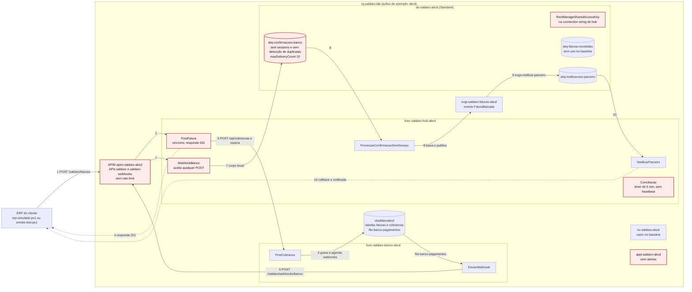

# Lab 0 — Fundação: "Saldaro 2.0 em 20 minutos"

**Version-anchor:** Q4-2026 · **Quando:** em casa, **antes** da aula ao vivo · **Duração:** ~30 min de trabalho seu (o deploy roda sozinho por ~8 a 10 min) · **Cenário:** Saldaro Pagamentos S.A., empresa fictícia

> **Prefere montar à mão, no Portal?** Siga o [Lab 0 montado no Portal](Lab0_Montagem_no_Portal_Guia.md): o mesmo ambiente, recurso por recurso, com o porquê de cada tecnologia (~3 h). Este guia, com o `deploy.ps1`, continua sendo o caminho rápido e o plano B.

> **CUSTO E FREE TRIAL**
> | Item | Valor |
> |------|-------|
> | Custo mensal (se deixar rodando) | ~R$ 60 (o Service Bus Standard responde por ~R$ 55; o resto cabe na franquia gratuita) |
> | Custo real do Lab 0 | ~R$ 1 se subir e apagar no mesmo dia; ~R$ 2 a 3 se subir na véspera e apagar no fim da aula |
> | Compatível com Azure Free Trial (US$ 200)? | **Sim**. Atenção: o crédito vale 30 dias a partir da criação da conta; crie a conta perto da data da aula |
>
> **Regra de ouro:** o `rg-saldaro-lab` só vive até o fim da aula. Para apagar tudo, rode `pwsh ./scripts/limpar.ps1 -Sufixo <seu-sufixo>`: ele apaga o Resource Group **e** purga o Key Vault e o APIM, que senão ficariam presos no soft-delete com o nome reservado. O Service Bus Standard cobra ~R$ 0,07 por hora, com ou sem tráfego.
>
> **Por que tão barato?** APIM Consumption, Functions (Flex Consumption), Event Grid, Key Vault e Log Analytics cobram por uso, e o volume do lab cabe na franquia gratuita de cada um. O único medidor que corre por hora é o do Service Bus Standard. O Basic, mais barato, não serve: não tem sessions nem duplicate detection, que o Incidente 2 liga.

> **ESTE LAB É FEITO EM CASA, ANTES DA AULA AO VIVO**
>
> A aula começa direto nos incidentes: não sobra tempo para instalar ferramentas nem para esperar o APIM ativar. Faça o Lab 0 na véspera (ou até dois dias antes; com mais antecedência, apague e recrie na véspera, ver [Limpeza de Recursos](#limpeza-de-recursos)) e **chegue à aula com isto pronto**:
>
> - [ ] Ferramentas instaladas e conferidas: VS Code, .NET 10 SDK, Azure CLI com Bicep, PowerShell 7 (Etapa 1)
> - [ ] Kit clonado e `az login` feito na sua assinatura Free Trial (Etapas 2 e 3)
> - [ ] Sufixo escolhido e anotado; nos exemplos deste guia, `abcd` (Etapa 4)
> - [ ] `deploy.ps1 -Cenario 0` concluído, com a tabela de recursos impressa e o `scripts/.env.local` gravado (Etapas 5 e 6)
> - [ ] `smoke-test.ps1` passando, com o `faturaId` e o `operation_Id` anotados (Etapa 7)
> - [ ] `GET /saldaro/faturas/{id}` em `baixada` ou `notificada`, menos de 2 min depois de criada (Etapa 8)
> - [ ] Print do fluxo correlacionado no Application Insights (Etapa 9)
> - [ ] Os seis itens ingênuos do baseline entendidos e o pré-mortem de cinco linhas escrito (Etapas 10 e 11)
>
> Travou? Veja o [Troubleshooting](#troubleshooting-comum). Se não der para terminar em casa, rode o `deploy.ps1` logo no começo da aula, durante a abertura, e leve a mensagem de erro para o professor.
>
> Na aula, o bloco do Lab 0 só repete o smoke test: veja [Na aula ao vivo](#na-aula-ao-vivo-os-15-minutos-do-lab-0).

## Guia Passo-a-Passo

**Disciplina:** Integração e Mensageria no Azure (aula hands-on da pós-graduação TFTEC + Anhanguera)
**Aula:** Lab 0, a fundação. Os três incidentes da aula ao vivo partem do ambiente que você sobe aqui.
**Cenário:** a Saldaro Pagamentos S.A. ("Saldaro Hub") é um hub de cobrança B2B. Empresa, pessoas, números e incidentes são fictícios; qualquer semelhança é coincidência.

---

## A história: a Saldaro 2.0 no dia de sol

A Saldaro é um hub de cobrança B2B: o ERP de uma empresa cliente envia a **fatura**, a Saldaro registra a **cobrança** num banco parceiro, o banco avisa por **webhook** quando o pagador paga, a Saldaro faz a **baixa** e **notifica** o ERP. A "Saldaro 1.0" era um monólito que usava o banco relacional como fila, com um único worker de polling. A "Saldaro 2.0" roda no Azure: APIM na frente, Azure Functions, Service Bus, Table Storage, Event Grid, Key Vault e Application Insights.

Só que a 2.0 nasceu herdando os hábitos da 1.0. No Lab 0 você sobe essa versão com um único script, vê uma fatura percorrer o caminho inteiro no "dia de sol" e cataloga o que o ambiente tem de ingênuo. Na aula, cada incidente mostra o "dia de chuva" de um desses itens.

O Lab 0 não é um incidente. Por isso ele não segue o roteiro Incidente → Sintomas → Hipóteses → Conserto dos outros guias: tem a história, a **prova** (o critério de feito) e, no fim, um **pré-mortem** de cinco linhas, o post-mortem ao contrário, em que você aposta no que vai quebrar antes de quebrar.

### A jornada de uma fatura no baseline, em dez passos

1. O ERP do cliente (aqui, `erp-simulado.ps1` ou `smoke-test.ps1`) envia `POST /saldaro/faturas` ao APIM, com o header `x-cliente-id`.
2. O APIM repassa a chamada para a Function `PostFatura`, no hub. O gateway corta o backend aos 30 s.
3. `PostFatura` grava a fatura `recebida` e, **dentro da mesma requisição**, chama o banco simulado: `POST /api/cobrancas`, com o header `x-api-key`.
4. `PostCobranca`, no banco, registra a cobrança (tabela `cobrancas`), agenda os webhooks (fila de storage `banco-pagamentos`) e só então responde com o `idCobranca`.
5. O hub grava o `idCobranca`, muda a fatura para `cobranca-emitida` e responde **201** ao ERP: é a primeira resposta que o ERP recebe.
6. `EnviarWebhook`, no banco, assina e envia `cobranca.registrada` (~1 s depois) e `cobranca.paga` (~5 s depois) para `/saldaro/webhooks/banco`, também pelo APIM.
7. `WebhookBanco`, no hub, aceita o POST e põe o corpo bruto na fila `sbq-confirmacoes-banco`.
8. `ProcessarConfirmacaoSemSessao` aplica a baixa: a fatura vai a `registrada`, depois a `baixada`, e o hub publica o evento `FaturaBaixada` no Event Grid.
9. O tópico `evgt-saldaro-faturas-<sufixo>` entrega o evento na fila `sbq-notificacoes-parceiro`, pela event subscription `evgs-notificar-parceiro`.
10. `NotificarParceiro` faz o callback para o parceiro (se a fatura tiver `callbackUrl`) e marca a fatura como `notificada`. Em paralelo, o timer `Conciliacao` roda a cada 5 min.

A fatura passa pelos status `recebida` → `cobranca-emitida` → `registrada` → `baixada` → `notificada`.

## Prova: o critério de feito do Lab 0

| # | Critério | Como verificar | Etapa |
|---|---|---|---|
| 1 | O smoke test passa | `pwsh ./scripts/smoke-test.ps1` termina sem erro (`$LASTEXITCODE` = `0`) e imprime o `faturaId` e o `operation_Id` | 7 |
| 2 | A fatura chega ao fim da jornada em menos de 2 min | `GET /saldaro/faturas/{id}` pelo APIM devolve `status` = `baixada` ou `notificada`, com `baixadaEm` menos de 120 s depois de `criadaEm`; o banco simulado mostra `quantidade` = `1` cobrança para ela | 8 |
| 3 | O fluxo aparece correlacionado no Application Insights | No **Search**, o `faturaId` traz os eventos `fatura.recebida`, `cobranca.emitida`, `confirmacao.recebida` e `fatura.baixada` (e `notificacao.enviada`, se a fatura já estiver `notificada`): é a correlação de negócio. O **End-to-end transaction details** do `operation_Id` do `POST` mostra `PostFatura` chamando o banco simulado (`PostCobranca`); a parte assíncrona pode ter outro `operation_Id` | 9 |

---

## Pré-requisitos

- Conta Azure com assinatura ativa: o **Azure Free Trial** (US$ 200 por 30 dias) basta. Você precisa ser **Owner** da assinatura, porque o deploy cria role assignments; quem cria a conta Free Trial já é.
- Máquina com Windows 11, macOS ou Linux e as ferramentas da Etapa 1. Os comandos deste guia são de PowerShell 7 (`pwsh`); os exemplos de instalação usam o `winget`, do Windows.
- Git e acesso ao repositório do kit.
- Navegador para o [Portal Azure](https://portal.azure.com).

| Ferramenta | Para que serve no kit | Obrigatória? |
|---|---|---|
| VS Code | Ler o código, o Bicep e os guias | Sim |
| .NET 10 SDK | `dotnet publish` do hub e do banco simulado | Sim |
| Azure CLI com Bicep | Login, deploy (`az deployment group`), publicação e consultas | Sim |
| PowerShell 7 | Rodar os scripts do kit | Sim |
| Git | Clonar o kit | Sim |
| Azure Functions Core Tools | Rodar os apps na sua máquina (`func start`) | **Não**: o deploy publica sem ele |

---

## Tabela de Recursos

Todos os recursos são criados pelo `deploy.ps1` a partir de `infra/main.bicep`, num único Resource Group. `<sufixo>` são os 4 a 6 caracteres que você escolhe na Etapa 4. No fim do deploy, o script imprime esta mesma tabela com o seu sufixo.

| Recurso | Nome | SKU/Tier | Custo Estimado (mensal) |
|---------|------|----------|------------------------|
| Resource Group | `rg-saldaro-lab` | N/A | Gratuito |
| Service Bus namespace | `sb-saldaro-<sufixo>` | Standard | ~R$ 55 (US$ 0,0134/h) |
| Fila (entrada de faturas) | `sbq-faturas-recebidas` | lock 1 min, `maxDeliveryCount` 10, sem sessions | Incluído no namespace |
| Fila (confirmações do banco) | `sbq-confirmacoes-banco` | lock 1 min, `maxDeliveryCount` 10, sem sessions e sem duplicate detection no baseline, dead-lettering on expiration | Incluído no namespace |
| Fila (notificações) | `sbq-notificacoes-parceiro` | destino do Event Grid, `maxDeliveryCount` 10 | Incluído no namespace |
| Storage account | `stsaldaro<sufixo>` | Standard LRS; tabelas `faturas`, `inbox`, `idempotencia`, `conciliacao` (hub) e `cobrancas` (banco); fila de storage `banco-pagamentos`; containers de deploy do Flex | ~R$ 1 |
| Planos de hospedagem | `asp-saldaro-hub-<sufixo>`, `asp-saldaro-banco-<sufixo>` | Flex Consumption (FC1), um por app, 512 MB por instância, até 10 instâncias no hub e 5 no banco (cabe na cota de 15 núcleos por região do Free Trial); plano B: Consumption (Y1) em Windows | Gratuito na franquia (Flex: 100 mil GB-s e 250 mil execuções por mês) |
| Function App (hub) | `func-saldaro-hub-<sufixo>` | .NET 10 isolated, identidade system-assigned | Incluído no plano |
| Function App (banco simulado) | `func-saldaro-banco-<sufixo>` | .NET 10 isolated | Incluído no plano |
| API Management | `apim-saldaro-<sufixo>` | Consumption; APIs `saldaro` (faturas) e `saldaro-webhooks` (webhook do banco) | Gratuito até 1 milhão de chamadas por mês |
| Key Vault | `kv-saldaro-<sufixo>` | Standard, autorização RBAC, vazio no baseline; soft-delete de 7 dias, sem purge protection (para o `limpar.ps1` conseguir purgar) | ~R$ 0 (cobra por operação) |
| Event Grid topic | `evgt-saldaro-faturas-<sufixo>` | CloudEvents 1.0; event subscription `evgs-notificar-parceiro` → `sbq-notificacoes-parceiro` | Gratuito até 100 mil operações por mês |
| Log Analytics workspace | `log-saldaro-<sufixo>` | Pay-as-you-go | Gratuito até 5 GB por mês |
| Application Insights | `appi-saldaro-<sufixo>` | Workspace-based; recebe a telemetria dos dois apps e do APIM | Incluído no Log Analytics |
| Alertas | `ag-saldaro`, `alrt-heartbeat-ausente`, `alrt-dlq-confirmacoes` | **Não existem no baseline**; só nascem no desafio 3.6 (a regra *Failure Anomalies*, que o Application Insights cria sozinho, não é do kit) | R$ 0 no Lab 0 |
| Roles do seu usuário | `Azure Service Bus Data Owner` (namespace), `Storage Table Data Contributor` (storage), `Key Vault Secrets Officer` (Key Vault) | Role assignments | Gratuito |

> **Custo total estimado:** ~R$ 60/mês se o Resource Group for esquecido ligado; ~R$ 2 a 3 da véspera até o fim da aula. Valores com ~R$ 5,50/US$ e preços de lista de Brazil South em outubro de 2026; confira na [calculadora de preços](https://azure.microsoft.com/pricing/calculator/) na data da aula. **Evite** APIM Developer, Service Bus Premium e Functions Premium: o kit não precisa de nenhum deles.

---

## Diagrama: o fio condutor no baseline

No diagrama, `abcd` é o sufixo de exemplo. Os nós em vermelho são os pontos ingênuos de propósito, explicados na Etapa 10. Os números seguem a jornada em dez passos.



---

## Etapa 1 — Instalar e conferir as ferramentas (~10 min; ~2 min se já tiver tudo)

### Passo 1.1: Abrir o PowerShell 7

Todos os comandos deste guia são do **PowerShell 7** (`pwsh`), e não do Windows PowerShell 5.1 que vem com o Windows. Se o `pwsh` ainda não existir na sua máquina, instale-o primeiro:

```powershell
winget install --id Microsoft.PowerShell --source winget
```

Feche e reabra o terminal e confira:

```powershell
pwsh --version
```

Esperado: `PowerShell 7.4` ou mais novo (a LTS atual é a 7.6). No Windows Terminal, abra uma aba **PowerShell**, não **Windows PowerShell**.

### Passo 1.2: Instalar o que faltar

| Ferramenta | Instalação no Windows |
|---|---|
| VS Code | `winget install --id Microsoft.VisualStudioCode --exact` |
| .NET 10 SDK | `winget install Microsoft.DotNet.SDK.10` |
| Azure CLI | `winget install --exact --id Microsoft.AzureCLI` |
| Git | `winget install --id Git.Git --exact --source winget` |

Depois de instalar, **feche e reabra o terminal**: o PATH só é relido quando o terminal abre. Em macOS e Linux, use o instalador oficial de cada ferramenta; os demais comandos do guia são os mesmos no `pwsh`.

### Passo 1.3: Conferir as versões

```powershell
code --version
dotnet --list-sdks
az version
az bicep version
git --version
```

| Comando | Esperado |
|---|---|
| `code --version` | Imprime a versão (qualquer versão recente serve) |
| `dotnet --list-sdks` | Pelo menos uma linha começando com `10.0.` |
| `az version` | `azure-cli` 2.x recente; se estiver antiga, rode `az upgrade` |
| `az bicep version` | Imprime a versão do Bicep CLI; se disser que não está instalado, rode `az bicep install`; para atualizar, `az bicep upgrade` |
| `git --version` | Imprime a versão |

O Bicep que conta é o da Azure CLI (`az bicep`): é ele que o `deploy.ps1` usa para compilar `infra/main.bicep` e os arquivos `.bicepparam`. A Azure CLI instala o Bicep sozinha na primeira vez que precisa dele, mas conferir agora evita surpresa no meio do deploy.

### Passo 1.4 (opcional): Core Tools e extensões do VS Code

O kit **não precisa** do Azure Functions Core Tools: o deploy publica os apps com `dotnet publish` e `az functionapp deployment source config-zip`. Instale-o só se quiser rodar os apps na sua máquina (`func start`); confira com `func --version` (esperado: 4.x). O Microsoft Learn indica o instalador MSI de 64 bits ou o npm (`npm i -g azure-functions-core-tools@4 --unsafe-perm true`).

Extensões úteis no VS Code: **Azure Functions**, **Bicep**, **C# Dev Kit** e **PowerShell**.

---

## Etapa 2 — Obter o kit (~2 min)

### Passo 2.1: Clonar o repositório

```powershell
git clone https://github.com/tftec-guilherme/aula-integracao-mensageria.git
cd aula-integracao-mensageria
```

Rode todos os comandos deste guia **na raiz do repositório**. Prefira o `git clone` a baixar o ZIP pelo navegador: arquivos de um ZIP baixado vêm marcados como "vindos da internet", e o PowerShell pode se recusar a rodar os scripts (ver [Troubleshooting](#troubleshooting-comum)).

### Passo 2.2: Conhecer as pastas

| Pasta | O que tem |
|---|---|
| `01_Aulas/` | Este guia, os três incidentes da aula, as leituras e o desafio para casa |
| `03_Aplicações/` | O código: `Saldaro.Hub` (o hub), `Saldaro.BancoSimulado` (o banco parceiro com botões de caos) e `Saldaro.Ferramentas` (triagem da DLQ e outras ferramentas), cada um com seu projeto de testes |
| `infra/` | O Bicep: `main.bicep`, `modules/` e um arquivo de parâmetros por cenário em `parameters/` (`cenario-0.bicepparam` é o baseline do Lab 0) |
| `scripts/` | `deploy.ps1`, `limpar.ps1`, `check-drift.ps1`, `erp-simulado.ps1`, `smoke-test.ps1` e `triagem-dlq.ps1` |
| `kql/` | Consultas KQL prontas, usadas nos incidentes |
| `templates/` | Modelos de post-mortem e de ADR |

### Passo 2.3: Ler a ajuda dos scripts

Todo script do kit tem ajuda embutida:

```powershell
Get-Help ./scripts/deploy.ps1 -Detailed
Get-Help ./scripts/smoke-test.ps1 -Detailed
```

---

## Etapa 3 — Entrar no Azure na assinatura certa (~3 min)

### Passo 3.1: Fazer login

```powershell
az login
```

- No Windows, a Azure CLI abre a janela de contas do próprio Windows (WAM), e não o navegador; em macOS e Linux, abre o navegador.
- A Microsoft exige MFA para entrar pela Azure CLI: tenha o app autenticador à mão.
- Se você tiver acesso a mais de uma assinatura, a CLI mostra uma lista numerada (**Tenant and subscription selection**): digite o número da sua Free Trial.

### Passo 3.2: Conferir a assinatura ativa

```powershell
az account show --query "{assinatura:name, estado:state, tenant:tenantId}" -o table
```

Confira três coisas: o nome é o da sua Free Trial (costuma ser **Azure subscription 1**), o estado é `Enabled` e o tenant é o da sua conta pessoal, não o da sua empresa. É nessa assinatura que o `deploy.ps1` vai criar tudo.

### Passo 3.3: Trocar de assinatura ou de tenant (só se precisar)

```powershell
az account list -o table
az account set --subscription "<nome ou id da sua Free Trial>"
```

Se a Free Trial nem aparece na lista, você entrou no tenant errado. Entre no tenant certo informando o ID dele ou o domínio `.onmicrosoft.com`:

```powershell
az login --tenant <id-ou-dominio-do-seu-tenant>
```

Se o seletor de assinaturas atrapalhar o login com `--tenant`, desligue-o antes com `az config set core.login_experience_v2=off`.

### Passo 3.4: Confirmar o Flex Consumption em Brazil South

```powershell
az functionapp list-flexconsumption-locations -o json | ConvertFrom-Json | Where-Object name -eq 'brazilsouth'
az functionapp list-flexconsumption-runtimes --location brazilsouth --runtime dotnet-isolated -o table
```

O primeiro comando precisa devolver uma linha com `brazilsouth`; o segundo precisa listar a versão 10 do `dotnet-isolated`. Se algum deles vier vazio, anote: no Passo 5.4 você usa o plano B, `-Plano Consumption`.

---

## Etapa 4 — Escolher o sufixo (~2 min)

### Passo 4.1: Entender por que existe um sufixo

Service Bus, Storage, Key Vault, APIM e Function Apps têm nome **global**: o nome vira um endereço DNS (`sb-saldaro-abcd.servicebus.windows.net`, `apim-saldaro-abcd.azure-api.net` e assim por diante). Se a turma inteira usasse `sb-saldaro`, só o primeiro conseguiria criar. O sufixo resolve isso.

- **4 a 6 caracteres**, só **letras minúsculas e dígitos**: sem hífen, sem acento, sem maiúscula. O nome do Storage (`stsaldaro<sufixo>`) não aceita nada além disso.
- Use **o mesmo sufixo** em todas as execuções do `deploy.ps1` e do `limpar.ps1`, do Lab 0 até o fim da aula. Ele fica gravado em `scripts/.env.local`, na chave `SALDARO_SUFIXO`.
- Neste guia, o sufixo de exemplo é `abcd`. **Troque pelo seu** em todos os comandos.
- Se você não passar `-Sufixo`, o `deploy.ps1` gera um; nesse caso, anote o que ele escolheu.

### Passo 4.2: Conferir se os nomes globais estão livres

```powershell
$s = 'abcd'   # troque pelo SEU sufixo
az servicebus namespace exists --name "sb-saldaro-$s" --query nameAvailable -o tsv
az storage account check-name --name "stsaldaro$s" --query nameAvailable -o tsv
az keyvault check-name --name "kv-saldaro-$s" --query nameAvailable -o tsv
az apim check-name --name "apim-saldaro-$s" --query nameAvailable -o tsv
```

As quatro linhas precisam imprimir `true`. Se alguma imprimir `false`, troque o sufixo e confira de novo. Depois do seu primeiro deploy elas passam a imprimir `false`, porque agora os nomes são seus: isso é esperado. Os nomes dos Function Apps também são globais, mas não têm um comando `az` simples de checagem. O `deploy.ps1` confere todos os nomes globais (inclusive os dos dois Function Apps) antes de criar um ambiente novo e para listando os que estiverem ocupados: aí você troca o sufixo (ver [Troubleshooting](#troubleshooting-comum)).

---

## Etapa 5 — Subir a Saldaro 2.0 com um comando (~8 a 10 min, quase tudo espera)

### Passo 5.1: Rodar o deploy do cenário 0

```powershell
pwsh ./scripts/deploy.ps1 -Cenario 0 -Sufixo abcd
```

| Parâmetro | No Lab 0 | Para que serve |
|---|---|---|
| `-Cenario 0` | Obrigatório | Escolhe o estado do ambiente; `0` é o baseline ingênuo (`infra/parameters/cenario-0.bicepparam`) |
| `-Sufixo abcd` | Recomendado | O seu sufixo (Etapa 4); sem ele, o script gera um |
| `-Location` | Omita | Região; o padrão é `brazilsouth` |
| `-Plano` | Omita | `Flex` (padrão) ou `Consumption` (plano B, Passo 5.4) |
| `-Pronto` | Não use | Leva o ambiente ao estado **pronto** de um cenário; é o atalho da aula para quem travar num incidente. O cenário 0 não tem estado "pronto" próprio: `-Cenario 0 -Pronto` é aceito e aplica o mesmo `cenario-0` |
| `-EmailAlerta` | Não use | E-mail dos alertas; só o desafio 3.6 usa |
| `-SemPublicar` | Não use | Aplica só a infraestrutura, sem publicar o código dos apps |
| `-SomenteValidar` | Opcional, antes do deploy | Modo seguro: compila o Bicep e roda o what-if sem criar, alterar ou publicar nada. Sem o `rg-saldaro-lab`, o what-if não tem onde rodar e é pulado (valem só a compilação e as checagens de nomes) |
| `-PurgarExcluidos` | Só se o deploy pedir | Purga o Key Vault e o APIM que um lab anterior com o mesmo sufixo deixou em soft-delete. Sem ele, o deploy para e indica as saídas (ver [Troubleshooting](#troubleshooting-comum)) |

Enquanto o deploy roda, leia a Etapa 10: ela explica cada item ingênuo que você vai conferir depois.

### Passo 5.2: Entender o que o script faz

1. Confere as ferramentas e o login (`az account show`) e mostra a assinatura em uso. O script **não pausa** para você confirmar: se não for a sua Free Trial, interrompa logo com **Ctrl+C** (até o passo 6, ele não cria nada) e volte à Etapa 3.
2. Resolve o arquivo de parâmetros do cenário: no `cenario-0.bicepparam`, todos os toggles estão `false` e `maxDeliveryCount = 10`.
3. Confere se o Flex Consumption existe na região com `dotnet-isolated` 10 (se não existir, para e indica o plano B do Passo 5.4) e se os nomes globais com o seu sufixo estão livres. Se encontrar em soft-delete um Key Vault ou um APIM de um lab anterior com o mesmo nome, para e indica duas saídas: o `limpar.ps1 -Sufixo <sufixo>` ou repetir o deploy com `-PurgarExcluidos`. Ele não purga sozinho, porque purgar apaga de vez (ver [Troubleshooting](#troubleshooting-comum)).
4. Gera os dois segredos do kit (`WebhookSecret` e `BancoApiKey`, 32 bytes aleatórios em base64) na primeira execução e os reaproveita nos redeploys. Eles nunca são exibidos nem gravados em arquivo.
5. Descobre o seu usuário (`az ad signed-in-user show`) para o Bicep criar as roles dele: `Azure Service Bus Data Owner`, `Storage Table Data Contributor` e `Key Vault Secrets Officer`, que você usa no Service Bus Explorer, na triagem da DLQ e na leitura 3.5.
6. Cria o `rg-saldaro-lab` (`az group create`).
7. Roda o `az deployment group what-if` no formato `ResourceIdOnly` (só a lista de recursos, sem valores, porque os app settings do baseline têm segredos; na primeira vez, todos aparecem como **Create**). Em seguida, sem pedir confirmação, aplica o Bicep com `az deployment group create`, o passo mais longo: o script avisa que, na primeira vez, ele leva de 5 a 15 minutos, quase tudo esperando o APIM ativar. Se a assinatura nunca usou algum dos serviços, o próprio `az deployment group create` registra o resource provider que falta: no primeiro deploy de teste do kit, numa assinatura sem `Microsoft.ApiManagement` e `Microsoft.EventGrid` registrados, os dois ficaram `Registered` sem nenhum comando a mais.
8. Compila os dois apps (`dotnet publish -c Release`) e publica cada um no seu Function App (`az functionapp deployment source config-zip`).
9. Grava o `scripts/.env.local` com os nomes e as URLs do seu ambiente (sem segredos) e imprime a tabela de recursos.
10. Roda o `smoke-test.ps1` (só no cenário 0).

Pelas medições do primeiro deploy de teste do kit, um deploy do zero leva uns 8 a 10 minutos, do passo 1 ao smoke test.

O deploy é **idempotente**: se falhar no meio, corrija a causa e rode o mesmo comando de novo, com o mesmo sufixo. Os nomes das role assignments são determinísticos e os segredos são reaproveitados, então repetir não duplica nada.

### Passo 5.3 (opcional): Acompanhar no Portal

No Portal, abra **Resource groups** → `rg-saldaro-lab` → **Settings** → **Deployments**. O deployment do Bicep mostra cada recurso sendo criado; o mais demorado costuma ser o `apim-saldaro-<sufixo>`.

### Passo 5.4: Plano B, se o Flex Consumption não estiver disponível

Se o Passo 3.4 veio vazio, ou se o deploy falhou nos planos `asp-saldaro-hub-<sufixo>`/`asp-saldaro-banco-<sufixo>` com mensagem sobre Flex Consumption, região ou cota, use o plano **Consumption em Windows** (legado, mas GA; tem de ser Windows, porque o .NET 10 não roda no Consumption em Linux):

```powershell
pwsh ./scripts/limpar.ps1 -Sufixo abcd
pwsh ./scripts/deploy.ps1 -Cenario 0 -Sufixo abcd -Plano Consumption
```

Limpe antes: um Function App não migra do Flex Consumption para outro plano, então misturar os dois no mesmo Resource Group só gera erro (com o ambiente de pé, o `deploy.ps1` para em vez de tentar). Para o lab nada muda: mesmos nomes, mesmo código, mesmos testes. Nos `deploy.ps1` seguintes da aula, o script reaproveita o plano do ambiente que já existe: não precisa repetir `-Plano Consumption` (repetir não faz mal).

---

## Etapa 6 — Conferir o que foi criado (~3 min)

### Passo 6.1: Ler a tabela de recursos

No fim, o `deploy.ps1` imprime a tabela de recursos com o seu sufixo. Compare com a [Tabela de Recursos](#tabela-de-recursos) deste guia: os nomes têm que bater. Para listar o que existe de fato no Resource Group:

```powershell
az resource list --resource-group rg-saldaro-lab -o table
```

### Passo 6.2: Conhecer o `scripts/.env.local`

O `deploy.ps1` grava em `scripts/.env.local` os nomes e as URLs do seu ambiente, no formato `CHAVE=valor`. Os outros scripts do kit (`smoke-test.ps1`, `erp-simulado.ps1`, `triagem-dlq.ps1`) leem esse arquivo, por isso você não precisa copiar URL nenhuma. Ele **não tem segredos** e é ignorado pelo git.

Exemplo **ilustrativo**, com o sufixo `abcd` e uma assinatura fictícia (o seu é gerado pelo `scripts/deploy.ps1`):

```text
SALDARO_RG=rg-saldaro-lab
SALDARO_SUFIXO=abcd
SALDARO_LOCATION=brazilsouth
SALDARO_SUBSCRIPTION=00000000-0000-0000-0000-000000000000
SALDARO_APIM_URL=https://apim-saldaro-abcd.azure-api.net/saldaro
SALDARO_HUB_URL=https://func-saldaro-hub-abcd.azurewebsites.net/api
SALDARO_BANCO_URL=https://func-saldaro-banco-abcd.azurewebsites.net/api
SALDARO_SB_NAMESPACE=sb-saldaro-abcd
SALDARO_SB_FQDN=sb-saldaro-abcd.servicebus.windows.net
SALDARO_STORAGE=stsaldaroabcd
SALDARO_KV=kv-saldaro-abcd
SALDARO_APPI=appi-saldaro-abcd
```

As URLs do hub e do banco vêm do `defaultHostName` de cada Function App e podem ter um trecho a mais (um hash e a região) no meio do host. Use sempre o valor do arquivo; nunca monte essas URLs à mão.

### Passo 6.3: Conferir o APIM

```powershell
az apim show --name apim-saldaro-abcd --resource-group rg-saldaro-lab -o table
```

A coluna `STATUS` tem que mostrar `Online`. `Activating` significa que o gateway ainda está subindo (ver [Troubleshooting](#troubleshooting-comum)).

### Passo 6.4 (opcional): Ver os Function Apps no Portal

Abra **Resource groups** → `rg-saldaro-lab` → `func-saldaro-hub-<sufixo>`. Na **Overview**, a lista de Functions mostra `PostFatura`, `GetFatura`, `GetFaturaStatus`, `EmitirCobranca`, `WebhookBanco`, `ProcessarConfirmacaoSemSessao`, `ProcessarConfirmacaoComSessao`, `NotificarParceiro`, `Conciliacao` e `Saude`. Repare que `ProcessarConfirmacaoComSessao` aparece desabilitada: no baseline só roda a versão sem sessão. No `func-saldaro-banco-<sufixo>`, as Functions são `PostCobranca`, `EnviarWebhook`, `GetCobrancasPorFatura` e `Saude`.

---

## Etapa 7 — Smoke test: uma fatura de ponta a ponta (~3 min)

### Passo 7.1: Rodar o smoke test

O `deploy.ps1` já rodou o smoke test no fim. Rode de novo, sozinho, para acompanhar com calma:

```powershell
pwsh ./scripts/smoke-test.ps1
$LASTEXITCODE
```

O script envia **uma** fatura, acompanha a jornada e espera até 120 s (`-TimeoutSegundos 120`, o padrão) pela fatura em `baixada` ou `notificada`; no primeiro deploy de teste do kit, ela chegou a `notificada` em uns 30 s. Passou: termina sem erro e o `$LASTEXITCODE` é `0`. Não chegou no prazo: termina com erro (ver Passo 7.4).

### Passo 7.2: Anotar o `faturaId` e o `operation_Id`

No fim, o smoke test imprime o `faturaId` e a `referenciaErp` da fatura de teste, o status final, o tempo total e o `operation_Id` do `POST` no Application Insights, junto com as consultas KQL prontas para colar no **Logs**. Guarde o `faturaId` e o `operation_Id` na sessão, para as próximas etapas:

```powershell
$faturaId    = '<faturaId que o smoke test imprimiu>'
$operationId = '<operation_Id que o smoke test imprimiu>'
```

O `faturaId` é o identificador de **negócio**: a chave da fatura em todas as tabelas, mensagens e eventos. O `operation_Id` é o identificador **técnico** que o Application Insights usa para juntar a telemetria de uma mesma transação. O smoke test escolhe esse id antes de enviar: é o trace-id do header `traceparent` (W3C Trace Context) que ele manda no `POST`. Ele vale para o `POST` e o que acontece dentro dele; a parte assíncrona (webhook, filas, baixa) pode ter outro, e por isso a jornada inteira se acompanha pelo `faturaId`.

### Passo 7.3 (opcional): Uma fatura pelo ERP simulado, e o 201

```powershell
pwsh ./scripts/erp-simulado.ps1 -Faturas 1
```

O relatório final conta as respostas por código HTTP (201, 202, 429, 5xx e timeout), a média de tentativas e o tempo total, e o script grava um CSV em `scripts/saida/`. Repare: **1 em 201** e **0 em 202**. O 201 é o primeiro item ingênuo do baseline: o hub só respondeu depois de registrar a cobrança no banco. Guarde isso para o Incidente 1.

### Passo 7.4 (se o smoke test falhou): Procurar exceções

Abra **Logs** no `appi-saldaro-<sufixo>` (Passo 9.4) e rode:

```kusto
// funcao: a Function que falhou (só nas linhas do worker; em exceptions, operation_Name só vem
// preenchido nas linhas do APIM)
exceptions
| where timestamp > ago(30m)
| project timestamp, cloud_RoleName, operation_Name,
          funcao = tostring(customDimensions.AzureFunctions_FunctionName), outerMessage
| order by timestamp desc
```

Sem exceção nenhuma, o mais provável é a primeira execução logo depois do deploy (cold start dos apps ou roles ainda propagando): espere 2 a 3 min e rode o smoke test de novo. Com exceção, a coluna `funcao` diz qual Function falhou, e a mensagem diz por quê; procure-a no [Troubleshooting](#troubleshooting-comum). A mesma falha aparece de novo em linhas sem `cloud_RoleName` e sem `funcao`: é o host do Functions repetindo o registro.

---

## Etapa 8 — Consultar a fatura pela API (~3 min)

### Passo 8.1: Carregar o `.env.local` na sessão

```powershell
$cfg = Get-Content ./scripts/.env.local -Raw | ConvertFrom-StringData
$cfg.SALDARO_APIM_URL
```

Esperado: `https://apim-saldaro-abcd.azure-api.net/saldaro`, com o seu sufixo.

### Passo 8.2: `GET /saldaro/faturas/{id}` pelo APIM

```powershell
$f = Invoke-RestMethod "$($cfg.SALDARO_APIM_URL)/faturas/$faturaId"
$f | Format-List
$f.status
([datetime]$f.baixadaEm - [datetime]$f.criadaEm).TotalSeconds
```

Três conferências:

- `status` é `baixada` ou `notificada` (a notificação ao parceiro é o último passo e pode já ter acontecido);
- a diferença entre `baixadaEm` e `criadaEm` fica abaixo de 120 segundos;
- `quantidadeBaixas` é `1` ou, às vezes, `0`. No baseline, a `cobranca.registrada`, processada junto com a baixa, pode regravar o contador que leu antes dela: é a atualização perdida que o Incidente 2 conserta, e não um defeito do seu ambiente. Mais que `1`, só no Incidente 2.

Saída **ilustrativa**, resumida (os campos exatos são os que `GetFatura` devolve, em `03_Aplicações/Saldaro.Hub`):

```text
status           : notificada
idCobranca       : COB-1a2b3c4d
quantidadeBaixas : 1
```

Se o `status` ainda for `cobranca-emitida` ou `registrada`, espere alguns segundos e repita: o `cobranca.paga` chega cerca de 5 s depois da cobrança. Se a fatura nunca sair de `cobranca-emitida`, a parte assíncrona (webhook e fila) não está andando: volte ao Passo 7.4.

### Passo 8.3: Conferir a cobrança no banco simulado

```powershell
Invoke-RestMethod "$($cfg.SALDARO_BANCO_URL)/cobrancas/$faturaId"
```

O campo `quantidade` tem que ser `1`: uma fatura, uma cobrança. Para um `faturaId` sem cobrança, o banco responde `quantidade = 0` (nunca 404). No Incidente 1, a duplicata aparece de outro jeito: cada reenvio do ERP vira um `faturaId` novo, cada um com `quantidade = 1`, e é a contagem por `referenciaErp` (a mesma fatura do ERP) que mostra duas faturas e duas cobranças.

### Passo 8.4 (opcional): Ver a linha na tabela `faturas`

No Portal: **Storage accounts** → `stsaldaro<sufixo>` → **Storage browser** → **Tables** → `faturas`. Há uma linha por fatura enviada (a do smoke test do deploy, a do seu smoke test e, se você rodou, a do ERP simulado), com `PartitionKey` = `faturaId` e o `status` atual.

---

## Etapa 9 — Ver o fluxo correlacionado no Application Insights (~5 min)

A telemetria leva de 2 a 5 minutos para aparecer. Se você acabou de rodar o smoke test, leia esta etapa inteira antes e depois execute.

### Passo 9.1: Abrir o Search

1. No Portal, busque **Application Insights** e abra `appi-saldaro-<sufixo>`.
2. No menu da esquerda, em **Investigate**, clique em **Search** (nas versões anteriores do Portal, **Transaction search**). Você está na tela certa se a barra do topo traz **View in Logs** e **Leave Preview** e os resultados aparecem com a opção **View as: Traces**.
3. No intervalo de tempo, escolha **Last 30 minutes** (ou **Last hour**).

Os dois Function Apps e o APIM mandam telemetria para esse mesmo Application Insights; por isso dá para ver a jornada inteira num lugar só.

### Passo 9.2: Procurar a fatura pelo `faturaId`

1. Na caixa de busca, cole o `faturaId` **entre aspas**: a busca é por palavra inteira, e as aspas protegem os hífens do GUID.
2. O resultado mistura requisições, dependências, logs e eventos customizados: no primeiro deploy de teste do kit, a fatura do smoke test trouxe mais de cem itens. Se a sua tela tiver o filtro **Event types**, deixe marcado **Custom Event** para ficar só com os eventos de negócio (pode marcar também **Request** e **Dependency**). O **View in Logs** leva a mesma busca para o **Logs**, em KQL, como no Passo 9.4.
3. Confira os eventos de negócio que o hub emitiu para essa fatura:

| Evento | O que significa no dia de sol |
|---|---|
| `fatura.recebida` | A fatura entrou no hub; a propriedade `modo` vale `sync` no baseline |
| `cobranca.emitida` | O banco devolveu o `idCobranca` |
| `confirmacao.recebida` | Um webhook do banco chegou; aparece duas vezes, uma com `tipo` = `cobranca.registrada` e outra com `cobranca.paga` |
| `fatura.baixada` | A baixa aconteceu e o `FaturaBaixada` foi publicado |
| `notificacao.enviada` | O parceiro foi notificado (aparece quando a fatura chega a `notificada`) |

### Passo 9.3: Abrir a transação

Clique no evento `fatura.recebida`. Abre o **End-to-end transaction details**: o gráfico mostra a cadeia do `POST`, do APIM ao banco. O APIM recebe o `POST /faturas`, o hub executa `PostFatura`, grava na tabela `faturas` (Table Storage) e chama o banco simulado (`POST /api/cobrancas`, que no banco aparece como `PostCobranca`); no primeiro deploy de teste do kit, a cadeia apareceu inteira, APIM → hub → tabela → banco. A lista em ordem de tempo, logo abaixo, mostra também os eventos customizados. No painel de detalhes, em **Show all**, confira que o **Operation ID** é o mesmo `operation_Id` que o smoke test imprimiu (o APIM continua o `traceparent` W3C que o script enviou). Se não for, anote: a correlação técnica quebrou já no gateway, e a prova por `faturaId` continua valendo.

Os eventos da parte assíncrona (webhook, baixa e notificação) podem aparecer em outras transações, com outro `operation_Id`: a fila de storage do banco e o Event Grid são fronteiras assíncronas. Não é erro. É justamente por isso que o hub carimba o `faturaId` em todo evento: ele é o **identificador de correlação de negócio**, que costura a jornada quando a correlação técnica se perde (padrão Correlation Identifier).

### Passo 9.4: A mesma prova em KQL

Em `appi-saldaro-<sufixo>` → **Monitoring** → **Logs**, no modo **KQL**, rode as duas consultas, trocando os valores entre aspas pelos seus:

```kusto
// Transação do smoke test: quem participou (cole o operation_Id)
union requests, dependencies, customEvents
| where timestamp > ago(1h)
| where operation_Id == "<operation_Id>"
| project timestamp, itemType, cloud_RoleName, name, resultCode, duration
| order by timestamp asc
```

```kusto
// Jornada da fatura pelos eventos de negócio (cole o faturaId)
customEvents
| where timestamp > ago(1h)
| where tostring(customDimensions.faturaId) == "<faturaId>"
| project timestamp, name, operation_Id, cloud_RoleName
| order by timestamp asc
```

Na primeira consulta aparecem linhas de pelo menos dois `cloud_RoleName`: o hub e o banco simulado. Na segunda, a sequência de eventos do Passo 9.2, em ordem. Os horários estão em UTC.

### Passo 9.5: Guardar o print

Tire um print do **End-to-end transaction details** (ou do resultado da segunda consulta). Na aula, ele é a referência do dia de sol, para comparar quando tudo quebrar. Antes de compartilhar, esconda o nome e o ID da assinatura e o seu e-mail.

---

## Etapa 10 — Entender o baseline ingênuo, item a item (~10 min)

Nenhum item abaixo é bug: é o jeito que muita gente sobe o primeiro ambiente. Cada um é uma herança da Saldaro 1.0 com dono: um guia da aula mostra o dia de chuva e faz o conserto. O baseline nasce assim porque o `cenario-0.bicepparam` deixa todos os toggles `false` e `maxDeliveryCount = 10`.

| # | Item ingênuo (de propósito) | Onde ver no seu ambiente | O que dá errado no dia de chuva | Quem conserta |
|---|---|---|---|---|
| 1 | `POST /faturas` **síncrono**: o hub só responde 201 depois que o banco responde | `Cenario__AsyncRequestReply` = `false`; o 201 do Passo 7.3 | O banco fica lento (45 s), o APIM corta aos 30 s (504) e o ERP reenvia; o hub cria outra fatura e o banco, que já tinha registrado a primeira cobrança, registra outra: a mesma fatura do ERP (`referenciaErp`) vira **duas faturas e duas cobranças** | **Incidente 1** (cenário 3.2): 202 + `Location` + `Retry-After`, fila `sbq-faturas-recebidas`, `Idempotency-Key` |
| 2 | Fila `sbq-confirmacoes-banco` **sem sessions nem duplicate detection**; webhook sem validação de assinatura (HMAC) e baixa sem inbox | `requiresSession` e `requiresDuplicateDetection` = `false` (Passo 10.4); `Cenario__WebhookHmac` e `Cenario__Inbox` = `false` | O banco manda confirmações repetidas e fora de ordem: **baixa duplicada**, notificação em dobro e um `cobranca.registrada` atrasado que "desbaixa" a fatura; uma confirmação forjada, sem assinatura, é aceita | **Incidente 2** (cenário 3.3): HMAC, duplicate detection, sessions (`SessionId` = `faturaId`) e inbox. Sessions e duplicate detection são **imutáveis**: a fila precisa ser recriada |
| 3 | `maxDeliveryCount` **10** e nenhuma classificação de erro | `maxDeliveryCount` = `10` (Passo 10.4); `Cenario__DlqComMotivo` e `Cenario__RetryAgendado` = `false` | O banco parceiro muda o formato do `valor` (`"1.250,00"`) e, junto, vêm falhas transientes: as 10 reentregas imediatas acabam em segundos e a DLQ enche de `MaxDeliveryCountExceeded`, mensagens boas e ruins misturadas | **Incidente 3** (cenário 3.4): dead-letter com motivo (`SchemaInvalida`), retry agendado, `maxDeliveryCount = 3`, triagem e reprocesso |
| 4 | `RootManageSharedAccessKey` na `ServiceBusConnection` e chaves em texto nos app settings (`TablesConnection`, `EventGridTopicKey`, `BancoApiKey`, `WebhookSecret`) | Environment variables do hub (Passo 10.2); Shared access policies do namespace (Passo 10.3) | Uma chave "dona de tudo": quem a tem cria, apaga e lê qualquer fila; rotacioná-la derruba todos os clientes de uma vez; se vazou, vazou tudo | **Leitura 3.5**: Managed Identity e Key Vault (`identidadeGerenciada`), `disableLocalAuth`. Ligada a isso, a **leitura 3.7**: com direito de gerência, um worker legado cria uma "fila fantasma" fora do Bicep (drift) |
| 5 | **Sem rate limit** no APIM | Operação `post-fatura` sem `rate-limit` e API `saldaro` sem subscription (Passo 10.5) | Um ERP com retry em "metralhadora" inunda o hub e derruba o serviço para todas as empresas clientes | **Leitura 3.1**: uma subscription por empresa cliente (`cliente-a`, `cliente-b`) e `rate-limit` de 60 chamadas por minuto por subscription (o `rate-limit-by-key` não existe no APIM Consumption), 429 + `Retry-After`, cliente com backoff e teto |
| 6 | **Sem alertas e sem heartbeat** | Nenhum alerta do kit no Resource Group (Passo 10.6); `Cenario__Heartbeat` = `false` | O timer `Conciliacao` para e ninguém percebe: os painéis mostram zero erros porque nada está rodando | **Desafio 3.6**: `conciliacao.heartbeat` emitido ao concluir, alerta por ausência de sinal (`alrt-heartbeat-ausente`) e alerta de DLQ (`alrt-dlq-confirmacoes`) |

> **Simplificações de laboratório, que nenhum guia conserta:** os HTTP triggers são anônimos (`AuthorizationLevel.Anonymous`, comentado no código), a API `saldaro` do APIM não exige subscription key (`subscriptionRequired: false`; só o estado pronto da leitura 3.1 liga a subscription, para o rate limit por empresa cliente) e a `saldaro-webhooks` nunca exige, e o `AzureWebJobsStorage` usa connection string mesmo depois da leitura 3.5 (compromisso documentado: só os dados da aplicação migram para identidade). Em produção, nenhuma das três ficaria assim: o APIM autenticaria cada empresa cliente (subscription própria ou OAuth 2.0 com `validate-jwt`) e tiraria o `clienteId` da credencial, e não do header `x-cliente-id`; o hub só aceitaria tráfego vindo do APIM; e o `AzureWebJobsStorage` também passaria para identidade (Parte 6 da leitura 3.5). A lista completa do que mudaria está na ADR-0007 (`docs/adr/0007-http-triggers-anonymous-e-apim-sem-subscription.md`).

### Passo 10.1: Ver os toggles pelo endpoint de saúde

```powershell
Invoke-RestMethod "$($cfg.SALDARO_HUB_URL)/saude" | ConvertTo-Json -Depth 5
```

A Function `Saude` responde `{ versao, toggles }`: a versão do hub e oito booleanos (`AsyncRequestReply`, `WebhookHmac`, `Inbox`, `DlqComMotivo`, `RetryAgendado`, `Heartbeat`, `WorkerComSessao` e `IdentidadeGerenciada`). No baseline, todos `false`. O `/saude` do banco simulado (`$($cfg.SALDARO_BANCO_URL)/saude`) responde `{ servico, status, versao, settingsPreenchidos }`: diz só se cada setting está preenchido, nunca o valor.

### Passo 10.2: Ver os app settings do hub (itens 1 a 4 e 6)

No Portal: **Function App** `func-saldaro-hub-<sufixo>` → **Settings** → **Environment variables** → aba **App settings** → **Show values**. Procure `ServiceBusConnection` (repare no `SharedAccessKeyName=RootManageSharedAccessKey`), os `Cenario__*` e os dois `AzureWebJobs.ProcessarConfirmacao...Disabled`. **Não tire print com os valores visíveis**: eles contêm chaves.

Pela CLI, mascarando a chave:

```powershell
$hub = "func-saldaro-hub-$($cfg.SALDARO_SUFIXO)"
$settings = az functionapp config appsettings list --name $hub --resource-group $cfg.SALDARO_RG -o json | ConvertFrom-Json
$settings | Where-Object { $_.name -like 'Cenario__*' -or $_.name -like 'AzureWebJobs.Processar*' } | Sort-Object name | Format-Table name, value
($settings | Where-Object name -eq 'ServiceBusConnection').value -replace 'SharedAccessKey=[^;]+', 'SharedAccessKey=***'
```

Esperado: os seis `Cenario__*` (`AsyncRequestReply`, `WebhookHmac`, `Inbox`, `DlqComMotivo`, `RetryAgendado`, `Heartbeat`) em `false`; `AzureWebJobs.ProcessarConfirmacaoComSessao.Disabled` em `true` e `AzureWebJobs.ProcessarConfirmacaoSemSessao.Disabled` em `false`; e a connection string terminando em `SharedAccessKeyName=RootManageSharedAccessKey;SharedAccessKey=***`.

### Passo 10.3: Ver a chave dona de tudo (item 4)

No namespace `sb-saldaro-<sufixo>` → **Settings** → **Shared access policies** → `RootManageSharedAccessKey`: as claims são **Manage**, **Send** e **Listen**. É essa chave, com direito de gerência sobre o namespace inteiro, que está na `ServiceBusConnection` do hub.

### Passo 10.4: Ver as propriedades da fila de confirmações (itens 2 e 3)

```powershell
az servicebus queue show --resource-group $cfg.SALDARO_RG --namespace-name $cfg.SALDARO_SB_NAMESPACE --name sbq-confirmacoes-banco -o json |
  ConvertFrom-Json |
  Select-Object requiresSession, requiresDuplicateDetection, maxDeliveryCount, lockDuration
```

Esperado: `requiresSession` = `False`, `requiresDuplicateDetection` = `False`, `maxDeliveryCount` = `10`, `lockDuration` = `PT1M`. As duas primeiras são **imutáveis** numa fila existente: no Portal, na página **Overview** da fila, **Essentials** mostra **Sessions** e **Duplicate detection** como **Disabled**, sem nada para mudar; só dá para escolher na criação da fila (**+ Queue**). Não procure em **Settings** → **Properties**: essa página hoje só lista metadados do ARM (Id, Name, Type, Tags e Location). Guarde isso para o Incidente 2.

### Passo 10.5: Ver o APIM sem rate limit e o corte de 30 s (itens 1 e 5)

No Portal: **API Management services** → `apim-saldaro-<sufixo>` → **APIs** → **APIs**. O kit tem duas APIs: **Saldaro Hub - faturas** (nome `saldaro`, path `saldaro`) e **Saldaro Hub - webhooks** (nome `saldaro-webhooks`, path `saldaro/webhooks`, só para o webhook do banco, que nunca exige subscription). Abra a **Saldaro Hub - faturas**, aba **Design**.

- Em **All operations**, a caixa **Backend** tem a política `forward-request` com `timeout="30"`: é ela que corta o backend aos 30 s no Incidente 1. No editor de código (**</>**), a seção `on-error` transforma esse corte num **504** com o corpo `{"erro":"o gateway esperou 30 s e desistiu"}`.
- Na operação `post-fatura` (o `POST /faturas`), **Inbound processing** não tem `rate-limit`, e a API não exige subscription key: é o item 5.
- As outras duas operações da API são `get-fatura` e `get-fatura-status`. A `post-webhook-banco` (`POST /banco`, URL pública `/saldaro/webhooks/banco`) fica na **Saldaro Hub - webhooks**, com o mesmo corte de 30 s.

### Passo 10.6: Confirmar que não há alertas (item 6)

```powershell
az resource list --resource-group $cfg.SALDARO_RG -o json | ConvertFrom-Json |
  Where-Object type -match 'scheduledQueryRules|metricAlerts|smartDetectorAlertRules|actionGroups' |
  Select-Object name, type
```

Nenhum alerta do kit aparece: `ag-saldaro`, `alrt-heartbeat-ausente` e `alrt-dlq-confirmacoes` só nascem no desafio 3.6. O que pode aparecer é a regra `Failure Anomalies - appi-saldaro-<sufixo>` e o Action Group `Application Insights Smart Detection`, que o próprio Application Insights cria ao nascer. Essa regra avisa quando a taxa de falhas sobe fora do normal, mas não enxerga ausência de sinal: um timer que parou não falha, só some. E o timer `Conciliacao` roda a cada 5 min sem emitir heartbeat. Se ele parar, ninguém fica sabendo: é o desafio 3.6.

### Passo 10.7: Saber onde cada toggle liga

Cada toggle do Bicep vira um app setting do hub ou uma propriedade de recurso. A tabela mostra quem liga cada um; o estado pronto de cada cenário fica em `infra/parameters/cenario-N-pronto.bicepparam`.

| Toggle (`infra/main.bicep`) | Vira o quê | No baseline | Quem liga |
|---|---|---|---|
| `asyncRequestReply` | `Cenario__AsyncRequestReply` | `false` | Incidente 1 (`cenario-2-pronto`) |
| `webhookHmac` | `Cenario__WebhookHmac` | `false` | Incidente 2 (`cenario-3-pronto`) |
| `inbox` | `Cenario__Inbox` | `false` | Incidente 2 |
| `filaComSessions` | `requiresSession` da fila `sbq-confirmacoes-banco` | `false` | Incidente 2 |
| `filaDupDetection` | `requiresDuplicateDetection` da mesma fila (janela de 10 min) | `false` | Incidente 2 |
| `workerComSessao` | Qual das duas Functions de confirmação fica ativa (`AzureWebJobs.ProcessarConfirmacaoComSessao.Disabled` e `AzureWebJobs.ProcessarConfirmacaoSemSessao.Disabled`) | `false` (roda a `ProcessarConfirmacaoSemSessao`) | Incidente 2 |
| `dlqComMotivo` | `Cenario__DlqComMotivo` | `false` | Incidente 3 (`cenario-4-pronto`) |
| `retryAgendado` | `Cenario__RetryAgendado` | `false` | Incidente 3 |
| `maxDeliveryCount` | `maxDeliveryCount` da fila `sbq-confirmacoes-banco` | `10` | Incidente 3 (vai a `3`) |
| `rateLimit` | Subscription obrigatória na API `saldaro` (subscriptions `cliente-a` e `cliente-b`) e `rate-limit` de 60 chamadas por minuto na operação `post-fatura` | `false` | Leitura 3.1 (`cenario-1-pronto`) |
| `identidadeGerenciada` | `disableLocalAuth` no namespace, roles do hub, segredos no Key Vault e settings por identidade | `false` | Leitura 3.5 (`cenario-5-pronto`) |
| `heartbeat` | `Cenario__Heartbeat` | `false` | Desafio 3.6 (`cenario-6-pronto`) |
| `alertas` | Action Group `ag-saldaro`, `alrt-heartbeat-ausente` e `alrt-dlq-confirmacoes` | `false` | Desafio 3.6 |

---

## Etapa 11 — Pré-mortem de cinco linhas (~3 min)

Na aula, cada incidente termina com um post-mortem de cinco linhas, sem culpados (`templates/post-mortem.md`). O pré-mortem é o mesmo exercício ao contrário: antes de quebrar, aposte. Escolha **um** item da Etapa 10, aquele que você acha que trai primeiro, e escreva, no caderno ou num arquivo seu:

1. **Aposta:** qual item quebra primeiro, e em que situação de negócio.
2. **Sintoma:** o que a empresa cliente ou a operação veria.
3. **Onde eu olharia:** a ferramenta (Search, Logs, Service Bus Explorer, métricas) e o que procuraria nela.
4. **Conserto:** o que eu mudaria (toggle, propriedade, padrão).
5. **Prova:** o critério objetivo de que consertou.

Guarde o texto: no fim da aula, compare a aposta com o que de fato quebrou.

---

## Na aula ao vivo: os 15 minutos do Lab 0

No encontro, o bloco do Lab 0 (0:15–0:30, slides 5 e 6) não refaz o deploy: só repete o smoke test, para a turma começar o Incidente 1 com o ambiente provado.

1. No PowerShell 7, na raiz do kit, rode `pwsh ./scripts/smoke-test.ps1` (Passo 7.1). Depois de uma noite parados, o APIM e os Function Apps acordam devagar: se o script falhar na primeira vez, espere 2 a 3 minutos e rode de novo (ver [Troubleshooting](#troubleshooting-comum)).
2. Anote o `faturaId` e o `operation_Id` desta execução (Passo 7.2) e acompanhe o professor no **Search** do Application Insights (Passos 9.1 a 9.3).
3. Deixe o pré-mortem da Etapa 11 à mão: o professor pergunta qual item da Etapa 10 vai trair primeiro.

Chegou sem o Lab 0? Rode `pwsh ./scripts/deploy.ps1 -Cenario 0 -Sufixo abcd` (com o seu sufixo) logo no começo da aula: leva de 8 a 10 minutos, quase tudo esperando o APIM ativar, e termina rodando o smoke test sozinho. Enquanto isso, acompanhe a demonstração na tela do professor.

---

## Conceitos Praticados

| Conceito | Onde apareceu |
|---|---|
| Infraestrutura como código idempotente | `deploy.ps1` + Bicep: o mesmo comando cria, corrige e recria; `what-if` antes de aplicar |
| Nomes globais e sufixo | Service Bus, Storage, Key Vault, APIM e Function Apps viram nomes DNS |
| Baseline como herança explícita | Toggles `false` no `cenario-0.bicepparam`, cada um com o guia que o liga |
| Smoke test ponta a ponta | Uma fatura do ERP à notificação, com prazo (120 s) e código de saída |
| Correlação técnica e de negócio | O `operation_Id` junta uma transação; o `faturaId` costura a jornada através de filas e webhooks |
| Custo por uso e custo por hora | Só o Service Bus Standard cobra por hora; o resto cabe na franquia gratuita |

## Lições para produção

- Ambiente descartável é requisito, não luxo: com Bicep idempotente e `what-if`, recriar tudo custa um comando e uns 10 minutos.
- Tenha um smoke test ponta a ponta antes de qualquer alerta sofisticado; ele é o primeiro teste depois de cada deploy.
- Carimbe um identificador de negócio (aqui, o `faturaId`) em todo log, mensagem e evento: filas, webhooks e Event Grid quebram a correlação técnica.
- Escreva as heranças: o que é ingênuo, por que e quem conserta. Um baseline sem essa lista vira produção sem que ninguém perceba.
- Saiba qual medidor corre por hora: num ambiente de testes esquecido, é ele que gera a conta.

---

## Troubleshooting Comum

| Problema | Causa provável | Solução |
|----------|---------------|---------|
| O deploy falha em `sb-saldaro-<sufixo>`, `stsaldaro<sufixo>`, `kv-saldaro-<sufixo>`, `apim-saldaro-<sufixo>` ou num Function App com mensagem de nome já existente, já usado ou indisponível | **Nome global em uso**: alguém no mundo já tem esse nome | Escolha outro sufixo e confira com o Passo 4.2. Apague o que ficou pela metade com `pwsh ./scripts/limpar.ps1 -Sufixo <sufixo-antigo>` e rode o deploy com o novo `-Sufixo` |
| O deploy falha nos planos `asp-saldaro-hub-<sufixo>`/`asp-saldaro-banco-<sufixo>` ou nos Function Apps citando Flex Consumption, região ou cota, ou o `deploy.ps1` avisa que o Flex não está disponível | **Flex Consumption indisponível** para a sua assinatura nessa região, ou cota regional esgotada (no Free Trial, 15 cores por região, somando todos os seus apps Flex) | Confira com o Passo 3.4; a ferramenta **Flex Consumption Quota**, em **Diagnose and solve problems** de um app Flex, mostra a cota. Plano B: Passo 5.4 (`limpar.ps1` e depois `deploy.ps1 ... -Plano Consumption`) |
| O deploy fica vários minutos parado no `apim-saldaro-<sufixo>` | **APIM demorando**: o gateway leva alguns minutos para ativar (o tier Developer, que a aula evita, leva de 30 a 40) | Espere. Acompanhe com `az apim show --name apim-saldaro-<sufixo> --resource-group rg-saldaro-lab -o table` até `STATUS` = `Online`. Se o deploy estourar o tempo, rode o mesmo comando de novo |
| 401, 403, *Unauthorized* ou *AuthorizationFailed* ao usar o Service Bus Explorer, o Storage browser ou as ferramentas com a sua conta logo depois do deploy; ou a fatura fica um tempo em `baixada` antes de ir a `notificada` | **RBAC propagando**: role assignments levam até 10 min para valer (as suas e a do tópico do Event Grid na fila `sbq-notificacoes-parceiro`) | Espere 10 min. Na CLI, force um token novo com `az logout` e `az login`; no Portal, saia e entre de novo. O Event Grid reentrega sozinho: a fatura chega a `notificada` |
| Ao recriar com o mesmo sufixo, o `deploy.ps1` para antes de criar o ambiente avisando que o `kv-saldaro-<sufixo>` ou o `apim-saldaro-<sufixo>` está excluído, em soft-delete, com o mesmo nome (ou o deploy falha num dos dois dizendo que o nome existe em estado deletado) | **Key Vault ou APIM excluído com o mesmo nome**: apagar o Resource Group não libera esses nomes, porque o Key Vault fica em soft-delete por 7 dias e o APIM, por 48 h. Acontece quando um lab anterior com o mesmo sufixo foi apagado pelo Portal, sem o `limpar.ps1`. O `deploy.ps1` não purga sozinho, porque purgar apaga de vez: ele para e deixa a decisão com você | Uma das duas saídas: `pwsh ./scripts/limpar.ps1 -Sufixo <sufixo>` (com o RG já apagado, ele só purga as sobras) e depois o mesmo deploy; ou o mesmo deploy com `-PurgarExcluidos`, que purga as sobras antes de criar. Para conferir: `az keyvault list-deleted --resource-type vault -o table` e `az apim deletedservice show --service-name apim-saldaro-<sufixo> --location brazilsouth`. Se a purga for recusada, use outro sufixo |
| `az account show` mostra uma assinatura que não é a sua Free Trial, ou o deploy falha com *SubscriptionNotFound*/*AuthorizationFailed*, ou o `rg-saldaro-lab` apareceu na assinatura errada | **`az login` em tenant errado**, ou a assinatura padrão é outra (por exemplo, a da empresa) | Passo 3.3: `az account set --subscription "<Free Trial>"` ou `az login --tenant <id-ou-dominio>`. Se o RG foi criado na assinatura errada, rode o `limpar.ps1` nela antes de trocar |
| *AuthorizationFailed* ao criar role assignments (`Microsoft.Authorization/roleAssignments/write`), às vezes já no what-if | A sua conta não é Owner da assinatura (comum em assinatura de empresa ou sandbox) | Use a sua Free Trial (quem cria a conta é Owner) ou peça a role **Owner** ou **Role Based Access Control Administrator** na assinatura |
| *MissingSubscriptionRegistration* ou *NoRegisteredProviderFound* | Assinatura nova que ainda não registrou o resource provider do serviço. No `deploy.ps1`, o próprio `az deployment group create` registra o que falta (no primeiro deploy de teste do kit, `Microsoft.ApiManagement` e `Microsoft.EventGrid`); o erro continua possível para quem cria recursos por outro caminho, como o Portal | `az provider register --namespace <namespace citado no erro>`; espere `az provider show --namespace <namespace> --query registrationState -o tsv` mostrar `Registered` e rode o deploy de novo |
| O PowerShell se recusa a rodar o script, dizendo que ele não está assinado digitalmente ou que a execução de scripts está desabilitada | O kit veio de um ZIP baixado pelo navegador (arquivos marcados como vindos da internet) ou a política de execução está restrita | Clone com `git` (Passo 2.1) ou desbloqueie: `Get-ChildItem -Recurse -Filter *.ps1 \| Unblock-File`. Se a política estiver `Restricted`: `Set-ExecutionPolicy -ExecutionPolicy RemoteSigned -Scope CurrentUser` |
| Erro citando `#requires` e a versão do PowerShell, ou erros de sintaxe estranhos nos scripts | Rodou no Windows PowerShell 5.1 (`powershell.exe`) | Use o PowerShell 7: `pwsh ./scripts/deploy.ps1 ...` (Passo 1.1) |
| `dotnet publish` falha com `NETSDK1045` (o SDK não suporta .NET 10) | O .NET 10 SDK não está instalado ou não é o que está no PATH | `winget install Microsoft.DotNet.SDK.10`, feche e reabra o terminal e confira `dotnet --list-sdks` |
| `az`, `pwsh`, `dotnet` ou `code` não é reconhecido | O terminal foi aberto antes da instalação | Feche e reabra o terminal |
| `az login` falha com *User cancelled the Accounts Control Operation* | Problema com o WAM, a janela de contas do Windows | `az account clear`, `az config set core.enable_broker_on_windows=false` e `az login` (passa a usar o navegador) |
| `smoke-test.ps1` termina com erro sem chegar a `baixada`/`notificada` | Primeira execução logo depois do deploy: cold start dos apps, APIM recém-ativado ou roles propagando | Espere 2 a 3 min e rode `pwsh ./scripts/smoke-test.ps1` de novo. Se repetir, siga o Passo 7.4 e confira `GET {SALDARO_HUB_URL}/saude` |
| O Search do Application Insights não mostra nada | A telemetria leva de 2 a 5 min para chegar; intervalo de tempo curto; recurso errado | Espere, use **Last 30 minutes** ou **Last hour**, confirme que está no `appi-saldaro-<sufixo>` e ponha o `faturaId` entre aspas |
| Uma chamada manual a `POST /saldaro/faturas` devolve 400 | Falta o header `x-cliente-id`, obrigatório | Use o `erp-simulado.ps1` ou envie o header |

---

## Limpeza de Recursos

**Quando:** no fim da aula, todos juntos. Antes disso, só se você fez o Lab 0 com mais de dois dias de antecedência (apague e recrie na véspera), se não vai à aula ao vivo ou se quer recomeçar do zero.

```powershell
pwsh ./scripts/limpar.ps1 -Sufixo abcd
```

O `limpar.ps1` lista os recursos, pede confirmação (digite `sim`), apaga o `rg-saldaro-lab` inteiro, purga do soft-delete o `kv-saldaro-<sufixo>` e o `apim-saldaro-<sufixo>`, para os nomes ficarem livres de novo, e apaga o `scripts/.env.local`, que passaria a apontar para recursos que não existem mais. Confira:

```powershell
az group exists --name rg-saldaro-lab                      # false
az keyvault list-deleted --resource-type vault -o table    # sem kv-saldaro-abcd
```

**Prefira o `limpar.ps1` ao Portal.** Apagar o Resource Group pelo Portal (abaixo) deixa o Key Vault e o APIM em soft-delete (7 dias e 48 h), segurando os nomes `kv-saldaro-<sufixo>` e `apim-saldaro-<sufixo>`. Na próxima vez que você subir o lab com o mesmo sufixo (ao apagar e recriar na véspera, por exemplo), o `deploy.ps1` para e pede a purga (ver [Troubleshooting](#troubleshooting-comum)). Se já apagou pelo Portal, rode depois `pwsh ./scripts/limpar.ps1 -Sufixo abcd`: com o RG já apagado, ele só purga as sobras. À mão, o APIM sai com:

```powershell
az apim deletedservice purge --service-name apim-saldaro-abcd --location brazilsouth
```

**Pelo Portal (alternativa):**

1. Na barra de busca, digite **Resource groups** e clique em `rg-saldaro-lab`.
2. Clique em **Delete resource group**, digite o nome (`rg-saldaro-lab`) para confirmar e clique em **Delete**.
3. Na barra de busca, digite **Key vaults** e, no topo da lista, clique em **Manage deleted vaults**.
4. Selecione a assinatura, marque `kv-saldaro-<sufixo>` e clique em **Purge**.
5. O APIM continua em soft-delete depois destes passos: purgue com o `az apim deletedservice purge` acima ou com o `limpar.ps1 -Sufixo <sufixo>`.

> **Atenção:** isso apaga TODOS os recursos do grupo: APIM, os dois Function Apps, o Service Bus, o Storage com as tabelas, o Event Grid, o Key Vault e o Application Insights. O `limpar.ps1` também apaga o `scripts/.env.local`; pelo Portal, o arquivo continua no seu disco (não tem segredos) e é sobrescrito no próximo deploy.
>
> **Custo se esquecer de apagar:** ~R$ 1,80 por dia, ~R$ 13 por semana, ~R$ 55 a 60 por mês, quase tudo do Service Bus Standard. No Free Trial, a assinatura é desativada quando o crédito acaba ou quando completa 30 dias.

---

## O Que Fazer a Seguir

- **Na aula ao vivo**, os três incidentes partem do ambiente que você acabou de subir:
  - [Incidente 1: O timeout de sexta às 18h](Incidente1_Timeout_Guia.md) (cenário 3.2), o dia de chuva do item 1.
  - [Incidente 2: O webhook que chegou duas vezes](Incidente2_Webhook_Guia.md) (cenário 3.3), o item 2.
  - [Incidente 3: A mensagem que ninguém conseguia processar](Incidente3_DLQ_Guia.md) (cenário 3.4), o item 3.
  - Travou num incidente? `pwsh ./scripts/deploy.ps1 -Cenario N -Pronto -Sufixo abcd` leva o ambiente ao estado pronto do cenário N (`2`, `3` e `4` para os Incidentes 1, 2 e 3), e você segue com a turma.
- **Guias de leitura:** [3.1, O parceiro que não dormia](Leitura_3.1_RateLimit_Guia.md) (item 5), [3.5, O segredo que expirou às 3h](Leitura_3.5_ManagedIdentity_Guia.md) (item 4), [3.7, A fila fantasma](Leitura_3.7_Bicep_Drift_Guia.md) e [3.8, Premium ou Standard?](Leitura_3.8_Premium_vs_Standard_Guia.md).
- **Desafio para casa:** [3.6, O agendador que morreu em silêncio](Desafio_3.6_Heartbeat_Guia.md) (item 6).
- **Para ir além:** abra `infra/main.bicep` e `infra/parameters/cenario-0.bicepparam` no VS Code e ache onde cada toggle da Etapa 10 vira app setting ou propriedade de recurso; o `infra/README.md` reúne as armadilhas de IaC do kit.
