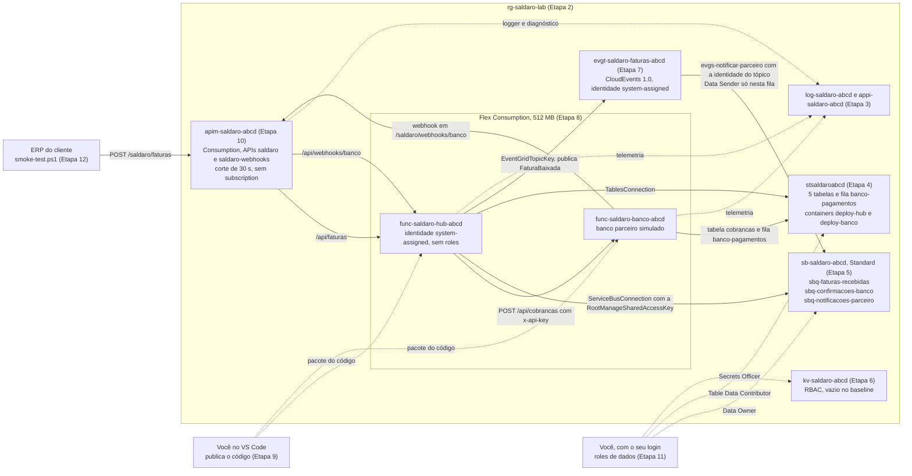

# Lab 0, montado no Portal — "A Saldaro 2.0 peça por peça"

**Version-anchor:** Q4-2026 · **Quando:** em casa, **antes** da aula ao vivo · **Duração:** ~3 h de trabalho seu (o tempo de cada etapa está no título dela) · **Cenário:** Saldaro Pagamentos S.A., empresa fictícia

> **CUSTO E FREE TRIAL**
> | Item | Valor |
> |------|-------|
> | Custo mensal (se deixar rodando) | ~R$ 60 (o Service Bus Standard responde por ~R$ 55; o resto cabe nas franquias gratuitas ou custa centavos) |
> | Custo real desta montagem | ~R$ 0,20 a 1 se montar e apagar no mesmo dia, conforme a hora em que apagar; ~R$ 2 a 3 se montar na véspera e apagar no fim da aula. Montar à mão leva ~3 h, contra ~10 min do script: são uns R$ 0,20 a mais de Service Bus |
> | Compatível com Azure Free Trial (US$ 200)? | **Sim**, com um cuidado: no Free Trial, a cota do Flex Consumption é de **15 núcleos por região**, somando todos os seus apps Flex. Use o que o Bicep usa: **512 MB** por instância e no máximo **10** instâncias no hub e **5** no banco simulado (~13 núcleos no pior caso, Passo 8.3). Com o padrão do Portal (2.048 MB e até 100 instâncias), a rajada de 1.000 faturas do Incidente 1 esbarra na cota |
>
> **Regra de ouro:** o `rg-saldaro-lab` só vive até o fim da aula. Para apagar tudo, rode `pwsh ./scripts/limpar.ps1 -Sufixo <seu-sufixo>` ou siga a [Limpeza de Recursos](#limpeza-de-recursos) pelo Portal: apague o Resource Group **e** purgue o Key Vault e o APIM, que senão ficam presos no soft-delete com o nome reservado. O Service Bus Standard cobra ~R$ 0,07 por hora, com ou sem tráfego.
>
> **Por que tão barato?** APIM Consumption, Functions (Flex Consumption), Event Grid, Key Vault e Log Analytics cobram por uso, e o volume do lab cabe na franquia gratuita de cada um ou, no Key Vault, que não tem franquia, custa centavos. A franquia do Flex (100 mil GB-s e 250 mil execuções por mês, por assinatura) tem uma ressalva: a [página de preços do Functions](https://azure.microsoft.com/pricing/details/functions/) diz que ela vale "on paid, consumption subscriptions only" e não cita o Free Trial, então a fonte não deixa claro se ela vale no seu. Se não valer, o pouco que os dois apps executam sai do crédito de US$ 200, em valores pequenos. O único medidor que corre por hora é o do Service Bus Standard.

> **ESTE GUIA É O LAB 0 FEITO À MÃO**
>
> Ele monta, clique a clique no Portal, **exatamente** o ambiente que o [Lab 0](Lab0_Fundacao_Guia.md) sobe com um comando (`deploy.ps1 -Cenario 0`): os mesmos nomes, SKUs e configurações do Bicep do cenário 0, o baseline ingênuo. Em cada recurso, um bloco recolhível **Por que este recurso** explica o objetivo, o papel na Saldaro, a alternativa que ficou de fora, a configuração escolhida, os custos e o que mudaria em produção, com as fontes. A prova é a mesma do Lab 0: o `smoke-test.ps1` passando.
>
> Escolha **um** caminho: este guia (~3 h, para entender cada peça) ou o Lab 0 (~30 min, com o script). Os dois deixam o mesmo ambiente, e a aula ao vivo começa nos incidentes, partindo dele. Chegue à aula com isto pronto:
>
> - [ ] Ferramentas, kit, Portal na assinatura certa e sufixo escolhido (Etapa 1)
> - [ ] Os recursos das Etapas 2 a 11 criados com os nomes do seu sufixo
> - [ ] O código publicado nos dois Function Apps (Etapa 9)
> - [ ] `scripts/.env.local` montado e `smoke-test.ps1` passando (Etapa 12)
> - [ ] Post-mortem da montagem e pré-mortem da aula escritos (Etapa 13)
> - [ ] A seção [Antes do primeiro `deploy.ps1`](#antes-do-primeiro-deployps1) lida: ela vale para o plano B dos incidentes e para os guias de depois da aula
>
> **Plano B, a qualquer momento:** travou e o tempo apertou? Apague o que montou e suba pelo script, nas Etapas 1 a 5 do Lab 0: `pwsh ./scripts/limpar.ps1 -Sufixo <seu-sufixo>` e depois `pwsh ./scripts/deploy.ps1 -Cenario 0 -Sufixo <seu-sufixo>`. São uns 15 minutos.

## Guia Passo-a-Passo

**Disciplina:** Integração e Mensageria no Azure (aula hands-on da pós-graduação TFTEC + Anhanguera)
**Aula:** Lab 0, a fundação, montado à mão no Portal. Os três incidentes da aula ao vivo partem do ambiente que você monta aqui.
**Cenário:** a Saldaro Pagamentos S.A. ("Saldaro Hub") é um hub de cobrança B2B. Empresa, pessoas, números e incidentes são fictícios; qualquer semelhança é coincidência.

---

## Por que montar à mão

O Bicep do kit (`infra/main.bicep`) descreve o ambiente inteiro, e o `deploy.ps1` aplica tudo em uns 10 minutos. É rápido, mas é opaco: o script cria a fila de confirmações sem você ver a caixa **Enable sessions** desmarcada, grava `Cenario__AsyncRequestReply = false` sem você escolher o valor e dá ao tópico do Event Grid uma role sem você decidir o escopo. Montando à mão, você toma cada uma dessas decisões, e cada incidente da aula passa a mexer em algo que você mesmo criou.

Você também sai com a régua da Leitura 3.7: tudo o que clicou aqui, o Bicep declara em texto. É por isso que o script recria o ambiente em minutos, igual, e o Portal não.

## O que você vai montar

São os recursos da [Tabela de Recursos](#tabela-de-recursos), em dez etapas de montagem (2 a 11), na ordem em que um depende do outro. A jornada de uma fatura por eles, em dez passos, está no Lab 0 ([A jornada de uma fatura no baseline](Lab0_Fundacao_Guia.md#a-jornada-de-uma-fatura-no-baseline-em-dez-passos)); vale ler antes de começar.

## Prova: o critério de feito

O mesmo critério do Lab 0:

| # | Critério | Como verificar | Passo |
|---|---|---|---|
| 1 | O smoke test passa | `pwsh ./scripts/smoke-test.ps1` termina sem erro (`$LASTEXITCODE` = `0`) e imprime o `faturaId` e o `operation_Id` | 12.3 |
| 2 | A fatura chega ao fim da jornada em menos de 2 min | `GET /saldaro/faturas/{id}` pelo APIM devolve `status` = `baixada` ou `notificada`, com `baixadaEm` menos de 120 s depois de `criadaEm`; o banco simulado mostra `quantidade` = `1` cobrança para ela | 12.4 |
| 3 | O fluxo aparece correlacionado no Application Insights | No **Search**, o `faturaId` traz os eventos `fatura.recebida`, `cobranca.emitida`, `confirmacao.recebida` e `fatura.baixada` (e `notificacao.enviada`, se a fatura já estiver `notificada`). O **End-to-end transaction details** do `operation_Id` do `POST` mostra `PostFatura` chamando o banco simulado (`PostCobranca`) | 12.5 |

---

## Pré-requisitos

- Conta Azure com assinatura ativa: o **Azure Free Trial** (US$ 200 por 30 dias) basta. Você precisa ser **Owner** da assinatura, porque as Etapas 7 e 11 criam role assignments; quem cria a conta Free Trial já é.
- As ferramentas da Etapa 1. Os comandos deste guia são de PowerShell 7 (`pwsh`), na raiz do kit.
- Navegador para o [Portal Azure](https://portal.azure.com).

---

## Tabela de Recursos

`<sufixo>` são os 4 a 6 caracteres que você escolhe no Passo 1.4. São os mesmos recursos que o `deploy.ps1` cria no Lab 0.

| Recurso | Nome | SKU/Tier | Custo Estimado (mensal) | Etapa |
|---------|------|----------|------------------------|-------|
| Resource Group | `rg-saldaro-lab` | N/A | Gratuito | 2 |
| Log Analytics workspace | `log-saldaro-<sufixo>` | Pay-as-you-go, retenção de 30 dias | Gratuito até 5 GB por mês | 3 |
| Application Insights | `appi-saldaro-<sufixo>` | Workspace-based; recebe a telemetria dos dois apps e do APIM | Incluído no Log Analytics | 3 |
| Storage account | `stsaldaro<sufixo>` | StorageV2, Standard LRS, Hot; tabelas `faturas`, `inbox`, `idempotencia`, `conciliacao` e `cobrancas`; fila `banco-pagamentos`; containers `deploy-hub` e `deploy-banco` | ~R$ 1 | 4 |
| Service Bus namespace | `sb-saldaro-<sufixo>` | Standard | ~R$ 55 (US$ 0,0134/h) | 5 |
| Filas | `sbq-faturas-recebidas`, `sbq-confirmacoes-banco`, `sbq-notificacoes-parceiro` | lock de 1 min, `maxDeliveryCount` 10, sem sessions e sem duplicate detection; dead-lettering na expiração só na de confirmações | Incluído no namespace | 5 |
| Key Vault | `kv-saldaro-<sufixo>` | Standard, autorização RBAC, vazio no baseline; soft-delete de 7 dias, sem purge protection | ~R$ 0 (cobra por operação) | 6 |
| Event Grid topic | `evgt-saldaro-faturas-<sufixo>` | CloudEvents 1.0, identidade system-assigned; event subscription `evgs-notificar-parceiro` → `sbq-notificacoes-parceiro` | Gratuito até 100 mil operações por mês | 7 |
| Planos de hospedagem | criados pelo Portal junto com cada app (o Bicep os chama de `asp-saldaro-banco-<sufixo>` e `asp-saldaro-hub-<sufixo>`) | Flex Consumption (FC1), 512 MB por instância, até 5 instâncias no banco e 10 no hub | ~R$ 0 na franquia (Flex: 100 mil GB-s e 250 mil execuções por mês); no Free Trial, ver a ressalva da caixa de custo | 8 |
| Function App (banco simulado) | `func-saldaro-banco-<sufixo>` | .NET 10 isolated, sem identidade | Incluído no plano | 8 |
| Function App (hub) | `func-saldaro-hub-<sufixo>` | .NET 10 isolated, identidade system-assigned (sem roles no baseline) | Incluído no plano | 8 |
| API Management | `apim-saldaro-<sufixo>` | Consumption; APIs `saldaro` (faturas) e `saldaro-webhooks` (webhook do banco) | Gratuito até 1 milhão de chamadas por mês | 10 |
| Roles | tópico → `Azure Service Bus Data Sender` na fila `sbq-notificacoes-parceiro`; você → `Azure Service Bus Data Owner` (namespace), `Storage Table Data Contributor` (storage), `Key Vault Secrets Officer` (Key Vault) | Role assignments | Gratuito | 7 e 11 |
| Alertas | `ag-saldaro`, `alrt-heartbeat-ausente`, `alrt-dlq-confirmacoes` | **Não existem no baseline**; só nascem no desafio 3.6 | R$ 0 | — |

> **Custo total estimado:** ~R$ 60/mês se o Resource Group for esquecido ligado; ~R$ 2 a 3 da véspera até o fim da aula. Valores com ~R$ 5,50/US$ e preços de lista de Brazil South em outubro de 2026; confira na [calculadora de preços](https://azure.microsoft.com/pricing/calculator/) na data da aula. **Evite** APIM Developer, Service Bus Premium, Functions Premium e Defender for Storage: o kit não precisa de nenhum deles.

## O que fica diferente do Bicep (e por que não atrapalha)

O Portal decide algumas coisas sozinho. Nenhuma delas muda o comportamento do lab, mas convém saber quais são:

| Diferença | Montado à mão | No Bicep | Importa? |
|---|---|---|---|
| Nome dos planos do Flex | o Portal cria um plano por app e escolhe o nome, no formato `ASP-rgsaldarolab-<4 caracteres>` | `asp-saldaro-banco-<sufixo>` e `asp-saldaro-hub-<sufixo>` | Não para a aula. **Sim** para o `deploy.ps1`: ele para nos Function Apps, porque o Flex não troca o plano de um app (ver [Antes do primeiro `deploy.ps1`](#antes-do-primeiro-deployps1)) |
| Endereço dos Function Apps | o Portal gera um endereço com hash e região (**Secure unique default hostname**, ligado por padrão), como `func-saldaro-hub-abcd-<hash>.brazilsouth-01.azurewebsites.net` | `func-saldaro-hub-abcd.azurewebsites.net` | Não: o kit sempre usa o **Default domain** que o app recebeu, nunca o endereço montado à mão |
| Nome das role assignments | um GUID aleatório | um GUID calculado (`guid(...)`), igual em todo deploy | **Sim**, para o `deploy.ps1`: apague as suas antes do primeiro (ver a mesma seção) |
| **Message time to live** das filas | 14 dias, o padrão do painel | o padrão do serviço (o maior valor possível) | Não: as mensagens do lab são consumidas em segundos, e o `check-drift.ps1` não compara TTL |
| Soft delete de blobs | ligado pelo Portal (7 dias) | não declarado | Não |
| Logger do APIM | autenticado pela chave de instrumentação | pela connection string do Application Insights | Não |
| Tags | só se você puser | `projeto = saldaro-hub` e `ambiente = lab` em tudo | Não (o Passo 1.6 sugere pôr) |
| Histórico de deployments | nenhum | um por `deploy.ps1` | O `check-drift.ps1` compara com o último deployment: até o primeiro `deploy.ps1`, ele não tem com o que comparar e sai com código 2 |

---

## Diagrama: o que você monta, etapa por etapa

No diagrama, `abcd` é o sufixo de exemplo. Setas cheias são o caminho da fatura e das credenciais do baseline; setas tracejadas, publicação, permissões e telemetria.



---

## Etapa 1 — Preparar a máquina, o Portal e o sufixo (~15 min; ~5 min se já fez as Etapas 1 a 4 do Lab 0)

### Passo 1.1: Instalar e conferir as ferramentas

| Ferramenta | Para que serve nesta montagem | Obrigatória? |
|---|---|---|
| Navegador | Montar tudo no Portal | Sim |
| VS Code com a extensão **Azure Functions** e a extensão **C#** | Publicar o código dos dois apps (Etapa 9) | Sim |
| .NET 10 SDK | A extensão compila o C# com `dotnet publish` na sua máquina | Sim |
| PowerShell 7 | Gerar os segredos (Passo 8.6), gravar o `.env.local` e rodar o smoke test (Etapa 12) | Sim |
| Git | Clonar o kit | Sim |
| Azure CLI com Bicep | Os blocos **Equivalente `az`** deste guia; na aula, os scripts dos incidentes e o plano B | Opcional aqui, obrigatória na aula |
| Azure Functions Core Tools | Rodar os apps na sua máquina | **Não** |

A instalação está no Passo 1.2 do [Lab 0](Lab0_Fundacao_Guia.md#passo-12-instalar-o-que-faltar). As extensões do VS Code:

```powershell
code --install-extension ms-azuretools.vscode-azurefunctions
code --install-extension ms-dotnettools.csharp
dotnet --list-sdks     # uma linha começando com 10.0.
pwsh --version         # 7.4 ou mais novo
```

### Passo 1.2: Clonar o kit

```powershell
git clone https://github.com/tftec-guilherme/aula-integracao-mensageria.git
cd aula-integracao-mensageria
```

Rode todos os comandos deste guia **na raiz do repositório**.

### Passo 1.3: Entrar no Portal na assinatura certa

1. Abra o [Portal Azure](https://portal.azure.com) e entre com a conta da sua Free Trial.
2. Se a sua conta tiver mais de um diretório (o da empresa, por exemplo), clique na sua conta, no canto superior direito, e use **Switch directory** para ir ao diretório da conta pessoal.
3. Na barra de busca, digite **Subscriptions** e confira a sua Free Trial (costuma se chamar **Azure subscription 1**), ativa.
4. Na mesma lista, a coluna **My role** da sua assinatura tem que mostrar **Owner** (ou clique nela → **Access control (IAM)** → aba **Check access**, que lista as suas roles). Sem ela, você não consegue criar as role assignments das Etapas 7 e 11.

### Passo 1.4: Escolher o sufixo

Storage, Service Bus, Key Vault, Event Grid, Function Apps e APIM viram endereços DNS, e o nome deles precisa ser único. O sufixo resolve isso:

- **4 a 6 caracteres**, só **letras minúsculas e dígitos**: sem hífen, sem acento, sem maiúscula. O nome do Storage (`stsaldaro<sufixo>`) não aceita nada além disso.
- **Um sufixo só para tudo**, do primeiro recurso ao último. O `.env.local`, os scripts e o `deploy.ps1` montam todos os nomes a partir dele.
- Neste guia, o sufixo de exemplo é `abcd`. **Troque pelo seu** em todos os nomes.

| Recurso | Nome com o sufixo `abcd` | Nome global? |
|---|---|---|
| Resource Group | `rg-saldaro-lab` | Não |
| Log Analytics workspace | `log-saldaro-abcd` | Não |
| Application Insights | `appi-saldaro-abcd` | Não |
| Storage account | `stsaldaroabcd` | Sim |
| Service Bus namespace | `sb-saldaro-abcd` | Sim |
| Key Vault | `kv-saldaro-abcd` | Sim |
| Event Grid topic | `evgt-saldaro-faturas-abcd` | Sim |
| Function App do banco simulado | `func-saldaro-banco-abcd` | Sim |
| Function App do hub | `func-saldaro-hub-abcd` | Sim |
| API Management | `apim-saldaro-abcd` | Sim |

O Portal confere cada nome global enquanto você digita: um aviso vermelho embaixo do campo quer dizer que o nome está ocupado. Se isso acontecer, troque o sufixo de **todos** os recursos, não só daquele. Para conferir os principais antes de começar, use os comandos do Passo 4.2 do [Lab 0](Lab0_Fundacao_Guia.md#passo-42-conferir-se-os-nomes-globais-estão-livres).

### Passo 1.5: Conferir o Flex Consumption em Brazil South

A lista de regiões do assistente do Flex Consumption (Passo 8.1) só mostra as regiões em que ele existe. Para saber antes, rode os comandos do Passo 3.4 do [Lab 0](Lab0_Fundacao_Guia.md#passo-34-confirmar-o-flex-consumption-em-brazil-south). Se o **Brazil South** não estiver disponível para .NET 10, **não monte à mão**: use o Lab 0 com `-Plano Consumption`, porque o plano B de hospedagem muda vários app settings que este guia não cobre.

### Passo 1.6: Combinar as convenções da montagem

- **Região:** **Brazil South** em todos os recursos.
- **Resource group:** `rg-saldaro-lab` em todos.
- **Tags** (recomendado): na aba **Tags** de cada assistente, `projeto` = `saldaro-hub` e `ambiente` = `lab`, como o Bicep faz. Facilitam achar o lab e conferir o custo.
- **Abas e campos que o guia não cita:** deixe o padrão.
- **Anotações:** guarde num bloco de notas os endereços que aparecem pelo caminho (o **Default domain** de cada app, o **Topic Endpoint**). **Nunca** anote chaves nem connection strings: elas vão direto do Portal para o app setting.

---

## Etapa 2 — Resource Group (~3 min)

### Passo 2.1: Criar o `rg-saldaro-lab`

1. Na barra de busca do Portal, digite **Resource groups** e clique no resultado.
2. Clique em **+ Create** e preencha:

| Campo | Valor |
|-------|-------|
| **Subscription** | a sua Free Trial |
| **Resource group name** | `rg-saldaro-lab` |
| **Region** | **(South America) Brazil South** |

3. Aba **Tags**: `projeto` = `saldaro-hub` e `ambiente` = `lab`.
4. Clique em **Review + create** e depois em **Create**.

**Confira:** o `rg-saldaro-lab` aparece na lista de **Resource groups**, com a região **Brazil South**.

<details>
<summary><strong>Por que este recurso: Resource Group</strong></summary>

**Objetivo.** Dar ao lab uma fronteira única de ciclo de vida: tudo nasce junto, é cobrado junto e morre junto, num clique.

**Descrição.** O Resource Group é um contêiner lógico do Azure Resource Manager para os recursos de uma solução. Não executa nada: guarda os metadados dos recursos e serve de escopo para permissões, políticas, locks, deploys e relatórios de custo.

**Papel na Saldaro.** Todos os recursos do kit moram nele, e é ele que torna a regra de ouro viável: "When you delete a resource group, all resources in the resource group are also deleted". O `deploy.ps1` aplica o Bicep no escopo dele (`targetScope = 'resourceGroup'`), o `check-drift.ps1` compara com o histórico de deployments dele e o `limpar.ps1` começa por ele. Sem um grupo só, a limpeza vira caça ao recurso esquecido, e é o recurso esquecido que gera conta.

**Por que um grupo só, e não um por tipo de serviço (ou uma assinatura só para o lab).** O critério do Learn é ciclo de vida, não tipo de recurso: "All resources in your resource group should share the same lifecycle. You deploy, update, and delete them together." Um grupo de rede, outro de dados e outro de apps misturaria ciclos e espalharia a limpeza: agrupe por ciclo de vida e por dono. Grupos separados vencem quando os ciclos diferem de verdade, como um workspace central de logs que sobrevive às aplicações; recursos de grupos diferentes conversam normalmente. Uma assinatura dedicada vence quando é preciso separar cobrança e cotas, que valem por assinatura (a do Flex Consumption é por assinatura e região); no lab, o próprio Free Trial já faz esse papel.

**Por que esta configuração.**

- **Region = Brazil South:** o grupo guarda os metadados dos recursos na região escolhida, e o Learn recomenda a mesma região dos recursos. É também a região em que o kit confirmou o Flex Consumption com .NET 10 (Passo 1.5).
- **Nome fixo, sem sufixo:** o nome do grupo só precisa ser único dentro da assinatura; os scripts o leem do `.env.local` (`SALDARO_RG`).
- **Tags `projeto` e `ambiente`:** filtram custo e inventário. Cuidado que pega muita gente: os recursos **não herdam** as tags do grupo ("Resources don't inherit the tags you apply to a resource group"). Por isso o Passo 1.6 manda pôr as tags em cada assistente, e o Bicep as aplica em todo recurso.

**Custos.**

- **Modelo de cobrança:** grátis. O grupo não tem medidor; quem cobra são os recursos dentro dele.
- **Custo real no lab:** R$ 0.
- **Se ficar ligado:** R$ 0 pelo grupo; os ~R$ 60/mês são dos recursos (quase tudo Service Bus).
- **Franquia e Free Trial:** nenhum limite que o lab alcance.
- **O que encarece em produção:** nada no grupo em si; o risco é esquecer um grupo inteiro ligado, e é para isso que existem budgets.

**Em produção, mudaria.** Um grupo por carga e por ambiente, separados por ciclo de vida; lock **CanNotDelete** no grupo de produção (ele protege só o plano de controle: não impede apagar mensagens, linhas ou blobs pelo plano de dados); tags obrigatórias por Azure Policy, já que não há herança; roles atribuídas a grupos do Microsoft Entra ID no escopo do grupo, não a pessoas; e um budget com alerta, que avisa mas não desliga nada ("Resources aren't affected, and your consumption isn't stopped").

**Fontes:** [What is Azure Resource Manager?](https://learn.microsoft.com/en-us/azure/azure-resource-manager/management/overview) · [Use tags to organize your Azure resources](https://learn.microsoft.com/en-us/azure/azure-resource-manager/management/tag-resources) · [Lock your Azure resources](https://learn.microsoft.com/en-us/azure/azure-resource-manager/management/lock-resources) · [Create and manage budgets](https://learn.microsoft.com/en-us/azure/cost-management-billing/costs/tutorial-acm-create-budgets) · [Best practices for Azure RBAC](https://learn.microsoft.com/en-us/azure/role-based-access-control/best-practices)

</details>

<details>
<summary>Equivalente <code>az</code></summary>

```powershell
az group create --name rg-saldaro-lab --location brazilsouth --tags projeto=saldaro-hub ambiente=lab
```

</details>

---

## Etapa 3 — Log Analytics e Application Insights (~8 min)

### Passo 3.1: Criar o workspace `log-saldaro-<sufixo>`

1. Na barra de busca, digite **Log Analytics workspaces** e clique no resultado.
2. Clique em **+ Create** e preencha:

| Campo | Valor |
|-------|-------|
| **Subscription** | a sua Free Trial |
| **Resource group** | `rg-saldaro-lab` |
| **Name** | `log-saldaro-<sufixo>` |
| **Region** | **Brazil South** |

3. Tags; **Review + Create** → **Create**.

O workspace nasce no pay-as-you-go e com retenção de 30 dias, os mesmos valores do Bicep: não há nada a mudar.

<details>
<summary><strong>Por que este recurso: Log Analytics workspace</strong></summary>

**Objetivo.** Ter um lugar único onde toda a telemetria da Saldaro (hub, banco simulado e APIM) fica guardada e consultável por KQL, para provar a jornada de uma fatura e investigar os incidentes.

**Descrição.** O Log Analytics workspace é o armazenamento de logs do Azure Monitor: recebe registros em tabelas, guarda por um período de retenção e responde a consultas KQL. Cobra pelo volume ingerido e pela retenção além da gratuita.

**Papel na Saldaro.** É o "disco" do Application Insights do Passo 3.2: as tabelas `requests`, `dependencies`, `exceptions`, `traces` e `customEvents` moram aqui (no Log Analytics aparecem como `AppRequests`, `AppEvents` e assim por diante). Os arquivos de `kql/` rodam sobre ele. Sem workspace, não há Prova 3, nem as hipóteses por KQL dos Incidentes 1 a 3 (`faturas-por-referencia-erp.kql`, `baixa-duplicada.kql`, `dlq-por-motivo.kql`), nem o alerta de heartbeat do desafio 3.6, que é uma consulta agendada.

**Por que um workspace, e não o log de cada serviço (nem vários workspaces).** O Learn manda começar com um só: "Your design should always start with a single workspace". Os critérios para ter mais (dados de segurança separados, residência de dados por região, dono dos dados, cobrança separada, retenção diferente por recurso) não existem no lab. O Application Insights clássico, sem workspace, foi aposentado: hoje ele é sempre workspace-based (pergunta 16). Ver o log de cada serviço isolado até ajuda a olhar um recurso, mas perde a junção pelo `faturaId` que a prova pede. O Azure Monitor workspace é outro produto, para métricas Prometheus e OpenTelemetry com PromQL; vence quando a equipe já trabalha com Prometheus.

**Por que esta configuração.**

- **Pricing tier Pay-as-you-go** (`PerGB2018`, o padrão): paga por GB ingerido. Os commitment tiers começam em 100 GB por dia, ordens de grandeza acima do lab.
- **Retenção de 30 dias** (o padrão do assistente e o que o Bicep declara): cabe nos 31 dias de retenção sem custo das tabelas Analytics; o lab vive horas.
- **Region = Brazil South:** junto dos recursos que mandam dados para ele. O Learn só separa workspaces por região quando há exigência de residência de dados ou custo de banda relevante.
- **Modo de acesso** (o padrão, "Use resource or workspace permissions", que o Bicep também declara): quem pode ler um recurso lê a telemetria dele, sem ganhar acesso ao workspace inteiro.

**Custos.**

- **Modelo de cobrança:** por GB ingerido (Analytics Logs) e por dia de retenção além do período gratuito. Consulta interativa em tabela Analytics não é cobrada.
- **Custo real no lab:** R$ 0. O lab gera megabytes.
- **Se ficar ligado:** ~R$ 0 enquanto o volume ficar abaixo de 5 GB/mês, e o timer de 5 em 5 minutos não chega perto disso.
- **Franquia e Free Trial:** os primeiros 5 GB/mês por conta de cobrança são grátis; a retenção é gratuita por 31 dias nas tabelas Analytics e por 90 dias nos dados do Application Insights. Cabe no Free Trial sem cuidado especial.
- **O que encarece em produção:** volume. Acima da franquia, ~US$ 4,60/GB em Brazil South (~R$ 25/GB). Pesam telemetria sem sampling, log em nível Information de tudo, retenção longa e o Microsoft Sentinel no mesmo workspace, que passa a cobrar sobre todo dado ingerido nele.

**Em produção, mudaria.** Um workspace por ambiente (e por região, se houver exigência de residência), com retenção por tabela conforme a política de auditoria; daily cap só como rede de segurança, porque, atingido, a coleta para e o time fica cego ("data collection stops"); alerta de ingestão anormal; e, com rede privada, ingestão e consulta pelo Azure Monitor Private Link Scope, o AMPLS (pergunta 20).

**Fontes:** [Design a Log Analytics workspace architecture](https://learn.microsoft.com/en-us/azure/azure-monitor/logs/workspace-design) · [Azure Monitor Logs cost calculations and options](https://learn.microsoft.com/en-us/azure/azure-monitor/logs/cost-logs) · [Set daily cap on Log Analytics workspace](https://learn.microsoft.com/en-us/azure/azure-monitor/logs/daily-cap) · [Azure Monitor pricing](https://azure.microsoft.com/pricing/details/monitor/) · [Create a Log Analytics workspace](https://learn.microsoft.com/en-us/azure/azure-monitor/logs/quick-create-workspace?tabs=azure-portal) · Dúvidas: [FAQ das tecnologias](../docs/research/2026-10-14-duvidas-das-tecnologias.md), veja as perguntas 16 e 20

</details>

### Passo 3.2: Criar o `appi-saldaro-<sufixo>` ligado ao workspace

1. Na barra de busca, digite **Application Insights** e clique no resultado.
2. Clique em **+ Create** e preencha:

| Campo | Valor |
|-------|-------|
| **Subscription** | a sua Free Trial |
| **Resource Group** | `rg-saldaro-lab` |
| **Name** | `appi-saldaro-<sufixo>` |
| **Region** | **Brazil South** |
| **OTLP support** | **Off** (o padrão) |
| **Log Analytics Workspace** (em **WORKSPACE DETAILS**) | `log-saldaro-<sufixo>` |

3. Tags; **Review + create** → **Create**.

> **Troque o workspace.** Ao escolher o resource group, o campo **Log Analytics Workspace** se preenche sozinho com `(new) DefaultWorkspace-<id da assinatura>-CQ`: um workspace **novo**, fora do `rg-saldaro-lab`, que não sai junto quando você apagar o lab. Escolha o `log-saldaro-<sufixo>` na lista.

**Confira:** na **Overview** do `appi-saldaro-<sufixo>`, em **Essentials**, o **Logs workspace** é o `log-saldaro-<sufixo>` e aparece a **Connection string** (você não precisa copiá-la: na Etapa 8, os apps escolhem o Application Insights pelo nome). No Resource Group podem aparecer a regra **Failure Anomalies** e o action group **Application Insights Smart Detection**, que o próprio Application Insights cria; eles não são do kit (Passo 10.6 do Lab 0).

<details>
<summary><strong>Por que este recurso: Application Insights</strong></summary>

**Objetivo.** Costurar a jornada da fatura de ponta a ponta: o mesmo `faturaId` e o mesmo `operation_Id` visíveis no APIM, no hub e no banco simulado, num lugar só.

**Descrição.** O Application Insights é o APM do Azure Monitor: recebe requisições, dependências, exceções, logs e eventos customizados das aplicações e mostra a transação distribuída (**Search**, **End-to-end transaction details**, **Application map**). No modo workspace-based, o recurso não guarda dado: grava no Log Analytics do Passo 3.1, consultável por KQL (os arquivos de `kql/`).

**Papel na Saldaro.** Os dois Function Apps (Passos 8.1 e 8.2) e o APIM (Passos 10.2 e 10.3) mandam telemetria para o **mesmo** Application Insights. O hub grava os eventos de negócio (`fatura.recebida`, `cobranca.emitida`, `confirmacao.recebida`, `fatura.baixada`, `notificacao.enviada`, `mensagem.deadletter`...), e é por eles que a Prova 3 acha a fatura no **Search**. No Incidente 1, é aqui que aparecem o 504 de 30 s do APIM e o `PostFatura` de 45 s com resultado 499; no Incidente 2, as três baixas da mesma fatura; no Incidente 3, as reentregas e os motivos de DLQ; no desafio 3.6, a ausência do `conciliacao.heartbeat`. Sem ele, cada incidente vira adivinhação.

**Por que este, e não o log de cada serviço (ou um Application Insights por app).** Na divisão da pergunta 16, o Azure Monitor é a plataforma, o Log Analytics é onde o dado mora, e o Application Insights é a camada de APM que entende transação distribuída. Com o log de cada serviço separado, a jornada se perde nas fronteiras (APIM, hub, banco, fila, webhook). Um Application Insights por app vence quando times e ciclos de vida são diferentes; aqui a jornada é uma só, e o kit quer exatamente juntar as três origens. O modo clássico, sem workspace, foi aposentado.

**Por que esta configuração.**

- **Log Analytics Workspace = `log-saldaro-<sufixo>`:** deixa a telemetria no workspace que você controla e que morre com o grupo; o quadro **Troque o workspace**, acima, mostra o que acontece com a sugestão do Portal.
- **Region = Brazil South:** junto do workspace e das origens.
- **Sem sampling no lab** (decisão do kit: desligado no `host.json` e no worker, e 100% no APIM, Passo 10.3): a prova conta eventos por `faturaId`, e um evento amostrado sumiria. É o oposto do padrão do Functions, que vem com sampling ligado.
- **Sem alertas no baseline, ingênuo de propósito (item 6):** os alertas do kit (`alrt-heartbeat-ausente` e `alrt-dlq-confirmacoes`) só nascem no desafio 3.6. A regra **Failure Anomalies**, que o próprio Application Insights cria, avisa quando a taxa de falhas sobe, mas não enxerga ausência de sinal: um timer que parou não falha, só some.

**Custos.**

- **Modelo de cobrança:** o recurso não tem medidor próprio; ingestão e retenção são cobradas pelo workspace onde o dado mora.
- **Custo real no lab:** R$ 0 (megabytes, dentro dos 5 GB/mês).
- **Se ficar ligado:** ~R$ 0 no volume do lab. Se você criar os alertas do desafio 3.6 e esquecer, somam ~R$ 8/mês (a regra de log a cada 5 min custa US$ 1,50/mês; a de métrica cabe nas 10 séries grátis).
- **Franquia e Free Trial:** os dados do Application Insights têm 90 dias de retenção sem custo, e a ingestão entra nos 5 GB/mês do workspace. Cabe no Free Trial.
- **O que encarece em produção:** amostragem de 100% com tráfego real (no APIM, o Learn mediu queda de 40% a 50% no throughput acima de 1.000 requisições por segundo com log de tudo), log de payload e testes de disponibilidade, que são cobrados como qualquer telemetria.

**Em produção, mudaria.** Sampling ligado e calibrado, tirando requisições e exceções da amostragem; níveis de log por categoria; migração do SDK clássico 2.x (que o kit fixa) para OpenTelemetry antes da aposentadoria do 2.x, em 31/03/2027; alertas de métrica e de log desde o primeiro dia (é o que o 3.6 ensina); e, com rede privada, AMPLS.

**Fontes:** [Create and configure Application Insights resources](https://learn.microsoft.com/en-us/azure/azure-monitor/app/create-workspace-resource?tabs=portal) · [Azure Monitor Logs cost calculations and options](https://learn.microsoft.com/en-us/azure/azure-monitor/logs/cost-logs) · [Configure monitoring for Azure Functions](https://learn.microsoft.com/en-us/azure/azure-functions/configure-monitoring) · [Integrate API Management with Application Insights](https://learn.microsoft.com/en-us/azure/api-management/api-management-howto-app-insights) · [Overview of Azure Monitor alerts](https://learn.microsoft.com/en-us/azure/azure-monitor/alerts/alerts-overview) · Dúvidas: [FAQ das tecnologias](../docs/research/2026-10-14-duvidas-das-tecnologias.md), veja a pergunta 16

</details>

> **Ganhe tempo:** o APIM Consumption leva alguns minutos para ativar. Se quiser, faça agora o Passo 10.1 (só o serviço do APIM) e volte; as APIs ficam para a Etapa 10.

<details>
<summary>Equivalente <code>az</code></summary>

```powershell
$s = 'abcd'   # troque pelo SEU sufixo
az monitor log-analytics workspace create -g rg-saldaro-lab -n "log-saldaro-$s" -l brazilsouth --retention-time 30
az monitor app-insights component create -g rg-saldaro-lab --app "appi-saldaro-$s" -l brazilsouth `
  --kind web --application-type web --workspace "log-saldaro-$s"
```

</details>

---

## Etapa 4 — Storage: tabelas, fila e containers (~12 min)

### Passo 4.1: Criar o `stsaldaro<sufixo>`

1. Na barra de busca, digite **Storage accounts** e clique no resultado (abre o **Storage center**, na lista de contas).
2. Clique em **+ Create**. Na aba **Basics**:

| Campo | Valor |
|-------|-------|
| **Subscription** | a sua Free Trial |
| **Resource group** | `rg-saldaro-lab` |
| **Storage account name** | `stsaldaro<sufixo>` (só minúsculas e dígitos) |
| **Region** | **Brazil South** |
| **Primary service** | **Azure Blob Storage or Azure Data Lake Storage** (é obrigatório, mas é só uma dica para o Portal e não muda o tipo da conta) |
| **Performance** | **Standard** |
| **Redundancy** | **Locally-redundant storage (LRS)** (o padrão é GRS) |

3. Aba **Advanced**: **Access tier** = **Hot** (o padrão). O resto como está.
4. Aba **Security** (todos os valores abaixo já são o padrão; só confira):

| Campo | Valor | Por quê |
|-------|-------|---------|
| **Require secure transfer for REST API operations** | marcado | só HTTPS, como o Bicep (`supportsHttpsTrafficOnly`) |
| **Allow enabling anonymous access on individual containers** | **desmarcado** | nenhum container do kit é público (`allowBlobPublicAccess: false`) |
| **Enable storage account key access** | **marcado** | o baseline usa connection string, com a chave da conta, de propósito (`allowSharedKeyAccess: true`) |
| **Default to Microsoft Entra authorization in the Azure portal** | desmarcado | o Bicep não liga |
| **Minimum TLS version** | **Version 1.2** | |
| **Enable Defender for Storage** (se aparecer) | **desmarcado** | cobra à parte e o kit não usa |

5. Abas **Networking**, **Data protection** e **Encryption**: deixe o padrão.
6. Tags; **Review + create** → **Create** → **Go to resource**.

<details>
<summary><strong>Por que este recurso: Storage account</strong></summary>

**Objetivo.** Dar à Saldaro um armazenamento barato e único para três necessidades: o estado do hub (tabelas), a infraestrutura do banco simulado (tabela e fila) e o que os Function Apps exigem para rodar (host storage e pacote de deploy).

**Descrição.** A storage account é a conta que expõe os serviços de dados do Azure Storage (Blob, Queue, Table e Files) sob um nome DNS (`stsaldaro<sufixo>.table.core.windows.net`, `.queue.`, `.blob.`). Redundância, rede, criptografia e forma de autenticação valem para todos os serviços da conta.

**Papel na Saldaro.** Uma conta atende quatro papéis: (1) o `AzureWebJobsStorage` dos dois apps, que o Functions exige (chaves de função, estado de bindings, leases); (2) os containers `deploy-banco` e `deploy-hub`, de onde o Flex lê o código; (3) as cinco tabelas; (4) a fila `banco-pagamentos`. Sem ela, nenhum Function App roda ("When you delete that account, your function app stops running") e nenhuma fatura é gravada.

**Por que uma conta só, e não uma por app (ou um banco de dados).** O Learn aceita compartilhar: "Multiple function apps can share the same storage account without any problems. [...] The same storage account that your function app uses can also store your application data. However, this approach isn't always a good idea in a production environment." No lab, uma conta é menos coisa para criar, pagar e apagar. Separar vence em produção com volume: "To maximize performance, use a separate storage account for each function app", e outra conta para os dados da aplicação. A escolha do Table Storage contra Cosmos DB e SQL está no Passo 4.2 (pergunta 13); a da fila de Storage contra o Service Bus, no Passo 4.3 (pergunta 4).

**Por que esta configuração.**

- **Performance = Standard** (StorageV2): o Functions exige conta com Blob, Queue e Table, e as contas Premium e blob-only não têm fila nem tabela.
- **Redundancy = Locally-redundant storage (LRS):** a opção mais barata, com as cópias num único datacenter da região (11 noves de durabilidade por ano). O Learn indica LRS quando o dado "can be easily reconstructed": é o caso de um lab que nasce e morre em um dia.
- **Access tier = Hot:** só vale para blobs (o pacote de deploy, lido a cada partida do app); tabelas e filas não têm tier.
- **Require secure transfer for REST API operations = marcado** e **Minimum TLS version = Version 1.2:** só HTTPS e TLS moderno, como o Bicep.
- **Allow enabling anonymous access on individual containers = desmarcado:** o pacote do código não pode ser público.
- **Enable storage account key access = marcado, ingênuo de propósito (item 4):** o baseline usa connection string com a chave da conta (`AzureWebJobsStorage` e `TablesConnection`), e o Learn recomenda o contrário: "Microsoft Entra ID provides superior security and ease of use over Shared Key". A Leitura 3.5 passa as tabelas do hub para identidade; o `AzureWebJobsStorage` fica com chave, compromisso documentado ([contrato do kit](../docs/research/2026-10-13-contrato-do-kit.md), seção 5.2).
- **Enable Defender for Storage = desmarcado:** cobra à parte, e o lab não tem dado real.
- **Networking no padrão (todas as redes):** os scripts rodam da sua máquina, pela internet ([ADR-0007](../docs/adr/0007-http-triggers-anonymous-e-apim-sem-subscription.md)).

**Custos.**

- **Modelo de cobrança:** por GB armazenado por mês e por bloco de transações, separado por serviço (Blob, Table, Queue) e por redundância. Valores unitários: ver a calculadora (consulta de 2026-10-14).
- **Custo real no lab:** centavos.
- **Se ficar ligado:** ~R$ 1/mês (estimativa do kit).
- **Franquia e Free Trial:** sem franquia relevante, mas o volume do lab é ínfimo; cabe no Free Trial.
- **O que encarece em produção:** ZRS e GZRS custam mais que LRS; volume de transações (Durable Functions e Event Hubs são os grandes geradores que o Learn cita); Defender for Storage; logs de recurso enviados ao Log Analytics; e Private Endpoints, cobrados por hora e por GB processado.

**Em produção, mudaria.** ZRS no mínimo (é requisito do host storage quando o Function App é zone-redundant) e GZRS se o dado precisar sobreviver à perda da região; Shared Key desligado (`allowSharedKeyAccess = false`) com o `AzureWebJobsStorage` também por identidade (no Flex, sem bloqueio técnico; pergunta 15); uma conta para o host de cada app e outra para os dados; rede fechada (pergunta 20); logs de recurso, ao menos `StorageWrite`, num destino fora do próprio storage; e nenhuma lifecycle management policy nos containers do Functions (prefixos `azure-webjobs` e `scm`).

**Fontes:** [Storage considerations for Azure Functions](https://learn.microsoft.com/en-us/azure/azure-functions/storage-considerations) · [Azure Storage redundancy](https://learn.microsoft.com/en-us/azure/storage/common/storage-redundancy) · [Prevent authorization with Shared Key](https://learn.microsoft.com/en-us/azure/storage/common/shared-key-authorization-prevent) · [Create a storage account](https://learn.microsoft.com/en-us/azure/storage/common/storage-account-create?tabs=azure-portal) · [Azure Storage pricing](https://azure.microsoft.com/pricing/details/storage/) · Dúvidas: [FAQ das tecnologias](../docs/research/2026-10-14-duvidas-das-tecnologias.md), veja as perguntas 4, 13, 15 e 20

</details>

### Passo 4.2: Criar as cinco tabelas

1. No storage, abra **Data storage** → **Tables** e clique em **+ Table**.
2. No painel **Add table**, em **Table name**, digite `faturas` e clique em **OK**.
3. Repita para `inbox`, `idempotencia`, `conciliacao` e `cobrancas`.

| Tabela | Quem usa | Para quê |
|---|---|---|
| `faturas` | hub | Uma linha por fatura (`PartitionKey` = `faturaId`) |
| `inbox` | hub | Confirmações já aplicadas, para ignorar repetidas (Incidente 2) |
| `idempotencia` | hub | O `Idempotency-Key` de cada reenvio do ERP (Incidente 1) |
| `conciliacao` | hub | O resumo de cada execução do timer `Conciliacao` |
| `cobrancas` | banco simulado | As cobranças registradas pelo banco |

O hub até cria as próprias tabelas se faltarem (útil quando roda na sua máquina, com o Azurite), mas o Bicep declara as cinco: crie-as.

<details>
<summary><strong>Por que este recurso: Table Storage</strong></summary>

**Objetivo.** Guardar o estado do hub e do banco simulado com leitura por chave, gravação condicional e concorrência otimista, pelo menor custo possível.

**Descrição.** O Table Storage é um banco NoSQL de chave e atributos, sem esquema, dentro da storage account. Cada entidade tem até 1 MB e 252 propriedades; `PartitionKey` + `RowKey` formam a chave primária, o único índice da tabela.

**Papel na Saldaro.** Duas operações sustentam os consertos: o insert que falha com 409 (`EntityAlreadyExists`) se a chave já existe, que é o insert condicional da `Idempotency-Key` do Incidente 1; e o update com `If-Match` que falha com 412 se o ETag mudou, que é a concorrência otimista que segura a baixa duplicada no Incidente 2.

**Por que Table Storage, e não Cosmos DB ou Azure SQL.** O hub guarda poucas entidades, sempre lidas pela chave (`PartitionKey` = `faturaId`), e precisa de insert condicional e ETag; o Table Storage faz isso por centavos ("typically lower in cost than traditional SQL"), no mesmo storage account que o Functions já exige. O Cosmos DB for Table (mesma API e mesmo SDK) vence quando é preciso latência com SLA, índices secundários e distribuição global, a um custo que o lab não precisa. O Azure SQL vence quando uma transação precisa cobrir fatura, inbox e outbox juntas, com joins e restrições: o caso de um razão financeiro de verdade. No Table Storage, a transação atômica só vale na mesma tabela e na mesma `PartitionKey` (até 100 entidades); por isso a baixa é protegida pela máquina de estados com ETag, e não por uma transação entre `faturas` e `inbox` (pergunta 8).

**Por que esta configuração.** Só o nome. Não há esquema nem índice a configurar: o desenho está na escolha de `PartitionKey` e `RowKey` de cada tabela, feita no código (bloco seguinte). E o Learn avisa que esse desenho precisa sair certo de primeira, porque mudar depois é difícil e caro: não dá para "acrescentar um índice", como num banco relacional.

**Custos.** Por GB armazenado e por transação (ver a calculadora, consulta de 2026-10-14). No lab, centavos, dentro do ~R$ 1/mês da conta. Em produção, pesam o volume de transações e, se a carga migrar para o Cosmos DB, outro modelo de cobrança.

**Em produção, mudaria.** Acesso só por identidade (`Storage Table Data Contributor` para o hub, como na Leitura 3.5), tabelas numa conta separada da do host do Functions e, se a regra de negócio exigir transação entre entidades, o estado migrando para um banco relacional.

**Fontes:** [What is Azure Table storage?](https://learn.microsoft.com/en-us/azure/storage/tables/table-storage-overview) · [Design Azure Table storage for queries](https://learn.microsoft.com/en-us/azure/storage/tables/table-storage-design-for-query) · [Performing entity group transactions](https://learn.microsoft.com/en-us/rest/api/storageservices/performing-entity-group-transactions) · [Update Entity](https://learn.microsoft.com/en-us/rest/api/storageservices/update-entity2) · [Azure Cosmos DB for Table overview](https://learn.microsoft.com/en-us/azure/cosmos-db/table/overview) · Dúvidas: [FAQ das tecnologias](../docs/research/2026-10-14-duvidas-das-tecnologias.md), veja as perguntas 8 e 13

</details>

<details>
<summary><strong>Por que este recurso: as cinco tabelas</strong></summary>

As cinco nascem só com o nome; o que muda de uma para outra é a chave que o código usa ([contrato do kit](../docs/research/2026-10-13-contrato-do-kit.md), seção 5.4). Nenhuma tem custo próprio: entram nos centavos do Table Storage.

**`faturas`**

- **Objetivo.** Ser a fonte da verdade de cada fatura: dados, status e contadores.
- **Descrição.** Uma entidade por fatura: `PartitionKey` = `faturaId` (GUID gerado pelo hub), `RowKey` = `"fatura"`, com `clienteId`, `valor`, `vencimento`, `referenciaErp`, `status`, `idCobranca`, `quantidadeBaixas`, `baixadaEm`, `callbackUrl` e o campo `caos`.
- **Papel na Saldaro.** É o que o `GET /saldaro/faturas/{id}` devolve (Prova 2) e o que o `GetFaturaStatus` lê para responder 200 ou 303 (Incidente 1). Na regra, o status só avança (`recebida` → `cobranca-emitida` → `registrada` → `baixada` → `notificada`); no baseline, sem ETag, um `cobranca.registrada` atrasado "desbaixa" a fatura, e o `quantidadeBaixas` passa de 1 (Incidente 2).
- **Por que esta configuração.** `PartitionKey` + `RowKey` é a consulta por ponto, "the most efficient lookup". Uma entidade por partição escala bem, mas impede transação com outras entidades: é a troca que o Learn descreve, e por isso o conserto do Incidente 2 usa o ETag desta entidade (quem perde a disputa relê e reavalia).
- **Em produção, mudaria.** A janela entre gravar a baixa e publicar o `FaturaBaixada` está comentada no código como caso para o padrão Outbox (pergunta 8).
- **Fontes:** [contrato do kit](../docs/research/2026-10-13-contrato-do-kit.md), seções 5.3 e 5.4 · [Design Azure Table storage for queries](https://learn.microsoft.com/en-us/azure/storage/tables/table-storage-design-for-query) · [Update Entity](https://learn.microsoft.com/en-us/rest/api/storageservices/update-entity2)

**`inbox`**

- **Objetivo.** Lembrar quais confirmações do banco o hub já aplicou, para ignorar as repetidas.
- **Descrição.** Uma linha por confirmação aplicada: `PartitionKey` = `faturaId`, `RowKey` = `idEvento`, com `tipo` e `processadoEm`.
- **Papel na Saldaro.** Fica vazia no baseline (`Cenario__Inbox = false`, ingênuo de propósito, item 2). No Incidente 2, a camada do consumidor passa a gravar nela, e uma confirmação com `idEvento` já registrado é completada sem efeito (`confirmacao.duplicada.ignorada`). A prova do Incidente 2 espera duas linhas por fatura: a `registrada` e a `paga`.
- **Por que uma tabela, e não confiar só na detecção de duplicatas da fila.** A detecção do Service Bus vale numa janela e só para o que o produtor reenvia; a reentrega depois de um lock vencido passa por ela. O Learn é direto: "Don't substitute broker deduplication for idempotent consumer logic" (pergunta 8). Como inbox e fatura ficam em tabelas diferentes, não há transação entre elas: quem impede a baixa dupla é a máquina de estados com ETag, e a inbox é o atalho e a trilha de auditoria.
- **Em produção, mudaria.** Guardar o registro ao menos enquanto o broker puder reentregar, contando os reprocessamentos feitos a partir da DLQ.
- **Fontes:** [Idempotent Consumer pattern](https://learn.microsoft.com/en-us/azure/architecture/patterns/idempotent-consumer) · [contrato do kit](../docs/research/2026-10-13-contrato-do-kit.md), seções 5.3 e 5.4

**`idempotencia`**

- **Objetivo.** Garantir que o reenvio do ERP, com a mesma `Idempotency-Key`, devolva o mesmo `faturaId` em vez de criar outra fatura e outra cobrança.
- **Descrição.** `PartitionKey` = `clienteId`, `RowKey` = o valor da `Idempotency-Key`, com `faturaId` e `criadaEm`.
- **Papel na Saldaro.** Vazia no baseline (`Cenario__AsyncRequestReply = false`, item 1). No Incidente 1, o `PostFatura` faz um insert condicional: o primeiro grava; o segundo recebe 409, lê o `faturaId` gravado e responde o mesmo, sem enfileirar de novo. É atômico, diferente de "consultar e depois gravar". Prova: mesma chave, mesmo `faturaId`.
- **Por que esta configuração.** `clienteId` na partição: a chave vale por empresa cliente, e duas empresas podem usar o mesmo valor sem colidir.
- **Em produção, mudaria.** Definir por quanto tempo a chave vale e quem limpa as antigas; o padrão Asynchronous Request-Reply recomenda a `Idempotency-Key`, mas o prazo é decisão de negócio.
- **Fontes:** [Insert Entity](https://learn.microsoft.com/en-us/rest/api/storageservices/insert-entity) · [Asynchronous Request-Reply pattern](https://learn.microsoft.com/en-us/azure/architecture/patterns/asynchronous-request-reply)

**`conciliacao`**

- **Objetivo.** Guardar o resumo de cada execução da conciliação, a rotina que compara o que o banco confirmou com o que o hub baixou.
- **Descrição.** `PartitionKey` = data (`yyyyMMdd`), `RowKey` = id da execução, com as contagens por status, `faturasVerificadas`, `divergencias` e `duracaoMs`.
- **Papel na Saldaro.** O timer `Conciliacao` roda a cada 5 minutos, marca como divergência a fatura em `cobranca-emitida` há mais de 10 minutos sem confirmação e grava uma linha aqui. No desafio 3.6, o heartbeat sai **depois** de gravar o resumo: se a conciliação para, a tabela para de crescer e o alerta por ausência de sinal dispara.
- **Por que esta configuração.** Uma partição por dia: "as execuções de hoje" viram uma consulta de uma partição só, já ordenada pela `RowKey`.
- **Fontes:** [contrato do kit](../docs/research/2026-10-13-contrato-do-kit.md), seções 5.1, 5.4 e A2.5 · [Design Azure Table storage for queries](https://learn.microsoft.com/en-us/azure/storage/tables/table-storage-design-for-query)

**`cobrancas`**

- **Objetivo.** Ser o "sistema do banco parceiro": a lista de cobranças que o banco simulado registrou.
- **Descrição.** `PartitionKey` = `faturaId`, `RowKey` = `idCobranca` (`COB-<8 hex>`). É a única tabela do banco simulado.
- **Papel na Saldaro.** O `PostCobranca` grava aqui **antes** de responder: é por isso que, no baseline, o reenvio do ERP vira cobrança duplicada (Incidente 1). O `GET /api/cobrancas/{faturaId}` lê daqui a `quantidade` da Prova 2 (`1`).
- **Por que no mesmo storage do hub, e não num storage do banco.** Simplificação de laboratório: o banco é "o parceiro", mas mora na sua assinatura. Num parceiro real, esse dado estaria do outro lado de uma API, sem acesso seu.
- **Fontes:** [contrato do kit](../docs/research/2026-10-13-contrato-do-kit.md), seções 6 e A2.6

Dúvidas: [FAQ das tecnologias](../docs/research/2026-10-14-duvidas-das-tecnologias.md), veja a pergunta 8.

</details>

### Passo 4.3: Criar a fila de storage `banco-pagamentos`

1. Em **Data storage** → **Queues**, clique em **+ Queue**.
2. No painel **Add queue**, em **Queue name**, digite `banco-pagamentos` e clique em **OK**.

É por ela que o banco simulado agenda os webhooks de confirmação: a Function `EnviarWebhook` consome a fila e faz o POST para o hub.

<details>
<summary><strong>Por que este recurso: a fila de Storage <code>banco-pagamentos</code></strong></summary>

**Objetivo.** Deixar o banco simulado agendar os webhooks de confirmação e tentar de novo quando o hub não responde, com a infraestrutura mais simples possível.

**Descrição.** Uma fila do Azure Queue Storage, dentro da storage account: mensagens de até 64 KB, TTL padrão de 7 dias, acesso por HTTPS. Não tem ordem garantida, sessões, detecção de duplicatas nem DLQ com motivo: o trigger do Functions conta as tentativas e, ao estourar o limite, move a mensagem para a fila `banco-pagamentos-poison`.

**Papel na Saldaro.** O `PostCobranca` enfileira aqui os eventos (`cobranca.registrada` e `cobranca.paga`), e o `EnviarWebhook` consome, assina com HMAC e faz o POST em `/saldaro/webhooks/banco` (passo 6 da jornada). Os botões de caos que geram os incidentes passam por ela: `atrasoWebhook`, `duplicar` e `embaralhar` (Incidente 2), `valorComVirgula` e `falhaTransiente` (Incidente 3). Sem ela, a fatura para em `cobranca-emitida`.

**Por que fila de Storage aqui, e Service Bus no hub.** O banco faz o papel do parceiro, com a infraestrutura mais simples possível: a fila guarda a mensagem e a Function tenta de novo se falhar, e é só. O parceiro não precisa do que o hub precisa: um webhook pode ser reenviado, e quem tem de ser idempotente é o hub. A fila de Storage vence em trabalho simples e barato, com backlog grande e sem exigência de ordem, sessão ou deduplicação; o Service Bus vence quando a mensagem é de negócio e não pode se perder nem ser aplicada duas vezes, como as confirmações dos Incidentes 2 e 3. Ver as duas lado a lado (a `-poison` daqui contra a DLQ com motivo da `sbq-confirmacoes-banco`) faz parte da lição do Incidente 3.

**Por que esta configuração.** Na fila, só o nome, minúsculo como o serviço exige. O comportamento está no `host.json` do banco: `maxDequeueCount = 5` (cinco tentativas e depois a `-poison`), `visibilityTimeout = 10 s` (a espera entre tentativas), `maxPollingInterval = 1 s` (o banco olha a fila a cada segundo, no máximo, para os atrasos dos botões de caos saírem no tempo certo) e `messageEncoding = base64`. O `EnviarWebhook` só falha, e portanto só tenta de novo, em 5xx, 408, 429, timeout ou erro de rede; um 4xx do hub é definitivo.

**Custos.** Por GB armazenado e por transação, no medidor de Queue Storage da conta (ver a calculadora, consulta de 2026-10-14). No lab, centavos, dentro do ~R$ 1/mês da conta; cabe no Free Trial.

**Em produção, mudaria.** Nada do lado do banco, que é simulado: num parceiro real, quem decide a fila é ele. Do lado da Saldaro, o que importa é o webhook ser assinado e idempotente (Incidente 2). Se fosse uma fila da Saldaro com dado de negócio, a escolha voltaria ao Service Bus.

**Fontes:** [Introduction to Azure Queue Storage](https://learn.microsoft.com/en-us/azure/storage/queues/storage-queues-introduction) · [Azure Queue storage trigger for Azure Functions](https://learn.microsoft.com/en-us/azure/azure-functions/functions-bindings-storage-queue-trigger) · [Storage queues and Service Bus queues - compared and contrasted](https://learn.microsoft.com/en-us/azure/service-bus-messaging/service-bus-azure-and-service-bus-queues-compared-contrasted) · Dúvidas: [FAQ das tecnologias](../docs/research/2026-10-14-duvidas-das-tecnologias.md), veja a pergunta 4

</details>

### Passo 4.4: Criar os containers do pacote de deploy

1. Em **Data storage** → **Containers**, clique em **+ Add container**.
2. No painel **New container**: **Name** = `deploy-banco`; **Anonymous access level** = **Private (no anonymous access)** (o padrão) → **Create**.
3. Repita com `deploy-hub`.

No Passo 8.4, cada Function App passa a guardar ali o pacote do próprio código: um container por app, vazio até a primeira publicação.

<details>
<summary><strong>Por que este recurso: os containers <code>deploy-banco</code> e <code>deploy-hub</code></strong></summary>

- **Objetivo.** Dar a cada Function App um lugar privado e previsível para o pacote do código.
- **Descrição.** Dois containers de blob privados. No Flex Consumption, publicar é subir um zip para um container: "You build and zip your project code into an application package, and then deploy it to a blob storage container"; o app lê o pacote dali a cada partida.
- **Papel na Saldaro.** Recebem o zip na Etapa 9 (VS Code) ou no `deploy.ps1` (`config-zip`). Container errado ou ausente: o app sobe sem Functions (ver o [Troubleshooting](#troubleshooting-comum)).
- **Por que um por app, e não os containers que o Portal criaria.** Um container por app evita que um pacote sobrescreva o outro; criá-los antes deixa o ambiente igual ao Bicep (o Portal criaria containers com nome gerado, Passo 8.4). No Flex não há edição de C# no Portal: pacote é o único caminho (pergunta 11).
- **Por que esta configuração.** **Anonymous access level = Private (no anonymous access):** o pacote contém o código compilado do hub, e a conta já proíbe acesso anônimo (Passo 4.1).
- **Custos.** Blob Hot por GB e por operação; o pacote tem poucos MB: centavos.
- **Em produção, mudaria.** Autenticação do deploy por identidade gerenciada, que o Flex aceita; publicação por pipeline de CI/CD; e, com o app zone-redundant, a conta do container também ZRS.
- **Fontes:** [Flex Consumption plan: Deployment](https://learn.microsoft.com/en-us/azure/azure-functions/flex-consumption-plan#deployment) · [Configure deployment settings](https://learn.microsoft.com/en-us/azure/azure-functions/flex-consumption-how-to#configure-deployment-settings) · [Reliability in Azure Functions](https://learn.microsoft.com/en-us/azure/reliability/reliability-functions) · Dúvidas: [FAQ das tecnologias](../docs/research/2026-10-14-duvidas-das-tecnologias.md), veja a pergunta 11

</details>

### Passo 4.5: Saber onde fica a connection string

Em **Security + networking** → **Access keys**, embaixo de **key1**, fica a **Connection string**: o **Show** ao lado dela mostra o valor e o botão de copiar. Não copie agora: os Passos 8.7 e 8.8 dizem quando.

<details>
<summary><strong>Por que este recurso: as chaves da conta e a connection string</strong></summary>

- **Objetivo.** Saber onde está a credencial que o baseline usa, e por que ela é perigosa.
- **Descrição.** A storage account tem duas chaves de acesso (key1 e key2); a connection string é o endereço da conta mais uma delas.
- **Papel na Saldaro.** É o valor do `AzureWebJobsStorage` (criado pelo Portal) e do `TablesConnection` dos dois apps (Passos 8.7 e 8.8). Ingênuo de propósito (item 4): a Leitura 3.5 troca a das tabelas do hub por identidade.
- **Por que é perigosa.** "The account keys provide complete access to data in the storage account." E quem tem Owner, Contributor ou Storage Account Contributor pode listar as chaves (`listKeys`) e, com elas, ler tudo, mesmo sem nenhuma role de dados. As duas chaves existem para girar uma de cada vez sem derrubar quem as usa.
- **Custos.** Nenhum.
- **Em produção, mudaria.** Shared Key desligado (a Azure Policy "Storage accounts should prevent shared key access" audita e depois bloqueia) e acesso só por Microsoft Entra ID; enquanto houver chave, rotação com as duas e a chave guardada no Key Vault.
- **Fontes:** [Prevent authorization with Shared Key](https://learn.microsoft.com/en-us/azure/storage/common/shared-key-authorization-prevent) · [Manage storage account access keys](https://learn.microsoft.com/en-us/azure/storage/common/storage-account-keys-manage?tabs=azure-portal) · [Lock your Azure resources](https://learn.microsoft.com/en-us/azure/azure-resource-manager/management/lock-resources)

</details>

**Confira:** em **Data storage**, **Tables** lista as cinco tabelas, **Queues** lista a `banco-pagamentos` e **Containers** mostra `deploy-banco` e `deploy-hub` (o `$logs` é do próprio storage).

<details>
<summary>Equivalente <code>az</code></summary>

```powershell
$s = 'abcd'
az storage account create -g rg-saldaro-lab -n "stsaldaro$s" -l brazilsouth --sku Standard_LRS --kind StorageV2 `
  --access-tier Hot --min-tls-version TLS1_2 --https-only true --allow-blob-public-access false --allow-shared-key-access true
foreach ($t in 'faturas', 'inbox', 'idempotencia', 'conciliacao', 'cobrancas') {
  az storage table create --name $t --account-name "stsaldaro$s" --auth-mode key -o none
}
az storage queue create --name banco-pagamentos --account-name "stsaldaro$s" --auth-mode key -o none
foreach ($c in 'deploy-banco', 'deploy-hub') {
  az storage container create --name $c --account-name "stsaldaro$s" --auth-mode key -o none
}
```

</details>

---

## Etapa 5 — Service Bus: namespace e filas (~15 min)

### Passo 5.1: Criar o namespace `sb-saldaro-<sufixo>`

1. Na barra de busca, digite **Service Bus** e clique no resultado.
2. Clique em **+ Create**. Na aba **Basics**:

| Campo | Valor |
|-------|-------|
| **Subscription** | a sua Free Trial |
| **Resource group** | `rg-saldaro-lab` |
| **Namespace name** | `sb-saldaro-<sufixo>` |
| **Location** | **Brazil South** |
| **Pricing tier** | **Standard**, em **All Available Pricing** (o **Recommended** da lista é o Premium) |

3. Aba **Advanced**: **Minimum TLS version** = **Version 1.2** e **Local Authentication** = **Enabled** (os dois já vêm assim).
4. Abas **Networking** e **Tags**: o acesso público fica como está; tags como no Passo 1.6.
5. **Review + create** → **Create** → espere 1 a 2 minutos → **Go to resource**.

**Confira:** na **Overview**, em **Essentials**, **Local Authentication** está **Enabled** (o padrão). O baseline usa a chave SAS de propósito; quem desliga é a Leitura 3.5.

<details>
<summary><strong>Por que este recurso: Service Bus namespace</strong></summary>

**Objetivo.** Dar à Saldaro um broker para mensagens de negócio: faturas a emitir e confirmações de pagamento que não podem se perder nem ser aplicadas duas vezes.

**Descrição.** O namespace é o contêiner, e o endereço (`sb-saldaro-<sufixo>.servicebus.windows.net`), das filas e tópicos do Azure Service Bus. Tier, rede, TLS mínimo e autenticação local são do namespace; peek-lock, DLQ, sessions e detecção de duplicatas são das filas dentro dele.

**Papel na Saldaro.** Hospeda as três filas do hub. É o centro dos Incidentes 2 e 3, com as ferramentas que eles usam (peek-lock, reentrega contada pelo `maxDeliveryCount`, DLQ com motivo, mensagens agendadas, sessions e detecção de duplicatas), e do conserto do Incidente 1 (a `sbq-faturas-recebidas` absorve a rajada de 1.000 faturas). Na Leitura 3.5 ganha `disableLocalAuth`; na 3.7, é onde aparece a fila fantasma; na 3.8, é o objeto da decisão Standard × Premium.

**Por que Service Bus Standard, e não Storage Queue, Event Hubs, Event Grid, Basic ou Premium.** O Learn posiciona o Service Bus como "enterprise transactional messaging", para "order processing, financial transactions": só ele tem transações e detecção de duplicatas, e FIFO com sessions. Storage Queue vence em backlog simples e barato; Event Hubs, em streaming de telemetria com releitura; Event Grid, em aviso reativo, e ele entra no kit para isso (Etapa 7). Entre os tiers: o **Basic** não tem tópicos, transações, detecção de duplicatas, sessions nem auto-forwarding, e o Incidente 2 precisa de duas dessas; o **Premium** traz recursos dedicados (messaging units), mensagens de até 100 MB e a rede privada (Private Endpoint, service endpoints, trusted services), a US$ 0,9275 por messaging unit por hora, um valor fixo que não cabe no Free Trial. O [ADR-0003](../docs/adr/0003-service-bus-standard-com-identidade-gerenciada.md) fixa os cinco gatilhos objetivos que reabrem a discussão do Premium.

**Por que esta configuração.**

- **Pricing tier = Standard:** o menor tier com tudo o que os incidentes usam. A troca para Premium existe in-place, mas sem volta, sem migrar role assignments e sem copiar mensagens (pergunta 6).
- **Location = Brazil South:** junto do hub, que é quem mais conversa com o namespace.
- **Minimum TLS version = Version 1.2:** o que o Bicep declara.
- **Networking com o acesso público:** o Standard não tem Private Endpoint; o firewall de IP existe, mas sem a exceção de trusted services, e bloquearia a entrega do Event Grid (ADR-0003). A proteção do lab é a autenticação.
- **Local Authentication = Enabled (o padrão), ingênuo de propósito (item 4):** o hub entra com a `RootManageSharedAccessKey` (Passo 5.5). A Leitura 3.5 liga o `disableLocalAuth` e passa o hub para identidade.

**Custos.**

- **Modelo de cobrança:** por hora, com ou sem tráfego: base de US$ 10/mês (US$ 0,0134/h) com 13 milhões de operações incluídas por mês; de 13 a 100 milhões, US$ 0,80 por milhão.
- **Custo real no lab:** ~R$ 0,07 por hora. A montagem de ~3 h custa ~R$ 0,20; a janela inteira, da véspera ao fim da aula (~30 h), ~R$ 2. É o grosso dos "~R$ 2 a 3" da caixa de custo.
- **Se ficar ligado:** ~R$ 55/mês (~R$ 1,80 por dia). É o único medidor do kit que corre por hora: esquecer o grupo ligado é, na prática, pagar Service Bus.
- **Franquia e Free Trial:** não há franquia de horas, mas as 13 milhões de operações incluídas sobram (o guia 3.8 estima 12 operações por fatura). Um mês inteiro consumiria ~US$ 10 dos US$ 200.
- **O que encarece em produção:** o Premium (1 messaging unit ≈ US$ 677/mês, ~R$ 3.700), operações acima das incluídas e namespaces extras para isolar empresas clientes (bulkhead, US$ 10/mês cada no Standard; Leitura 3.8).

**Em produção, mudaria.** Só Microsoft Entra ID (`disableLocalAuth`, já na 3.5), com roles de dados no menor escopo; rede fechada: Premium com Private Endpoint ou, no Standard, Network Security Perimeter, que é GA para o Service Bus (pergunta 23; testar antes a entrega do Event Grid); Geo-Replication, que é do Premium, se a mensagem precisar sobreviver à perda da região; e alertas de `ThrottledRequests` (erro 50009: o Standard aceita 1.000 créditos por segundo por namespace) e de `DeadletteredMessages` (o que o desafio 3.6 cria).

**Fontes:** [Choose between Azure messaging services](https://learn.microsoft.com/en-us/azure/service-bus-messaging/compare-messaging-services) · [Service Bus Premium messaging](https://learn.microsoft.com/en-us/azure/service-bus-messaging/service-bus-premium-messaging) · [Service Bus quotas and limits](https://learn.microsoft.com/en-us/azure/service-bus-messaging/service-bus-quotas) · [Azure Service Bus throttling](https://learn.microsoft.com/en-us/azure/service-bus-messaging/service-bus-throttling) · [Disable local authentication](https://learn.microsoft.com/en-us/azure/service-bus-messaging/disable-local-authentication) · [Service Bus pricing](https://azure.microsoft.com/pricing/details/service-bus/) · Dúvidas: [FAQ das tecnologias](../docs/research/2026-10-14-duvidas-das-tecnologias.md), veja as perguntas 4, 6 e 23

</details>

### Passo 5.2: Criar a `sbq-faturas-recebidas`

1. No namespace, abra **Entities** → **Queues** e clique em **+ Queue**.
2. Preencha o painel **Create queue**:

| Campo | Valor | Por quê |
|-------|-------|---------|
| **Name** | `sbq-faturas-recebidas` | a fila do request-reply assíncrono; no baseline ninguém escreve nela (o `POST /faturas` ainda é síncrono), e o Incidente 1 liga |
| **Max queue size** | 1 GB (o padrão) | o Bicep não declara |
| **Max delivery count** | `10` (o padrão) | |
| **Message time to live** | o padrão do painel (14 dias) | o Bicep não declara; ver o quadro do Passo 5.3 |
| **Lock duration** | **1 minuto** (`0` dias, `0` horas, `1` minuto, `0` segundos) | o `lockDuration: 'PT1M'` do Bicep; é o padrão do painel |
| **Enable auto-delete on idle queue** | desmarcado | a fila não é temporária |
| **Enable duplicate detection** | desmarcado | |
| **Enable dead lettering on message expiration** | desmarcado | |
| **Enable partitioning** | desmarcado | |
| **Enable sessions** | desmarcado | |
| **Forward messages to queue/topic** | desmarcado | |

3. Clique em **Create**.

<details>
<summary><strong>Por que este recurso: a fila <code>sbq-faturas-recebidas</code></strong></summary>

**Objetivo.** Absorver a rajada de faturas para a API responder em milissegundos mesmo com o banco lento (queue-based load leveling).

**Descrição.** Uma fila do Service Bus guarda as mensagens até um consumidor recebê-las em peek-lock: recebe, processa e completa; se o consumidor falha ou o lock vence, a mensagem volta para nova entrega, e o `DeliveryCount` sobe.

**Papel na Saldaro.** Ingênuo de propósito (item 1): no baseline ninguém escreve nela, porque o `POST /faturas` é síncrono. No Incidente 1, o `PostFatura` grava a fatura, enfileira aqui (`MessageId = faturaId`) e responde 202; o `EmitirCobranca` consome no ritmo dele (4 mensagens por vez por instância, até 10 instâncias) e chama o banco, que pode levar 60 s. Se o banco responde 503, a exceção devolve a mensagem para nova entrega. Prova: 1.000 faturas sem nenhum 5xx.

**Por que uma fila feita à mão, e não Durable Functions (nem fila de Storage).** O Durable entrega o 202 com status pronto e brilha em orquestração de várias etapas; aqui há uma etapa só, e fazer à mão mostra cada peça (202 com `Location` e `Retry-After`, fila, status 200/303 e `Idempotency-Key`), como discute a pergunta 18. E Service Bus, não Storage Queue, porque esta mensagem é de negócio (uma cobrança a emitir) e ganha peek-lock, reentrega contada e DLQ (pergunta 4).

**Por que esta configuração** (os campos do painel **Create queue**; valem também para as filas dos Passos 5.3 e 5.4):

- **Max queue size = 1 GB** (o padrão): no Standard, de 1 a 5 GB (80 GB só com partitioning), e muda depois da criação. A mensagem de uma fatura é um JSON de poucos campos.
- **Max delivery count = 10** (o padrão do serviço): quantas entregas antes da DLQ com `MaxDeliveryCountExceeded`. Muda a qualquer hora.
- **Message time to live** (o padrão do painel, 14 dias): quanto tempo uma mensagem não consumida vale. O Bicep não declara e fica com o padrão do serviço, que no Standard é o maior valor possível. Para o lab tanto faz: as mensagens saem em segundos.
- **Lock duration = 1 minuto** (o `PT1M` do Bicep): o tempo para completar antes de a mensagem voltar e contar mais uma entrega; o máximo é 5 minutos. O trigger do Functions renova o lock sozinho por até 5 minutos (`maxAutoLockRenewalDuration`) quando a Function recebe uma mensagem por chamada, sem batch, que é o caso do hub: por isso 1 minuto basta mesmo com o banco a 60 s.
- **Enable auto-delete on idle queue = desmarcado:** apagaria a fila depois de um tempo sem uso (mínimo de 5 minutos); fila de negócio não é temporária. Um lock CanNotDelete no namespace não impede esse auto-delete.
- **Enable duplicate detection = desmarcado:** o `MessageId = faturaId` já é único por fatura, e quem protege o reenvio do ERP é a `Idempotency-Key`, antes da fila.
- **Enable dead lettering on message expiration = desmarcado:** com o TTL de 14 dias, nada expira no lab.
- **Enable partitioning = desmarcado:** partição serve a throughput alto, o Learn a desaconselha em baixo volume, e ela só se escolhe na criação.
- **Enable sessions = desmarcado:** a ordem entre faturas não importa; também só na criação.
- **Forward messages to queue/topic = desmarcado:** o auto-forwarding encadeia filas (não existe no Basic, e cada mensagem encaminhada conta uma operação); aqui não há para onde encaminhar.

**Custos.** Incluída no namespace: a fila não tem preço próprio; contam as operações (enviar, receber, completar) dentro das 13 milhões incluídas. Pela estimativa do guia 3.8 (12 operações por fatura), a rajada de 1.000 faturas fica na casa de 12 mil operações.

**Em produção, mudaria.** Lock calibrado pelo tempo real do consumidor; alerta de profundidade da fila (mensagens ativas) e da DLQ; TTL ligado ao prazo de negócio, com dead-lettering na expiração, para uma fatura parada virar alerta e não ficar esquecida; e, com volume, avaliar partitioning, que só se liga na criação.

**Fontes:** [Create a Service Bus namespace and a queue in the Azure portal](https://learn.microsoft.com/en-us/azure/service-bus-messaging/service-bus-quickstart-portal) · [Microsoft.ServiceBus/namespaces/queues: propriedades e padrões](https://learn.microsoft.com/en-us/azure/templates/microsoft.servicebus/namespaces/queues) · [Message expiration](https://learn.microsoft.com/en-us/azure/service-bus-messaging/message-expiration) · [Azure Service Bus bindings for Azure Functions (host.json)](https://learn.microsoft.com/en-us/azure/azure-functions/functions-bindings-service-bus) · [Autoforwarding](https://learn.microsoft.com/en-us/azure/service-bus-messaging/service-bus-auto-forwarding) · [Queue-Based Load Leveling pattern](https://learn.microsoft.com/en-us/azure/architecture/patterns/queue-based-load-leveling) · Dúvidas: [FAQ das tecnologias](../docs/research/2026-10-14-duvidas-das-tecnologias.md), veja as perguntas 4 e 18

</details>

### Passo 5.3: Criar a `sbq-confirmacoes-banco`, a fila dos incidentes

Clique de novo em **+ Queue** e preencha como no Passo 5.2, com duas diferenças:

| Campo | Valor |
|-------|-------|
| **Name** | `sbq-confirmacoes-banco` |
| **Enable dead lettering on message expiration** | **marcado** |

Todas as outras caixas, **inclusive Enable duplicate detection e Enable sessions, ficam desmarcadas**. Clique em **Create**.

> **Cada campo desta fila, e quem mexe nele:**
>
> - **Max delivery count = 10.** Quantas vezes o Service Bus entrega a mesma mensagem (a cada exceção, abandono ou lock vencido) antes de mandá-la para a DLQ com o motivo `MaxDeliveryCountExceeded`. Dez reentregas imediatas acabam em segundos: é o item 3 do baseline, e o Incidente 3 baixa para 3, com retry agendado. Muda a qualquer hora.
> - **Lock duration = 1 minuto.** Quanto tempo o consumidor tem para completar a mensagem que recebeu (peek-lock) antes de ela voltar para a fila e contar mais uma entrega.
> - **Message time to live (TTL).** Quanto tempo uma mensagem não consumida vale. Com **Enable dead lettering on message expiration** marcado, a mensagem vencida vai para a DLQ com o motivo `TTLExpiredException`, em vez de sumir: confirmação de pagamento não se perde em silêncio. O Bicep não declara TTL e fica com o padrão do serviço, que no Standard é o maior valor possível; o painel sugere 14 dias. Para o lab tanto faz, porque as mensagens são consumidas em segundos.
> - **Enable duplicate detection, desmarcado no baseline.** Ligada, ela descarta, dentro de uma janela (10 minutos no kit), mensagens com um `MessageId` já visto; o hub usa `MessageId` = `idEvento`. É **imutável**: só se escolhe na criação da fila.
> - **Enable sessions, desmarcado no baseline.** Ligada, toda mensagem leva um `SessionId` (aqui, o `faturaId`), e cada fatura é processada em ordem, por um consumidor de cada vez. Também é **imutável**.
>
> As duas caixas imutáveis são o conserto do Incidente 2, que apaga e recria esta fila ao vivo. Deixá-las desmarcadas agora é o que torna o incidente possível: é o item 2 do baseline.

<details>
<summary><strong>Por que este recurso: a fila <code>sbq-confirmacoes-banco</code></strong></summary>

**Objetivo.** Receber as confirmações de pagamento do banco e entregá-las ao consumidor de baixa sem perder nenhuma. É a fila em que moram os Incidentes 2 e 3.

**Descrição.** A mesma fila do Passo 5.2, com dead-lettering na expiração ligado. O `WebhookBanco` envia o corpo bruto do webhook com `MessageId = idEvento` e `SessionId = faturaId`; os dois campos já vão preenchidos no baseline, mesmo sem a fila usá-los.

**Papel na Saldaro.** No baseline, o `ProcessarConfirmacaoSemSessao` aplica a baixa sem sessões, sem detecção de duplicatas e com 10 reentregas imediatas. Incidente 2: confirmações triplicadas e fora de ordem viram baixa duplicada e "desbaixa"; o conserto apaga e recria esta fila com sessions e duplicate detection. Incidente 3: o banco muda o formato do `valor` e oscila, as 10 reentregas acabam em segundos e a DLQ enche de `MaxDeliveryCountExceeded`, boas e envenenadas misturadas; o conserto baixa o `maxDeliveryCount` para 3 e liga a DLQ com motivo e o retry agendado.

**Por que sessions e duplicate detection desmarcadas, e não ligadas desde já.** Deixá-las desmarcadas é o que torna o Incidente 2 possível, como diz o quadro acima, e ensina, ao vivo, que algumas decisões só existem no nascimento do recurso. E nenhuma das duas resolve o incidente sozinha (perguntas 7 e 8): a **sessão** garante processamento em ordem e um consumidor por vez dentro de cada `SessionId`, mas preserva a ordem de chegada, que o banco já mandou errada; a **detecção de duplicatas** descarta, numa janela, cópias com o mesmo `MessageId`, mas não protege da reentrega depois de um lock vencido. Por isso o Incidente 2 ainda precisa da inbox e da máquina de estados no consumidor.

**Por que esta configuração.** O quadro acima explica cada campo; o que vale acrescentar:

- **Enable dead lettering on message expiration = marcado:** sem a caixa, "expired messages are dropped". É a única diferença de configuração em relação às outras duas filas.
- **Max delivery count = 10, ingênuo de propósito (item 3):** a reentrega do Service Bus é imediata, e 10 tentativas acabam antes dos 45 s da falha transiente. O Incidente 3 baixa para 3 (pela **Overview** da fila) e passa a esperar entre tentativas com mensagem agendada, porque o Functions não oferece retry policy para o trigger de Service Bus (pergunta 9).
- **Lock duration = 1 minuto:** a baixa leva bem menos que isso.
- **Enable duplicate detection:** no conserto, a janela fica em 10 minutos (o padrão; vai de 20 s a 7 dias e pode mudar depois; a caixa, não).
- **Enable partitioning = desmarcado:** também imutável; com partição, a ordem só existiria com chave de partição.

**Custos.** Incluída no namespace. A DLQ é uma subfila que já existe: não se cria nem se paga à parte, mas guarda as mensagens até alguém tratá-las, porque não observa TTL nem se limpa sozinha.

**Em produção, mudaria.** A fila nasceria com sessions e duplicate detection decididos; se precisar mudar, a saída é "versionar o canal", criando outra fila e migrando ([ADR-0006](../docs/adr/0006-consertos-por-toggle-e-sessions-em-duas-functions.md)). Alerta de `DeadletteredMessages` desde o primeiro dia (desafio 3.6), `maxDeliveryCount` baixo com classificação de erro no consumidor (transiente × permanente) e uma rotina de triagem da DLQ com dono.

**Fontes:** [Message sessions](https://learn.microsoft.com/en-us/azure/service-bus-messaging/message-sessions) · [Enable message sessions](https://learn.microsoft.com/en-us/azure/service-bus-messaging/enable-message-sessions) · [Duplicate detection](https://learn.microsoft.com/en-us/azure/service-bus-messaging/duplicate-detection) · [Service Bus dead-letter queues](https://learn.microsoft.com/en-us/azure/service-bus-messaging/service-bus-dead-letter-queues) · [Message expiration](https://learn.microsoft.com/en-us/azure/service-bus-messaging/message-expiration) · [Azure Functions error handling and retry guidance](https://learn.microsoft.com/en-us/azure/azure-functions/functions-bindings-error-pages) · Dúvidas: [FAQ das tecnologias](../docs/research/2026-10-14-duvidas-das-tecnologias.md), veja as perguntas 7, 8 e 9

</details>

### Passo 5.4: Criar a `sbq-notificacoes-parceiro`

Clique de novo em **+ Queue** e preencha exatamente como no Passo 5.2, com **Name** = `sbq-notificacoes-parceiro`. É o destino da event subscription do Event Grid (Etapa 7) e a origem da Function `NotificarParceiro`. Clique em **Create**.

<details>
<summary><strong>Por que este recurso: a fila <code>sbq-notificacoes-parceiro</code></strong></summary>

- **Objetivo.** Garantir que o aviso de baixa chegue ao ERP mesmo com o ERP lento ou fora do ar.
- **Descrição.** Fila igual à do Passo 5.2. Quem escreve nela não é o hub: é o Event Grid, pela event subscription `evgs-notificar-parceiro` (Etapa 7), com a identidade do tópico.
- **Papel na Saldaro.** Recebe o CloudEvent `FaturaBaixada`; o `NotificarParceiro` consome, faz o callback para o `callbackUrl` da fatura e a marca como `notificada` (passo 10 da jornada). Se o ERP falha, a exceção devolve a mensagem para nova entrega; esgotadas as 10, ela vai para a DLQ.
- **Por que uma fila depois do Event Grid, e não o Event Grid direto no consumidor.** O Event Grid espalha o evento, mas não garante ordem nem deduplica, e descarta o que não consegue entregar; a fila dá ao consumidor peek-lock, reentrega contada e DLQ (pergunta 5 e [ADR-0005](../docs/adr/0005-event-grid-entrega-em-fila-do-service-bus.md)). O Architecture Center chama esse desenho de "crossover": "If an event requires a workflow, Event Grid sends it to a Service Bus queue."
- **Por que esta configuração.** Igual ao Passo 5.2, sem duplicate detection. A entrega do Event Grid é "pelo menos uma vez": no baseline, uma notificação repetida é possível; a partir do Incidente 2 (`Cenario__Inbox`), o `NotificarParceiro` ignora o `FaturaBaixada` de fatura já `notificada`, e o ERP deve deduplicar pelo `id` do CloudEvent.
- **Custos.** Incluída no namespace.
- **Em produção, mudaria.** Se a repetição virar problema: duplicate detection com janela igual ao maior entre o TTL do evento e a duração do retry do Event Grid (recomendação do Learn), decidida na criação da fila.
- **Fontes:** [Service Bus queues and topics as event handlers for Azure Event Grid events](https://learn.microsoft.com/en-us/azure/event-grid/handler-service-bus) · [Asynchronous messaging options](https://learn.microsoft.com/en-us/azure/architecture/guide/technology-choices/messaging) · [ADR-0005](../docs/adr/0005-event-grid-entrega-em-fila-do-service-bus.md) · Dúvidas: [FAQ das tecnologias](../docs/research/2026-10-14-duvidas-das-tecnologias.md), veja a pergunta 5

</details>

### Passo 5.5: Conhecer a chave dona de tudo

No namespace, abra **Settings** → **Shared access policies** → `RootManageSharedAccessKey`. No painel **SAS Policy**, as **Claims** são **Manage**, **Send** e **Listen**: quem tem essa chave cria, apaga e lê qualquer fila. A **Primary connection string** dela vai para o app setting `ServiceBusConnection` do hub no Passo 8.8. É o item 4 do baseline, ingênuo de propósito; a Leitura 3.5 troca a chave pela identidade do hub.

<details>
<summary><strong>Por que este recurso: a <code>RootManageSharedAccessKey</code></strong></summary>

- **Objetivo.** Mostrar, de propósito, o que é uma credencial "dona de tudo", para a Leitura 3.5 trocá-la por identidade.
- **Descrição.** Política de acesso compartilhado (SAS) que nasce com o namespace, com as claims **Manage**, **Send** e **Listen**; dela saem as connection strings com chave.
- **Papel na Saldaro.** Vai para o `ServiceBusConnection` do hub (Passo 8.8). Ingênuo de propósito (item 4): além de abrir qualquer fila, girá-la derruba todos os clientes de uma vez, e, se vazou, vazou tudo. Na Leitura 3.7, é o direito Manage que deixa um worker legado criar a fila fantasma.
- **Por que não uma SAS menor, só Send ou Listen numa fila.** Seria menos ruim, mas continuaria sendo um segredo com dono e validade, que é o problema da 3.5 ([ADR-0003](../docs/adr/0003-service-bus-standard-com-identidade-gerenciada.md): guardar a connection string no Key Vault não resolve, porque "o segredo continua existindo"). O caminho do kit é identidade gerenciada mais `disableLocalAuth`.
- **Custos.** Nenhum.
- **Em produção, mudaria.** Nenhum cliente com a `RootManageSharedAccessKey`; identidades com `Data Sender` ou `Data Receiver` no menor escopo; `disableLocalAuth = true`; SAS só para quem não consegue usar Microsoft Entra ID, com escopo de entidade e rotação.
- **Fontes:** [Service Bus access control with Shared Access Signatures](https://learn.microsoft.com/en-us/azure/service-bus-messaging/service-bus-sas) · [Disable local authentication](https://learn.microsoft.com/en-us/azure/service-bus-messaging/disable-local-authentication) · [ADR-0003](../docs/adr/0003-service-bus-standard-com-identidade-gerenciada.md)

</details>

**Confira:**

- **Entities** → **Queues** lista as três filas.
- Na **Overview** da `sbq-confirmacoes-banco`, em **Essentials**, **Sessions** e **Duplicate detection** aparecem como **Disabled**, sem nada para mudar: é o que o Incidente 2 vai encontrar. Ali também, **Dead lettering** mostra **Enabled on message expiration**; logo abaixo, na seção **Settings**, **Max delivery count** = 10 e **Message lock duration** = 1 minuto.
- Marcou sessions ou duplicate detection por engano? Não tem conserto no lugar: apague a fila (**Delete**, no topo da **Overview** dela) e crie de novo.

<details>
<summary>Equivalente <code>az</code></summary>

```powershell
$s = 'abcd'
az servicebus namespace create -g rg-saldaro-lab -n "sb-saldaro-$s" -l brazilsouth --sku Standard
foreach ($fila in 'sbq-faturas-recebidas', 'sbq-notificacoes-parceiro') {
  az servicebus queue create -g rg-saldaro-lab --namespace-name "sb-saldaro-$s" -n $fila `
    --lock-duration PT1M --max-delivery-count 10 -o none
}
az servicebus queue create -g rg-saldaro-lab --namespace-name "sb-saldaro-$s" -n sbq-confirmacoes-banco `
  --lock-duration PT1M --max-delivery-count 10 --enable-dead-lettering-on-message-expiration true -o none
```

Pela CLI, sem `--default-message-time-to-live`, as filas ficam com o TTL padrão do serviço, como no Bicep. Confira o TLS mínimo 1.2 do namespace no Portal (**Settings** → **Configuration**).

</details>

---

## Etapa 6 — Key Vault (~5 min)

### Passo 6.1: Criar o `kv-saldaro-<sufixo>`

1. Na barra de busca, digite **Key vaults** e clique no resultado.
2. Clique em **+ Create** e preencha (**Recovery options** é uma seção da aba **Basics**, abaixo de **Pricing tier**):

| Campo | Valor |
|-------|-------|
| **Subscription** | a sua Free Trial |
| **Resource group** | `rg-saldaro-lab` |
| **Key vault name** | `kv-saldaro-<sufixo>` |
| **Region** | **Brazil South** (o padrão pode vir outro, como East US) |
| **Pricing tier** | **Standard** |
| **Days to retain deleted vaults** (em **Recovery options**) | **`7`** (o padrão é 90) |
| **Purge protection** (em **Recovery options**) | **Disable purge protection (allow key vault and objects to be purged during retention period)** (o padrão) |
| **Permission model** (aba **Access configuration**) | **Azure role-based access control (recommended)** (o padrão) |
| **Enable public access** (aba **Networking**) | marcado, com **Allow access from** = **All networks** |

3. Tags; **Review + create** → **Create**.

> **Atenção: as duas escolhas de Recovery options não têm volta.** O prazo de retenção do soft-delete só se escolhe na criação, e a purge protection, uma vez ligada, nunca mais desliga. Com 90 dias, o nome `kv-saldaro-<sufixo>` fica preso por três meses se você apagar o lab sem purgar; com purge protection, ninguém consegue purgar. E o Bicep declara 7 dias: o `deploy.ps1` (plano B) não conseguiria atualizar um cofre criado com outro prazo. **Em produção**, purge protection fica **ligada**; no lab, desligada, para o `limpar.ps1` conseguir purgar.

**Confira:** na **Overview**, em **Essentials**, **Soft-delete** = **Enabled** e **Purge protection** = **Disabled**; na aba **Properties** da mesma página, **Permission model** = **Azure role-based access control**; em **Settings** → **Properties**, **Days to retain deleted vaults** = 7. O cofre fica **vazio**: os segredos só entram na Leitura 3.5.

<details>
<summary><strong>Por que este recurso: Key Vault</strong></summary>

**Objetivo.** Ter pronto, desde o primeiro dia, o cofre para onde os segredos da Saldaro vão quando a Leitura 3.5 tirá-los dos app settings.

**Descrição.** O Azure Key Vault guarda segredos, chaves e certificados com controle de acesso, versionamento, auditoria e soft-delete. Uma Key Vault reference (`@Microsoft.KeyVault(...)`) deixa o app setting apontar para o segredo, e a plataforma o busca com a identidade do app.

**Papel na Saldaro.** Vazio no baseline, ingênuo de propósito (item 4): os segredos (`BancoApiKey`, `WebhookSecret` e as connection strings) ficam em texto nos app settings. É a herança que a Leitura 3.5 conserta: o cofre recebe `WebhookSecret` e `BancoApiKey`, e os app settings do hub viram Key Vault references lidas pela identidade do Passo 8.5, com `Key Vault Secrets User`. O cofre nasce agora para que o conserto seja só um toggle, e para você decidir já, na criação, as duas coisas que não mudam depois.

**Por que um Key Vault, e não o app setting nem o App Configuration.** O app setting é criptografado em repouso, mas "if you need capabilities for managing secrets, they should go into a key vault": dono, versão, auditoria e rotação. O App Configuration centraliza configuração e feature flags e "complements Azure Key Vault"; não o substitui. O próprio guia de segurança do Key Vault manda não usar o cofre como repositório de configuração. Os toggles `Cenario__*` são app settings, não feature flags ([ADR-0006](../docs/adr/0006-consertos-por-toggle-e-sessions-em-duas-functions.md)).

**Por que esta configuração.**

- **Pricing tier = Standard:** guarda segredos e chaves de software; o Premium só acrescenta chaves protegidas por HSM, que o kit não usa.
- **Days to retain deleted vaults = 7** e **purge protection desligada:** o quadro **Atenção**, acima, explica por que as duas escolhas não têm volta. O prazo "can't be changed afterwards", e enquanto ele dura o nome `kv-saldaro-<sufixo>` fica reservado: 7 dias é o mínimo, para você poder recriar o lab.
- **Permission model = Azure role-based access control:** a mesma régua dos outros recursos (roles como **Key Vault Secrets User**). As access policies são legado, com "known security vulnerabilities" e sem suporte a Privileged Identity Management; nelas, quem tem Contributor consegue se dar acesso aos segredos. Repare: ser **Owner** da assinatura não deixa você ler segredos; para isso existe a role do Passo 11.3.
- **Enable public access** marcado, com **All networks:** o Portal e os scripts acessam da sua máquina, pela internet.

**Custos.**

- **Modelo de cobrança:** por operação, sem taxa fixa por cofre: US$ 0,03 por 10 mil operações de segredo no Standard. O Premium cobra também por chave HSM por mês.
- **Custo real no lab:** R$ 0. Vazio, o cofre não faz operações; na 3.5, são dezenas.
- **Se ficar ligado:** ~R$ 0. A plataforma guarda em cache o valor das Key Vault references (o app vê uma versão nova em até 24 h, ou no restart), então as leituras são poucas.
- **Franquia e Free Trial:** sem franquia, mas o custo é desprezível; cabe no Free Trial. Um cofre em soft-delete não gera cobrança, a não ser pelas operações de purge e recover.
- **O que encarece em produção:** chaves HSM do Premium (por chave por mês), Microsoft Defender for Key Vault e Private Endpoints (por hora e por GB). Ver a calculadora (consulta de 2026-10-14).

**Em produção, mudaria.** Um cofre por aplicação, ambiente e região, para o "blast radius" de um vazamento ser pequeno; purge protection ligada e retenção maior; acesso público desligado com Private Endpoint (ou firewall, ou Network Security Perimeter); log de auditoria e alertas de falha de acesso e de exclusão de segredo; rotação automática; e as roles de administração do cofre via PIM, com ativação just-in-time, aprovação e MFA. Um cuidado de operação: apagar um cofre apaga também as role assignments e as event subscriptions ligadas a ele, e recuperar o cofre não as traz de volta.

**Fontes:** [Provide access to Key Vault keys, certificates, and secrets with Azure RBAC](https://learn.microsoft.com/en-us/azure/key-vault/general/rbac-guide) · [Use Key Vault references as app settings](https://learn.microsoft.com/en-us/azure/app-service/app-service-key-vault-references) · [Azure RBAC vs. access policies](https://learn.microsoft.com/en-us/azure/key-vault/general/rbac-access-policy) · [Azure Key Vault soft-delete](https://learn.microsoft.com/en-us/azure/key-vault/general/soft-delete-overview) · [Secure your Azure Key Vault](https://learn.microsoft.com/en-us/azure/key-vault/general/secure-key-vault) · [What is Azure App Configuration?](https://learn.microsoft.com/en-us/azure/azure-app-configuration/overview) · [Key Vault pricing](https://azure.microsoft.com/pricing/details/key-vault/) · Dúvidas: [FAQ das tecnologias](../docs/research/2026-10-14-duvidas-das-tecnologias.md), veja a pergunta 14

</details>

<details>
<summary>Equivalente <code>az</code></summary>

```powershell
$s = 'abcd'
az keyvault create -g rg-saldaro-lab -n "kv-saldaro-$s" -l brazilsouth --sku standard `
  --enable-rbac-authorization true --retention-days 7 --public-network-access Enabled
```

Sem `--enable-purge-protection`, a purge protection fica desligada.

</details>

---

## Etapa 7 — Event Grid: tópico, permissão na fila e event subscription (~12 min)

### Passo 7.1: Criar o tópico `evgt-saldaro-faturas-<sufixo>`

1. Na barra de busca, digite **Event Grid Topics** e clique no resultado.
2. Clique em **+ Create** e preencha o assistente **Create Topic**:

| Aba | Campo | Valor |
|-----|-------|-------|
| **Basics** | **Subscription** | a sua Free Trial |
| **Basics** | **Resource group** | `rg-saldaro-lab` |
| **Basics** | **Name** | `evgt-saldaro-faturas-<sufixo>` |
| **Basics** | **Region** | **Brazil South** |
| **Networking** | acesso | **Public access** (o padrão) |
| **Security** | **Enable system assigned identity** | **Enabled** (o botão vem desligado) |
| **Security** | **Enable authentication using SAS keys** (seção **Local Authentication**) | **Enabled** (o padrão): o baseline publica com a chave do tópico |
| **Advanced** | **Event Schema** | **Cloud Event Schema v1.0** (o padrão é Event Grid Schema) |

3. Tags; **Review + create** → **Create** → **Go to resource**.

O esquema de entrada não muda depois: um tópico CloudEvents só entrega CloudEvents.

<details>
<summary><strong>Por que este recurso: Event Grid topic e a identidade dele</strong></summary>

**Objetivo.** Publicar a baixa de uma fatura como um fato, o `FaturaBaixada`, que qualquer interessado pode assinar sem o hub saber quem consome.

**Descrição.** Um custom topic do Event Grid é um endpoint HTTPS que recebe eventos e os empurra (push) para cada event subscription, com filtro, nova tentativa por até 24 h e, se configurado, dead-letter num container de blob. Este tópico aceita eventos no esquema CloudEvents 1.0.

**Papel na Saldaro.** Na transição para `baixada`, o hub publica o `FaturaBaixada` aqui (com a `EventGridTopicKey`, no baseline); a event subscription `evgs-notificar-parceiro` entrega na `sbq-notificacoes-parceiro` (passo 9 da jornada). Sem o tópico, a fatura fica em `baixada` e nunca chega a `notificada`. No Incidente 2, o baseline publica de novo a cada baixa duplicada, e é isso que vira notificação em dobro.

**Por que Event Grid, e não o hub enviar direto para a fila (nem um tópico do Service Bus).** `FaturaBaixada` é um evento de integração: o hub publica uma vez e não sabe quem consome, e amanhã outro assinante (um BI, uma conciliação externa) entra com uma nova event subscription, sem mudar o hub; enviar direto para a fila acoplaria o hub a cada consumidor. Um tópico do Service Bus serviria para vários consumidores com filtro e semântica de mensagem, mas cada avaliação de filtro consome crédito no Standard, e o lab tem um consumidor só. O Event Hubs é para streaming, não para avisar que algo aconteceu (pergunta 4). A decisão está na [ADR-0005](../docs/adr/0005-event-grid-entrega-em-fila-do-service-bus.md) e na pergunta 5.

**Por que esta configuração.**

- **Event Schema = Cloud Event Schema v1.0** (aba **Advanced**): especificação aberta, que o Architecture Center manda preferir; o esquema do Event Grid é "proprietary, nonextensible" (pergunta 22). O par `source` + `id` identifica o evento de forma estável, o que ajuda o ERP a deduplicar.
- **Enable system assigned identity = Enabled** (aba **Security**): é com ela que o tópico entrega na fila (Passos 7.2 e 7.3), sem chave no caminho. A identidade nasce e morre com o tópico e tem o nome dele, e é por isso que você a encontra pelo nome no Passo 7.2.
- **Enable authentication using SAS keys = Enabled** (aba **Security**, seção **Local Authentication**), ingênuo de propósito (item 4): no baseline, o hub publica com a chave do tópico. Na Leitura 3.5, passa a publicar com a própria identidade e a role `EventGrid Data Sender`.
- **Networking = Public access:** o hub publica pela internet; o lab não tem rede privada.

**Custos.**

- **Modelo de cobrança:** por operação. Contam os eventos publicados, as avaliações de filtro avançado e as tentativas de entrega, cada uma por bloco de 64 KB. Preço por milhão: ver a calculadora (consulta de 2026-10-14).
- **Custo real no lab:** R$ 0; cada fatura gera uma publicação e uma entrega.
- **Se ficar ligado:** R$ 0 sem tráfego; não há cobrança por hora.
- **Franquia e Free Trial:** 100 mil operações por mês grátis; cabe no Free Trial.
- **O que encarece em produção:** o volume de eventos multiplicado pelo número de assinantes (cada entrega é uma operação), os filtros avançados e as entregas que falham e são refeitas.

**Em produção, mudaria.** Autenticação local desligada (`disableLocalAuth`), publicação só por Microsoft Entra ID; Private Endpoint de entrada para a publicação, lembrando que a entrega não sai por Private Endpoint e depende de trusted services com a identidade do tópico (ADR-0005); dead-letter configurado (Passo 7.3); e identidade user-assigned se a role tiver de existir antes do tópico.

**Fontes:** [Create a custom topic](https://learn.microsoft.com/en-us/azure/event-grid/create-custom-topic) · [Event Grid delivery and retry](https://learn.microsoft.com/en-us/azure/event-grid/delivery-and-retry) · [Authenticate Event Grid publishing clients using Microsoft Entra ID](https://learn.microsoft.com/en-us/azure/event-grid/authenticate-with-microsoft-entra-id) · [Configure private endpoints for topics or domains](https://learn.microsoft.com/en-us/azure/event-grid/configure-private-endpoints) · [Asynchronous messaging options](https://learn.microsoft.com/en-us/azure/architecture/guide/technology-choices/messaging) · [Event Grid pricing](https://azure.microsoft.com/pricing/details/event-grid/) · Dúvidas: [FAQ das tecnologias](../docs/research/2026-10-14-duvidas-das-tecnologias.md), veja as perguntas 4, 5 e 22

</details>

### Passo 7.2: Dar ao tópico o direito de enviar só para a `sbq-notificacoes-parceiro`

1. Abra o namespace `sb-saldaro-<sufixo>` → **Entities** → **Queues** → `sbq-notificacoes-parceiro`.
2. **Na fila** (não no namespace), clique em **Access control (IAM)** → **+ Add** → **Add role assignment**.
3. Aba **Role**: busque **Azure Service Bus Data Sender**, selecione e clique em **Next**.
4. Aba **Members**: em **Assign access to**, escolha **User, group, or service principal** → **+ Select members** → busque `evgt-saldaro-faturas-<sufixo>` (a identidade do tópico tem o mesmo nome do tópico) → selecione → **Select**. A opção **Managed identity**, logo abaixo de **Assign access to**, também serve.
5. **Review + assign** (duas vezes).

Faça este passo **antes** do 7.3: é a ordem do Learn, e a entrega só funciona com a role valendo (a propagação leva até 10 minutos).

<details>
<summary><strong>Por que este recurso: a role do tópico na fila</strong></summary>

- **Objetivo.** Deixar o tópico entregar na fila sem nenhuma chave, e com o menor poder possível: só enviar, e só para esta fila.
- **Descrição.** Um role assignment junta quem (a identidade do tópico), o quê (`Azure Service Bus Data Sender`, que só envia) e onde (o escopo: a fila `sbq-notificacoes-parceiro`, não o namespace).
- **Papel na Saldaro.** Sem ele, a entrega falha e a fatura para em `baixada`, com o Event Grid tentando de novo por até 24 h. Como a entrega usa a identidade do tópico, e nunca uma chave, nada quebra quando a Leitura 3.5 ligar o `disableLocalAuth` no namespace.
- **Por que no escopo da fila, e não no namespace (nem uma SAS).** Privilégio mínimo: o Learn manda usar "the narrowest possible scope". No namespace, o tópico poderia escrever em qualquer fila, inclusive na de confirmações; com SAS, haveria mais uma chave para guardar e girar (pergunta 15). **Data Sender, e não Data Owner:** o tópico só envia; Data Owner criaria e apagaria filas.
- **Por que antes do Passo 7.3.** A entrega só funciona com a role valendo, e a propagação pode levar até 10 minutos ([Troubleshoot Azure RBAC](https://learn.microsoft.com/en-us/azure/role-based-access-control/troubleshooting)).
- **Custos.** Nenhum: role assignments não custam.
- **Em produção, mudaria.** A mesma role, declarada em IaC com nome determinístico (o Bicep usa `guid(...)` e o ID da role, não o nome, como o Learn recomenda para automação).
- **Fontes:** [Event delivery with a managed identity](https://learn.microsoft.com/en-us/azure/event-grid/managed-service-identity) · [Authenticate and authorize an application with Microsoft Entra ID to access Azure Service Bus entities](https://learn.microsoft.com/en-us/azure/service-bus-messaging/authenticate-application) · [Best practices for Azure RBAC](https://learn.microsoft.com/en-us/azure/role-based-access-control/best-practices) · [Troubleshoot Azure RBAC](https://learn.microsoft.com/en-us/azure/role-based-access-control/troubleshooting) · Dúvidas: [FAQ das tecnologias](../docs/research/2026-10-14-duvidas-das-tecnologias.md), veja a pergunta 15

</details>

### Passo 7.3: Criar a event subscription `evgs-notificar-parceiro`

1. Volte ao tópico e clique em **+ Event Subscription**.
2. Na aba **Basics** de **Create Event Subscription**:

| Campo | Valor |
|-------|-------|
| **Name** | `evgs-notificar-parceiro` |
| **Event Schema** | **Cloud Event Schema v1.0**: confira que está em Cloud Event Schema v1.0; se vier outro, troque |
| **Filter to Event Types** | deixe como está (todos os tipos) |
| **Endpoint Type** | **Service Bus Queue** |
| **Endpoint** | **Configure an endpoint** → a sua assinatura, `rg-saldaro-lab`, `sb-saldaro-<sufixo>` e, em **Service Bus Queue**, a `sbq-notificacoes-parceiro` (o painel sugere a primeira da lista) → **Confirm Selection** |
| **Managed identity type** (seção **MANAGED IDENTITY FOR DELIVERY**) | **System Assigned** |

3. As abas **Filters**, **Additional Features** e **Delivery Properties** ficam no padrão (nova tentativa por até 24 h). Clique em **Create**.

<details>
<summary><strong>Por que este recurso: a event subscription <code>evgs-notificar-parceiro</code></strong></summary>

**Objetivo.** Ligar o fato "fatura baixada" à fila de notificação, com entrega autenticada e nova tentativa automática.

**Descrição.** A event subscription diz ao tópico para onde empurrar cada evento (o endpoint), em que esquema, com que filtro, com que identidade e com que política de nova tentativa e dead-letter.

**Papel na Saldaro.** Entrega cada `FaturaBaixada` na `sbq-notificacoes-parceiro` (passo 9 da jornada). Se a role do Passo 7.2 ainda não propagou, ou se a fila estiver indisponível, o Event Grid tenta de novo sozinho.

**Por que destino Service Bus Queue, e não Azure Function (nem webhook).** O Event Grid empurra o evento, e a fila dá ao `NotificarParceiro` o mesmo peek-lock, reentrega e DLQ dos incidentes (Passo 5.4). O destino "Azure Function" (Event Grid trigger) é o que o Learn recomenda para Functions, mas aponta para o recurso da função, que só existe depois da publicação do código (o Bicep roda antes), e o Event Grid chamaria a função com uma chave de acesso. O destino webhook exigiria o handshake de validação e mais um endpoint público, anônimo no lab ([ADR-0005](../docs/adr/0005-event-grid-entrega-em-fila-do-service-bus.md)).

**Por que esta configuração.**

- **Event Schema = Cloud Event Schema v1.0:** o mesmo do tópico.
- **Filter to Event Types = todos:** o tópico só publica um tipo.
- **Managed identity type = System Assigned:** a do tópico, com a role do Passo 7.2 (`deliveryWithResourceIdentity` no Bicep).
- **Nova tentativa no padrão** (aba **Additional Features**): até 30 tentativas ou 24 h (1.440 minutos), o que vencer primeiro; o cronograma de espera não é configurável.
- **Dead-lettering desligado** (o padrão, na mesma aba): no lab, um evento que esgotar as tentativas é descartado. Aceitável para um aviso num ambiente de horas; em produção, não.
- **Delivery Properties no padrão:** o `MessageId` da mensagem é um ID interno do Event Grid, que se repete nas novas tentativas.

**Custos.** Cada tentativa de entrega é uma operação do Event Grid (dentro das 100 mil grátis por mês), e cada mensagem que chega à fila é uma operação do Service Bus (dentro das 13 milhões incluídas).

**Em produção, mudaria.** Dead-letter num container de blob, com identidade gerenciada para escrever nele, e alerta sobre esse container; retry ajustado ao prazo de negócio da notificação; e, se o ERP sofrer com repetição, duplicate detection na fila de destino (Passo 5.4).

**Fontes:** [Service Bus queues and topics as event handlers for Azure Event Grid events](https://learn.microsoft.com/en-us/azure/event-grid/handler-service-bus) · [Set dead letter location and retry policy](https://learn.microsoft.com/en-us/azure/event-grid/manage-event-delivery) · [Event Grid delivery and retry](https://learn.microsoft.com/en-us/azure/event-grid/delivery-and-retry) · [Event Grid event handler with Azure Functions](https://learn.microsoft.com/en-us/azure/event-grid/handler-functions) · Dúvidas: [FAQ das tecnologias](../docs/research/2026-10-14-duvidas-das-tecnologias.md), veja a pergunta 5

</details>

### Passo 7.4: Saber onde ficam o endpoint e a chave

- **Overview** do tópico: o **Topic Endpoint**, no formato `https://evgt-saldaro-faturas-<sufixo>.brazilsouth-1.eventgrid.azure.net/api/events`.
- **Settings** → **Access keys**: a **Key 1**.

Os dois vão para o hub no Passo 8.8 (`EventGridTopicEndpoint` e `EventGridTopicKey`).

<details>
<summary><strong>Por que este recurso: o endpoint e a chave do tópico</strong></summary>

- **Objetivo.** Saber de onde vêm os dois valores com que o hub publica no baseline.
- **Descrição.** O **Topic Endpoint** é a URL de publicação (`.../api/events`); **Key 1** e **Key 2** são as chaves de acesso do tópico (autenticação local).
- **Papel na Saldaro.** Viram `EventGridTopicEndpoint` e `EventGridTopicKey` no hub (Passo 8.8). A chave é ingênua de propósito (item 4): na Leitura 3.5, o hub publica com `DefaultAzureCredential` e a role `EventGrid Data Sender`, e o endpoint continua o mesmo.
- **Custos.** Nenhum.
- **Em produção, mudaria.** Autenticação local desligada e nenhuma chave em app setting.
- **Fontes:** [Authenticate Event Grid publishing clients using Microsoft Entra ID](https://learn.microsoft.com/en-us/azure/event-grid/authenticate-with-microsoft-entra-id)

</details>

**Confira:**

- Em **Event Subscriptions**, no tópico, aparece a `evgs-notificar-parceiro`, com o endpoint do tipo Service Bus Queue.
- Em **Access control (IAM)** → **Role assignments** da fila `sbq-notificacoes-parceiro`, o tópico aparece com **Azure Service Bus Data Sender**.
- Em **Identity**, no tópico, **System assigned** está **On**.

<details>
<summary>Equivalente <code>az</code></summary>

```powershell
$s = 'abcd'
az eventgrid topic create -g rg-saldaro-lab -n "evgt-saldaro-faturas-$s" -l brazilsouth `
  --input-schema cloudeventschemav1_0 --mi-system-assigned
$topico = az eventgrid topic show -g rg-saldaro-lab -n "evgt-saldaro-faturas-$s" -o json | ConvertFrom-Json
$fila = az servicebus queue show -g rg-saldaro-lab --namespace-name "sb-saldaro-$s" -n sbq-notificacoes-parceiro --query id -o tsv
az role assignment create --assignee-object-id $topico.identity.principalId --assignee-principal-type ServicePrincipal `
  --role "Azure Service Bus Data Sender" --scope $fila
az eventgrid event-subscription create --name evgs-notificar-parceiro --source-resource-id $topico.id `
  --event-delivery-schema cloudeventschemav1_0 --delivery-identity systemassigned `
  --delivery-identity-endpoint-type servicebusqueue --delivery-identity-endpoint $fila
```

</details>

---

## Etapa 8 — Function Apps no Flex Consumption: banco e hub (~35 min)

Dois apps, o banco simulado primeiro, porque o hub precisa do endereço dele. Cada um com o próprio plano Flex Consumption, .NET 10 isolated, 512 MB, o storage da Etapa 4 e o Application Insights da Etapa 3, conectados por connection string, como o baseline pede.

### Passo 8.1: Criar o `func-saldaro-banco-<sufixo>`

1. Na barra de busca, digite **Function App** e clique no resultado → **+ Create**.
2. Em **Select a hosting option**, escolha **Flex Consumption** (já vem marcado) → **Select**.
3. Preencha o assistente **Create Function App (Flex Consumption)**:

| Aba | Campo | Valor |
|-----|-------|-------|
| **Basics** | **Subscription** | a sua Free Trial |
| **Basics** | **Resource Group** | `rg-saldaro-lab` (o padrão é um novo) |
| **Basics** | **Function App name** | `func-saldaro-banco-<sufixo>` |
| **Basics** | **Region** | **Brazil South** (o padrão é outra; se não aparecer na lista, pare: ver Passo 1.5) |
| **Basics** | **Runtime stack** | **.NET** |
| **Basics** | **Version** | **10 (LTS), isolated worker model** (o padrão é o 8) |
| **Basics** | **Instance size** | **512 MB** (o padrão é 2048 MB) |
| **Basics** | **Zone redundancy** | **Disabled** (o padrão) |
| **Storage** | **Storage account** | `stsaldaro<sufixo> (v2)`, o existente (o padrão é um novo) |
| **Azure OpenAI** | **Enable Azure OpenAI** | desmarcado (o padrão) |
| **Networking** | **Enable public access** | **On** (o padrão); **Enable virtual network integration** = **Off** |
| **Monitoring** | **Enable Application Insights** | **Yes** |
| **Monitoring** | **Application Insights** | `appi-saldaro-<sufixo>`, o existente (o padrão é um novo, com o nome do app) |
| **Durable Functions** | — | o padrão |
| **Deployment** | **Continuous deployment** | **Disable** (o padrão) |
| **Authentication** | **Authentication type** das três linhas | **Secrets** (o padrão), por connection string. Não escolha identidade: o Portal criaria uma identidade user-assigned e settings que o Bicep não tem |

4. O assistente não pede nome de plano nem mostra o **Secure unique default hostname**, que vem ligado (aparece no **Review + create**): o kit sempre usa o endereço que o app recebe.
5. Tags; **Review + create** → **Create**. Espere a notificação **Deployment succeeded** (cerca de 1 minuto) → **Go to resource**.

O Portal cria o plano Flex Consumption junto com o app, com o nome `ASP-rgsaldarolab-<4 caracteres>`, diferente do `asp-saldaro-banco-<sufixo>` do Bicep (ver [Antes do primeiro `deploy.ps1`](#antes-do-primeiro-deployps1)). O assistente também pode criar, na assinatura, um resource group vazio `DefaultResourceGroup-CQ`, mesmo com o Application Insights existente escolhido; ele não é do lab e não cobra.

<details>
<summary><strong>Por que este recurso: o plano Flex Consumption (um por app)</strong></summary>

O Portal cria o plano junto com cada app, nos Passos 8.1 e 8.2; este bloco vale para os dois.

**Objetivo.** Rodar o código do hub e do banco só quando há trabalho, escalando por evento e voltando a zero, sem servidor para administrar e sem custo fixo.

**Descrição.** O plano de hospedagem define o modelo de computação, cobrança e escala de um Function App. O Flex Consumption (SKU FC1) é o plano serverless recomendado do Azure Functions: Linux, um app por plano, instâncias de 512, 2.048 ou 4.096 MB, escala por grupo de funções até 1.000 instâncias, instâncias always ready opcionais e VNet integration.

**Papel na Saldaro.** Hospeda os dois apps, cada um no seu plano. O hub é feito de gatilhos (HTTP, filas e um timer) que passam boa parte do tempo parados: o Functions cobra por execução e escala por evento, até zero. A escala por função é o que o Incidente 1 exercita: na rajada de 1.000 faturas, o grupo HTTP do hub, o `EmitirCobranca` e os consumidores de fila escalam cada um por si, até o teto do Passo 8.3.

**Por que Flex Consumption, e não Consumption, Premium, Dedicated, Container Apps ou Logic Apps.** O Learn chama o Flex de "the recommended serverless hosting plan" e marca o Consumption como legado: em Linux, o Consumption não recebe versões novas (o .NET 10 nem roda nele) e se aposenta em 30/09/2028. O Premium elimina o cold start com instâncias sempre quentes, mas cobra ao menos uma instância o tempo todo; o Dedicated (App Service plan) cobra a máquina ligada; o Container Apps vence quando o time quer controlar a imagem; o Logic Apps, quando a integração se monta com conectores e com gente no meio. O hub é código orientado a eventos, parado boa parte do tempo: é o perfil do Flex. Restrições a conhecer: um app por plano, sem deployment slots, sem edição de C# no Portal e sem migração de plano no lugar, nem para o Flex, nem a partir dele.

**Por que esta configuração** (os campos do Passo 8.1):

- **Flex Consumption** em **Select a hosting option** e **Region = Brazil South:** confira no Passo 1.5; sem Flex na região, o plano B é o Lab 0 com `-Plano Consumption`, em Windows.
- **Runtime stack = .NET** e **Version = 10 (LTS), isolated worker model:** ver o bloco do hub, no Passo 8.2.
- **Instance size = 512 MB** (o padrão é 2048 MB): por causa da cota do Free Trial, explicada no Passo 8.3.
- **Zone redundancy = Disabled:** o Flex aceita zone redundancy, mas ela exige host storage ZRS e mantém pelo menos duas instâncias always ready por grupo de escala, cobradas o tempo todo: o app deixa de escalar a zero. Num lab de horas, não faz sentido.
- **Storage account** e **Application Insights** = os existentes: tudo no mesmo grupo e a telemetria no mesmo lugar (Prova 3).
- **Enable public access = On** e **Enable virtual network integration = Off:** os scripts chamam pela internet ([ADR-0007](../docs/adr/0007-http-triggers-anonymous-e-apim-sem-subscription.md)).
- **Continuous deployment = Disable:** a publicação é a Etapa 9 (ou o `deploy.ps1`).
- **Authentication type = Secrets**, ingênuo de propósito (item 4) e igual ao Bicep: a opção de identidade criaria uma identidade user-assigned e settings que o kit não tem.

**Custos.**

- **Modelo de cobrança:** on demand, por GB-s (a memória da instância vezes o tempo em que ela executa funções) e por número de execuções; mínimo de 1 s por execução, depois arredonda para 100 ms. Instâncias always ready cobram uma linha de base contínua, sem franquia. Valores unitários: ver a calculadora (consulta de 2026-10-14).
- **Custo real no lab:** ~R$ 0 dentro da franquia (ver a ressalva do Free Trial logo abaixo). A montagem roda uma fatura de teste e o timer de 5 em 5 minutos; o maior consumo do encontro é a rajada do Incidente 1.
- **Se ficar ligado:** ~R$ 0. Sem tráfego, o app escala a zero; só o timer da conciliação acorda o hub a cada 5 minutos.
- **Franquia e Free Trial:** a franquia mensal é de 100 mil GB-s e 250 mil execuções por assinatura, dividida entre os apps, só no modo on demand. A [página de preços do Functions](https://azure.microsoft.com/pricing/details/functions/) diz que ela vale "on paid, consumption subscriptions only" e não cita o Free Trial: a fonte não deixa claro se ela vale no seu. Se não valer, o pouco que os dois apps executam sai do crédito de US$ 200, em valores pequenos. A cota que pesa no Free Trial é outra: 15 núcleos por região (Passo 8.3).
- **O que encarece em produção:** always ready (linha de base contínua); instâncias maiores (cada segundo de uma instância de 2.048 MB conta quatro vezes os GB-s de uma de 512 MB); zone redundancy, que obriga duas always ready por grupo; e, com VNet, os Private Endpoints em volta.

**Em produção, mudaria.** 2.048 MB como ponto de partida (o padrão que o Learn recomenda) e tetos pela cota da assinatura paga (250 núcleos por padrão, ampliável por chamado); always ready no grupo HTTP, para cortar cold start; zone redundancy com storage ZRS; VNet integration de saída e Private Endpoint de entrada (pergunta 20).

**Fontes:** [Azure Functions Flex Consumption plan hosting](https://learn.microsoft.com/en-us/azure/azure-functions/flex-consumption-plan) · [Azure Functions scale and hosting](https://learn.microsoft.com/en-us/azure/azure-functions/functions-scale) · [Reliability in Azure Functions](https://learn.microsoft.com/en-us/azure/reliability/reliability-functions) · [Create a function app in the Azure portal (Flex Consumption)](https://learn.microsoft.com/en-us/azure/azure-functions/functions-create-function-app-portal?pivots=flex-consumption-plan) · [Azure Functions pricing](https://azure.microsoft.com/pricing/details/functions/) · Dúvidas: [FAQ das tecnologias](../docs/research/2026-10-14-duvidas-das-tecnologias.md), veja as perguntas 10, 11 e 20

</details>

<details>
<summary><strong>Por que este recurso: o Function App do banco simulado</strong></summary>

**Objetivo.** Ter um "banco parceiro" de verdade do outro lado da rede: registra cobranças, manda webhooks assinados e obedece aos botões de caos que provocam os incidentes.

**Descrição.** Um Function App .NET 10 isolated com quatro Functions: `PostCobranca` (HTTP, exige `x-api-key`), `EnviarWebhook` (fila de Storage), `GetCobrancasPorFatura` e `Saude` (HTTP). Não imita a API de nenhum banco real.

**Papel na Saldaro.** É o passo 4 e o passo 6 da jornada: registra a cobrança e, segundos depois, confirma por webhook. Cada incidente nasce de um botão de caos dele: `latencia` (Incidente 1), `duplicar` e `embaralhar` (Incidente 2), `valorComVirgula` e `falhaTransiente` (Incidente 3). E é o juiz da Prova 2 (`quantidade = 1`).

**Por que um Function App separado, e não um mock dentro do hub.** O banco é "o parceiro": precisa estar do outro lado de uma chamada HTTP de verdade, com latência, falha e webhook, para os incidentes serem de integração e não de código. Um app próprio também deixa claro o que é da Saldaro e o que não é: o banco não ganha identidade nem migra para Key Vault na Leitura 3.5.

**Por que esta configuração.** A do plano (bloco acima), com duas particularidades: **sem identidade gerenciada** (ele é de fora; o Bicep o cria sem identidade) e **teto de 5 instâncias por grupo** (Passo 8.3), porque o banco só precisa acompanhar o hub, não disputar a cota com ele. Os settings dele são três (Passo 8.7).

**Custos.** Os do plano Flex dele (bloco acima): ~R$ 0 na franquia, com a mesma ressalva do Free Trial.

**Em produção, mudaria.** Ele não existiria: é o parceiro. O que muda em produção é o contrato com o parceiro, com mTLS ou OAuth client credentials na chamada do hub ao banco no lugar da `x-api-key` ([ADR-0007](../docs/adr/0007-http-triggers-anonymous-e-apim-sem-subscription.md), item 5).

**Fontes:** [contrato do kit](../docs/research/2026-10-13-contrato-do-kit.md), seções 6 e A2.6 · [ADR-0007](../docs/adr/0007-http-triggers-anonymous-e-apim-sem-subscription.md) · [Azure Functions HTTP trigger](https://learn.microsoft.com/en-us/azure/azure-functions/functions-bindings-http-webhook-trigger)

</details>

### Passo 8.2: Criar o `func-saldaro-hub-<sufixo>`

Repita o Passo 8.1 com **Function App name** = `func-saldaro-hub-<sufixo>`. Todo o resto é igual.

<details>
<summary><strong>Por que este recurso: o Function App do hub</strong></summary>

**Objetivo.** Ser a Saldaro: receber faturas, emitir cobranças, aplicar baixas e notificar, com o conserto de cada incidente já no código, atrás de um toggle.

**Descrição.** Um Function App .NET 10 no modelo isolated worker, com dez Functions: HTTP (`PostFatura`, `GetFatura`, `GetFaturaStatus`, `WebhookBanco`, `Saude`), Service Bus (`EmitirCobranca`, `ProcessarConfirmacaoSemSessao`, `ProcessarConfirmacaoComSessao`, `NotificarParceiro`) e Timer (`Conciliacao`).

**Papel na Saldaro.** Está em quase todos os passos da jornada e em todos os incidentes. O código traz os dois caminhos de cada conserto, o ingênuo e o consertado, e os app settings `Cenario__*` escolhem qual roda ([ADR-0006](../docs/adr/0006-consertos-por-toggle-e-sessions-em-duas-functions.md)): é assim que um conserto ao vivo vira "mudar um app setting no Portal e esperar o restart".

**Por que Azure Functions em .NET 10 isolated, e não .NET 8, in-process, Logic Apps ou contêiner.** Functions, porque o hub é código orientado a eventos com regra de negócio (idempotência, máquina de estados, HMAC) e triggers nativos de HTTP, Service Bus e Timer. .NET 10, porque no Azure Functions o .NET 8 (e o 9) sai de suporte em 10/11/2026, menos de um mês depois deste material, e o .NET 10 vai até 14/11/2028. Isolated, porque nele o seu código roda num processo separado do host do Functions, é o único modelo que o Flex Consumption aceita para C#, e o in-process sai de suporte na mesma data; e é no isolated que o trigger de Service Bus oferece `ServiceBusMessageActions` e `ServiceBusSessionMessageActions`, que o kit usa para dead-letter com motivo e para sessões (Incidentes 2 e 3). A decisão está na [ADR-0001](../docs/adr/0001-stack-dotnet-10-isolated-bicep-e-powershell-7.md).

**Por que esta configuração.** A do plano (Passo 8.1), com duas diferenças: **teto de 10 instâncias por grupo** (Passo 8.3) e **identidade system-assigned ligada**, sem roles no baseline (Passo 8.5).

**Custos.** Os do plano Flex dele: ~R$ 0 na franquia, com a ressalva do Free Trial (Passo 8.1). O timer `Conciliacao` acorda o hub 288 vezes por dia, e cada execução conta no mínimo 1 s.

**Em produção, mudaria.** HTTP triggers não anônimos atrás de um APIM que se autentica no backend com identidade, e App Service Authentication no app (ADR-0007, item 3); conexões por identidade em tudo, inclusive no `AzureWebJobsStorage`; e consertos publicados como versão nova do código, não como toggles (ADR-0006).

**Fontes:** [Guide for running C# Azure Functions in the isolated worker model](https://learn.microsoft.com/en-us/azure/azure-functions/dotnet-isolated-process-guide) · [Differences between in-process and isolated worker](https://learn.microsoft.com/en-us/azure/azure-functions/dotnet-isolated-in-process-differences) · [Supported languages in Azure Functions](https://learn.microsoft.com/en-us/azure/azure-functions/supported-languages) · [Azure Service Bus bindings for Azure Functions](https://learn.microsoft.com/en-us/azure/azure-functions/functions-bindings-service-bus) · [Securing Azure Functions](https://learn.microsoft.com/en-us/azure/azure-functions/security-concepts) · [ADR-0007](../docs/adr/0007-http-triggers-anonymous-e-apim-sem-subscription.md) · Dúvidas: [FAQ das tecnologias](../docs/research/2026-10-14-duvidas-das-tecnologias.md), veja as perguntas 10 e 12

</details>

### Passo 8.3: Ajustar a escala: 512 MB e um teto de instâncias

Em cada app, abra **Settings** → **Scale and concurrency**:

| Campo | Banco simulado | Hub |
|-------|----------------|-----|
| **Instance memory** | **512 MB** | **512 MB** |
| **On demand maximum instance count** (seção **App scale out**) | **`5`** | **`10`** |

Clique em **Save** → **Confirm** (o app reinicia). O padrão do **On demand maximum instance count** é 100.

O teto vale **por grupo de escala**: as Functions HTTP escalam juntas, e cada Function de fila ou de timer escala sozinha. Com 512 MB (0,25 núcleo por instância), hub e banco somam uns 13 núcleos no pior caso, dentro da cota de 15 do Free Trial. Com 2.048 MB (1 núcleo), a mesma escala passaria dela. Para ver a cota, abra um dos apps → **Diagnose and solve problems** → busque `Flex Consumption Quota`.

<details>
<summary><strong>Por que este recurso: a escala dos dois apps</strong></summary>

**Objetivo.** Fazer a rajada de 1.000 faturas do Incidente 1 caber na cota de 15 núcleos do Free Trial.

**Descrição.** **Instance memory** é o tamanho de cada instância (512 MB = 0,25 núcleo; 2.048 MB = 1; 4.096 MB = 2). **On demand maximum instance count** é o teto de instâncias on demand de cada grupo de escala, como o passo explica; instâncias always ready não contam nesse teto, mas contam na cota.

**Papel na Saldaro.** Sem teto, a rajada pediria instâncias além da cota, e a plataforma passaria a atrasar ou recusar execuções e deploys ("some executions and deployments might be delayed or fail, and scaling is throttled"): o sintoma pareceria bug do hub. Com 512 MB e tetos de 10 e 5, o pior caso fica em ~13 núcleos: o hub tem quatro grupos que escalam (HTTP, `EmitirCobranca`, `ProcessarConfirmacaoSemSessao` e `NotificarParceiro`), 4 × 10 × 0,25 = 10 núcleos, mais o timer; o banco tem dois (HTTP e `EnviarWebhook`), 2 × 5 × 0,25 = 2,5.

**Por que 512 MB, e não os 2.048 MB que o Learn recomenda como padrão.** Com 2.048 MB, cada instância vale 1 núcleo, e a mesma escala pediria ~51 núcleos, mais de três vezes a cota. Para o .NET 10 do kit, 512 MB atende ao lab, com cold start um pouco maior (decisão do kit, Atualização 2 do [contrato](../docs/research/2026-10-13-contrato-do-kit.md)). Em assinatura paga, a cota padrão é de 250 núcleos, e 2.048 MB volta a ser o ponto de partida.

**Custos.** Menor memória também é menos GB-s por segundo de execução: o Flex cobra pela memória configurada da instância (os 272 MB extras que a plataforma reserva não entram na conta). Instâncias que escalaram a zero não contam na cota.

**Em produção, mudaria.** Tamanho e teto pela carga medida e pela cota da assinatura, que se pede para ampliar por chamado; always ready no grupo HTTP.

**Fontes:** [Flex Consumption plan: instance sizes, per-function scaling e regional subscription memory quotas](https://learn.microsoft.com/en-us/azure/azure-functions/flex-consumption-plan) · [Event-driven scaling: limit scale-out](https://learn.microsoft.com/en-us/azure/azure-functions/event-driven-scaling#limit-scale-out)

</details>

### Passo 8.4: Apontar o pacote de deploy para o container do kit

O Flex Consumption publica o código como um pacote zip num container de blob. O Portal cria um container com nome gerado (`app-package-func-saldaro-...`) e um app setting `DEPLOYMENT_STORAGE_CONNECTION_STRING` para ele; o Bicep usa os containers do Passo 4.4 e a connection string que já existe no `AzureWebJobsStorage`. Ajuste cada app para ficar igual:

1. No app, abra **Settings** → **Deployment settings**.
2. Em **Application package location**: **Storage account** = `stsaldaro<sufixo>`; **Container** = `deploy-banco` no banco, `deploy-hub` no hub.
3. Em **Storage authentication**: **Authentication type** = **Connection string** (o padrão) e **App setting name** = `AzureWebJobsStorage`.
4. Clique em **Save**, no topo. Depois de salvar, a tela pode continuar mostrando o container antigo até um **Refresh**.
5. Só depois: em **Settings** → **Environment variables** → aba **App settings**, apague o `DEPLOYMENT_STORAGE_CONNECTION_STRING` (lixeira na coluna **Delete**) → **Apply**, no rodapé → **Confirm**. Ele deixou de ser usado, e o Bicep não o tem.

A ordem importa: apagar o setting antes de trocar a autenticação deixaria o app sem acesso ao próprio pacote.

<details>
<summary><strong>Por que este recurso: o pacote de deploy dos apps</strong></summary>

- **Objetivo.** Deixar cada app lendo o pacote do container do kit, autenticado pela credencial que já existe, sem setting a mais.
- **Descrição.** No Flex, **Deployment settings** diz onde fica o pacote (conta e container) e como o app se autentica nele (connection string ou identidade gerenciada).
- **Papel na Saldaro.** Garante que o pacote publicado na Etapa 9 caia em `deploy-banco` e `deploy-hub` e que o ambiente fique igual ao Bicep (`storageAccountConnectionStringName: 'AzureWebJobsStorage'`). O `DEPLOYMENT_STORAGE_CONNECTION_STRING` que o Portal cria seria um segundo segredo igual ao primeiro: por isso o passo o apaga, na ordem certa.
- **Por que connection string, e não identidade.** Coerência com o baseline: o `AzureWebJobsStorage` já é connection string, e o compromisso do kit é mantê-lo assim até depois da Leitura 3.5. O Flex aceita identidade gerenciada para o pacote, e em produção é esse o caminho.
- **Custos.** Nenhum.
- **Em produção, mudaria.** Pacote autenticado por identidade gerenciada; conta de deploy ZRS se o app for zone-redundant.
- **Fontes:** [Configure deployment settings](https://learn.microsoft.com/en-us/azure/azure-functions/flex-consumption-how-to#configure-deployment-settings) · [Storage considerations for Azure Functions](https://learn.microsoft.com/en-us/azure/azure-functions/storage-considerations)

</details>

### Passo 8.5: Ligar a identidade do hub

1. No `func-saldaro-hub-<sufixo>`, abra **Settings** → **Identity** → aba **System assigned**.
2. **Status** = **On** → **Save** → **Yes** na pergunta **Enable system assigned managed identity**.

O banco simulado fica **sem** identidade: ele é o parceiro, de fora, e não migra para identidade na Leitura 3.5.

> **Uma identidade sem nenhuma role?** É de propósito. O Bicep liga a identidade do hub desde o baseline, mas as roles dela (Service Bus, tabelas, Event Grid e Key Vault) só entram na Leitura 3.5, quando o hub troca as connection strings por ela. Uma identidade sem role não abre nada: é só um nome no Microsoft Entra ID esperando permissão.

<details>
<summary><strong>Por que este recurso: a identidade gerenciada do hub</strong></summary>

**Objetivo.** Dar ao hub uma identidade própria no Microsoft Entra ID, pronta para substituir as connection strings na Leitura 3.5.

**Descrição.** Uma identidade gerenciada system-assigned é um service principal que o Azure cria para o recurso, com o mesmo nome dele e o mesmo ciclo de vida: nasce com o app e é apagada com ele. Só o próprio app pede tokens com ela, e ninguém vê nem gira credencial nenhuma.

**Papel na Saldaro.** No baseline, existe sem nenhuma role e não abre nada. Na Leitura 3.5, ganha `Azure Service Bus Data Sender`, `Data Receiver` e `Reader` no namespace, `Storage Table Data Contributor`, `EventGrid Data Sender` e `Key Vault Secrets User`, e o hub troca as connection strings por endpoints com `DefaultAzureCredential`. É o conserto do item 4.

**Por que identidade gerenciada system-assigned, e não connection string nem user-assigned.** Com identidade, "you don't need to manage credentials": não há segredo para vazar, girar ou expirar, e o incidente da 3.5 é justamente um segredo que expirou às 3h. System-assigned porque é a mais simples e boa para auditoria: o recurso que agiu é o dono da identidade. A user-assigned vence quando a role precisa existir **antes** do recurso, quando vários recursos compartilham as mesmas permissões ou quando o recurso é recriado com frequência; o Learn a chama de "the recommended managed identity type for Microsoft services", e ela evita a corrida de propagação que o kit viu no primeiro deploy real.

**Por que esta configuração.** Ligada desde o baseline e sem roles, como explica o quadro acima: o conserto da 3.5 fica só em roles e settings, sem mexer no app.

**Custos.** Grátis: "Managed identities can be used at no extra cost."

**Em produção, mudaria.** User-assigned criada antes do app, com as roles já atribuídas por IaC; nenhuma connection string de dados; e o `AzureWebJobsStorage` também por identidade.

**Fontes:** [Managed identities for Azure resources](https://learn.microsoft.com/en-us/entra/identity/managed-identities-azure-resources/overview) · [Managed identities for App Service and Azure Functions](https://learn.microsoft.com/en-us/azure/app-service/overview-managed-identity?tabs=portal) · [Best practice recommendations for managed system identities](https://learn.microsoft.com/en-us/entra/identity/managed-identities-azure-resources/managed-identity-best-practice-recommendations) · [Configure connections in Azure Functions](https://learn.microsoft.com/en-us/azure/azure-functions/manage-connections) · Dúvidas: [FAQ das tecnologias](../docs/research/2026-10-14-duvidas-das-tecnologias.md), veja a pergunta 15

</details>

### Passo 8.6: Gerar os dois segredos compartilhados

O hub e o banco simulado combinam dois segredos: o `BancoApiKey` (o hub manda no header `x-api-key` ao registrar a cobrança) e o `WebhookSecret` (o banco assina cada webhook com HMAC, e o hub confere a partir do Incidente 2). Gere os dois como o `deploy.ps1` gera, 32 bytes aleatórios em base64, numa janela do PowerShell 7 que fica aberta até o fim da Etapa 8:

```powershell
# Ficam só na memória desta sessão: nada vai para a tela nem para arquivo
$webhookSecret = [Convert]::ToBase64String([System.Security.Cryptography.RandomNumberGenerator]::GetBytes(32))
$bancoApiKey   = [Convert]::ToBase64String([System.Security.Cryptography.RandomNumberGenerator]::GetBytes(32))
```

Quando os Passos 8.7 e 8.8 pedirem, copie cada um para a área de transferência e cole no Portal:

```powershell
$webhookSecret | Set-Clipboard   # cole no WebhookSecret
$bancoApiKey   | Set-Clipboard   # cole no BancoApiKey
```

**O mesmo valor vai para os dois apps.** Ao terminar a Etapa 8, feche esta janela e copie qualquer outra coisa, para limpar a área de transferência. O `deploy.ps1` não roda por cima deste ambiente: só depois do `limpar.ps1`, num `rg-saldaro-lab` limpo (ver [Antes do primeiro `deploy.ps1`](#antes-do-primeiro-deployps1)).

<details>
<summary><strong>Por que este recurso: os segredos <code>BancoApiKey</code> e <code>WebhookSecret</code></strong></summary>

- **Objetivo.** Criar as duas credenciais que hub e banco combinam, fortes e sem deixar rastro.
- **Descrição.** `BancoApiKey` é a chave que o hub manda no header `x-api-key` ao registrar a cobrança; `WebhookSecret` é a chave do HMAC-SHA256 com que o banco assina cada webhook (`X-Saldaro-Signature` sobre `{timestamp}.{corpo}`). Os dois: 32 bytes de um gerador criptográfico, em base64.
- **Papel na Saldaro.** Sem o mesmo `BancoApiKey` nos dois apps, o banco responde 401 e o `POST /faturas` volta 502. O `WebhookSecret` existe desde o baseline, mas o hub só confere a assinatura a partir do Incidente 2 (`Cenario__WebhookHmac`): até lá, a confirmação forjada passa.
- **Por que HMAC no webhook, e não segredo no header, mTLS, lista de IPs ou OAuth.** O HMAC prova que o corpo veio de quem tem o segredo e não mudou no caminho, sem infraestrutura; com o timestamp dentro da assinatura, limita a repetição a 5 minutos. Segredo no header é senha em texto. mTLS e OAuth dependem do parceiro; lista de IPs, de IPs de saída fixos. Em produção, eles se somam ([ADR-0007](../docs/adr/0007-http-triggers-anonymous-e-apim-sem-subscription.md), item 4).
- **Por que esta configuração.** Só na memória da sessão e colados pelo clipboard: nada na tela, no histórico ou em arquivo. Em texto no app setting, ingênuo de propósito (item 4); a Leitura 3.5 os leva para o Key Vault.
- **Custos.** Nenhum.
- **Em produção, mudaria.** No Key Vault desde o início, com rotação combinada com o parceiro: aceitar o antigo e o novo por um tempo, como o Learn descreve para os webhooks do Event Grid.
- **Fontes:** [Authenticate event delivery in Azure Event Grid](https://learn.microsoft.com/en-us/azure/event-grid/security-authentication) · [Create an outgoing webhook (Teams)](https://learn.microsoft.com/en-us/microsoftteams/platform/webhooks-and-connectors/how-to/add-outgoing-webhook) · [ADR-0007](../docs/adr/0007-http-triggers-anonymous-e-apim-sem-subscription.md) · [contrato do kit](../docs/research/2026-10-13-contrato-do-kit.md), seção 7.2 · Dúvidas: [FAQ das tecnologias](../docs/research/2026-10-14-duvidas-das-tecnologias.md), veja a pergunta 19

</details>

### Passo 8.7: App settings do banco simulado

1. No `func-saldaro-banco-<sufixo>`, abra **Settings** → **Environment variables** → aba **App settings**.
2. Para cada linha da tabela, clique em **+ Add**, preencha **Name** e **Value** no painel **Add/Edit application setting** e clique em **Apply** no painel:

| Name | Value | De onde vem |
|---|---|---|
| `TablesConnection` | a **Connection string** da **key1** do `stsaldaro<sufixo>` | Passo 4.5 (é o mesmo valor do `AzureWebJobsStorage`) |
| `WebhookSecret` | `$webhookSecret` | Passo 8.6 |
| `BancoApiKey` | `$bancoApiKey` | Passo 8.6 |

3. No fim, clique em **Apply**, no rodapé da página, e em **Confirm**, no aviso **Save changes**. O app reinicia (alguns segundos).

**Confira:** a lista tem 5 settings: estes 3, o `AzureWebJobsStorage` e o `APPLICATIONINSIGHTS_CONNECTION_STRING`, que o Portal criou a partir das abas **Storage** e **Monitoring**.

> **Segredos no telão.** Os valores vêm ocultos. Para conferir um, clique em **Show value** só na linha dele; nunca no **Show values** da barra, que revela de uma vez todas as chaves e connection strings do app, nem tire print com ele ligado.

<details>
<summary><strong>Por que este recurso: os app settings do banco simulado</strong></summary>

- **Objetivo.** Dar ao banco o que ele precisa: onde gravar, com que chave assinar e que chave exigir.
- **Descrição.** `TablesConnection` (a tabela `cobrancas`), `WebhookSecret` e `BancoApiKey`; o Portal já criou o `AzureWebJobsStorage` e o `APPLICATIONINSIGHTS_CONNECTION_STRING`.
- **Papel na Saldaro.** São os settings do contrato (seção 6). O `/saude` do banco diz só se cada setting existe, nunca o valor.
- **Por que esta configuração.** Connection string, e não identidade, mesmo depois da 3.5: o banco "é o parceiro". Trocar um app setting reinicia o app.
- **Custos.** Nenhum.
- **Fontes:** [Work with application settings](https://learn.microsoft.com/en-us/azure/azure-functions/functions-how-to-use-azure-function-app-settings) · [contrato do kit](../docs/research/2026-10-13-contrato-do-kit.md), seção 6

</details>

### Passo 8.8: App settings do hub

No `func-saldaro-hub-<sufixo>`, mesma página, os 17 settings do contrato do kit (seção 5.2). Os nomes são exatos, com maiúsculas e minúsculas, e os `Cenario__` levam **dois** sublinhados:

| # | Name | Value | De onde vem |
|---|---|---|---|
| 1 | `ServiceBusConnection` | a **Primary connection string** da `RootManageSharedAccessKey` | Passo 5.5 |
| 2 | `TablesConnection` | a **Connection string** da **key1** do `stsaldaro<sufixo>` | Passo 4.5 |
| 3 | `EventGridTopicEndpoint` | o **Topic Endpoint**, terminado em `/api/events` | Passo 7.4 |
| 4 | `EventGridTopicKey` | a **Key 1** do tópico | Passo 7.4 |
| 5 | `BancoApiKey` | `$bancoApiKey`, o mesmo do banco | Passo 8.6 |
| 6 | `WebhookSecret` | `$webhookSecret`, o mesmo do banco | Passo 8.6 |
| 7 | `BancoBaseUrl` | `https://<Default domain do banco>/api` | **Overview** do `func-saldaro-banco-<sufixo>`, em **Essentials** |
| 8 | `UrlBasePublica` | `https://apim-saldaro-<sufixo>.azure-api.net/saldaro` | o APIM ainda não existe, mas o endereço já é conhecido: o nome dele, `.azure-api.net` e o path `saldaro` |
| 9 | `WebhookUrlPublica` | `https://apim-saldaro-<sufixo>.azure-api.net/saldaro/webhooks/banco` | idem; é para onde o banco manda os webhooks |
| 10 | `Cenario__AsyncRequestReply` | `false` | o Incidente 1 liga |
| 11 | `Cenario__WebhookHmac` | `false` | o Incidente 2 liga |
| 12 | `Cenario__Inbox` | `false` | o Incidente 2 liga |
| 13 | `Cenario__DlqComMotivo` | `false` | o Incidente 3 liga |
| 14 | `Cenario__RetryAgendado` | `false` | o Incidente 3 liga |
| 15 | `Cenario__Heartbeat` | `false` | o desafio 3.6 liga |
| 16 | `AzureWebJobs.ProcessarConfirmacaoComSessao.Disabled` | `true` | desliga o consumidor com sessão: a fila não tem sessions |
| 17 | `AzureWebJobs.ProcessarConfirmacaoSemSessao.Disabled` | `false` | o consumidor sem sessão fica ligado |

No fim, **Apply** no rodapé → **Confirm**, no aviso **Save changes**. **Confira:** 19 settings, estes 17 mais o `AzureWebJobsStorage` e o `APPLICATIONINSIGHTS_CONNECTION_STRING`. Para conferir um valor, clique em **Show value** só na linha dele. Não use o **Show values** da barra, nem para tirar print: ele revela de uma vez `ServiceBusConnection`, `TablesConnection`, `EventGridTopicKey`, `BancoApiKey`, `WebhookSecret` e `AzureWebJobsStorage`, e no telão isso é segredo projetado.

<details>
<summary>Atalho: <strong>Advanced edit</strong> em vez de 17 vezes <strong>+ Add</strong></summary>

Em **Environment variables** → **App settings**, clique em **Advanced edit**. Aparece a lista atual em JSON, com os valores em texto, como no **Show values**: não use este atalho com a tela projetada. **Sem apagar nada do que já está lá**, acrescente antes do `]` final os objetos abaixo (com uma vírgula depois do último objeto que já existia), trocando os valores entre `<>`; siga o formato das linhas existentes (se elas tiverem `"slotSetting": false`, mantenha). Depois, **OK** → **Apply** → **Confirm**.

```json
  { "name": "ServiceBusConnection", "value": "<Primary connection string da RootManageSharedAccessKey>" },
  { "name": "TablesConnection", "value": "<Connection string da key1 do storage>" },
  { "name": "EventGridTopicEndpoint", "value": "<Topic Endpoint>" },
  { "name": "EventGridTopicKey", "value": "<Key 1 do tópico>" },
  { "name": "BancoApiKey", "value": "<$bancoApiKey>" },
  { "name": "WebhookSecret", "value": "<$webhookSecret>" },
  { "name": "BancoBaseUrl", "value": "https://<Default domain do banco>/api" },
  { "name": "UrlBasePublica", "value": "https://apim-saldaro-<sufixo>.azure-api.net/saldaro" },
  { "name": "WebhookUrlPublica", "value": "https://apim-saldaro-<sufixo>.azure-api.net/saldaro/webhooks/banco" },
  { "name": "Cenario__AsyncRequestReply", "value": "false" },
  { "name": "Cenario__WebhookHmac", "value": "false" },
  { "name": "Cenario__Inbox", "value": "false" },
  { "name": "Cenario__DlqComMotivo", "value": "false" },
  { "name": "Cenario__RetryAgendado", "value": "false" },
  { "name": "Cenario__Heartbeat", "value": "false" },
  { "name": "AzureWebJobs.ProcessarConfirmacaoComSessao.Disabled", "value": "true" },
  { "name": "AzureWebJobs.ProcessarConfirmacaoSemSessao.Disabled", "value": "false" }
```

</details>

<details>
<summary><strong>Por que este recurso: os app settings do hub</strong></summary>

**Objetivo.** Configurar o hub inteiro sem tocar no código: conexões, endereços e os toggles que ligam cada conserto.

**Descrição.** 17 settings em três grupos: conexões e segredos (`ServiceBusConnection`, `TablesConnection`, `EventGridTopicEndpoint`, `EventGridTopicKey`, `BancoApiKey`, `WebhookSecret`), endereços (`BancoBaseUrl`, `UrlBasePublica`, `WebhookUrlPublica`) e toggles (os seis `Cenario__*` e os dois `AzureWebJobs.*.Disabled`).

**Papel na Saldaro.** Os `Cenario__*` em `false` são o baseline ingênuo; cada guia liga o seu (`AsyncRequestReply` no Incidente 1; `WebhookHmac` e `Inbox` no 2; `DlqComMotivo` e `RetryAgendado` no 3; `Heartbeat` no desafio 3.6). Os dois `AzureWebJobs.ProcessarConfirmacao...Disabled` escolhem qual consumidor lê a `sbq-confirmacoes-banco`: só um roda. O com sessão falha numa fila sem sessions (o baseline, por isso o setting 16 o desliga); o sem sessão falha numa fila com sessions (Incidente 2). `UrlBasePublica` e `WebhookUrlPublica` apontam para o APIM, para o `Location` do 202 e o webhook do banco nunca exporem o host do hub.

**Por que app settings, e não App Configuration (nem Key Vault já agora).** O app setting já aparece no Portal e já reinicia o app; um serviço de feature flags seria mais um serviço e mais um conceito ([ADR-0006](../docs/adr/0006-consertos-por-toggle-e-sessions-em-duas-functions.md) e pergunta 14). As sessions pedem duas Functions porque, em C#, `IsSessionsEnabled` é argumento de atributo, uma constante de compilação: não dá para ligar por setting (ADR-0006).

**Por que esta configuração.** Connection strings e chaves em texto são ingênuas de propósito (item 4; o hub usa a chave dona de tudo do Service Bus); a Leitura 3.5 as troca por `__fullyQualifiedNamespace`, `__serviceUri` e Key Vault references. Os dois sublinhados de `Cenario__X` viram `:` para o .NET (`Cenario:X`). Toda troca de app setting reinicia o app, de segundos a um minuto. E ligar um toggle no Portal é drift proposital: o próximo `deploy.ps1` reaplica a lista inteira do `.bicepparam` (Leitura 3.7).

**Custos.** Nenhum.

**Em produção, mudaria.** Nenhum segredo em app setting (identidade e Key Vault references); conserto publicado como versão nova, não como toggle; e a configuração declarada em IaC, para o Portal não virar fonte da verdade.

**Fontes:** [Work with application settings](https://learn.microsoft.com/en-us/azure/azure-functions/functions-how-to-use-azure-function-app-settings) · [How to disable functions](https://learn.microsoft.com/en-us/azure/azure-functions/disable-function) · [Use Key Vault references as app settings](https://learn.microsoft.com/en-us/azure/app-service/app-service-key-vault-references) · [ADR-0006](../docs/adr/0006-consertos-por-toggle-e-sessions-em-duas-functions.md) · Dúvidas: [FAQ das tecnologias](../docs/research/2026-10-14-duvidas-das-tecnologias.md), veja a pergunta 14

</details>

### Passo 8.9: Conferir o que o Portal decidiu sozinho

Em cada app:

1. **Settings** → **Configuration** → aba **General settings**: **HTTPS only** marcado (o Bicep exige `httpsOnly`) e **Minimum Inbound TLS Version** = **1.2**. Os dois já vêm assim; se mudar algo, **Apply** no rodapé.
2. Em **Environment variables**, não pode haver `FUNCTIONS_WORKER_RUNTIME`, `FUNCTIONS_EXTENSION_VERSION`, `WEBSITE_RUN_FROM_PACKAGE` nem `WEBSITE_CONTENTSHARE`: o Flex Consumption não aceita esses settings, porque o runtime e o pacote vêm da configuração do app (Passos 8.1 e 8.4).

<details>
<summary><strong>Por que este recurso: HTTPS, TLS e os settings proibidos no Flex</strong></summary>

- **Objetivo.** Garantir que os dois apps só aceitem HTTPS com TLS moderno e não carreguem settings que o Flex rejeita.
- **Por que HTTPS only e Minimum Inbound TLS Version = 1.2.** É o que o Bicep exige (`httpsOnly` e `minTlsVersion`); HTTPS é a primeira camada de proteção de um endpoint HTTP no guia de segurança do Functions.
- **Por que nenhum dos quatro settings.** Além do motivo do passo, eles estão na lista de deprecações do Flex Consumption, que manda não usá-los ao automatizar a criação de apps.
- **Custos.** Nenhum.
- **Fontes:** [Securing Azure Functions](https://learn.microsoft.com/en-us/azure/azure-functions/security-concepts) · [App settings reference: Flex Consumption plan deprecations](https://learn.microsoft.com/en-us/azure/azure-functions/functions-app-settings#flex-consumption-plan-deprecations)

</details>

**Confira (Etapa 8):**

| O que | Onde | Esperado |
|---|---|---|
| Plano | **Overview** → **Essentials** → **Plan type** | Flex Consumption |
| Endereço | **Overview** → **Essentials** → **Default domain** | anote os dois: vão para o APIM (Etapa 10) e para o `.env.local` (Etapa 12) |
| Escala | **Scale and concurrency** | 512 MB; teto 5 no banco e 10 no hub |
| Pacote | **Deployment settings** | `deploy-banco` e `deploy-hub`, por connection string (`AzureWebJobsStorage`) |
| Identidade | **Identity** | hub **On**; banco **Off** |
| App settings | **Environment variables** | 5 no banco e 19 no hub |

Sem código, os dois apps ainda não têm Functions: é a próxima etapa.

<details>
<summary>Equivalente <code>az</code> (sem os app settings com segredo)</summary>

```powershell
$s = 'abcd'
foreach ($app in @(
    @{ Nome = "func-saldaro-banco-$s"; Container = 'deploy-banco'; Teto = 5 },
    @{ Nome = "func-saldaro-hub-$s";   Container = 'deploy-hub';   Teto = 10 })) {
  az functionapp create -g rg-saldaro-lab -n $app.Nome --flexconsumption-location brazilsouth `
    --runtime dotnet-isolated --runtime-version 10.0 --instance-memory 512 --maximum-instance-count $app.Teto `
    --storage-account "stsaldaro$s" --app-insights "appi-saldaro-$s" --https-only true `
    --deployment-storage-name "stsaldaro$s" --deployment-storage-container-name $app.Container `
    --deployment-storage-auth-type StorageAccountConnectionString --deployment-storage-auth-value AzureWebJobsStorage
}
az functionapp identity assign -g rg-saldaro-lab -n "func-saldaro-hub-$s"
```

Confira a versão do runtime com `az functionapp list-flexconsumption-runtimes --location brazilsouth --runtime dotnet-isolated -o table`. Os app settings com segredo ficam de fora de propósito: passá-los na linha de comando deixa o valor no histórico do terminal. O kit evita isso (o `deploy.ps1` passa os segredos por variável de ambiente do próprio processo); aqui, use o Portal.

</details>

---

## Etapa 9 — Publicar o código pelo VS Code (~15 min)

### Passo 9.1: Preparar o VS Code

1. Confira as extensões **Azure Functions** e **C#** (Passo 1.1).
2. Clique no ícone do **Azure** na barra lateral → **Resources** → **Sign in to Azure** e entre com a conta da Free Trial. Em **Resources**, a sua assinatura passa a listar os dois Function Apps.

### Passo 9.2: Publicar o banco simulado

1. **File** → **Open Folder** → abra a pasta `03_Aplicações/Saldaro.BancoSimulado` (a pasta do projeto, não a raiz do kit). <!-- conferir no VS Code -->
2. Se a extensão perguntar se quer inicializar o projeto para uso com o VS Code, aceite: ela cria uma pasta `.vscode/` (ignorada pelo git) com a tarefa que roda o `dotnet publish`.
3. Pressione **F1** e rode **Azure Functions: Deploy to Function App**. Escolha a sua assinatura e o app `func-saldaro-banco-<sufixo>`.
4. No aviso de que a publicação sobrescreve a anterior, clique em **Deploy**.
5. Espere a notificação de fim e clique em **View Output**: o log mostra o build, o pacote e o envio.

### Passo 9.3: Publicar o hub

Repita o Passo 9.2 com a pasta `03_Aplicações/Saldaro.Hub` e o app `func-saldaro-hub-<sufixo>`. **Confira o nome do app antes de clicar em Deploy**: publicar o hub no banco (ou o contrário) troca o código, e o smoke test falha.

### Passo 9.4: Conferir os dois apps

1. Na **Overview** do hub, a lista de Functions mostra `PostFatura`, `GetFatura`, `GetFaturaStatus`, `EmitirCobranca`, `WebhookBanco`, `ProcessarConfirmacaoSemSessao`, `ProcessarConfirmacaoComSessao` (desabilitada, pelo setting 16 do Passo 8.8), `NotificarParceiro`, `Conciliacao` e `Saude`. No banco: `PostCobranca`, `EnviarWebhook`, `GetCobrancasPorFatura` e `Saude`.
2. Chame o endpoint de saúde dos dois, trocando os endereços pelos **Default domain** que você anotou:

```powershell
$hubHost   = '<Default domain do hub>'     # sem https://
$bancoHost = '<Default domain do banco>'
Invoke-RestMethod "https://$bancoHost/api/saude" | ConvertTo-Json -Depth 5
Invoke-RestMethod "https://$hubHost/api/saude" | ConvertTo-Json -Depth 5
```

Esperado: no banco, `settingsPreenchidos` com `bancoApiKey`, `webhookSecret` e `tablesConnection` em `true` (ele diz só se cada setting existe, nunca o valor); no hub, `versao` `1.0.0` e os oito `toggles` em `false`. A primeira chamada pode levar alguns segundos (cold start).

> **Por que publicar pelo VS Code (e não editar o código no Portal)?**
> O código do kit é C# compilado: no Flex Consumption, só Node.js, PowerShell e Python editam no Portal, e o Learn manda desenvolver C# localmente. A extensão **Azure Functions** roda o `dotnet publish`, empacota o resultado e envia o pacote para o container do Passo 8.4; no Flex, pacote é a única forma de publicar. O `deploy.ps1` faz o mesmo pela CLI (`az functionapp deployment source config-zip`, no bloco abaixo): dois caminhos, o mesmo resultado.
>
> Fontes: [Develop Azure Functions by using Visual Studio Code](https://learn.microsoft.com/en-us/azure/azure-functions/functions-develop-vs-code?pivots=programming-language-csharp) e [Deployment technologies in Azure Functions](https://learn.microsoft.com/en-us/azure/azure-functions/functions-deployment-technologies)

<details>
<summary>Equivalente <code>az</code>: <code>dotnet publish</code> + zip + <code>config-zip</code>, como o <code>deploy.ps1</code> faz</summary>

```powershell
$s = 'abcd'
$tmp = Join-Path ([System.IO.Path]::GetTempPath()) 'saldaro-publicar'
Remove-Item $tmp -Recurse -Force -ErrorAction SilentlyContinue
foreach ($app in @(
    @{ Projeto = 'Saldaro.BancoSimulado'; Nome = "func-saldaro-banco-$s" },
    @{ Projeto = 'Saldaro.Hub';           Nome = "func-saldaro-hub-$s" })) {
  $saida = Join-Path $tmp $app.Projeto
  dotnet publish "03_Aplicações/$($app.Projeto)/$($app.Projeto).csproj" -c Release -o $saida
  [System.IO.Compression.ZipFile]::CreateFromDirectory($saida, "$saida.zip")
  az functionapp deployment source config-zip -g rg-saldaro-lab -n $app.Nome --src "$saida.zip"
}
Remove-Item $tmp -Recurse -Force
```

O zip leva o conteúdo da pasta do `dotnet publish`, sem a pasta em volta, como o Learn pede.

</details>

---

## Etapa 10 — API Management: serviço, logs, APIs e políticas (~30 min, com a espera da ativação)

### Passo 10.1: Criar o serviço `apim-saldaro-<sufixo>`

1. Clique em **Create a resource** → categoria **Integration** → em **API Management**, **Create**.
2. Na aba **Basics** de **Create API Management service**:

| Campo | Valor |
|-------|-------|
| **Subscription** | a sua Free Trial |
| **Resource group** | `rg-saldaro-lab` |
| **Region** | **Brazil South** |
| **Resource name** | `apim-saldaro-<sufixo>` (vira `apim-saldaro-<sufixo>.azure-api.net` e não muda depois) |
| **Organization name** | `Saldaro Pagamentos S.A.` |
| **Administrator email** | `lab@saldaro.example`, fictício como no Bicep: o domínio `.example` é reservado para exemplos, e nenhum e-mail chega. Se o Portal recusar, use o seu |
| **Pricing tier** | **Consumption (99.95% SLA)** (o padrão é o **Standard v2**, que cobra por hora) |

3. Aba **Add-ins**: **não marque nada** (API Center, Log Analytics, Defender, Application insights). Cada add-in cobra à parte, e o Application Insights entra pelos Passos 10.2 e 10.3, como o Bicep faz.
4. Abas **Networking** (**Connectivity type** = **None**) e **Managed identity**: deixe o padrão (sem identidade).
5. Tags; **Review + create** (a aba se chama **Review + install**) → **Create**. O Consumption leva alguns minutos para criar e ativar (no teste do guia, uns 2).

<details>
<summary><strong>Por que este recurso: API Management</strong></summary>

**Objetivo.** Dar à Saldaro uma porta única e governada: o ERP e o banco falam com um endereço estável, e é no gateway que moram o corte de tempo, o rate limit por empresa cliente e a telemetria de cada chamada.

**Descrição.** O Azure API Management é um gateway de API com plano de gerenciamento: recebe as chamadas em `apim-saldaro-<sufixo>.azure-api.net`, aplica políticas (autenticação, cotas, transformação, timeout) e repassa ao backend. No tier Consumption, é serverless: sem instância para dimensionar, cobrado por chamada, com escala automática.

**Papel na Saldaro.** É o passo 1 e o passo 6 da jornada: o ERP chama `/saldaro/faturas`, e o banco chama `/saldaro/webhooks/banco`. No Incidente 1, é ele que corta o backend aos 30 s e devolve 504 (`forward-request`, Passo 10.8). Na Leitura 3.1, aplica o rate limit por subscription de empresa cliente (429 com `Retry-After`). Em todas as provas, registra o `x-cliente-id` no Application Insights. E o hub pode mudar atrás dele sem o ERP perceber.

**Por que um gateway, e não o ERP chamar a Function direto.** Autenticação, limite, timeout, transformação e log por operação são preocupações transversais, que o padrão Gateway Offloading tira do código e põe num lugar só (pergunta 3). O guia de segurança do Functions é claro sobre chave de função: "the only way to truly secure your function endpoints is by implementing positive authentication of clients". O preço do padrão: um salto de rede a mais, um componente que precisa estar sempre disponível, regra de negócio proibida no gateway, e proteção só se o backend aceitar tráfego apenas dele. No lab, o backend não está fechado: o `erp-simulado.ps1 -Direto` é o "gateway bypass", de propósito ([ADR-0007](../docs/adr/0007-http-triggers-anonymous-e-apim-sem-subscription.md)).

**Aprofundando: por que APIM, e não WAF (pergunta 1).** São camadas diferentes e, em produção, trabalham juntas.

- O **WAF** (Azure Web Application Firewall, que roda no Application Gateway e no Front Door) é segurança de borda web: compara cada requisição com regras de ataques conhecidos (o Core Rule Set da OWASP: SQL injection, cross-site scripting), barra o que casar, protege contra bots e filtra por geografia. Ele não sabe quem é a empresa cliente, quanto ela pode chamar nem que versão da API usa.
- O **APIM** é governança de API: identifica quem chama (subscription, JWT, certificado), aplica rate limit e cota por cliente, transforma requisição e resposta, publica versões e revisões e mede cada operação.
- **Em produção, o WAF fica na frente:** ele barra o ataque genérico, e o APIM governa o uso da API. A arquitetura de referência do Architecture Center põe o Application Gateway com WAF na borda (ou o Front Door, quando o tráfego é global) e o APIM atrás, em modo privado. O guia OWASP do APIM diz o mesmo: Front Door, Application Gateway e WAF "provide protection against traditional web application threats and bots". Com o Front Door, o Learn mostra como fazer o APIM aceitar só o tráfego dele (`ip-filter` com as faixas `AzureFrontDoor.Backend` e `check-header` no `X-Azure-FDID`), e isso vale até no Consumption. Dois cuidados de quem já montou: atrás de um Application Gateway, o certificado de cliente (mTLS) não chega ao APIM; e o APIM não é balanceador de carga genérico.
- **Quando cada um vence sozinho:** só WAF, quando não há API para governar (um site); só a borda (Front Door ou Application Gateway), quando o requisito é TLS, roteamento ou balanceamento; os dois juntos, em qualquer API pública de verdade.
- **Por que só o APIM no lab:** os incidentes são de integração, não de ataque web, e o WAF tem parcela fixa por hora, que corre com ou sem tráfego, fora do Free Trial (ver a calculadora, consulta de 2026-10-14). Atenção ao vocabulário: no Learn, "WAF" também é a sigla do Well-Architected Framework.

**Por que o tier Consumption, e o que se perde nele (pergunta 2).** É o único tier sem custo fixo, com o primeiro milhão de chamadas por assinatura incluído e SLA de 99,95%: cabe num Free Trial que nasce e morre em um dia. O Developer não tem SLA, cobra por hora (~US$ 0,07/h, ~R$ 280/mês) e leva de 30 a 40 minutos para ativar; o Basic v2 sai ~US$ 0,21/h (~R$ 840/mês ligado). O que o Consumption **não** tem, e quando isso pesa:

- **`rate-limit-by-key` e `quota-by-key`:** não existem no gateway Consumption. A Leitura 3.1 contorna com uma subscription por empresa cliente e `rate-limit`, que conta por subscription (ADR-0007). Limite por IP, por claim do token ou por header exige outro tier.
- **30 s de duração total por requisição,** imposto pela plataforma (nos outros tiers, sem esse teto). É o relógio que o Incidente 1 encontra (pergunta 21).
- **Rede:** nem VNet, nem private endpoint de entrada, nem IP estático. Sem IP determinístico, não dá para fechar o backend por IP; o caminho é o APIM se autenticar no hub com a própria identidade (`authentication-managed-identity`, que existe no Consumption; ADR-0007).
- **Observabilidade:** logs de requisição só no Application Insights, não como resource logs no Log Analytics (por isso os Passos 10.2 e 10.3); sem API analytics.
- **O resto:** sem cache interno (só externo, compatível com Redis), developer portal, zonas de disponibilidade, multirregião, self-hosted gateway, workspaces, backup e restore, autoscaling configurável e Defender for APIs.
- **O que continua:** as políticas (inclusive `validate-jwt`, `ip-filter`, `validate-client-certificate` e `authentication-managed-identity`), as métricas do Azure Monitor e os logs no Application Insights.

**Por que esta configuração.**

- **Resource name = `apim-saldaro-<sufixo>`:** vira o DNS `apim-saldaro-<sufixo>.azure-api.net` e não muda depois; o hub já o conhece (`UrlBasePublica`, Passo 8.8).
- **Organization name** e **Administrator email** fictícios (`lab@saldaro.example`): o domínio `.example` é reservado para exemplos, e nenhum e-mail real entra no material.
- **Pricing tier = Consumption (99.95% SLA):** pelos motivos acima.
- **Add-ins sem nada marcado:** cada add-in cobra à parte, e no Consumption o Application Insights entra pelo logger (Passo 10.2), como no Bicep.
- **Networking** (**Connectivity type** = **None**) e **Managed identity** no padrão, sem identidade: no lab, o APIM não lê o Key Vault nem se autentica no backend.
- **Region = Brazil South:** junto do hub, para o salto extra custar pouco.

**Custos.**

- **Modelo de cobrança:** por chamada, sem custo fixo; acima da franquia, ~US$ 4,25 por milhão de chamadas (~R$ 23 por milhão).
- **Custo real no lab:** R$ 0. O encontro inteiro gera alguns milhares de chamadas.
- **Se ficar ligado:** R$ 0 sem tráfego. Mas um APIM apagado fica 48 h em soft-delete com o nome reservado, e o Portal não purga: use o `limpar.ps1` ou `az apim deletedservice purge`.
- **Franquia e Free Trial:** 1 milhão de chamadas por mês por assinatura; cabe no Free Trial.
- **O que encarece em produção:** um tier com custo fixo por hora (v2 ou Premium) quando faltar algo da lista acima; o WAF na frente (Application Gateway com WAF ou Front Door; ver a calculadora); e o volume de telemetria com 100% de amostragem.

**Em produção, mudaria.** WAF na frente; tier com rede (Standard v2 com private endpoint de entrada e VNet integration, ou Premium v2 injetado em VNet; pergunta 20); autenticação de quem chama (subscription por empresa cliente e, de preferência, OAuth com `validate-jwt`; mTLS para quem exigir); identidade da empresa cliente tirada da credencial, nunca do header `x-cliente-id`; backend fechado para quem não for o APIM (identidade do APIM e App Service Authentication no hub); identidade gerenciada do APIM para ler named values do Key Vault; e amostragem calibrada.

**Fontes:** [API Management key concepts](https://learn.microsoft.com/en-us/azure/api-management/api-management-key-concepts) · [Feature-based comparison of API Management tiers](https://learn.microsoft.com/en-us/azure/api-management/api-management-features) · [API Gateway overview](https://learn.microsoft.com/en-us/azure/api-management/api-management-gateways-overview) · [Azure Web Application Firewall](https://learn.microsoft.com/en-us/azure/web-application-firewall/overview) · [Protect APIs with Application Gateway and API Management](https://learn.microsoft.com/en-us/azure/architecture/web-apps/api-management/architectures/protect-apis) · [Front Door in front of API Management](https://learn.microsoft.com/en-us/azure/api-management/front-door-api-management) · [Mitigate OWASP API security top 10 in API Management](https://learn.microsoft.com/en-us/azure/api-management/mitigate-owasp-api-threats) · [Gateway Offloading pattern](https://learn.microsoft.com/en-us/azure/architecture/patterns/gateway-offloading) · [Soft-delete for API Management](https://learn.microsoft.com/en-us/azure/api-management/soft-delete) · [API Management pricing](https://azure.microsoft.com/pricing/details/api-management/) · Dúvidas: [FAQ das tecnologias](../docs/research/2026-10-14-duvidas-das-tecnologias.md), veja as perguntas 1, 2, 3 e 20

</details>

### Passo 10.2: Ligar o APIM ao Application Insights

1. No APIM, abra **Monitoring** → **Application Insights** → **+ Add**.
2. No painel **Add a logger**: **Application Insights instance** = `appi-saldaro-<sufixo>`; **Description** = `App Insights do lab (o mesmo dos dois Function Apps)`; **desmarque** **Add availability monitor** (vem marcado); deixe **Use as default and enable basic logging for all APIs** marcado (cria o diagnóstico que o Passo 10.3 ajusta).
3. Clique em **Create**.

Isso cria o *logger*: o APIM passa a saber para onde mandar a telemetria.

<details>
<summary><strong>Por que este recurso: o logger do APIM</strong></summary>

- **Objetivo.** Dizer ao APIM para onde mandar a telemetria.
- **Descrição.** O logger é um sub-recurso do APIM que aponta para um destino, aqui o `appi-saldaro-<sufixo>`. Sozinho não registra nada: quem liga a coleta é o diagnóstico do Passo 10.3.
- **Papel na Saldaro.** Junta o APIM aos dois Function Apps no mesmo Application Insights (Prova 3, KQL do Incidente 1 e da Leitura 3.1).
- **Por que o Application Insights, e não o Log Analytics direto.** No Consumption, os logs de requisição não vão para o Log Analytics como resource logs; o caminho é o Application Insights.
- **Por que esta configuração.** **Add availability monitor desmarcado:** teste de disponibilidade gera telemetria cobrada como qualquer outra, e o lab já tem o smoke test. Pelo Portal, o logger se autentica pela chave de instrumentação; o Bicep usa a connection string (ver [O que fica diferente do Bicep](#o-que-fica-diferente-do-bicep-e-por-que-não-atrapalha)).
- **Custos.** Nenhum pelo logger; a telemetria entra nos 5 GB/mês do workspace.
- **Em produção, mudaria.** Logger com connection string e identidade gerenciada, como o Learn recomenda.
- **Fontes:** [Integrate API Management with Application Insights](https://learn.microsoft.com/en-us/azure/api-management/api-management-howto-app-insights) · [Azure Monitor Logs cost calculations and options](https://learn.microsoft.com/en-us/azure/azure-monitor/logs/cost-logs)

</details>

### Passo 10.3: Registrar todas as APIs no Application Insights

1. Abra **APIs** → **APIs** → **All APIs** → aba **Settings** → seção **Diagnostics Logs** → aba **Application Insights**.
2. Preencha (em **Additional settings**, clique em **Advanced Options** para ver uma caixa por direção; marque a caixa, digite o header em **Headers to log** e clique em **Add header "..."**):

| Campo | Valor | Por quê |
|-------|-------|---------|
| **Enable** | marcado | |
| **Destination** | `appi-saldaro-<sufixo>` | o logger do Passo 10.2 |
| **Sampling (%)** | `100` | nenhum 429 pode sumir por amostragem (Leitura 3.1) |
| **Always log errors** | marcado | |
| **Log client IP address** | **desmarcado** (vem marcado) | o KQL do kit agrupa por empresa cliente, não por IP |
| **Verbosity** | **Information** | |
| **Correlation protocol** | **W3C** (o padrão é Legacy) | o APIM continua o `traceparent` que o smoke test envia |
| **Frontend Request** → **Headers to log** | `x-cliente-id` | o `kql/429-por-cliente.kql` agrupa por ele |
| **Frontend Response** → **Headers to log** | `Retry-After` | o tempo de espera que o 429 devolve |
| **Backend Request** → **Headers to log** | `x-cliente-id` | |
| **Number of payload bytes to log (up to 8192)**, em cada caixa | `0` (o padrão) | sem corpo: as faturas não vão para o log |

3. Clique em **Save**. O diagnóstico se chama `applicationinsights`, o mesmo nome do Bicep.

<details>
<summary><strong>Por que este recurso: o diagnóstico <code>applicationinsights</code> (All APIs)</strong></summary>

**Objetivo.** Registrar cada chamada da API no Application Insights, com os dados que as provas e a Leitura 3.1 consultam, e nada além disso.

**Descrição.** O diagnóstico no escopo **All APIs** liga a coleta para todas as APIs e define o que entra: amostragem, nível, correlação, headers e bytes de payload.

**Papel na Saldaro.** É o que faz o 504 do Incidente 1 aparecer como `request` do APIM de ~30 s, e o que alimenta o `kql/429-por-cliente.kql` da Leitura 3.1.

**Por que esta configuração.**

- **Sampling (%) = 100:** nenhum 429 nem 504 pode sumir por amostragem, e o volume do lab é pequeno. O Learn avisa o preço em produção: com log de tudo, o throughput caiu de 40% a 50% acima de 1.000 requisições por segundo, num teste interno.
- **Always log errors = marcado:** erro entra mesmo quando a amostragem for menor.
- **Log client IP address = desmarcado:** o KQL agrupa por empresa cliente, não por IP; o que não se usa, não se guarda.
- **Verbosity = Information** e **Correlation protocol = W3C:** o APIM continua o `traceparent` que o smoke test envia, e o `operation_Id` do POST liga APIM, hub e banco no **End-to-end transaction details**.
- **Headers to log:** `x-cliente-id` na requisição (frontend e backend) e `Retry-After` na resposta; é por eles que o KQL separa as empresas clientes e mede a espera do 429.
- **Number of payload bytes to log = 0:** sem corpo no log; as faturas, com CNPJ do pagador e valor, não vão para a telemetria.

**Custos.** A telemetria entra na ingestão do workspace (5 GB/mês grátis). Com 100% e tráfego real, é o que mais pesa no Log Analytics.

**Em produção, mudaria.** Amostragem calibrada, com **Always log errors**; só os headers necessários; payload continua fora; e o Application Insights tratado como telemetria, não como trilha de auditoria (o Learn é explícito: não é "an audit system").

**Fontes:** [Integrate API Management with Application Insights](https://learn.microsoft.com/en-us/azure/api-management/api-management-howto-app-insights) · [Leitura 3.1](Leitura_3.1_RateLimit_Guia.md)

</details>

### Passo 10.4: Criar a API `saldaro` (faturas)

1. Em **APIs** → **APIs**, clique em **+ Add API** e, em **Define a new API** (no fim da página, depois dos blocos de IA e de Azure resource), escolha o bloco **HTTP**.
2. Na janela **Create an HTTP API**, clique em **Full** e preencha:

| Campo | Valor |
|-------|-------|
| **Display name** | `Saldaro Hub - faturas` |
| **Name** | **`saldaro`**: apague a sugestão que o Portal preenche a partir do Display name |
| **Description** | `Faturas da Saldaro (lab). Com rateLimit, exige a subscription da empresa cliente.` |
| **Web service URL** | `https://<Default domain do hub>/api` |
| **URL scheme** | **HTTPS** |
| **API URL suffix** | `saldaro` |
| **Products** | vazio |
| **Version this API?** | desmarcado |

3. Clique em **Create**.

> **O Name é a identidade da API, e não muda depois.** O Bicep procura as APIs pelo Name (`saldaro` e `saldaro-webhooks`) e as operações também (`post-fatura` e as outras). Com outro Name, o `deploy.ps1` tentaria criar uma segunda API no mesmo path e falharia. Na janela de criação o **Name** é editável; depois, na aba **Settings**, ele aparece cinza, e só o **Display name** muda.

<details>
<summary><strong>Por que este recurso: a API <code>saldaro</code> (faturas)</strong></summary>

**Objetivo.** Publicar as operações de fatura num endereço estável (`/saldaro/faturas`), separadas do webhook do banco.

**Descrição.** Uma API do APIM é um conjunto de operações com um sufixo de URL público (`saldaro`) e um backend (**Web service URL** = `https://<Default domain do hub>/api`).

**Papel na Saldaro.** É a porta do ERP: `POST /faturas`, `GET /faturas/{id}` e `GET /faturas/{id}/status`. Na Leitura 3.1, é a API que passa a exigir a subscription de cada empresa cliente, com rate limit no `post-fatura`.

**Por que duas APIs, e não uma.** O rate limit da 3.1 precisa de subscription obrigatória na API de faturas, e o webhook do banco nunca pode exigir subscription, porque quem autentica o banco é o HMAC. Como "subscription required" é uma propriedade da API, as operações ficaram em duas ([ADR-0007](../docs/adr/0007-http-triggers-anonymous-e-apim-sem-subscription.md) e Atualização 1 do [contrato do kit](../docs/research/2026-10-13-contrato-do-kit.md)).

**Por que esta configuração.**

- **Name = `saldaro`:** a identidade da API, que não muda (o quadro acima).
- **Web service URL terminado em `/api`:** o prefixo de rota do Functions.
- **URL scheme = HTTPS.**
- **Products vazio** e, no Passo 10.7, sem subscription: simplificação de laboratório.
- **Version this API? desmarcado:** há uma versão só.

**Custos.** Nenhum por API; cobra-se a chamada.

**Em produção, mudaria.** API importada da definição OpenAPI do hub, em vez de operações à mão; versões para mudanças que quebram o contrato e revisões para as que não quebram; e um produto com subscription por empresa cliente e OAuth.

**Fontes:** [Add an API manually](https://learn.microsoft.com/en-us/azure/api-management/add-api-manually) · [Import an OpenAPI specification](https://learn.microsoft.com/en-us/azure/api-management/import-api-from-oas) · [Versions in API Management](https://learn.microsoft.com/en-us/azure/api-management/api-management-versions) · [ADR-0007](../docs/adr/0007-http-triggers-anonymous-e-apim-sem-subscription.md)

</details>

### Passo 10.5: Criar as três operações da API de faturas

Na API **Saldaro Hub - faturas**, aba **Design**, clique em **+ Add operation** para cada linha. Na tela **Frontend**, preencha **Display name** (o **Name** se preenche igual), escolha o método no primeiro campo de **URL**, digite o caminho no segundo e clique em **Save**:

| Display name e Name | URL |
|---|---|
| `post-fatura` | **POST** `/faturas` |
| `get-fatura` | **GET** `/faturas/{id}` |
| `get-fatura-status` | **GET** `/faturas/{id}/status` |

Nas duas operações com `{id}`, o Portal reconhece o parâmetro de template `id` sozinho e o lista em **Template parameters** (aba **Template**): preencha **DESCRIPTION** = `faturaId (GUID)` (o campo abre uma caixa de texto) e **TYPE** = `string`. Parâmetro de template é sempre obrigatório; não há caixa para isso.

<details>
<summary><strong>Por que este recurso: as três operações da API de faturas</strong></summary>

Nenhuma das três tem custo próprio: cobra-se a chamada.

**`post-fatura`** (**POST** `/faturas`)

- **Objetivo.** Receber a fatura do ERP.
- **Papel na Saldaro.** No baseline, espera o banco dentro da requisição e responde 201 (item 1, ingênuo de propósito); no Incidente 1, responde 202 com `Location` e `Retry-After` em menos de 500 ms. É a operação que ganha `<rate-limit calls="60" renewal-period="60" />` na Leitura 3.1.
- **Por que esta configuração.** O Name importa: o Bicep declara a operação `post-fatura` com uma política própria, sempre presente (só `<base />` fora da 3.1), para um redeploy tirar o rate limit de verdade; pelo Portal, essa política vazia não precisa ser criada.
- **Fontes:** [contrato do kit](../docs/research/2026-10-13-contrato-do-kit.md), seções 3 e A2.3 · [rate-limit policy](https://learn.microsoft.com/en-us/azure/api-management/rate-limit-policy)

**`get-fatura`** (**GET** `/faturas/{id}`)

- **Objetivo.** Devolver a fatura inteira: é a Prova 2 (`status`, `criadaEm`, `baixadaEm`).
- **Por que esta configuração.** Parâmetro de template `id`, `string`, obrigatório: o `faturaId` (GUID). É para onde o 303 do status aponta no Incidente 1.
- **Fontes:** [contrato do kit](../docs/research/2026-10-13-contrato-do-kit.md), seção 3 · [Add an API manually](https://learn.microsoft.com/en-us/azure/api-management/add-api-manually)

**`get-fatura-status`** (**GET** `/faturas/{id}/status`)

- **Objetivo.** Dar ao ERP um status barato para acompanhar o 202.
- **Papel na Saldaro.** Responde 200 enquanto a fatura processa e 303 com `Location` para a `get-fatura` quando ela chega a `baixada` ou `notificada`; 404 para fatura inexistente, que é a sonda de aquecimento dos scripts. 303, e não 302, porque o 303 obriga o cliente a fazer GET no resultado (pergunta 18).
- **Fontes:** [Asynchronous Request-Reply pattern](https://learn.microsoft.com/en-us/azure/architecture/patterns/asynchronous-request-reply) · [contrato do kit](../docs/research/2026-10-13-contrato-do-kit.md), seção 5.1 · Dúvidas: [FAQ das tecnologias](../docs/research/2026-10-14-duvidas-das-tecnologias.md), veja a pergunta 18

</details>

### Passo 10.6: Criar a API `saldaro-webhooks` e a operação do banco

Repita o Passo 10.4 com estes valores:

| Campo | Valor |
|-------|-------|
| **Display name** | `Saldaro Hub - webhooks` |
| **Name** | **`saldaro-webhooks`** |
| **Description** | `Webhook de confirmação do banco parceiro (lab). Nunca exige subscription: quem autentica é a assinatura HMAC.` |
| **Web service URL** | `https://<Default domain do hub>/api/webhooks` |
| **URL scheme** | **HTTPS** |
| **API URL suffix** | `saldaro/webhooks` |

Depois, na aba **Design** dela, **+ Add operation**: `post-webhook-banco`, **POST** `/banco` → **Save**. A URL pública fica `https://apim-saldaro-<sufixo>.azure-api.net/saldaro/webhooks/banco`, a mesma do `WebhookUrlPublica` do Passo 8.8.

<details>
<summary><strong>Por que este recurso: a API <code>saldaro-webhooks</code> e a operação <code>post-webhook-banco</code></strong></summary>

**A API `saldaro-webhooks`**

- **Objetivo.** Isolar o webhook do banco numa API que nunca exige subscription.
- **Descrição.** Sufixo `saldaro/webhooks`, backend `https://<Default domain do hub>/api/webhooks` e uma operação (`post-webhook-banco`).
- **Papel na Saldaro.** Recebe as confirmações (passo 6 da jornada), a confirmação forjada do Incidente 2 e as tempestades de `duplicar=3;embaralhar=true`.
- **Por que separada, e não dentro da API de faturas.** O parceiro não usa a subscription das empresas clientes; quem o autentica é a assinatura HMAC, conferida no hub (pergunta 19 e o bloco do Passo 10.4).
- **Por que esta configuração.** **Name = `saldaro-webhooks`** (a identidade que o Bicep procura); **Web service URL** terminado em `/api/webhooks` e **API URL suffix** = `saldaro/webhooks`: juntos, mantêm a URL que o contrato fixou (`WebhookUrlPublica`).
- **Custos.** Nenhum por API; cobra-se a chamada.
- **Em produção, mudaria.** Somar ao HMAC uma lista de IPs do banco (`ip-filter`) ou mTLS (`validate-client-certificate`), conforme o contrato com o parceiro ([ADR-0007](../docs/adr/0007-http-triggers-anonymous-e-apim-sem-subscription.md), item 4). As duas políticas existem no Consumption; no mTLS, o Consumption não aceita certificados de CA para validar a cadeia, e um tier que aceite é melhor.
- **Fontes:** [ip-filter policy](https://learn.microsoft.com/en-us/azure/api-management/ip-filter-policy) · [Secure APIs using client certificate authentication](https://learn.microsoft.com/en-us/azure/api-management/api-management-howto-mutual-certificates-for-clients) · [ADR-0007](../docs/adr/0007-http-triggers-anonymous-e-apim-sem-subscription.md) · Dúvidas: [FAQ das tecnologias](../docs/research/2026-10-14-duvidas-das-tecnologias.md), veja a pergunta 19

**A operação `post-webhook-banco`** (**POST** `/banco`)

- **Objetivo.** Receber o webhook de confirmação do banco.
- **Papel na Saldaro.** No baseline, o hub aceita qualquer POST, e a confirmação forjada passa; no Incidente 2, exige HMAC válido e responde 401 antes de qualquer coisa ir para a fila. A URL pública é a mesma do `WebhookUrlPublica`.
- **Fontes:** [contrato do kit](../docs/research/2026-10-13-contrato-do-kit.md), seções 3 e 7.2

</details>

### Passo 10.7: Tirar a subscription obrigatória das duas APIs

Toda API nova no APIM nasce exigindo uma chave de subscription. No lab, nenhuma das duas exige (ADR-0007): só o estado pronto da Leitura 3.1 liga a chave da API de faturas.

1. Em cada API, abra a aba **Settings**.
2. Na seção **Subscription**, desmarque **Subscription required** → **Save**.

<details>
<summary><strong>Por que este recurso: as duas APIs sem Subscription required</strong></summary>

- **Objetivo.** Deixar os scripts chamarem as APIs sem chave, como simplificação de laboratório consciente.
- **Descrição.** Toda API nova nasce exigindo uma subscription key (`Ocp-Apim-Subscription-Key`). Com **Subscription required** desmarcado, a API fica aberta, e o APIM ignora a chave que vier na requisição.
- **Papel na Saldaro.** Sem este passo, a sonda devolve 401 e o smoke test para. É o item 5 do baseline, ingênuo de propósito: sem subscription, o `rate-limit` não tem por quem contar; a Leitura 3.1 religa a subscription na API de faturas, com `cliente-a` e `cliente-b`.
- **Por que desligar, e não usar subscription em todos os cenários.** Os incidentes ao vivo ensinam assinatura de webhook, identidade e rate limit, não autenticação de API, e subscription em todos os cenários obrigaria a distribuir chaves para os scripts o tempo todo ([ADR-0007](../docs/adr/0007-http-triggers-anonymous-e-apim-sem-subscription.md)). O guia OWASP do APIM manda proteger toda API com subscription ou política de autorização: aqui é exceção explícita, com a lista do que muda em produção.
- **Custos.** Nenhum.
- **Em produção, mudaria.** Subscription obrigatória por empresa cliente (num produto), de preferência OAuth com `validate-jwt`, e a identidade do cliente tirada da credencial.
- **Fontes:** [Subscriptions in Azure API Management](https://learn.microsoft.com/en-us/azure/api-management/api-management-subscriptions) · [rate-limit policy](https://learn.microsoft.com/en-us/azure/api-management/rate-limit-policy) · [Mitigate OWASP API security top 10 in API Management](https://learn.microsoft.com/en-us/azure/api-management/mitigate-owasp-api-threats) · [ADR-0007](../docs/adr/0007-http-triggers-anonymous-e-apim-sem-subscription.md)

</details>

### Passo 10.8: A política de timeout das duas APIs

1. Na API **Saldaro Hub - faturas**, aba **Design**, selecione **All operations**.
2. Na caixa **Backend**, clique em **</>** (o editor de código da política).
3. Apague o XML que aparece, cole o abaixo e clique em **Save**.
4. O Portal abre o aviso **Warning** sobre o formato das expressões, por causa das chaves do JSON no `<set-body>`: clique em **Save** no aviso. A notificação **Policy for API ... saved successfully** confirma.
5. Repita na **Saldaro Hub - webhooks**.

```xml
<policies>
  <inbound>
    <base />
  </inbound>
  <backend>
    <forward-request timeout="30" />
  </backend>
  <outbound>
    <base />
  </outbound>
  <on-error>
    <base />
    <choose>
      <when condition="@(context.LastError.Source == "forward-request" &amp;&amp; context.LastError.Reason == "Timeout")">
        <return-response>
          <set-status code="504" reason="Gateway Timeout" />
          <set-header name="Content-Type" exists-action="override">
            <value>application/json; charset=utf-8</value>
          </set-header>
          <set-body>{"erro":"o gateway esperou 30 s e desistiu"}</set-body>
        </return-response>
      </when>
    </choose>
  </on-error>
</policies>
```

É a mesma política do `infra/modules/apim-api.bicep`. O `forward-request` corta o backend aos 30 s (o padrão seria 300 s): é esse corte que o Incidente 1 mostra. O `on-error` transforma o corte em **504** com um corpo fixo; sem ele, quem chama receberia um erro genérico. Aqui o `&&` da expressão C# vai escapado como `&amp;&amp;`, que é XML válido; o Bicep usa o formato `rawxml`, que aceita o `&&` cru, e por isso lá ele está sem escape.

O Bicep também grava na operação `post-fatura` uma política só com `<base />`, que não muda nada; pelo Portal, não precisa.

<details>
<summary><strong>Por que este recurso: a política de timeout das duas APIs</strong></summary>

**Objetivo.** Fazer o gateway desistir do hub em 30 s, sempre com a mesma resposta (504), para o Incidente 1 mostrar o que acontece quando um parceiro lento segura a API.

**Descrição.** Uma política XML no escopo da API, com quatro seções: `inbound`, `backend`, `outbound` e `on-error`. No `backend`, `<forward-request timeout="30" />` limita a espera pelos headers da resposta do hub; no `on-error`, um `choose` reconhece o erro do `forward-request` com motivo `Timeout` e devolve 504 com corpo fixo.

**Papel na Saldaro.** É o primeiro relógio do Incidente 1: o banco a 45 s, o APIM corta aos 30, o ERP (que desiste aos 35) reenvia, e o hub, que continuou esperando, cria outra fatura e outra cobrança. A política não é o bug: é o relógio que expõe o bug do POST síncrono.

**Por que 30 s, e não "só aumentar o timeout".** No Consumption, a duração total da requisição já tem teto de 30 s pela plataforma; nos outros tiers, o padrão do `forward-request` é 300 s, e acima de 240 s a rede pode derrubar a conexão ociosa; e uma Function HTTP não segura resposta por mais de 230 s em plano nenhum. Aumentar o timeout só empurra o problema: o cliente desiste, reenvia e duplica. O conserto é responder já (202) e terminar depois (pergunta 21).

**Por que esta configuração.** Sem `on-error`, quem chama recebe o que o Learn descreve como "400 or 500 HTTP response messages if an error condition occurs"; o kit fixa um 504 inequívoco para o ERP. O `<base />` de cada seção herda as políticas do escopo de cima. A mesma política vai nas duas APIs, para o webhook ter o mesmo corte. Como o teto de 30 s do Consumption e o `timeout="30"` coincidem, o Learn não diz qual erro o `on-error` enxerga se o teto da plataforma vencer primeiro; no primeiro deploy real do kit, o `forward-request` venceu: 504 com o corpo do `on-error` em 30,3 s.

**Custos.** Nenhum.

**Em produção, mudaria.** O menor timeout aceitável e `limit-concurrency` para proteger o backend (recomendações do guia OWASP do APIM), e o padrão assíncrono onde o backend pode demorar.

**Fontes:** [forward-request policy](https://learn.microsoft.com/en-us/azure/api-management/forward-request-policy) · [Error handling in API Management policies](https://learn.microsoft.com/en-us/azure/api-management/api-management-error-handling-policies) · [API Gateway overview](https://learn.microsoft.com/en-us/azure/api-management/api-management-gateways-overview) · [Azure Functions scale and hosting: timeout](https://learn.microsoft.com/en-us/azure/azure-functions/functions-scale#function-app-timeout-duration) · [Set or edit policies](https://learn.microsoft.com/en-us/azure/api-management/set-edit-policies) · [Mitigate OWASP API security top 10 in API Management](https://learn.microsoft.com/en-us/azure/api-management/mitigate-owasp-api-threats) · [Checklist do primeiro deploy](../docs/research/2026-10-14-checklist-primeiro-deploy.md) · Dúvidas: [FAQ das tecnologias](../docs/research/2026-10-14-duvidas-das-tecnologias.md), veja a pergunta 21

</details>

**Confira:**

- Em **APIs** → **APIs**, aparecem **Saldaro Hub - faturas** e **Saldaro Hub - webhooks**. Na **Settings** de cada uma: o Name, o **Web service URL** terminado em `/api` (faturas) e `/api/webhooks` (webhooks), o **API URL suffix** e **Subscription required** desmarcado.
- Uma sonda pelo APIM, numa fatura que não existe:

```powershell
$s = 'abcd'
$r = Invoke-WebRequest "https://apim-saldaro-$s.azure-api.net/saldaro/faturas/00000000-0000-0000-0000-000000000000/status" -SkipHttpErrorCheck
$r.StatusCode; $r.Content
```

Esperado: `404` com o corpo **vazio**, a resposta do hub para uma fatura que não existe. `401` com "subscription key" no corpo: faltou o Passo 10.7. `404` com um JSON do próprio APIM (algo como "Resource not found"): o suffix ou a operação não bate. Erro de conexão logo depois de criar o APIM: ele ainda está ativando; espere uns minutos.

<details>
<summary>Equivalente <code>az</code> (serviço, APIs e operações; políticas e diagnóstico ficam no Portal ou no Bicep)</summary>

```powershell
$s = 'abcd'
$hub = az functionapp show -g rg-saldaro-lab -n "func-saldaro-hub-$s" --query "properties.defaultHostName || defaultHostName" -o tsv
$apim = "apim-saldaro-$s"
az apim create -g rg-saldaro-lab -n $apim -l brazilsouth --sku-name Consumption --sku-capacity 0 `
  --publisher-name "Saldaro Pagamentos S.A." --publisher-email lab@saldaro.example
az apim api create -g rg-saldaro-lab --service-name $apim --api-id saldaro --path saldaro `
  --display-name "Saldaro Hub - faturas" --service-url "https://$hub/api" --protocols https --subscription-required false
az apim api create -g rg-saldaro-lab --service-name $apim --api-id saldaro-webhooks --path saldaro/webhooks `
  --display-name "Saldaro Hub - webhooks" --service-url "https://$hub/api/webhooks" --protocols https --subscription-required false
az apim api operation create -g rg-saldaro-lab --service-name $apim --api-id saldaro `
  --operation-id post-fatura --display-name post-fatura --method POST --url-template /faturas
foreach ($op in @(@{ Id = 'get-fatura'; Url = '/faturas/{id}' }, @{ Id = 'get-fatura-status'; Url = '/faturas/{id}/status' })) {
  az apim api operation create -g rg-saldaro-lab --service-name $apim --api-id saldaro `
    --operation-id $op.Id --display-name $op.Id --method GET --url-template $op.Url `
    --template-parameters name=id type=string required=true
}
az apim api operation create -g rg-saldaro-lab --service-name $apim --api-id saldaro-webhooks `
  --operation-id post-webhook-banco --display-name post-webhook-banco --method POST --url-template /banco
```

Não há comando `az apim` para políticas nem para o diagnóstico do Application Insights: o Bicep faz os dois em `infra/modules/apim.bicep` e `infra/modules/apim-api.bicep`.

</details>

---

## Etapa 11 — As roles do seu usuário (~8 min)

Três role assignments, cada uma no escopo de um recurso, todas para o **seu** usuário. O caminho é o mesmo nos três passos: no recurso, **Access control (IAM)** → **+ Add** → **Add role assignment** → aba **Role**, busque a role → **Next** → aba **Members**, **Assign access to** = **User, group, or service principal** → **+ Select members** → busque o seu nome ou e-mail → **Select** → **Review + assign** (duas vezes).

### Passo 11.1: `Azure Service Bus Data Owner` no namespace

Recurso: `sb-saldaro-<sufixo>` (o namespace, não uma fila). Serve ao Service Bus Explorer com Microsoft Entra ID e à triagem da DLQ do Incidente 3, que entra com o seu login.

<details>
<summary><strong>Por que este recurso: a role <code>Azure Service Bus Data Owner</code> do seu usuário</strong></summary>

- **Objetivo.** Deixar você olhar e operar as filas com o seu login, como um operador de verdade, inclusive depois que as chaves forem desligadas.
- **Descrição.** Acesso total ao plano de dados do namespace: enviar, receber, espiar e gerenciar entidades.
- **Papel na Saldaro.** Serve ao Service Bus Explorer com Microsoft Entra ID (as cópias no Incidente 2, a DLQ no Incidente 3), à triagem `triagem-dlq.ps1`, que entra com o seu `az login`, e aos exercícios da 3.7 e da 3.8. Depois do `disableLocalAuth` da 3.5, é o único jeito de você entrar nas filas.
- **Por que uma role de dados, e não a chave do namespace (nem só o Owner).** Ser **Owner** da assinatura deixa você gerenciar os recursos, que é o plano de controle, mas não ler mensagens, linhas de tabela ou segredos com o seu login: isso é plano de dados, com roles próprias. É também o que deixa você trabalhar quando a Leitura 3.5 desligar as chaves. E por que Data Owner para você e só Sender e Receiver para o hub: você opera e investiga; o hub só envia e recebe, e Data Owner deixaria um worker criar filas, a fila fantasma da 3.7 ([ADR-0003](../docs/adr/0003-service-bus-standard-com-identidade-gerenciada.md)).
- **Por que esta configuração.** Escopo = o namespace: a triagem e o Explorer passam por todas as filas. Cada role das Etapas 7 e 11 vai no escopo do recurso usado, e não na assinatura inteira, como a do tópico do Event Grid, que só envia e só para uma fila: privilégio mínimo.
- **Custos.** Nenhum.
- **Em produção, mudaria.** Ninguém com Data Owner permanente: acesso just-in-time pelo PIM, atribuído a grupos e não a pessoas, e roles menores (Data Receiver) para quem só precisa receber ou espiar.
- **Fontes:** [Authenticate and authorize an application with Microsoft Entra ID to access Azure Service Bus entities](https://learn.microsoft.com/en-us/azure/service-bus-messaging/authenticate-application) · [Best practices for Azure RBAC](https://learn.microsoft.com/en-us/azure/role-based-access-control/best-practices) · Dúvidas: [FAQ das tecnologias](../docs/research/2026-10-14-duvidas-das-tecnologias.md), veja a pergunta 15

</details>

### Passo 11.2: `Storage Table Data Contributor` no storage

Recurso: `stsaldaro<sufixo>`. Serve às consultas `az storage entity query --auth-mode login` dos Incidentes 1 e 2 e ao Storage browser com Entra ID.

<details>
<summary><strong>Por que este recurso: a role <code>Storage Table Data Contributor</code> do seu usuário</strong></summary>

- **Objetivo.** Ler e ajustar as tabelas com o seu login, sem usar a chave da conta.
- **Descrição.** Lê, grava e apaga entidades de tabela via Microsoft Entra ID; não dá acesso a blobs nem a filas.
- **Papel na Saldaro.** Serve às consultas `az storage entity query --auth-mode login` dos Incidentes 1 e 2 e ao Storage browser com Entra ID.
- **Por que a role, se o Owner já lista as chaves.** O Learn é explícito: Owner, Contributor e Storage Account Contributor "do not provide access to the table data within that account via Microsoft Entra ID", mas, como incluem `listKeys`, dão acesso a tudo pela chave da conta. Usar a role, e não a chave, é treinar o caminho que sobra quando o Shared Key for desligado.
- **Por que esta configuração.** Escopo = a conta (todas as tabelas); dá para restringir a uma tabela só, o escopo mais estreito.
- **Propagação.** Costuma valer em segundos (no teste do guia, a role valeu uns 20 s depois da atribuição); o Learn fala em até 30 minutos. Se o `--auth-mode login` responder 403, espere e, na CLI, rode `az logout` e `az login`.
- **Custos.** Nenhum.
- **Em produção, mudaria.** `Storage Table Data Reader` para quem só consulta, escopo por tabela e nenhum humano com escrita permanente em produção.
- **Fontes:** [Authorize access to tables using Microsoft Entra ID](https://learn.microsoft.com/en-us/azure/storage/tables/authorize-access-azure-active-directory) (é ela que diz "Azure role assignments may take up to 30 minutes to propagate") · [Troubleshoot Azure RBAC](https://learn.microsoft.com/en-us/azure/role-based-access-control/troubleshooting)

</details>

### Passo 11.3: `Key Vault Secrets Officer` no Key Vault

Recurso: `kv-saldaro-<sufixo>`. Serve à Leitura 3.5, em que você cria e rotaciona os segredos. A busca da role mostra outras parecidas (Certificates Officer, Crypto Officer): escolha a **Key Vault Secrets Officer**.

<details>
<summary><strong>Por que este recurso: a role <code>Key Vault Secrets Officer</code> do seu usuário</strong></summary>

- **Objetivo.** Deixar você criar e girar os segredos da Saldaro na Leitura 3.5.
- **Descrição.** `Key Vault Secrets Officer` faz qualquer ação sobre os segredos do cofre, menos gerenciar permissões; `Key Vault Secrets User`, a role do hub na 3.5, só lê o conteúdo.
- **Papel na Saldaro.** Na 3.5, você grava `WebhookSecret` e `BancoApiKey` no cofre e gira um deles; o hub, com Secrets User, só lê, pela Key Vault reference.
- **Por que a role, se você é Owner.** No modelo RBAC, ser Owner da assinatura não lê segredo: é plano de dados (Passo 11.1). Mas o Owner pode se dar a role, que é exatamente o que este passo faz. Por isso o Learn manda ter no máximo 3 Owners por assinatura e usar PIM para papéis privilegiados.
- **Custos.** Nenhum.
- **Em produção, mudaria.** Secrets Officer só por PIM, com aprovação e MFA na ativação; aplicações sempre com Secrets User, no cofre da própria aplicação.
- **Fontes:** [Provide access to Key Vault keys, certificates, and secrets with Azure RBAC](https://learn.microsoft.com/en-us/azure/key-vault/general/rbac-guide) · [Secure your Azure Key Vault](https://learn.microsoft.com/en-us/azure/key-vault/general/secure-key-vault) · [Best practices for Azure RBAC](https://learn.microsoft.com/en-us/azure/role-based-access-control/best-practices)

</details>

**Confira:** em **Access control (IAM)** → **Role assignments** de cada recurso, o seu usuário aparece com a role certa. A role costuma valer em segundos (no teste do guia, a de tabelas valeu uns 20 s depois da atribuição); o Learn fala em até 30 minutos ([Authorize access to tables using Microsoft Entra ID](https://learn.microsoft.com/en-us/azure/storage/tables/authorize-access-azure-active-directory)). Até lá, o que usa a role pode responder 403.

> **Estas três roles e a do Passo 7.2 voltam a aparecer** antes do primeiro `deploy.ps1`: ver [Antes do primeiro `deploy.ps1`](#antes-do-primeiro-deployps1).

<details>
<summary>Equivalente <code>az</code></summary>

```powershell
$s = 'abcd'
$eu = az ad signed-in-user show --query id -o tsv
$escopos = @{
  'Azure Service Bus Data Owner'   = az servicebus namespace show -g rg-saldaro-lab -n "sb-saldaro-$s" --query id -o tsv
  'Storage Table Data Contributor' = az storage account show -g rg-saldaro-lab -n "stsaldaro$s" --query id -o tsv
  'Key Vault Secrets Officer'      = az keyvault show -g rg-saldaro-lab -n "kv-saldaro-$s" --query id -o tsv
}
foreach ($role in $escopos.Keys) {
  az role assignment create --assignee-object-id $eu --assignee-principal-type User --role $role --scope $escopos[$role] -o none
}
```

</details>

---

## Etapa 12 — O `scripts/.env.local` e a prova (~15 min)

### Passo 12.1: Juntar os doze valores

Os scripts do kit (`smoke-test.ps1`, `erp-simulado.ps1`, `triagem-dlq.ps1`) leem os nomes e endereços do seu ambiente em `scripts/.env.local`, no formato `CHAVE=valor`. No Lab 0, quem grava o arquivo é o `deploy.ps1`; aqui, é você. Ele **não tem segredos** e é ignorado pelo git.

| Chave | Valor | Onde achar |
|---|---|---|
| `SALDARO_RG` | `rg-saldaro-lab` | fixo |
| `SALDARO_SUFIXO` | o seu sufixo | Passo 1.4 |
| `SALDARO_LOCATION` | `brazilsouth` | a região, em minúsculas e sem espaço (o Portal mostra **Brazil South**) |
| `SALDARO_SUBSCRIPTION` | o ID da assinatura (um GUID) | **Overview** do `rg-saldaro-lab` → **Essentials** → **Subscription ID** |
| `SALDARO_APIM_URL` | `https://apim-saldaro-<sufixo>.azure-api.net/saldaro` | **Overview** do APIM → **Essentials** → **Gateway URL**, mais `/saldaro` |
| `SALDARO_HUB_URL` | `https://<Default domain do hub>/api` | **Overview** do hub → **Default domain**, mais `/api` |
| `SALDARO_BANCO_URL` | `https://<Default domain do banco>/api` | **Overview** do banco → **Default domain**, mais `/api` |
| `SALDARO_SB_NAMESPACE` | `sb-saldaro-<sufixo>` | o nome do namespace |
| `SALDARO_SB_FQDN` | `sb-saldaro-<sufixo>.servicebus.windows.net` | **Overview** do namespace → **Host name** |
| `SALDARO_STORAGE` | `stsaldaro<sufixo>` | o nome do storage |
| `SALDARO_KV` | `kv-saldaro-<sufixo>` | o nome do Key Vault |
| `SALDARO_APPI` | `appi-saldaro-<sufixo>` | o nome do Application Insights |

### Passo 12.2: Gravar o arquivo

Na raiz do kit, no PowerShell 7, troque os quatro valores entre `<>` e rode:

```powershell
$s          = '<seu sufixo>'
$assinatura = '<Subscription ID>'
$hubHost    = '<Default domain do hub, sem https://>'
$bancoHost  = '<Default domain do banco, sem https://>'

$linhas = @(
  'SALDARO_RG=rg-saldaro-lab'
  "SALDARO_SUFIXO=$s"
  'SALDARO_LOCATION=brazilsouth'
  "SALDARO_SUBSCRIPTION=$assinatura"
  "SALDARO_APIM_URL=https://apim-saldaro-$s.azure-api.net/saldaro"
  "SALDARO_HUB_URL=https://$hubHost/api"
  "SALDARO_BANCO_URL=https://$bancoHost/api"
  "SALDARO_SB_NAMESPACE=sb-saldaro-$s"
  "SALDARO_SB_FQDN=sb-saldaro-$s.servicebus.windows.net"
  "SALDARO_STORAGE=stsaldaro$s"
  "SALDARO_KV=kv-saldaro-$s"
  "SALDARO_APPI=appi-saldaro-$s"
)
Set-Content -Path ./scripts/.env.local -Value $linhas -Encoding utf8NoBOM
$cfg = Get-Content ./scripts/.env.local -Raw | ConvertFrom-StringData
$cfg.GetEnumerator() | Sort-Object Name | Format-Table -AutoSize
```

**Confira:** doze linhas, sem nenhuma chave nem connection string, e a saúde dos dois apps pelos endereços do arquivo:

```powershell
Invoke-RestMethod "$($cfg.SALDARO_HUB_URL)/saude" | ConvertTo-Json -Depth 5
Invoke-RestMethod "$($cfg.SALDARO_BANCO_URL)/saude" | ConvertTo-Json -Depth 5
```

Os guias dos incidentes dizem que o `.env.local` foi gravado pelo `deploy.ps1`; no seu caso foi você, e vale igual. O `deploy.ps1` só roda depois do `limpar.ps1`, num `rg-saldaro-lab` limpo, e aí grava o arquivo de novo, com os endereços do ambiente novo.

<details>
<summary><strong>Por que este recurso: o arquivo <code>scripts/.env.local</code></strong></summary>

- **Objetivo.** Dar aos scripts do kit os nomes e endereços do seu ambiente, sem nenhum segredo.
- **Descrição.** Doze linhas `CHAVE=valor`, ignoradas pelo git.
- **Por que sem segredos.** Os scripts precisam de endereços, não de chaves: o que exige credencial (a triagem da DLQ, as chaves de subscription da 3.1) usa o seu `az login` na hora e guarda o valor só em memória. Um arquivo sem segredo pode ir parar num print sem drama; um com segredo, não.
- **Custos.** Nenhum.
- **Fontes:** [contrato do kit](../docs/research/2026-10-13-contrato-do-kit.md), seções 9 e A2.4 · [ADR-0007](../docs/adr/0007-http-triggers-anonymous-e-apim-sem-subscription.md), seção Consequências

</details>

<details>
<summary>Equivalente <code>az</code> para os dois valores que não são previsíveis</summary>

```powershell
az account show --query id -o tsv                                                     # SALDARO_SUBSCRIPTION
az functionapp show -g rg-saldaro-lab -n "func-saldaro-hub-$s" --query "properties.defaultHostName || defaultHostName" -o tsv     # host do hub
az functionapp show -g rg-saldaro-lab -n "func-saldaro-banco-$s" --query "properties.defaultHostName || defaultHostName" -o tsv   # host do banco
```

</details>

### Passo 12.3: Rodar o smoke test (Prova 1)

```powershell
pwsh ./scripts/smoke-test.ps1 -TimeoutSegundos 300
$LASTEXITCODE
```

O script aquece os dois apps pelo `/api/saude`, mostra os toggles do hub, envia **uma** fatura pelo APIM e acompanha a jornada até `baixada` ou `notificada`. Na primeira vez, use os 300 s de prazo: os apps e o APIM acabaram de nascer. Passou: termina sem erro, o `$LASTEXITCODE` é `0` e ele imprime o `faturaId` e o `operation_Id`. No baseline, ele pode mostrar `quantidadeBaixas: 0` mesmo passando: a `cobranca.registrada`, processada junto com a baixa, regrava o contador que leu antes dela. É a atualização perdida que o Incidente 2 conserta. Guarde os dois:

```powershell
$faturaId    = '<faturaId que o smoke test imprimiu>'
$operationId = '<operation_Id que o smoke test imprimiu>'
```

Falhou? O motivo aparece em vermelho, com dicas; procure-o no [Troubleshooting](#troubleshooting-comum).

### Passo 12.4: Consultar a fatura e a cobrança (Prova 2)

```powershell
$f = Invoke-RestMethod "$($cfg.SALDARO_APIM_URL)/faturas/$faturaId"
$f.status                                                     # baixada ou notificada
([datetime]$f.baixadaEm - [datetime]$f.criadaEm).TotalSeconds  # abaixo de 120
(Invoke-RestMethod "$($cfg.SALDARO_BANCO_URL)/cobrancas/$faturaId").quantidade   # 1
```

Os detalhes de cada campo estão nos Passos 8.2 e 8.3 do [Lab 0](Lab0_Fundacao_Guia.md#etapa-8--consultar-a-fatura-pela-api-3-min).

### Passo 12.5: Ver o fluxo no Application Insights (Prova 3)

Siga a Etapa 9 do [Lab 0](Lab0_Fundacao_Guia.md#etapa-9--ver-o-fluxo-correlacionado-no-application-insights-5-min): no `appi-saldaro-<sufixo>`, **Investigate** → **Search**, busque o `faturaId` entre aspas e confira os eventos `fatura.recebida`, `cobranca.emitida`, `confirmacao.recebida` e `fatura.baixada`. A telemetria leva de 2 a 5 minutos para aparecer. Os dois apps e o APIM caem no mesmo lugar porque você os ligou ao mesmo Application Insights nos Passos 8.1, 8.2 e 10.2.

### Passo 12.6 (opcional): Comparar a sua montagem com o Bicep

Com a Azure CLI e o `az login` feitos, rode:

```powershell
pwsh ./scripts/deploy.ps1 -Cenario 0 -SomenteValidar
```

O modo `-SomenteValidar` não cria, não muda e não publica nada: compila o Bicep e roda o what-if contra o seu `rg-saldaro-lab`, no formato que lista só os recursos, sem valores (os app settings têm segredos). É a conversa da Leitura 3.7, no seu ambiente: o que o código declara contra o que existe. O que esperar (7 criações e 34 **Deploy** no teste do guia):

- uma linha de criação (`+`) para o que o Bicep criaria com outro nome: os dois planos `asp-saldaro-*` (o Portal batizou os seus) e as quatro role assignments (o Bicep usa um GUID calculado);
- outra criação para a policy da operação `post-fatura`, só com `<base />`, que o Passo 10.8 dispensa;
- o resto como **Deploy** (`!`): nesse formato, o what-if não diz o que muda num recurso que já existe;
- qualquer outro recurso do kit como criação é algo que faltou na montagem: volte à etapa dele.

O what-if não acusa o problema dos planos: o deploy de verdade para nos Function Apps (ver [Antes do primeiro `deploy.ps1`](#antes-do-primeiro-deployps1)).

Se o script parar antes do what-if dizendo que a `sbq-confirmacoes-banco` tem uma propriedade **imutável** diferente, você marcou sessions ou duplicate detection no Passo 5.3: apague e recrie a fila.

### Passo 12.7: Ver a Saldaro funcionando, à mão, no Portal (~10 min)

O smoke test prova a jornada por script. Aqui você faz a mesma jornada **à mão**, sem script nenhum, e acompanha cada peça no Portal: você faz o papel do ERP, manda uma fatura pelo APIM e vê a fatura atravessar o hub, o banco simulado, o Service Bus, o Event Grid e o Storage, até aparecer inteira no Application Insights. Na aula ao vivo, é a demonstração do ambiente funcionando.

**1. Mande uma fatura pelo APIM, como o ERP faria.**

1. No Portal, abra `apim-saldaro-<sufixo>` → **APIs** → **APIs** → a API `saldaro` → a operação **POST** `/faturas` → aba **Test**.
2. Em **Headers**, clique em **+ Add header**: **Name** `x-cliente-id`, **Value** `cliente-a`. É a identificação da empresa cliente; sem ela, o hub responde 400.
3. Em **Request body**, escolha **Raw** e cole:

   ```json
   { "valor": 1250.00, "vencimento": "2026-11-10", "referenciaErp": "DEMO-001" }
   ```

4. Clique em **Send**.

**Confira:** **HTTP response** com `201 Created` e um corpo com `faturaId`, `status` (`cobranca-emitida`) e `idCobranca`. No baseline, o `POST` é síncrono: o hub já chamou o banco simulado dentro da sua requisição e só respondeu depois que o banco devolveu a cobrança (é essa herança que o Incidente 1 conserta). Copie o `faturaId`.

<details>
<summary>Prefere pelo terminal? O mesmo pedido com PowerShell</summary>

```powershell
$apim = 'https://apim-saldaro-<sufixo>.azure-api.net/saldaro'
$corpo = '{ "valor": 1250.00, "vencimento": "2026-11-10", "referenciaErp": "DEMO-001" }'
$r = Invoke-RestMethod -Method Post -Uri "$apim/faturas" -Headers @{ 'x-cliente-id' = 'cliente-a' } -ContentType 'application/json' -Body $corpo
$r
Invoke-RestMethod -Uri "$apim/faturas/$($r.faturaId)"
```

</details>

**2. Acompanhe o status da fatura.**

Na mesma API, abra a operação **GET** `/faturas/{id}` → aba **Test**, cole o `faturaId` no parâmetro `id` e clique em **Send**. Repita a cada poucos segundos e veja o `status` andar:

| Status | O que aconteceu, e onde |
|---|---|
| `cobranca-emitida` | o hub gravou a fatura e o banco registrou a cobrança (Storage, tabela `faturas`) |
| `registrada` | o banco mandou o webhook `cobranca.registrada` (em segundos), assinado, pela API `saldaro-webhooks`; o hub enfileirou na `sbq-confirmacoes-banco` e o worker aplicou |
| `baixada` | veio o `cobranca.paga` (em segundos): o worker fez a baixa e publicou o `FaturaBaixada` no Event Grid |
| `notificada` | o Event Grid entregou o `FaturaBaixada` na `sbq-notificacoes-parceiro`, e o hub avisou o ERP |

**Confira:** em menos de um minuto, `baixada` ou `notificada`, com `quantidadeBaixas` = `1` (ou `0`, pela atualização perdida do Passo 12.3).

**3. Veja as mensagens passarem pelo Service Bus.**

Abra `sb-saldaro-<sufixo>` → **Overview** e role até os gráficos de **Requests** e **Messages** (ou abra **Monitoring** → **Metrics** e escolha **Incoming Messages** e **Outgoing Messages**). Depois, em **Entities** → **Queues**:

- `sbq-confirmacoes-banco`: as duas confirmações da sua fatura entraram e saíram (na **Overview** da fila, seção **Message Counts**, o **Active** volta a `0`; clique em **Refresh**, porque a página não se atualiza sozinha);
- `sbq-notificacoes-parceiro`: o `FaturaBaixada` passou por aqui;
- `sbq-faturas-recebidas`: parada. No baseline, o `POST` é síncrono; quem passa a usar esta fila é o conserto do Incidente 1.

**4. Veja o estado gravado no Storage.**

Abra `stsaldaro<sufixo>` → **Storage browser** → **Tables**:

- `faturas`: a linha da sua fatura, com `status`, `idCobranca` e `quantidadeBaixas`;
- `cobrancas`: a cobrança que o banco simulado registrou para ela (uma só; a prova do Incidente 1 é exatamente esta contagem).

**5. Veja a jornada inteira no Application Insights** (de 2 a 5 minutos depois, o tempo da ingestão).

1. Abra `appi-saldaro-<sufixo>` → **Investigate** → **Search** (o antigo Transaction search) e busque o `faturaId` **entre aspas**: a lista traz a jornada inteira, de `fatura.recebida` a `fatura.baixada`. Abra o `POST`: o **End-to-end transaction details** mostra só a parte síncrona (APIM → hub → banco simulado), porque o webhook sai de uma fila de Storage e o Event Grid inicia operações novas, com outro `operation_Id`. A jornada inteira é a lista do **Search** filtrada pelo `faturaId`.
2. Abra **Investigate** → **Application map**: as caixas e setas são a arquitetura do slide "O que vamos montar", viva, com quantidade de chamadas e latência em cada seta (APIM, hub, banco simulado, Service Bus e Storage).

**6. (Opcional) Uma rajada pequena, para ver os números se mexerem.**

Repita o **Send** do item 1 cinco vezes, trocando a `referenciaErp` (`DEMO-002` a `DEMO-006`), ou, no terminal, `pwsh ./scripts/erp-simulado.ps1 -Faturas 20 -Paralelismo 5`. Acompanhe os gráficos do Service Bus e, se quiser ver ao vivo, **Investigate** → **Live metrics** no Application Insights.

**Confira (fim da Etapa 12):** a fatura que você mandou à mão chegou a `baixada`/`notificada`, com uma cobrança só no banco, e a jornada dela aparece inteira no Application Insights. A Saldaro está de pé, e você sabe onde olhar cada peça.

---

## Etapa 13 — Post-mortem da montagem e pré-mortem da aula (~5 min)

### Passo 13.1: Post-mortem de cinco linhas da montagem

Quase toda montagem à mão tropeça em algum lugar: um nome ocupado, uma caixa marcada na fila errada, um app setting com um sublinhado só, uma role que demorou a valer. Escolha o tropeço que mais custou (se nada quebrou, o que mais quase quebrou) e preencha o template `templates/post-mortem.md`, sem culpados:

| Linha | O que escrever sobre a montagem |
|---|---|
| **O que aconteceu** | O sintoma: o que o Portal, o smoke test ou o Application Insights mostrou, e quanto tempo levou para achar a causa |
| **Impacto** | O que ficou parado (por exemplo, a fatura que não passava de `baixada`) e o que não foi afetado |
| **Causa raiz** | O mecanismo, não "eu errei": que campo, que padrão do Portal, que dependência fora de ordem |
| **O que consertamos** | A mudança e a prova: o comando ou a tela que mostrou que voltou a funcionar |
| **O que impede de repetir** | Um mecanismo que funciona sozinho: uma convenção de nomes, um checklist, o Bicep, que não esquece caixa nenhuma |

### Passo 13.2: O pré-mortem da aula

Faça também a Etapa 11 do [Lab 0](Lab0_Fundacao_Guia.md#etapa-11--pré-mortem-de-cinco-linhas-3-min): escolha o item ingênuo que você acha que trai primeiro e aposte, em cinco linhas. Na aula, o professor pergunta. A tabela [Os seis itens ingênuos: onde você os plantou](#os-seis-itens-ingênuos-onde-você-os-plantou) ajuda: você criou cada um deles com as próprias mãos.

---

## Antes do primeiro `deploy.ps1`

Os incidentes da aula são "Portal primeiro": você conserta no Portal o que montou aqui. O `deploy.ps1` aparece no **plano B** de cada incidente e nos guias de depois da aula (leituras 3.1, 3.5 e 3.7 e o desafio 3.6). **Ele não roda por cima do ambiente montado à mão**, e isso está registrado como defeito do kit: o `deploy.ps1` só depois do `limpar.ps1`, num `rg-saldaro-lab` limpo.

**Por quê: o Bicep não adota o que o Portal criou.** O Portal batizou sozinho o plano de cada Function App (`ASP-rgsaldarolab-...`), e o Bicep declara `asp-saldaro-banco-<sufixo>` e `asp-saldaro-hub-<sufixo>`. No teste do guia, o primeiro `deploy.ps1` criou o plano `asp-saldaro-banco-<sufixo>` vazio e parou no banco com um `Conflict` (59602), `Cannot change the site func-saldaro-banco-<sufixo> to the App Service Plan asp-saldaro-banco-<sufixo> due to hosting constraints.`: o Flex Consumption não move um app de plano. As role assignments que você criou à mão (Passos 7.2 e 11.1 a 11.3) também conflitam com as do Bicep, que têm nomes determinísticos: o Azure não aceita uma segunda atribuição da mesma role, para a mesma identidade, no mesmo escopo, e o deploy para com `RoleAssignmentExists` ("The role assignment already exists."). O ambiente continua funcionando (o smoke test passa), mas o plano B pelo script não roda sobre ele. Para usar o script, apague e suba pelo script, no estado do guia em que você está: `pwsh ./scripts/limpar.ps1 -Sufixo <seu-sufixo>`, que apaga tudo junto com o Resource Group, inclusive as role assignments, e depois `pwsh ./scripts/deploy.ps1 -Cenario N -Pronto -Sufixo <seu-sufixo>`. O Passo 12.6 não mostra esses erros: o what-if passa.

Lembre também: o `deploy.ps1` reaplica a lista inteira de app settings a partir do arquivo de parâmetros. O que você mudou só no Portal volta ao valor do arquivo; os guias dos incidentes explicam como levar a mudança para o `.bicepparam`.

---

## Na aula ao vivo

O bloco do Lab 0 no encontro (15 minutos) é o mesmo para quem montou à mão: rode `pwsh ./scripts/smoke-test.ps1` (Passo 12.3), anote o `faturaId` e o `operation_Id` e acompanhe o professor no **Search**. Depois de uma noite parados, o APIM e os apps acordam devagar: se falhar na primeira vez, espere 2 a 3 minutos e rode de novo. Nos incidentes, você vai mexer nos recursos que criou: a fila do Passo 5.3, os toggles do Passo 8.8 e as APIs da Etapa 10.

## Os seis itens ingênuos: onde você os plantou

A Etapa 10 do [Lab 0](Lab0_Fundacao_Guia.md#etapa-10--entender-o-baseline-ingênuo-item-a-item-10-min) explica cada herança da Saldaro 1.0 e quem conserta. Você plantou todas:

| # | Item ingênuo | Onde você o plantou | Quem conserta |
|---|---|---|---|
| 1 | `POST /faturas` síncrono | Passo 8.8: `Cenario__AsyncRequestReply` = `false` | Incidente 1 |
| 2 | Fila de confirmações sem sessions nem duplicate detection; webhook sem HMAC; baixa sem inbox | Passo 5.3 (caixas desmarcadas) e Passo 8.8 (`Cenario__WebhookHmac`, `Cenario__Inbox`) | Incidente 2 |
| 3 | `maxDeliveryCount` 10 e nenhuma classificação de erro | Passo 5.3 e Passo 8.8 (`Cenario__DlqComMotivo`, `Cenario__RetryAgendado`) | Incidente 3 |
| 4 | `RootManageSharedAccessKey` e chaves em texto nos app settings | Passos 5.5, 8.7 e 8.8 | Leitura 3.5 |
| 5 | Sem rate limit no APIM | Passos 10.7 e 10.8: sem subscription e sem `rate-limit` | Leitura 3.1 |
| 6 | Sem alertas e sem heartbeat | Nenhum passo cria alerta; `Cenario__Heartbeat` = `false` | Desafio 3.6 |

## Lições para produção

- O Portal é ótimo para aprender e ruim para repetir: o que você montou em três horas, o Bicep refaz em dez minutos, igual, e mostra a diferença antes de aplicar (what-if). Em produção, o Portal serve para explorar; o que fica no ar nasce de código.
- Algumas decisões só existem na criação: sessions e duplicate detection na fila, o período de retenção do soft-delete no Key Vault, nome do APIM. Para mudar depois, só recriando. (A purge protection do Key Vault pode ser ligada depois da criação; uma vez ligada, não desliga mais.) Um minuto a mais de atenção na criação vale mais que uma hora de migração.
- Privilégio mínimo desde o primeiro dia: o tópico do Event Grid só envia, e só para uma fila; o seu usuário tem uma role de dados por recurso, não por assinatura.
- Cada connection string colada aqui é um segredo com dono e validade. A Leitura 3.5 troca as do hub pela identidade que você já ligou no Passo 8.5.

---

## Troubleshooting Comum

| Problema | Causa provável | Solução |
|----------|---------------|---------|
| Aviso vermelho embaixo do nome ao criar Storage, Service Bus, Key Vault, Event Grid, Function App ou APIM: o nome já está em uso ou indisponível | **Nome global em uso**: alguém no mundo já tem esse nome | Troque o sufixo de **todos** os recursos, não só daquele: os scripts montam os nomes a partir de um sufixo só. Se já criou recursos com o sufixo antigo, apague o `rg-saldaro-lab` e recomece |
| O nome `kv-saldaro-<sufixo>` está indisponível, mas você não tem nenhum cofre com ele | **Key Vault em soft-delete**: sobra de um lab anterior com o mesmo sufixo, apagado sem purga | **Key vaults** → **Manage deleted vaults** → escolha a assinatura → marque o cofre → **Purge**. Ou `pwsh ./scripts/limpar.ps1 -Sufixo <sufixo>`, que purga mesmo sem o Resource Group. Se a purga for recusada, use outro sufixo |
| A criação do APIM fica vários minutos em andamento, ou a sonda do Passo 10.8 não responde logo depois | **APIM demorando**: o Consumption leva alguns minutos para criar e ativar | Espere (por isso a dica de fazer o Passo 10.1 já na Etapa 3). Se o nome `apim-saldaro-<sufixo>` estiver preso por um APIM apagado há menos de 48 h, a purga não existe no Portal: `az apim deletedservice purge --service-name apim-saldaro-<sufixo> --location brazilsouth` ou `limpar.ps1 -Sufixo <sufixo>` |
| A fatura chega a `baixada` e nunca a `notificada`; Storage browser ou Service Bus Explorer com Entra ID respondem 403; `az storage entity query --auth-mode login` falha | **Role sem propagar**: a role costuma valer em segundos, mas o Learn fala em até 30 minutos. A `baixada` sem `notificada` depende da role do tópico (**Passo 7.2**); os 403 dependem das suas roles (Etapa 11) | Espere. O Event Grid tenta de novo sozinho, por até 24 h. No Portal, saia e entre de novo; na CLI, `az logout` e `az login` |
| A role já aparece no IAM, o tempo de propagação passou, e o hub continua sem consumir uma fila, sem erro novo no log | **Trigger que não reavalia**: os triggers do Service Bus sobem com a permissão que existia naquela hora e não reavaliam a escala sozinhos. No primeiro deploy real do kit, o worker com sessão só voltou a consumir depois de um restart | **Overview** do hub → **Restart**; espere 1 a 2 minutos e rode o smoke test de novo. Trocar um app setting já reinicia o app |
| Na rajada do Incidente 1, as Functions ficam lentas, com execuções atrasadas ou falhando | **Cota do Flex**: no Free Trial, 15 núcleos por região, somando todos os apps Flex; com 2.048 MB e até 100 instâncias, a rajada passa da cota | Passo 8.3: 512 MB e teto de 5 e 10 instâncias. A ferramenta **Flex Consumption Quota**, em **Diagnose and solve problems** de um app, mostra o uso |
| O Brazil South não aparece na lista de regiões do Flex Consumption | Flex indisponível para a assinatura nessa região | Não monte à mão: use o Lab 0 com `-Plano Consumption` (Passo 5.4 do Lab 0) |
| O smoke test para dizendo que a API exige subscription key; a sonda dá `401` com "subscription key" | **Subscription required** ficou marcado: toda API nova nasce assim | Passo 10.7, nas duas APIs |
| `POST /faturas` volta `404` (com um JSON do APIM) ou a sonda do Passo 10.8 não chega ao hub | API URL suffix, Name ou operação diferente do guia, ou **Web service URL** sem o `/api` no fim | Confira a **Settings** e a **Design** das duas APIs contra os Passos 10.4 a 10.6 |
| `POST /faturas` volta `502` | O hub não conseguiu registrar a cobrança: `BancoApiKey` diferente nos dois apps (o banco responde 401) ou `BancoBaseUrl` errado | `/api/saude` do banco (Passo 9.4); refaça os Passos 8.6 a 8.8 com o mesmo valor nos dois apps; o `BancoBaseUrl` termina em `/api` |
| A fatura fica em `cobranca-emitida` e não passa disso | O webhook do banco não chega ao hub: `WebhookUrlPublica` errado, a API `saldaro-webhooks` com o **Web service URL** sem `/api/webhooks`, ou a fila `banco-pagamentos` faltando (as mensagens podem estar na `banco-pagamentos-poison`) | Confira os Passos 4.3, 8.8 e 10.6; veja `exceptions` do banco no Application Insights (Passo 7.4 do Lab 0) |
| `exceptions` do hub com "Configure ServiceBusConnection", "Configure TablesConnection" ou "Configure EventGridTopicEndpoint" | App setting faltando ou com o nome errado | Compare com a tabela do Passo 8.8: nomes exatos, `Cenario__` com dois sublinhados |
| Depois de publicar, o app não mostra nenhuma Function | O pacote não chegou: **Deployment settings** apontando para um container que não existe ou não está vazio, ou a publicação foi para o outro app | Passo 8.4; publique de novo (Passos 9.2 e 9.3). A ferramenta **Flex Consumption Deployment**, em **Diagnose and solve problems**, mostra o histórico |
| O comando **Azure Functions: Deploy to Function App** não acha o projeto ou falha no build | Pasta errada aberta no VS Code, ou o .NET 10 SDK não está instalado | Abra a pasta do projeto, não a raiz do kit (Passo 9.2); `dotnet --list-sdks` precisa mostrar uma linha `10.0.` |
| Apareceu um workspace `DefaultWorkspace-<id>-CQ`, num resource group `DefaultResourceGroup-CQ` | O Application Insights foi criado com o workspace que o assistente sugere (Passo 3.2) | No `appi-saldaro-<sufixo>`, **Configure** → **Properties** → **Change logs workspace** → `log-saldaro-<sufixo>`; depois apague o workspace sugerido. Um `DefaultResourceGroup-CQ` vazio pode aparecer mesmo sem erro seu (Passo 8.1) e não cobra |
| *MissingSubscriptionRegistration* ao criar um recurso | Assinatura nova sem o resource provider do serviço registrado | **Subscriptions** → a sua → **Resource providers** → selecione o provider citado no erro → **Register** |
| O `deploy.ps1` para com `RoleAssignmentExists` ("The role assignment already exists.") | As role assignments criadas à mão conflitam com as do Bicep | [Antes do primeiro `deploy.ps1`](#antes-do-primeiro-deployps1) |
| O `deploy.ps1` para com `Cannot change the site func-saldaro-banco-<sufixo> to the App Service Plan asp-saldaro-banco-<sufixo> due to hosting constraints.` | O Function App está no plano que o Portal criou, e o Flex não troca o plano de um app | O ambiente segue funcionando; para usar o script, `limpar.ps1` e `deploy.ps1` ([Antes do primeiro `deploy.ps1`](#antes-do-primeiro-deployps1)) |
| Ao salvar a policy do Passo 10.8, o Portal mostra **Warning**: "Some of the policy expressions may not have the correct parentheses or braces format. Please ensure that all policy expressions are in the correct format @() or @{}, in order to avoid any issues." | As chaves do JSON no `<set-body>` parecem, para o Portal, uma expressão `@{}` incompleta. Não é o `&&`: com `&amp;&amp;`, o aviso volta igual | É só um aviso: clique em **Save** nele, e a policy é gravada |
| O `check-drift.ps1` sai com código 2 | Ainda não houve nenhum `deploy.ps1` neste ambiente: não há deployment com o que comparar | Esperado num ambiente montado à mão; passa a funcionar depois do primeiro `deploy.ps1` |
| O smoke test diz que não encontrou o `scripts/.env.local` | O arquivo ficou em outro lugar ou com outro nome (`.env.local.txt`, por exemplo) | Refaça o Passo 12.2, na raiz do kit |

---

## Limpeza de Recursos

**Quando:** no fim da aula, todos juntos. Antes disso, só se você montou com mais de dois dias de antecedência (o Free Trial vale 30 dias, e o Service Bus cobra por hora), se não vai à aula ao vivo ou se quer recomeçar do zero.

**O caminho mais curto:** o `limpar.ps1` funciona igual num ambiente montado à mão. Ele apaga o `rg-saldaro-lab`, purga o `kv-saldaro-<sufixo>` e o `apim-saldaro-<sufixo>` do soft-delete e apaga o `scripts/.env.local`:

```powershell
pwsh ./scripts/limpar.ps1 -Sufixo abcd
```

**Pelo Portal:**

1. Na barra de busca, digite **Resource groups** e clique em `rg-saldaro-lab`.
2. Clique em **Delete resource group**, digite o nome (`rg-saldaro-lab`) para confirmar e clique em **Delete**.
3. Na barra de busca, digite **Key vaults** e clique em **Manage deleted vaults**. Escolha a assinatura, marque `kv-saldaro-<sufixo>` e clique em **Purge**.
4. O APIM continua em soft-delete por 48 h com o nome reservado, e o Portal não purga APIM: rode `az apim deletedservice purge --service-name apim-saldaro-<sufixo> --location brazilsouth` ou `pwsh ./scripts/limpar.ps1 -Sufixo <sufixo>` (com o RG já apagado, ele só purga as sobras).
5. Confira se existe um resource group `DefaultResourceGroup-<região>` (no Brazil South, `DefaultResourceGroup-CQ`), que o assistente do Function App pode criar fora do `rg-saldaro-lab` (Passo 8.1). Abra-o: **só se estiver vazio**, apague-o (**Delete resource group**); se tiver recursos, não mexa, porque ele pode servir a outros recursos da assinatura.
6. Apague o `scripts/.env.local`: ele passaria a apontar para recursos que não existem mais.

> **Atenção:** isso apaga TODOS os recursos do grupo: APIM, os dois Function Apps e os planos, o Service Bus, o Storage com as tabelas, o Event Grid, o Key Vault e o Application Insights. O workspace do Log Analytics fica 14 dias em soft-delete; recriar com o mesmo nome, na mesma região, recupera o workspace.
>
> **Custo se esquecer de apagar:** ~R$ 1,80 por dia, ~R$ 13 por semana, ~R$ 55 a 60 por mês, quase tudo do Service Bus Standard. No Free Trial, a assinatura é desativada quando o crédito acaba ou quando completa 30 dias.

---

## O Que Fazer a Seguir

- **Antes da aula:** leia a Etapa 10 do [Lab 0](Lab0_Fundacao_Guia.md) (os seis itens ingênuos, que você plantou) e a seção [Antes do primeiro `deploy.ps1`](#antes-do-primeiro-deployps1).
- **Na aula ao vivo**, os três incidentes partem do ambiente que você montou:
  - [Incidente 1: O timeout de sexta às 18h](Incidente1_Timeout_Guia.md) (cenário 3.2), o dia de chuva do item 1.
  - [Incidente 2: O webhook que chegou duas vezes](Incidente2_Webhook_Guia.md) (cenário 3.3): você apaga e recria, com as caixas marcadas, a fila do Passo 5.3.
  - [Incidente 3: A mensagem que ninguém conseguia processar](Incidente3_DLQ_Guia.md) (cenário 3.4), o item 3.
- **Guias de leitura:** [3.1, O parceiro que não dormia](Leitura_3.1_RateLimit_Guia.md) (item 5), [3.5, O segredo que expirou às 3h](Leitura_3.5_ManagedIdentity_Guia.md) (item 4: a identidade do Passo 8.5 ganha as roles), [3.7, A fila fantasma](Leitura_3.7_Bicep_Drift_Guia.md) e [3.8, Premium ou Standard?](Leitura_3.8_Premium_vs_Standard_Guia.md).
- **Desafio para casa:** [3.6, O agendador que morreu em silêncio](Desafio_3.6_Heartbeat_Guia.md) (item 6).
- **Para ir além:** abra `infra/main.bicep` e os módulos de `infra/modules/` no VS Code e ache, para cada passo deste guia, as linhas que fazem a mesma coisa. Depois rode o Passo 12.6 e leia o what-if com esses arquivos ao lado.

## Referências

Os rótulos do Portal seguem estas páginas do Microsoft Learn, na aba **Azure portal** quando ela existe (consultadas em 2026-10-14). O Portal muda mais rápido que a documentação: se um rótulo da sua tela for diferente, siga a tela e avise o professor.

| Etapa | Páginas |
|---|---|
| 2 | [Manage Azure resource groups by using the Azure portal](https://learn.microsoft.com/en-us/azure/azure-resource-manager/management/manage-resource-groups-portal) |
| 3 | [Create a Log Analytics workspace](https://learn.microsoft.com/en-us/azure/azure-monitor/logs/quick-create-workspace?tabs=azure-portal) · [Create and configure Application Insights resources](https://learn.microsoft.com/en-us/azure/azure-monitor/app/create-workspace-resource?tabs=portal) |
| 4 | [Create a storage account](https://learn.microsoft.com/en-us/azure/storage/common/storage-account-create?tabs=azure-portal) · [Tables in the Azure portal](https://learn.microsoft.com/en-us/azure/storage/tables/table-storage-quickstart-portal) · [Queues in the Azure portal](https://learn.microsoft.com/en-us/azure/storage/queues/storage-quickstart-queues-portal) · [Blobs in the Azure portal](https://learn.microsoft.com/en-us/azure/storage/blobs/storage-quickstart-blobs-portal) · [Manage storage account access keys](https://learn.microsoft.com/en-us/azure/storage/common/storage-account-keys-manage?tabs=azure-portal) |
| 5 | [Create a Service Bus namespace and a queue in the Azure portal](https://learn.microsoft.com/en-us/azure/service-bus-messaging/service-bus-quickstart-portal) · [Minimum TLS version](https://learn.microsoft.com/en-us/azure/service-bus-messaging/transport-layer-security-configure-minimum-version) · [Message expiration](https://learn.microsoft.com/en-us/azure/service-bus-messaging/message-expiration) · [Duplicate detection](https://learn.microsoft.com/en-us/azure/service-bus-messaging/duplicate-detection) · [Enable message sessions](https://learn.microsoft.com/en-us/azure/service-bus-messaging/enable-message-sessions) |
| 6 | [Create a key vault using the Azure portal](https://learn.microsoft.com/en-us/azure/key-vault/general/quick-create-portal) · [Soft-delete overview](https://learn.microsoft.com/en-us/azure/key-vault/general/soft-delete-overview) · [Key Vault recovery](https://learn.microsoft.com/en-us/azure/key-vault/general/key-vault-recovery?tabs=azure-portal) |
| 7 | [Create a custom topic](https://learn.microsoft.com/en-us/azure/event-grid/create-custom-topic) · [Event delivery with a managed identity](https://learn.microsoft.com/en-us/azure/event-grid/managed-service-identity) · [Add identity to Azure roles](https://learn.microsoft.com/en-us/azure/event-grid/add-identity-roles) |
| 8 | [Create a function app in the Azure portal (Flex Consumption)](https://learn.microsoft.com/en-us/azure/azure-functions/functions-create-function-app-portal?pivots=flex-consumption-plan) · [Create and manage function apps in the Flex Consumption plan](https://learn.microsoft.com/en-us/azure/azure-functions/flex-consumption-how-to?tabs=azure-portal) · [Work with application settings](https://learn.microsoft.com/en-us/azure/azure-functions/functions-how-to-use-azure-function-app-settings) · [Managed identities for App Service and Azure Functions](https://learn.microsoft.com/en-us/azure/app-service/overview-managed-identity?tabs=portal) |
| 9 | [Develop Azure Functions by using Visual Studio Code](https://learn.microsoft.com/en-us/azure/azure-functions/functions-develop-vs-code?pivots=programming-language-csharp) |
| 10 | [Create an API Management instance in the Azure portal](https://learn.microsoft.com/en-us/azure/api-management/get-started-create-service-instance) · [Add an API manually](https://learn.microsoft.com/en-us/azure/api-management/add-api-manually) · [Set or edit policies](https://learn.microsoft.com/en-us/azure/api-management/set-edit-policies) · [Integrate API Management with Application Insights](https://learn.microsoft.com/en-us/azure/api-management/api-management-howto-app-insights) · [Soft-delete for API Management](https://learn.microsoft.com/en-us/azure/api-management/soft-delete) |
| 7 e 11 | [Assign Azure roles using the Azure portal](https://learn.microsoft.com/en-us/azure/role-based-access-control/role-assignments-portal) |
