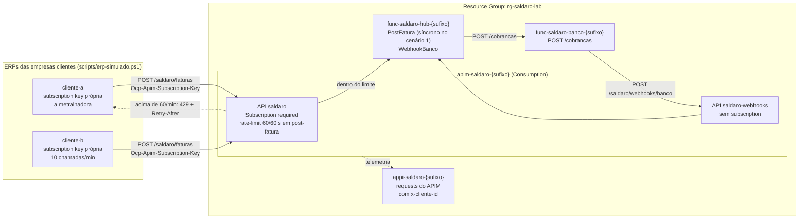

# Leitura 3.1 — "O parceiro que não dormia": rate limit no APIM, 429 e retry com teto

> **Version-anchor:** Q4-2026 · **Tipo:** guia de leitura prática, para fazer em casa depois da aula (uma noite, cerca de 1h30) · **Estado inicial:** `./scripts/deploy.ps1 -Cenario 1` · **Estado pronto:** `./scripts/deploy.ps1 -Cenario 1 -Pronto`
>
> Empresa, pessoas, números e incidentes são fictícios; qualquer semelhança é coincidência. Os serviços, os padrões e os limites citados são reais e foram conferidos no Microsoft Learn em 2026-10-14. Os resultados de referência dos passos vêm do primeiro deploy real do kit, também em 2026-10-14 (Flex Consumption, Brazil South); os seus vão variar um pouco.

> **CUSTO E FREE TRIAL**
> | Item | Valor |
> |------|-------|
> | Custo mensal (se deixar o ambiente ligado) | ~R$ 60 (quase tudo é o Service Bus Standard: US$ 10/mês) |
> | Custo real deste guia (subir, praticar e apagar na mesma noite) | ~R$ 1 |
> | Compatível com Azure Free Trial (US$ 200)? | **Sim** |
> | Base dos valores | Preços de lista da Microsoft para Brazil South consultados em 2026-10-14, convertidos a ~R$ 5,50/US$ e arredondados; confira na calculadora no dia |
>
> **Regra de ouro:** apague o Resource Group (`rg-saldaro-lab`) assim que terminar, com `./scripts/limpar.ps1`. O Service Bus Standard cobra por hora (~R$ 0,07/h) mesmo sem tráfego.

## Tabela de Recursos

Tudo é criado pelo `deploy.ps1` a partir do Bicep em `infra/`. As duas subscriptions do APIM só existem no estado pronto (`cenario-1-pronto`).

| Recurso | Tipo | SKU / Tier | Custo estimado (mensal, se ficar ligado) |
|---------|------|------------|------------------------------------------|
| `rg-saldaro-lab` | Resource Group | — | Gratuito |
| `sb-saldaro-<sufixo>` (filas `sbq-faturas-recebidas`, `sbq-confirmacoes-banco`, `sbq-notificacoes-parceiro`) | Service Bus namespace | Standard | ~R$ 55 (US$ 10 de base, com 13 milhões de operações incluídas) |
| `func-saldaro-hub-<sufixo>` e plano `asp-saldaro-hub-<sufixo>` | Function App (o hub) | Flex Consumption (FC1) | ~R$ 0 dentro da franquia mensal (100 mil GB-s e 250 mil execuções) |
| `func-saldaro-banco-<sufixo>` e plano `asp-saldaro-banco-<sufixo>` | Function App (banco parceiro simulado) | Flex Consumption (FC1) | ~R$ 0 |
| `apim-saldaro-<sufixo>` (APIs `saldaro` e `saldaro-webhooks`) | API Management | Consumption | ~R$ 0 (1 milhão de chamadas/mês grátis; depois ~US$ 4,25 por milhão) |
| Subscriptions `cliente-a` e `cliente-b` (só no `cenario-1-pronto`) | Subscription do APIM, escopo da API `saldaro` | — | Gratuito |
| `stsaldaro<sufixo>` | Storage Account | Standard LRS | centavos |
| `kv-saldaro-<sufixo>` | Key Vault | Standard | centavos (vazio neste cenário) |
| `evgt-saldaro-faturas-<sufixo>` | Event Grid custom topic | Basic | ~R$ 0 (100 mil operações/mês grátis) |
| `log-saldaro-<sufixo>` / `appi-saldaro-<sufixo>` | Log Analytics / Application Insights | Pay-as-you-go | ~R$ 0 (5 GB/mês grátis; depois ~US$ 4,60/GB em Brazil South) |

> **Custo total estimado:** ~R$ 60/mês se ficar ligado; ~R$ 1 se você subir, praticar e apagar na mesma noite.

---

## O incidente

Terça-feira, 2h10 da manhã. Um ERP recém-integrado de uma empresa cliente rodou de novo o lote do mês inteiro e disparou 40 mil `POST /faturas` em seis minutos, com retry imediato a cada erro. O hub da Saldaro passou a devolver 500 para todo mundo, inclusive para as outras 299 empresas clientes. Nenhuma fatura se perdeu, mas a Saldaro descobriu duas coisas: não existia nenhum limite por cliente na porta de entrada, e o "retry" do parceiro era uma metralhadora.

Na revisão do incidente apareceu uma terceira descoberta, a mais incômoda: o próprio hub, como cliente do banco parceiro, fazia a mesma coisa. Os lotes das empresas clientes começavam todos no minuto zero, e o hub repassava a rajada inteira ao banco no mesmo segundo.

## O que você vai provar

Ao final deste guia (critério de feito):

1. O `cliente-a`, com a própria subscription key, recebe **429** com `Retry-After` depois de umas 60 chamadas dentro de um minuto (no primeiro deploy real, depois de 56: o contador do APIM é aproximado).
2. O `cliente-b`, com a chave dele e 10 chamadas por minuto no mesmo intervalo, não recebe **nenhum** 429.
3. Contra o limite, o `erp-simulado.ps1` com backoff faz entrar quase o lote inteiro no ritmo que o servidor admite (194 de 200 faturas no primeiro deploy real), enquanto o `-SemBackoff` (a metralhadora) só acumula 429 e faz entrar só o começo do lote (56 de 200). O backoff é exponencial, com jitter, no máximo 5 tentativas e no máximo 30 s de espera, e honra o `Retry-After` dentro desse teto.
4. Você explica por que as poucas faturas que sobram com backoff terminam em 429: o teto de 30 s fica abaixo do `Retry-After` de ~48 s que o APIM manda.
5. A consulta `kql/429-por-cliente.kql` mostra 429 só para o `cliente-a`.
6. Você sabe explicar por que, no APIM Consumption, o limite por cliente é por **subscription** (`rate-limit`) e não por um header arbitrário (`rate-limit-by-key`), e por que "uma chave por parceiro" é um desenho realista.

## Pré-requisitos

- Lab 0 feito: VS Code, .NET 10 SDK, Azure CLI com Bicep e PowerShell 7 (`pwsh`) instalados, e `az login` feito numa assinatura que você controla (o Free Trial serve).
- Repositório da aula clonado; todos os comandos rodam na raiz do repositório.
- Dois terminais `pwsh` abertos: o guia roda dois "ERPs" ao mesmo tempo.
- Da Disciplina 04 (Hands-on 1): políticas do APIM, Products e Subscriptions.

## Diagrama da arquitetura



---

## Parte 1 — Estado inicial

### Passo 1.1 — Suba o cenário 1 (baseline, sem limite)

```powershell
./scripts/deploy.ps1 -Cenario 1
```

O estado inicial do cenário 1 é o baseline ingênuo (`infra/parameters/cenario-0.bicepparam`): todos os toggles desligados, inclusive `rateLimit`. O `PostFatura` ainda é síncrono: grava a fatura, chama o banco simulado e só então responde **201**. O script cria o `rg-saldaro-lab`, publica os dois apps, grava `scripts/.env.local` (que não tem segredos) e imprime a tabela de recursos. Num ambiente novo, leva de 8 a 10 minutos.

> **Veio da aula com o ambiente ainda de pé?** A fila `sbq-confirmacoes-banco` do fim da aula tem sessions e duplicate detection, e o 3.1 começa no baseline, sem elas. Como essas propriedades são imutáveis, o `deploy.ps1 -Cenario 1` para em menos de um minuto, sem mudar nada, dizendo que a mudança é **IMUTÁVEL** e quantas mensagens a fila tem. Siga a linha "`deploy.ps1 -Cenario 1` para dizendo que a mudança na `sbq-confirmacoes-banco` é imutável" do [Troubleshooting](#troubleshooting).

> **Dica:** se você apagou um ambiente com o mesmo sufixo pelo Portal (sem o `limpar.ps1`), o APIM e o Key Vault ficaram em soft-delete reservando o nome. O `deploy.ps1` detecta essas sobras com o mesmo nome e para antes de criar, sem purgar sozinho: rode `./scripts/limpar.ps1 -Sufixo <sufixo>`, que só purga as sobras, ou repita o deploy com `-PurgarExcluidos`. Se ainda assim falhar, veja a linha "APIM em soft-delete" do Troubleshooting.

### Passo 1.2 — Carregue as variáveis do ambiente (nos dois terminais)

```powershell
$cfg  = Get-Content ./scripts/.env.local | ConvertFrom-StringData
$rg   = $cfg.SALDARO_RG
$suf  = $cfg.SALDARO_SUFIXO
$apim = "apim-saldaro-$suf"
$url  = "$($cfg.SALDARO_APIM_URL)/faturas"
```

### Passo 1.3 — Confira que a porta está escancarada

1. No Portal, abra o API Management `apim-saldaro-<sufixo>` e vá em **APIs**. Há duas, listadas pelo nome de exibição: **Saldaro Hub - faturas** (a API `saldaro`, path `saldaro`) e **Saldaro Hub - webhooks** (a API `saldaro-webhooks`, path `saldaro/webhooks`, o webhook do banco).
2. Selecione **Saldaro Hub - faturas**, a aba **Design** e a operação **post-fatura**. Em **Inbound processing**, abra o editor de código (`</>`): só há `<base />`, nenhuma política de limite.
3. Na aba **Settings** da mesma API, repare que **Subscription required** está desmarcado: neste estado, a API é anônima (simplificação de laboratório do kit, registrada em `docs/adr/0007-http-triggers-anonymous-e-apim-sem-subscription.md`).

---

## Parte 2 — Sintomas: a metralhadora

### Passo 2.1 — Solte os dois ERPs ao mesmo tempo

Terminal 1, o `cliente-a` (a metralhadora), com 30% de falha transiente no banco:

```powershell
./scripts/erp-simulado.ps1 -Faturas 200 -Cliente cliente-a -ReqPorMin 300 -SemBackoff -Caos "falhaTransiente=30"
```

Terminal 2, logo em seguida, o `cliente-b` (um ERP comportado):

```powershell
./scripts/erp-simulado.ps1 -Faturas 20 -Cliente cliente-b -ReqPorMin 10
```

O que está acontecendo por baixo:

- `-Caos "falhaTransiente=30"` vira o campo `caos` da fatura, que o hub repassa ao banco simulado: 30% das chamadas `POST /cobrancas` respondem **503** antes de qualquer efeito.
- No baseline o hub é síncrono, sem fila nem retry: ele já gravou a fatura quando o banco responde 503, e devolve **502** ao ERP.
- `-SemBackoff` reenvia **na hora**. E, sem `Idempotency-Key`, cada reenvio é uma fatura nova para o hub.
- Efeito colateral, que não atrapalha este guia: o mesmo botão marca 30% dos `cobranca.paga` como falha transiente (por 45 s). No baseline, essas confirmações esgotam as 10 entregas e caem na DLQ da `sbq-confirmacoes-banco`, com `MaxDeliveryCountExceeded`. É o Incidente 3 (cenário 3.4).

### Passo 2.2 — Leia os dois relatórios

No fim de cada execução, o `erp-simulado.ps1` imprime as contagens de 201/202/429/5xx/timeout, a média de tentativas e o tempo total, e grava um CSV em `scripts/saida/`.

O que você deve ver:

- `cliente-a`: uma sequência de 5xx, cada um seguido de um reenvio imediato, e **nenhum 429**: nada freia ninguém.
- `cliente-b`: só 201.

No laboratório o `cliente-b` não sofre porque o volume é pequeno e o Flex Consumption escala. Na Saldaro da história, o recurso compartilhado (o limite que o banco parceiro concede para a Saldaro inteira, o banco de dados, as conexões de saída) acabou para todo mundo, e foi assim que as outras 299 empresas receberam 500.

### Passo 2.3 — Veja a inundação no Application Insights

1. No Portal, abra o Application Insights `appi-saldaro-<sufixo>` e vá em **Logs**.
2. Rode a consulta abaixo. Ela é ilustrativa (não está em `kql/`) e usa só o evento `fatura.recebida`, que o hub emite a cada fatura que recebe:

```kusto
// ILUSTRATIVO: faturas recebidas pelo hub por empresa cliente, minuto a minuto.
customEvents
| where timestamp > ago(30m) and name == "fatura.recebida"
| summarize faturas = count() by cliente = tostring(customDimensions.clienteId), bin(timestamp, 1m)
| render timechart
```

3. Abra o arquivo `kql/429-por-cliente.kql`, copie o conteúdo e rode também. Ele lista as chamadas que passaram pelo APIM, agrupadas por subscription e pelo header `x-cliente-id`: neste estado, a coluna `subscription` vem `(sem subscription)`, os 5xx do `cliente-a` aparecem em `r5xx` e a coluna `r429` é **zero** para os dois clientes. Ninguém foi freado.

Repare que o `cliente-a` aparece com bem mais de 200 faturas: cada reenvio sem `Idempotency-Key` virou uma fatura nova no hub. O Incidente 1 (cenário 3.2) conta o resto dessa história.

---

## Parte 3 — Hipóteses

| Hipótese | Como testar | Resultado esperado |
|----------|-------------|--------------------|
| O hub está lento e por isso todo mundo sofre | Duração das requisições no Application Insights | Durações normais: o problema é volume, não lentidão |
| Não existe limite por cliente na porta de entrada | Política de `post-fatura` (Passo 1.3) e `r429 = 0` no `kql/429-por-cliente.kql` | **Confirmada** |
| A porta de entrada nem sabe quem é o cliente | **Subscription required** desmarcado: o único sinal é o header `x-cliente-id`, que o próprio cliente escolhe | **Confirmada** |
| O retry do cliente amplifica a falha | Relatório do Passo 2.2: reenvio imediato depois de cada 5xx | **Confirmada** |
| O hub faz o mesmo com o banco parceiro | Como o hub chama o banco (Passo 4.7) | **Confirmada** no desenho: nada espalha as chamadas |

Conclusão: faltam duas defesas, uma de cada lado. O servidor precisa identificar cada empresa cliente e recusar o excesso de **uma** sem punir as outras (rate limit por cliente, com 429 e `Retry-After`), e o cliente precisa reenviar com educação (backoff exponencial, jitter, teto e respeito ao `Retry-After`).

---

## Parte 4 — Conserto

### Passo 4.1 — Ligue o rate limit por subscription

```powershell
./scripts/deploy.ps1 -Cenario 1 -Pronto
```

`cenario-1-pronto` é o baseline com `rateLimit = true`. Num ambiente que já existe, leva uns 6 minutos, e no fim o script avisa:

```text
    ATENÇÃO: a API saldaro agora EXIGE subscription (cliente-a, cliente-b): mande a chave no header Ocp-Apim-Subscription-Key.
```

O que muda:

| O quê | Estado inicial | `cenario-1-pronto` |
|-------|----------------|--------------------|
| API `saldaro` (`/saldaro/faturas`...) | **Subscription required** desmarcado (anônima) | **Subscription required** marcado |
| API `saldaro-webhooks` (`/saldaro/webhooks/banco`) | sem subscription | sem subscription: o banco parceiro continua entregando os webhooks |
| Subscriptions do APIM | nenhuma | `cliente-a` e `cliente-b`, com escopo da API `saldaro` (uma por empresa cliente) |
| Política de `post-fatura` | nenhuma | `<rate-limit calls="60" renewal-period="60" />` no inbound |
| `erp-simulado.ps1` | não manda chave | antes do lote, faz uma consulta sem efeito (status de uma fatura inexistente); se o APIM responder 401 pedindo subscription key, busca a chave da subscription do `-Cliente` em tempo de execução (`az rest` no `listSecrets` da subscription) e manda `Ocp-Apim-Subscription-Key`. Com `-ComChave`, busca logo de início. A chave fica só em memória: não vai para arquivo e não aparece inteira na tela (só os últimos 4 caracteres) |

O header `x-cliente-id` continua indo em toda chamada: é dele que o hub tira o `clienteId` da fatura.

### Passo 4.2 — Confira os crachás no Portal

1. No APIM, **APIs** → **Saldaro Hub - faturas** → aba **Settings**: **Subscription required** agora está marcado.
2. **APIs** → **Saldaro Hub - webhooks** → aba **Settings**: continua desmarcado.
3. No menu lateral, **Subscriptions**: aparecem `cliente-a` e `cliente-b`, com escopo na API **Saldaro Hub - faturas**. A lista também traz a **Built-in all-access subscription**, que todo APIM tem e o kit não usa. Você não precisa ver nem copiar as chaves.
4. **APIs** → **Saldaro Hub - faturas** → **Design** → **post-fatura** → **Inbound processing** (`</>`): a política `rate-limit` está lá.
5. No terminal, chame a API sem chave. É a mesma consulta sem efeito que o `erp-simulado.ps1` faz para descobrir se a chave é exigida (o status de uma fatura que não existe):

```powershell
$r = Invoke-WebRequest -Uri "$url/00000000-0000-0000-0000-000000000000/status" -SkipHttpErrorCheck
$r.StatusCode
$r.Content
```

Resultado esperado: `401` e a recusa do próprio APIM, que nem chega ao hub:

```json
{"statusCode": 401, "message": "Access denied due to missing subscription key. Make sure to include subscription key when making requests to an API."}
```

> **Fato verificado no Microsoft Learn (2026-10-14):** a política `rate-limit-by-key`, que conta por qualquer chave (como o header `x-cliente-id`), **não está disponível no tier Consumption** do APIM. A tabela de referência de políticas marca "Consumption: No", e a página da política lista só os tiers Developer, Basic, Basic v2, Standard, Standard v2, Premium e Premium v2. A política que existe em todos os tiers, inclusive no Consumption, é a `rate-limit`, que conta **por subscription**. Foi por isso que o kit trocou o desenho original pelo de uma chave por empresa cliente.

Trechos ilustrativos (a política real é gerada pelo Bicep, em `infra/`; procure por `rate-limit`):

```xml
<!-- ILUSTRATIVO: o desenho original, por header. Só roda nos tiers clássicos e v2, não no Consumption. -->
<rate-limit-by-key calls="60" renewal-period="60"
    counter-key="@(context.Request.Headers.GetValueOrDefault("x-cliente-id","anonimo"))" />

<!-- ILUSTRATIVO: o que roda no Consumption e no kit: um contador por subscription. -->
<rate-limit calls="60" renewal-period="60" />
```

A diferença entre as duas é a lição deste guia:

| | `rate-limit-by-key` | `rate-limit` |
|---|---|---|
| Tiers | Clássicos e v2; **não** existe no Consumption | Todos, inclusive o Consumption |
| Quem é "o cliente" | Qualquer expressão: header, IP, claim de um token validado, `context.Subscription.Id` | A subscription da chamada |
| Escopos | global, product, API, operation | product, API, operation |
| Chamada sem subscription key | Contada pela expressão (no exemplo, como `anonimo`) | Não é contada: a política só vale para chamadas com chave |
| API com **Subscription required** desmarcado | Funciona | A chave é ignorada e nada é limitado |
| Resposta ao estourar | 429 com `Retry-After` | 429 com `Retry-After` |
| Armadilha | Contar por um header que o próprio cliente escolhe é burlável: basta trocar o valor a cada chamada | O cliente precisa de uma credencial, e o contador segue a credencial |

Dois trechos da documentação explicam por que a API `saldaro` passou a **exigir** subscription no estado pronto: a `rate-limit` "só é aplicada quando a API é acessada com uma subscription key"; e, numa API que não exige subscription, "qualquer requisição que inclui uma subscription key é tratada como uma requisição sem chave: a chave é ignorada". E é por isso que o webhook do banco mudou para uma API própria, a `saldaro-webhooks`: o parceiro que só manda webhooks não precisa de crachá de cliente.

### Passo 4.3 — Por que "uma chave por parceiro" é o desenho de verdade

O Consumption empurrou o kit para a solução que a maioria dos gateways em produção já usa:

- **Identidade antes de limite.** Um limite por cliente pressupõe saber quem é o cliente. A subscription key é uma credencial emitida pela Saldaro; o `x-cliente-id` é só um texto que o cliente escolhe.
- **Revogação e suspensão individuais.** Se um ERP sai do controle, você suspende a subscription dele (estado **Suspended**) e as outras 299 empresas nem percebem.
- **Rotação por parceiro.** Cada subscription tem chave primária e secundária: dá para trocar a de um parceiro sem combinar com os outros.
- **Planos diferentes por parceiro.** Products com limites diferentes (como os "Partner" e "Partner Premium" do Hands-on 1 da Disciplina 04) funcionam também no Consumption: cada parceiro assina um product, e a `rate-limit` aceita o escopo de product. (Atenção: numa subscription com escopo de API, como as do kit, as políticas de product não se aplicam.)
- **Consumo por parceiro.** A telemetria do APIM passa a trazer a subscription de cada chamada; o `kql/429-por-cliente.kql` agrupa também por ela.

O que ainda falta em produção: o hub confia no header `x-cliente-id`, e nada impede o `cliente-a` de mandar a própria chave com `x-cliente-id: cliente-b`. O conserto é derivar o cliente da credencial no gateway, e não do que o cliente declara:

```xml
<!-- ILUSTRATIVO: não existe no kit. O gateway sobrescreve o header com a subscription que autenticou a chamada. -->
<set-header name="x-cliente-id" exists-action="override">
    <value>@(context.Subscription.Name)</value>
</set-header>
```

E a subscription key identifica, mas não é autenticação forte: para APIs sensíveis, combine com OAuth 2.0 (`validate-jwt` ou `validate-azure-ad-token`, ambas disponíveis no Consumption).

### Passo 4.4 — A metralhadora contra o limite

Terminal 1, o `cliente-a` sem backoff (agora sem caos: quem vai recusar é o APIM):

```powershell
./scripts/erp-simulado.ps1 -Faturas 200 -Cliente cliente-a -ReqPorMin 300 -SemBackoff
```

Terminal 2, logo em seguida, o `cliente-b`:

```powershell
./scripts/erp-simulado.ps1 -Faturas 20 -Cliente cliente-b -ReqPorMin 10
```

No cabeçalho de cada execução, a linha **Subscription key** mostra a subscription do cliente com a chave mascarada (`****` seguido dos 4 últimos caracteres): o script recebeu o 401 na consulta sem efeito, buscou a chave com `az rest` e a mantém só em memória.

Resultado esperado (entre parênteses, o primeiro deploy real do kit):

- `cliente-a`: umas 60 respostas 201 no começo (56) e, a partir daí, uma avalanche de **429** (723 em 40 s). Cada recusa vira um reenvio imediato, que é recusado de novo: o `-SemBackoff` gasta as 5 tentativas em milissegundos e não ganha nada com isso. Das 200 faturas, só as do começo entram (144 terminam em 429). Os 429 são respondidos pelo APIM, sem tocar no hub.
- `cliente-b`: só 201 e nenhum 429 (20 faturas em uns 2 minutos). O contador dele é outro.
- A conta não fecha exatamente em 60. A documentação avisa que, pela natureza distribuída do rate limit no gateway, o limite "nunca é completamente exato".

Anote os números do `cliente-a` (201, 429, faturas que terminaram com erro, média de tentativas, tempo total) para comparar no próximo passo.

### Passo 4.5 — O cliente educado: backoff com jitter, teto e `Retry-After`

Espere um minuto para a janela do `cliente-a` esvaziar e repita **sem** `-SemBackoff`, com o `cliente-b` de novo no outro terminal:

```powershell
./scripts/erp-simulado.ps1 -Faturas 200 -Cliente cliente-a -ReqPorMin 300
```

```powershell
./scripts/erp-simulado.ps1 -Faturas 20 -Cliente cliente-b -ReqPorMin 10
```

Compare (no relatório, as respostas estão na linha **Todas as respostas** e o desfecho de cada fatura no bloco **Resultado final por fatura**). A última coluna traz os números do primeiro deploy real do kit, como referência:

| Métrica (do relatório do `cliente-a`) | Metralhadora (`-SemBackoff`) | Com backoff | Primeiro deploy real (metralhadora → backoff) |
|---------------------------------------|------------------------------|-------------|-----------------------------------------------|
| Respostas 201 | | | 56 → 194 |
| Respostas 429 | | | 723 → 147 |
| Faturas que terminaram com erro | | | 144 → 6 (todas em 429) |
| Média de tentativas por fatura | | | ~3,9 → ~1,7 |
| Tempo total | | | 40 s → 3,1 min |

O que você deve ver: com backoff, bem menos 429, quase todas as faturas aceitas e um tempo total bem maior, na casa de três minutos para 200 faturas. É o ritmo de ~60 por minuto que o servidor admite: o cliente se ajustou ao limite em vez de brigar com ele. O `cliente-b` continua sem nenhum 429.

O que o cliente consertado faz (a lógica real está em `scripts/erp-simulado.ps1`):

```powershell
# ILUSTRATIVO: resumo da política de retry do erp-simulado.ps1 ($n = tentativa que acabou de falhar)
$exponencial = [math]::Min(30.0, 1.0 * [math]::Pow(2, $n - 1))                  # 1, 2, 4, 8 s, com teto de 30 s
$espera = $exponencial / 2 + (Get-Random -Minimum 0.0 -Maximum ($exponencial / 2)) # jitter: metade fixa, metade aleatória
if ($null -ne $retryAfter) { $espera = [math]::Max($espera, $retryAfter + (Get-Random -Maximum 1.0)) } # honra o Retry-After
$espera = [math]::Min(30.0, $espera)                                              # ...mas nunca além do teto
# ...e desiste depois da 5ª tentativa (-MaxTentativas): retry sem teto prolonga o incidente
```

Por que cada peça importa:

- **Exponencial:** dá tempo para o servidor se recuperar.
- **Jitter:** sem ele, mil clientes que falharam juntos voltam juntos (o "estouro da manada").
- **Teto** (5 tentativas, 30 s): retry infinito transforma um incidente de 5 minutos num de 5 horas.
- **`Retry-After` limitado ao teto:** o servidor sabe melhor quando voltar, mas um valor absurdo não pode travar o cliente.

#### Por que ainda sobram faturas em 429: o teto abaixo do `Retry-After`

"Quase todas" não é "todas", e as poucas que sobram mostram o lado caro do teto. Siga uma fatura que chega logo depois do bloqueio:

1. A 300 por minuto, o `cliente-a` gasta as ~60 chamadas da janela em uns 12 s. A chamada seguinte leva **429** com `Retry-After` de ~48 s, o que falta para a janela de 60 s liberar (no primeiro deploy real, o APIM registrou 48).
2. O ERP honra o `Retry-After`, mas só até o teto: espera 30 s, volta 18 s antes da hora e leva outro 429, agora com `Retry-After` de ~18 s, que cabe no teto.
3. Espera esses ~18 s e, na terceira tentativa, a janela já renovou: a fatura entra. Gastou 3 das 5 tentativas, uma delas à toa.
4. Na virada da janela, as faturas que estavam esperando disputam as ~60 chamadas novas com as que começam a sair. Quem chega tarde leva 429 de novo, e algumas esgotam as 5 tentativas: no primeiro deploy real, 6 de 200.

A responsável é a última linha do trecho acima, `$espera = [math]::Min(30.0, $espera)`. O teto protege o ERP de um `Retry-After` absurdo: um servidor com defeito que mande esperar uma hora não pode travar o lote. Mas 48 s não é absurdo, é a janela de 60 s do contrato. **Com o teto abaixo do `Retry-After` legítimo, o cliente volta cedo, leva 429 de novo e gasta tentativa à toa.**

Para ver os valores que o APIM mandou, rode no Application Insights (**Logs**) a consulta abaixo. Ela é ilustrativa (não está em `kql/`) e lê o header `Retry-After` das respostas, que o diagnóstico do APIM do kit registra em `customDimensions["Response-Retry-After"]`:

```kusto
// ILUSTRATIVO: o Retry-After que o APIM mandou nos 429, por subscription e minuto a minuto.
requests
| where timestamp > ago(30m) and resultCode == "429"
| extend subscription = tostring(customDimensions["Subscription Name"]),
         retryAfter = toint(customDimensions["Response-Retry-After"])
| summarize respostas429 = count(), retryAfterMin = min(retryAfter), retryAfterMax = max(retryAfter)
    by subscription, minuto = bin(timestamp, 1m)
| order by minuto asc
```

Todo 429 com `Retry-After` acima de 30 vira uma volta antes da hora: o ERP espera 30 s, e não o que o APIM pediu.

O que um ERP de verdade faria com isso (bom material para o post-mortem):

- **Calibrar o teto pela janela do contrato.** Se o parceiro documenta 60 chamadas por 60 s, um teto de espera de 60 s honra qualquer `Retry-After` legítimo e ainda barra o absurdo.
- **Contar tempo, não só tentativas.** Um orçamento por fatura (desistir depois de, digamos, 5 minutos) diz mais que "5 tentativas": conforme o que o servidor responde, as cinco tentativas deste script duram de uns 10 segundos (só o exponencial: 1, 2, 4 e 8 s, com jitter) a uns 2 minutos (quatro esperas de 30 s).
- **Não estourar o limite, para começar.** O ERP que conhece o contrato limita o próprio ritmo abaixo de 60 por minuto (um token bucket) e quase não vê 429. É o que o `cliente-b` faz com `-ReqPorMin 10`.
- **Mais tentativas é remendo.** O script aceita `-MaxTentativas` até 10, e mais voltas tendem a salvar as faturas que sobram, mas cada volta antes da hora continua sendo uma chamada recusada.
- **Quem desiste não pode sumir.** A fatura que esgotou as tentativas vai para uma fila de reenvio do ERP, com a mesma `Idempotency-Key` (Incidente 1), em vez de virar um erro esquecido num log.

**Experimento (opcional):** espere um minuto e rode o `cliente-a` no ritmo do contrato, abaixo do limite:

```powershell
./scripts/erp-simulado.ps1 -Faturas 200 -Cliente cliente-a -ReqPorMin 50
```

O esperado é nenhum (ou quase nenhum) 429, num tempo total de uns 4 minutos: um pouco mais lento que o backoff, mas sem brigar com o limite. Anote o resultado; é o argumento para pôr o ritmo do contrato no onboarding do parceiro.

Quer ver o mesmo efeito contra erros 5xx? Repita os dois modos acrescentando `-Caos "falhaTransiente=30"` e compare com o Passo 2.2.

### Passo 4.6 (opcional) — Veja o 429 e o `Retry-After` com os próprios olhos

O relatório do `erp-simulado.ps1` conta os 429, mas não mostra o header. Para ver a resposta crua, leia a chave do `cliente-a` para uma variável (do mesmo jeito que o script faz, sem imprimir nada) e dispare 80 chamadas de uma vez:

```powershell
$sub    = $cfg.SALDARO_SUBSCRIPTION
$chaveA = az rest --method post --url "https://management.azure.com/subscriptions/$sub/resourceGroups/$rg/providers/Microsoft.ApiManagement/service/$apim/subscriptions/cliente-a/listSecrets?api-version=2024-05-01" --query primaryKey -o tsv

$res = 1..80 | ForEach-Object -ThrottleLimit 8 -Parallel {
    $h = @{ 'x-cliente-id' = 'cliente-a'; 'Ocp-Apim-Subscription-Key' = $using:chaveA }
    $r = Invoke-WebRequest -Uri $using:url -Method Post -Headers $h -Body '{}' -ContentType 'application/json' -SkipHttpErrorCheck
    [pscustomobject]@{ Status = [int]$r.StatusCode; RetryAfter = "$($r.Headers['Retry-After'])" }
}
$res | Group-Object Status | Select-Object Name, Count
$res | Where-Object Status -eq 429 | Select-Object -First 3
Remove-Variable chaveA
```

Este bloco é um comando de verificação, não faz parte do kit. O corpo vazio (`{}`) é de propósito: as chamadas que passam pelo limite chegam ao hub e voltam com o erro de validação dele (um 4xx), sem criar faturas nem cobranças; as que estouram voltam **429**, com a coluna `RetryAfter` dizendo quantos segundos faltam para a janela liberar. Espere um minuto depois de qualquer execução do `erp-simulado.ps1` com o `cliente-a`, para não somar no mesmo contador.

### Passo 4.7 — O hub também é cliente: espalhe por hash

O hub chama o banco parceiro, e o banco limita quantas chamadas aceita da Saldaro por minuto. Se as 300 empresas clientes agendam seus lotes para o minuto zero, o hub vira a metralhadora do banco. O conserto do lado servidor é espalhar o trabalho de cada empresa ao longo da janela usando um hash **estável** do `clienteId`: a mesma empresa cai sempre no mesmo segundo, e as empresas se distribuem de forma uniforme.

Isto **não** existe no kit; é desenho para você discutir no post-mortem. Com o 202 assíncrono do cenário 3.2, o lugar natural é a fila: o hub agenda a mensagem em `sbq-faturas-recebidas` com um atraso por cliente.

```csharp
// ILUSTRATIVO: não existe no kit. O ponto de encaixe seria o envio para sbq-faturas-recebidas
// em 03_Aplicações/Saldaro.Hub (PostFatura, no modo assíncrono).
static TimeSpan AtrasoDoCliente(string clienteId, int janelaSegundos = 60)
{
    // Hash estável. Não use string.GetHashCode(): no .NET ele muda a cada processo.
    var hash = SHA256.HashData(Encoding.UTF8.GetBytes(clienteId));
    return TimeSpan.FromSeconds(BitConverter.ToUInt32(hash, 0) % (uint)janelaSegundos);
}

// uso: mensagem.ScheduledEnqueueTime = DateTimeOffset.UtcNow + AtrasoDoCliente(clienteId);
```

Exercício: calcule o segundo de cada empresa com o equivalente em PowerShell.

```powershell
'cliente-a', 'cliente-b' | ForEach-Object {
    $h = [System.Security.Cryptography.SHA256]::HashData([Text.Encoding]::UTF8.GetBytes($_))
    '{0} -> {1} s' -f $_, ([BitConverter]::ToUInt32($h, 0) % 60)
}
```

Resultado esperado: `cliente-a -> 54 s` e `cliente-b -> 18 s`. Em vez de chegarem juntas no segundo zero, as duas empresas chegam ao banco com 36 segundos de distância, sempre.

---

## Parte 5 — Prova

### Passo 5.1 — Consulte os 429 por cliente

1. No Application Insights `appi-saldaro-<sufixo>`, abra **Logs**.
2. Cole o conteúdo de `kql/429-por-cliente.kql` (todas as requests do APIM, agrupadas pela subscription e pelo header `x-cliente-id`, com as contagens `chamadas`, `r429`, `r2xx`, `r5xx` e o horário do primeiro 429) e rode com o intervalo da última hora.
3. Resultado esperado: a linha da subscription `cliente-a` tem `r429` alto, com as ocorrências dos Passos 4.4 a 4.6; a linha da subscription `cliente-b` aparece com `r429 = 0` (só 2xx). Linhas `(sem subscription)` são as chamadas da Parte 2 (antes do conserto) ou chamadas sem chave recusadas com 401 (a do Passo 4.2 e a consulta sem efeito que o `erp-simulado.ps1` faz antes de buscar a chave). Se vier vazio, espere de 2 a 5 minutos (latência de ingestão) e rode de novo.
4. Referência: no primeiro deploy real, rodando a consulta logo depois do Passo 4.4, o `cliente-a` tinha 779 chamadas e `r429 = 723` (`percentual429 = 92.8`), e o `cliente-b`, `r429 = 0`. Depois dos Passos 4.5 e 4.6, os números do `cliente-a` crescem, porque a consulta soma tudo o que caiu no intervalo.

### Passo 5.2 — Marque o critério de feito

- [ ] Sem chave, a API `saldaro` respondeu 401 "Access denied due to missing subscription key" (Passo 4.2).
- [ ] O `cliente-a` recebeu 429 com `Retry-After` depois de umas 60 chamadas no minuto (Passos 4.4 e 4.6).
- [ ] O `cliente-b` não recebeu nenhum 429 nas mesmas janelas (Passos 4.4 e 4.5).
- [ ] Com backoff, o lote do `cliente-a` terminou no ritmo do limite (uns 3 minutos para 200 faturas), com quase todas as faturas aceitas, bem menos 429 que a metralhadora e no máximo 5 tentativas por fatura (Passo 4.5).
- [ ] Você explica, com o `Retry-After` de ~48 s e o teto de 30 s, por que algumas faturas ainda terminaram em 429 com backoff, e o que mudaria no ERP para isso não acontecer (Passo 4.5).
- [ ] `kql/429-por-cliente.kql` mostra 429 só para o `cliente-a` (Passo 5.1).
- [ ] Você explica, em duas frases, a diferença entre `rate-limit-by-key` e `rate-limit` e por que uma chave por empresa cliente é o desenho certo no Consumption.

Prints sugeridos para o seu registro: as duas tabelas de comparação (Passos 4.4 e 4.5) e o resultado do KQL do Passo 5.1.

---

## Post-mortem de cinco linhas

Copie `templates/post-mortem.md` e preencha, sem culpados:

1. **O que aconteceu**
2. **Impacto**
3. **Causa raiz**
4. **O que consertamos**
5. **O que impede de repetir**

Dica para a causa raiz: "o ERP mandou demais" não é causa raiz, é o gatilho. Escreva a decisão de arquitetura que deixou o gatilho virar incidente (pista: como a porta de entrada identificava cada empresa cliente, e qual era o contrato de retry combinado com os parceiros).

## Lições para produção

- **Identifique o cliente por uma credencial, não por um header livre.** No Consumption, isso significa uma subscription por empresa cliente. Nos tiers clássicos e v2, `rate-limit-by-key` com `counter-key="@(context.Subscription.Id)"` ou com uma claim de um token validado.
- **Derive o cliente da credencial.** Se o backend precisa saber quem chamou, o gateway escreve isso a partir da subscription ou do token; o que o cliente declara num header é só uma sugestão.
- **Velocidade não é volume.** `rate-limit` controla a janela curta (até 300 s); `quota` controla o volume num período longo. A `quota-by-key` também não existe no Consumption; a `quota` por subscription existe.
- **O contador é aproximado.** Serve para proteger a plataforma, não para cobrar o cliente.
- **429 com `Retry-After` é um contrato.** Documente no onboarding do parceiro, com o limite, a janela e um exemplo de backoff com jitter e teto.
- **Teto de espera calibrado pela janela.** O teto barra um `Retry-After` absurdo, mas, abaixo do legítimo (48 s numa janela de 60 s), faz o cliente voltar cedo, levar 429 de novo e gastar tentativa. Calibre o teto pela janela documentada e prefira um orçamento de tempo por requisição a um número fixo de tentativas.
- **O gateway só protege quem passa por ele.** Com `-Direto`, o `erp-simulado.ps1` fala direto com o hub e escapa do limite, como um parceiro que descobriu a URL do backend. No kit os HTTP triggers são anônimos (simplificação de laboratório); em produção, o backend só aceita tráfego vindo do APIM.
- **Bulkhead por cliente sem subscription:** a política `limit-concurrency` aceita chave por expressão e existe em todos os tiers, inclusive o Consumption. Ela limita chamadas simultâneas, não por minuto, e recusa o excesso na hora com 429, sem `Retry-After`.
- **Espalhe a sua própria carga** com um hash estável do cliente; nunca com `GetHashCode()`.
- **Sampling:** no laboratório o sampling do Application Insights fica desligado. Em produção, garanta que os 429 não sejam amostrados para fora: sem eles você não sabe quem está sendo freado.
- **Custo de tier:** o tier mais barato com `rate-limit-by-key` é o Developer (~US$ 0,07/h, cerca de R$ 280/mês, sem SLA); o Basic v2 sai ~US$ 0,21/h (Brazil South, lista de 2026-10-14). Para o laboratório, o Consumption, sem custo fixo, continua sendo a escolha certa.

## Troubleshooting

| Problema | Causa provável | Solução |
|----------|----------------|---------|
| 401 `{"statusCode": 401, "message": "Access denied due to missing subscription key. Make sure to include subscription key when making requests to an API."}` no `cenario-1-pronto` | Chamada sem chave na API `saldaro` (um teste manual, como o do Passo 4.2, ou o `erp-simulado.ps1` não conseguiu ler a chave: ele avisa em amarelo e segue sem chave) | Use `-Cliente cliente-a` ou `-Cliente cliente-b` e, se preciso, `-ComChave`; confira o `az login` (a leitura da chave usa a sua identidade, que precisa de acesso ao APIM) |
| 401 "invalid subscription key" | Chave de outra subscription ou subscription suspensa | Em **Subscriptions**, confira o estado **Active** de `cliente-a` e `cliente-b`; redeploy com `./scripts/deploy.ps1 -Cenario 1 -Pronto` |
| Nenhum 429 no Passo 4.4 | Estado inicial ainda (sem `-Pronto`), ritmo abaixo de 60/min ou execução com `-Direto` | Rode o Passo 4.1; mantenha `-ReqPorMin 300`; não use `-Direto` (ele passa por fora do APIM) |
| 429 também para o `cliente-b` | O `cliente-b` passou de 60 chamadas no minuto | Mantenha `-ReqPorMin 10` no `cliente-b` |
| Com backoff, algumas faturas do `cliente-a` terminam em 429 (no primeiro deploy real, 6 de 200) | Esperado: o teto de 30 s de espera fica abaixo do `Retry-After` de ~48 s, e o ERP volta antes da hora | É a lição do Passo 4.5. Se forem muitas mais, espere 1 minuto depois da execução anterior do `cliente-a` (tudo soma no mesmo contador) e repita |
| Webhooks do banco recebendo 401 | Alguém marcou **Subscription required** na API **Saldaro Hub - webhooks** (`saldaro-webhooks`) | Desmarque, ou redeploy: o Bicep declara essa API sempre sem subscription |
| `kql/429-por-cliente.kql` vazia, ou com `subscription` e `clienteHeader` sempre vazios | Latência de ingestão, sampling, o header `x-cliente-id` não registrado ou nomes de dimensão diferentes no seu ambiente | Espere de 2 a 5 minutos e amplie o intervalo; em **APIs** → **All APIs** → **Settings** → **Diagnostics Logs** → **Application Insights**, confira o sampling em 100% e o `x-cliente-id` em **Headers to log** (o diagnóstico do kit vale para todas as APIs); rode a consulta de conferência do cabeçalho do `.kql` para ver as chaves reais de `customDimensions` |
| `A parameter cannot be found that matches parameter name 'Parallel'` | Windows PowerShell 5.1 em vez do PowerShell 7 | Abra o `pwsh` (7.x) e repita |
| `deploy.ps1` para por causa de um APIM excluído com o mesmo nome, ou falha dizendo que o nome do APIM está em uso (APIM em soft-delete) | Um APIM apagado fica em soft-delete por 48 horas e reserva o nome. O `limpar.ps1` purga a sobra com o mesmo nome na mesma região; o `deploy.ps1` só purga com `-PurgarExcluidos` (sem ele, para e indica as saídas); sobra em outra região ou purge que falhou continuam bloqueando | `./scripts/limpar.ps1 -Sufixo <sufixo>` ou o mesmo deploy com `-PurgarExcluidos`; à mão, `az apim deletedservice purge --location brazilsouth --service-name apim-saldaro-<sufixo>`; ou use outro `-Sufixo` |
| `deploy.ps1 -Cenario 1` para dizendo que a mudança na `sbq-confirmacoes-banco` é imutável | Você manteve o ambiente da aula (fila com sessions e duplicate detection), e o 3.1 começa no baseline, sem elas. O script para antes de mudar qualquer coisa | Recomendado: `./scripts/limpar.ps1` e comece do zero. Ou siga o atalho que a própria mensagem indica: rode `./scripts/deploy.ps1 -Cenario 1 -Pronto` uma vez (ele apaga a fila e o Bicep a recria sem sessions, e as mensagens dela se perdem; uns 6 minutos) e depois `./scripts/deploy.ps1 -Cenario 1` para voltar ao estado inicial. O caminho manual da mensagem (drenar, apagar a fila no Portal e rodar de novo) também serve |
| `deploy.ps1` para dizendo que o Flex Consumption não está disponível, ou o deploy falha por cota do Flex | Flex Consumption indisponível na região ou sem cota na assinatura | `./scripts/deploy.ps1 -Cenario 1 -Plano Consumption` (plano B do kit: Windows Consumption) ou outra `-Location` |
| `Get-Content ./scripts/.env.local` não encontra o arquivo | O deploy não terminou | Rode o `deploy.ps1` até o fim e repita o Passo 1.2 |

## Limpeza

```powershell
./scripts/limpar.ps1
```

O script pergunta antes, apaga o `rg-saldaro-lab` (inclusive o APIM com as subscriptions `cliente-a` e `cliente-b`), purga o Key Vault e o APIM, que ficam em soft-delete reservando o nome, e apaga o `scripts/.env.local`. Pelo Portal, o equivalente é **Resource groups** → `rg-saldaro-lab` → **Delete resource group**, digitar o nome e confirmar; nesse caso, rode depois `./scripts/limpar.ps1 -Sufixo <sufixo>` para purgar as sobras.

> **Atenção:** um APIM apagado sem purge fica em soft-delete por 48 horas e reserva o nome `apim-saldaro-<sufixo>`; um Key Vault, por 7 dias. Para repetir um guia com o mesmo sufixo, purgue (o `limpar.ps1` faz isso) ou use outro sufixo.
>
> **Custo se esquecer ligado:** ~R$ 1,80 por dia, quase todo do Service Bus Standard.

## O que fazer a seguir

- **Incidente 1 (cenário 3.2):** `01_Aulas/Incidente1_Timeout_Guia.md`. O mesmo ERP que reenvia, agora contra um banco lento: timeout, cobrança duplicada e a resposta 202 com `Idempotency-Key`.
- **Leitura 3.8:** `01_Aulas/Leitura_3.8_Premium_vs_Standard_Guia.md`. Throttling do outro lado da mesa: os créditos do Service Bus Standard e o erro 50009.
- **Desafio extra:** implemente o espalhamento por hash do Passo 4.7 numa branch do seu fork e mostre no Application Insights a chegada das empresas ao banco distribuída ao longo do minuto.
