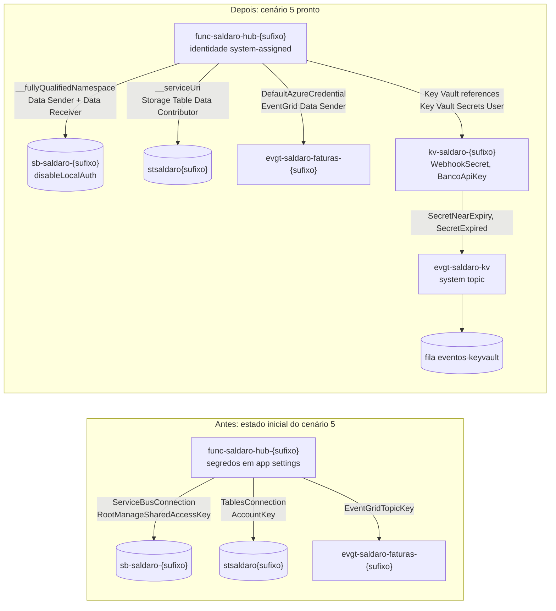

# Leitura 3.5 — "O segredo que expirou às 3h": Managed Identity e Key Vault no lugar de connection string

> **Version-anchor:** Q4-2026 · **Tipo:** guia de leitura prática, para fazer em casa depois da aula (uma noite, cerca de 1h45) · **Estado inicial:** `./scripts/deploy.ps1 -Cenario 5` · **Estado pronto:** `./scripts/deploy.ps1 -Cenario 5 -Pronto`
>
> Empresa, pessoas, números e incidentes são fictícios; qualquer semelhança é coincidência. Os serviços, os padrões e os comportamentos citados são reais e foram conferidos no Microsoft Learn em 2026-10-14. Os resultados de referência dos passos vêm do primeiro deploy real do kit, também em 2026-10-14 (Flex Consumption, Brazil South); os seus vão variar um pouco.

> **CUSTO E FREE TRIAL**
> | Item | Valor |
> |------|-------|
> | Custo mensal (se deixar o ambiente ligado) | ~R$ 60 (quase tudo é o Service Bus Standard: US$ 10/mês) |
> | Custo real deste guia (subir, praticar e apagar na mesma noite) | ~R$ 1 |
> | Compatível com Azure Free Trial (US$ 200)? | **Sim** |
> | Base dos valores | Preços de lista da Microsoft para Brazil South consultados em 2026-10-14, convertidos a ~R$ 5,50/US$ e arredondados; confira na calculadora no dia |
>
> **Regra de ouro:** apague o Resource Group (`rg-saldaro-lab`) assim que terminar, com `./scripts/limpar.ps1`. O Service Bus Standard cobra por hora (~R$ 0,07/h) mesmo sem tráfego.

## Tabela de Recursos

O kit é criado pelo `deploy.ps1` a partir do Bicep em `infra/`. Os três últimos itens são objetos descartáveis deste guia, criados por você no Portal; não fazem parte do kit e somem com o `limpar.ps1`.

| Recurso | Tipo | SKU / Tier | Custo estimado (mensal, se ficar ligado) |
|---------|------|------------|------------------------------------------|
| `rg-saldaro-lab` | Resource Group | — | Gratuito |
| `sb-saldaro-<sufixo>` (filas `sbq-faturas-recebidas`, `sbq-confirmacoes-banco`, `sbq-notificacoes-parceiro`) | Service Bus namespace | Standard | ~R$ 55 (US$ 10 de base, com 13 milhões de operações incluídas) |
| `func-saldaro-hub-<sufixo>` e plano `asp-saldaro-hub-<sufixo>` | Function App (o hub), identidade system-assigned | Flex Consumption (FC1) | ~R$ 0 dentro da franquia mensal (100 mil GB-s e 250 mil execuções) |
| `func-saldaro-banco-<sufixo>` e plano `asp-saldaro-banco-<sufixo>` | Function App (banco parceiro simulado) | Flex Consumption (FC1) | ~R$ 0 |
| `apim-saldaro-<sufixo>` | API Management | Consumption | ~R$ 0 (1 milhão de chamadas/mês grátis) |
| `stsaldaro<sufixo>` | Storage Account | Standard LRS | centavos |
| `kv-saldaro-<sufixo>` (segredos `WebhookSecret` e `BancoApiKey` no estado pronto) | Key Vault, autorização RBAC | Standard | centavos (US$ 0,03 por 10 mil operações) |
| `evgt-saldaro-faturas-<sufixo>` | Event Grid custom topic, identidade system-assigned | Basic | ~R$ 0 (100 mil operações/mês grátis) |
| `log-saldaro-<sufixo>` / `appi-saldaro-<sufixo>` | Log Analytics / Application Insights | Pay-as-you-go | ~R$ 0 (5 GB/mês grátis) |
| `evgt-saldaro-kv` (criado neste guia) | Event Grid system topic do Key Vault | — | ~R$ 0 (entra na franquia de operações do Event Grid) |
| `evgs-segredos-kv` (criada neste guia) | Event subscription | — | Gratuito |
| `eventos-keyvault` (criada neste guia) | Fila do Storage em `stsaldaro<sufixo>` | — | centavos |

> **Custo total estimado:** ~R$ 60/mês se ficar ligado; ~R$ 1 se você subir, praticar e apagar na mesma noite.

---

## O incidente

Madrugada de domingo. O client secret que o worker usava para falar com o Service Bus e a chave da API do banco parceiro, os dois colados em app settings, venceram exatamente dois anos depois de criados, por uma pessoa que já não trabalhava na empresa. Nada enfileirava, nada baixava, nada alertava. O chamado foi aberto às 8h40, pelo cliente.

No laboratório, o equivalente é regenerar a chave SAS do namespace: a connection string colada no app vira uma credencial morta, igualzinha a um client secret vencido.

## O que você vai provar

Ao final deste guia (critério de feito):

1. `az servicebus namespace show ... --query disableLocalAuth` devolve `true`, e o hub funciona (`smoke-test.ps1` passa).
2. Nenhum app setting do hub carrega chave ou connection string, exceto `AzureWebJobsStorage` (o compromisso documentado deste kit, Parte 6), `APPLICATIONINSIGHTS_CONNECTION_STRING` (que a Microsoft não considera segredo) e, só no plano B (Windows Consumption), o `WEBSITE_CONTENTAZUREFILECONNECTIONSTRING`.
3. Regenerar as chaves SAS do namespace e as chaves do tópico do Event Grid não gera nenhuma exception, e o smoke test continua passando.
4. A identidade do hub tem só as seis roles mínimas (cinco de dados e a leitura de gerenciamento do namespace, que a escala do trigger usa), e nenhuma "Data Owner".
5. `BancoApiKey` e `WebhookSecret` chegam ao hub como Key Vault references resolvidas, e um segredo com data de expiração (`exp`) gera os eventos `SecretNearExpiry` e `SecretExpired`, registrados numa fila.

## Pré-requisitos

- Lab 0 feito: VS Code, .NET 10 SDK, Azure CLI com Bicep e PowerShell 7 (`pwsh`) instalados, e `az login` feito numa assinatura que você controla (o Free Trial serve).
- Repositório da aula clonado; todos os comandos rodam na raiz do repositório.
- O `deploy.ps1` atribui ao seu usuário `Azure Service Bus Data Owner` no namespace, `Storage Table Data Contributor` no storage e `Key Vault Secrets Officer` no Key Vault. São elas que permitem o Service Bus Explorer com `disableLocalAuth` e os passos com segredos deste guia.
- Ter feito ou lido os três incidentes ao vivo: o estado inicial deste guia é o estado pronto do Incidente 3 (`cenario-4-pronto`).

## Diagrama da arquitetura



---

## Parte 1 — Estado inicial

### Passo 1.1 — Suba o cenário 5

```powershell
./scripts/deploy.ps1 -Cenario 5
```

O estado inicial do cenário 5 é o `cenario-4-pronto`: tudo o que os três incidentes ao vivo consertaram (202 assíncrono, HMAC, inbox, sessions, DLQ com motivo, retry agendado), ainda com `identidadeGerenciada = false`, ou seja, com connection strings e chaves em app settings. Costuma levar uns 10 minutos (no primeiro deploy real do kit, 10,6 min).

### Passo 1.2 — Carregue as variáveis do ambiente

```powershell
$cfg   = Get-Content ./scripts/.env.local | ConvertFrom-StringData
$rg    = $cfg.SALDARO_RG
$suf   = $cfg.SALDARO_SUFIXO
$hub   = "func-saldaro-hub-$suf"
$banco = "func-saldaro-banco-$suf"
$sb    = $cfg.SALDARO_SB_NAMESPACE
$st    = $cfg.SALDARO_STORAGE
$kv    = $cfg.SALDARO_KV
$evgt  = "evgt-saldaro-faturas-$suf"
```

### Passo 1.3 — Confirme o dia de sol

```powershell
./scripts/smoke-test.ps1
```

Uma fatura vai de ponta a ponta até `baixada` ou `notificada`. Guarde o `faturaId` que o script imprime, se quiser comparar depois no Application Insights: é por ele que se segue a jornada inteira (o `operation_Id` impresso é só o da operação do POST).

---

## Parte 2 — Sintomas

### Passo 2.1 — Faça o inventário de segredos do hub (sem imprimir nenhum valor)

```powershell
function Show-InventarioSegredos([string]$App) {
    az functionapp config appsettings list -g $rg -n $App | ConvertFrom-Json | ForEach-Object {
        [pscustomobject]@{
            Setting      = $_.name
            ChaveNoValor = $_.value -match 'AccountKey=|SharedAccessKey='
            KeyVaultRef  = $_.value -like '@Microsoft.KeyVault(*'
        }
    } | Sort-Object Setting | Format-Table -AutoSize
}
Show-InventarioSegredos $hub
```

A função só mostra o nome de cada setting e duas colunas de verdadeiro/falso; o valor nunca vai para a tela. O que você deve ver:

- `AzureWebJobsStorage`, `ServiceBusConnection` e `TablesConnection` com `ChaveNoValor = True`.
- `EventGridTopicKey`, `BancoApiKey` e `WebhookSecret` com as duas colunas `False`: eles **são** o segredo, em texto puro. O filtro não os pega porque não têm formato de connection string; o nome já entrega o problema.
- Nenhum setting com `KeyVaultRef = True`.

No primeiro deploy real do kit, o inventário saiu exatamente assim.

Se aparecer outro setting com `ChaveNoValor = True`, anote: é mais um segredo para o seu post-mortem. No plano B (Windows Consumption), é o `WEBSITE_CONTENTAZUREFILECONNECTIONSTRING`, do storage de conteúdo do app; no Flex Consumption não há outro, porque o pacote de deploy reaproveita a connection string do próprio `AzureWebJobsStorage`.

### Passo 2.2 — 3h da manhã: a chave morre

```powershell
az servicebus namespace authorization-rule keys renew -g $rg --namespace-name $sb --name RootManageSharedAccessKey --key PrimaryKey -o none
az servicebus namespace authorization-rule keys renew -g $rg --namespace-name $sb --name RootManageSharedAccessKey --key SecondaryKey -o none
az functionapp restart -g $rg -n $hub
```

O `-o none` é de propósito: o comando de renovação devolve as chaves novas, e elas não devem aparecer na tela.

> **Fato verificado no Microsoft Learn:** ao regenerar uma chave SAS, todos os tokens emitidos com ela ficam inválidos na hora, mas as conexões já abertas continuam funcionando até o token expirar. O `restart` força conexões novas, exatamente como a reciclagem noturna de uma instância faria às 3h.

### Passo 2.3 — Veja o estrago

```powershell
./scripts/smoke-test.ps1
./scripts/erp-simulado.ps1 -Faturas 3 -Cliente cliente-a
```

O smoke test falha já no `POST /faturas`, com **500**, e o `erp-simulado.ps1` reporta **500** e **504** (no primeiro deploy real do kit, 8 × 500 e 7 × 504 nas 15 tentativas das três faturas): o `PostFatura` não consegue mais enviar para `sbq-faturas-recebidas`, e os triggers de Service Bus não conseguem receber. No Application Insights `appi-saldaro-<sufixo>` → **Logs**:

```kusto
// ILUSTRATIVO: exceções dos últimos 15 minutos, agrupadas por tipo e Function.
// No worker isolated, operation_Name vem vazio em exceptions: o nome da Function fica em
// customDimensions.AzureFunctions_FunctionName (vazio nas linhas repetidas pelo host).
exceptions
| where timestamp > ago(15m)
| summarize quantidade = count(), exemplo = take_any(outerMessage)
    by type, funcao = tostring(customDimensions.AzureFunctions_FunctionName)
| order by quantidade desc
```

As mensagens falam em `Unauthorized`, 401 ou assinatura de token inválida. Nenhum alerta disparou: o kit, neste estado, não tem nenhum (o Desafio 3.6 trata disso).

---

## Parte 3 — Hipóteses

| Hipótese | Como testar | Resultado esperado |
|----------|-------------|--------------------|
| O Service Bus caiu | No Portal, abra o namespace e use o **Service Bus Explorer** com a sua conta Microsoft Entra | O namespace responde: o problema não é o serviço |
| A credencial que o app usa morreu | Exceptions com 401 (Passo 2.3) logo depois da regeneração | **Confirmada** |
| Alguém sabia que essa chave existia, de quem era e quando vencia | Procure dono, prazo e alerta da chave | Nada: chave de vida longa, compartilhada, com direito de **Manage** e sem dono |
| O conserto é "colar a chave nova" | Funciona até a próxima rotação | É o mesmo defeito com outra data |

Conclusão: o defeito é de arquitetura. Uma credencial de vida longa, com poder de administrador do namespace, morava na configuração do app, e ninguém era avisado de nada. O conserto é tirar a credencial do caminho: identidade gerenciada com RBAC para o que é Azure, Key Vault com prazo e evento para o que não dá para eliminar.

---

## Parte 4 — Conserto

### Passo 4.1 — Migre o hub para identidade

```powershell
./scripts/deploy.ps1 -Cenario 5 -Pronto
```

`cenario-5-pronto` é o `cenario-4-pronto` com `identidadeGerenciada = true`. O que muda nos app settings do hub:

| Setting | Antes | Depois |
|---------|-------|--------|
| `ServiceBusConnection` | connection string da `RootManageSharedAccessKey` | removido |
| `ServiceBusConnection__fullyQualifiedNamespace` | — | `sb-saldaro-<sufixo>.servicebus.windows.net` |
| `TablesConnection` | connection string do storage | removido |
| `TablesConnection__serviceUri` | — | `https://stsaldaro<sufixo>.table.core.windows.net` |
| `EventGridTopicEndpoint` | endpoint do tópico | endpoint do tópico |
| `EventGridTopicKey` | chave do tópico | removido: o hub publica com `DefaultAzureCredential` |
| `BancoApiKey` | valor em texto | `@Microsoft.KeyVault(VaultName=kv-saldaro-<sufixo>;SecretName=BancoApiKey)` |
| `WebhookSecret` | valor em texto | `@Microsoft.KeyVault(VaultName=kv-saldaro-<sufixo>;SecretName=WebhookSecret)` |
| `AzureWebJobsStorage` | connection string | connection string (o compromisso documentado da Parte 6) |

E nos recursos:

- O namespace ganha `disableLocalAuth = true`: chaves SAS deixam de funcionar para qualquer cliente.
- O Key Vault ganha os segredos `WebhookSecret` e `BancoApiKey`.
- A identidade system-assigned do hub ganha seis role assignments, com nomes `guid(...)` determinísticos no Bicep (redeployar não duplica nada).
- O banco simulado **não** migra: ele é o parceiro, e você não controla como o parceiro guarda as credenciais dele.

No fim, o `deploy.ps1` espera as Key Vault references do hub resolverem (até 9 consultas de 20 s, reiniciando o hub a cada três, por causa da propagação de RBAC), reinicia o hub assim que elas resolvem (o porquê está no Passo 4.5) e só então grava o `scripts/.env.local` e imprime a tabela de recursos. No primeiro deploy real do kit, o `-Pronto` levou uns 6 minutos, e as references resolveram dentro do próprio deploy: a saída mostrou `Key Vault references do hub resolvidas (BancoApiKey, WebhookSecret)`.

### Passo 4.2 — Entenda por que o código não mudou

Os clientes `ServiceBusClient`, `TableServiceClient` e `EventGridPublisherClient` são registrados por injeção de dependência e aceitam as duas formas: connection string quando o setting simples existe, ou endpoint com `DefaultAzureCredential` quando só existe a forma `__fullyQualifiedNamespace`, `__serviceUri` ou sem chave. O registro real está em `03_Aplicações/Saldaro.Hub/Configuracao/RegistroDeServicos.cs` (método `AdicionarClientesAzure`, chamado pelo `Program.cs`); a ideia, em duas linhas:

```csharp
// ILUSTRATIVO: as duas formas do mesmo cliente (o registro real está em 03_Aplicações/Saldaro.Hub/Configuracao/RegistroDeServicos.cs).
var porSegredo    = new ServiceBusClient(connectionString);                                     // antes
var porIdentidade = new ServiceBusClient("sb-saldaro-<sufixo>.servicebus.windows.net",
                                         new DefaultAzureCredential());                         // depois
```

Os triggers de Service Bus seguem a mesma convenção do Azure Functions: o atributo aponta para `ServiceBusConnection`, e o runtime procura `ServiceBusConnection` (connection string) ou `ServiceBusConnection__fullyQualifiedNamespace` (identidade).

### Passo 4.3 — Refaça o inventário

```powershell
Show-InventarioSegredos $hub
```

Resultado esperado: `BancoApiKey` e `WebhookSecret` com `KeyVaultRef = True`; `ServiceBusConnection`, `TablesConnection` e `EventGridTopicKey` sumiram, e no lugar deles estão `ServiceBusConnection__fullyQualifiedNamespace` e `TablesConnection__serviceUri`; a única linha com `ChaveNoValor = True` é `AzureWebJobsStorage` (no plano B, também o `WEBSITE_CONTENTAZUREFILECONNECTIONSTRING`). No primeiro deploy real do kit, o inventário depois da migração saiu exatamente assim.

### Passo 4.4 — Confira as Key Vault references no Portal

1. Abra o Function App `func-saldaro-hub-<sufixo>` → **Settings** → **Environment variables** → aba **App settings**.
2. Nas linhas `BancoApiKey` e `WebhookSecret`, a coluna **Source** mostra **Key vault**, com um ícone verde quando a referência resolveu.
3. Clique numa delas (**Edit**) para ver o status da resolução. Se aparecer erro, veja o Troubleshooting.

> **Fato verificado no Microsoft Learn:** uma referência sem versão usa sempre a versão mais recente do segredo. O App Service guarda o valor em cache e busca de novo a cada 24 horas; qualquer mudança de configuração do app provoca um restart e uma busca imediata. Se a referência não resolver, o app recebe o texto literal `@Microsoft.KeyVault(...)`.

### Passo 4.5 — Confira as roles mínimas da identidade do hub

```powershell
$principal = az functionapp identity show -g $rg -n $hub --query principalId -o tsv
az role assignment list --assignee $principal --all --query "[].{role:roleDefinitionName, escopo:scope}" -o table
```

Resultado esperado: exatamente seis linhas.

| Role | Escopo |
|------|--------|
| `Azure Service Bus Data Sender` | namespace `sb-saldaro-<sufixo>` |
| `Azure Service Bus Data Receiver` | namespace `sb-saldaro-<sufixo>` |
| `Reader` | namespace `sb-saldaro-<sufixo>` (só leitura de gerenciamento, para a escala do trigger) |
| `Storage Table Data Contributor` | storage `stsaldaro<sufixo>` |
| `EventGrid Data Sender` | tópico `evgt-saldaro-faturas-<sufixo>` |
| `Key Vault Secrets User` | Key Vault `kv-saldaro-<sufixo>` |

Nenhuma "Data Owner": o app envia, recebe, lê segredos e publica eventos, mas não cria nem apaga filas (o guia 3.7 mostra por que isso importa).

> **Por que o restart e o `Reader` no namespace:** são duas coisas diferentes.
>
> - **O restart.** No primeiro deploy real do kit (Flex Consumption, 2026-10-14), depois da migração para identidade, o worker da fila com sessions parou de consumir. As confirmações ficaram paradas na `sbq-confirmacoes-banco`, sem nenhum erro no log. A causa: os triggers do Service Bus subiram antes de as roles da identidade valerem e não se recuperaram sozinhos. Um restart do hub depois da propagação bastou; o teste repetido sem o `Reader` também passou. Por isso o `deploy.ps1` reinicia o hub depois que as Key Vault references resolvem. A ordem, app primeiro e roles depois, vem de as roles usarem o `principalId` da identidade system-assigned, que só o próprio app devolve; a seção **Lições para produção** explica e mostra o que muda com uma user-assigned.
> - **O `Reader`.** Com só `Azure Service Bus Data Sender` e `Data Receiver`, a extensão de Service Bus do Functions não consegue ler a contagem exata de mensagens pela API de administração e passa, em silêncio, a estimar a fila por peek. Para conexões por identidade, a seção "Scaling permissions" da documentação do trigger pede: *"The identity must be assigned the Azure Service Bus Data Owner role, or a custom role that includes `Microsoft.ServiceBus/namespaces/*/read`."* E a dica dela para produção fica com o `Data Owner`: *"For production workloads that rely on auto-scaling, include the Manage access right (SAS) or assign the Azure Service Bus Data Owner role (identity-based connections) to ensure accurate scale behavior."* O kit não segue essa dica, e é de propósito: o hub recebe o `Reader` no escopo do namespace, e a única ação do `Reader` é `*/read`, que cobre o `Microsoft.ServiceBus/namespaces/*/read`. A escolha segue o privilégio mínimo: dá a contagem exata com só leitura de gerenciamento, sem ler mensagens e sem o poder de criar ou apagar filas que o `Data Owner` (`Microsoft.ServiceBus/*`) daria. Em produção, um role customizado com só `Microsoft.ServiceBus/namespaces/*/read` é ainda mais estreito.
>
> Fontes: [Service Bus trigger: Scaling permissions](https://learn.microsoft.com/en-us/azure/azure-functions/functions-bindings-service-bus-trigger#scaling-permissions) (as duas citações) e as definições das roles [Reader](https://learn.microsoft.com/en-us/azure/role-based-access-control/built-in-roles/general#reader) e [Azure Service Bus Data Owner](https://learn.microsoft.com/en-us/azure/role-based-access-control/built-in-roles/integration#azure-service-bus-data-owner).

### Passo 4.6 — Confira o `disableLocalAuth`

```powershell
az servicebus namespace show -g $rg -n $sb --query disableLocalAuth
```

Resultado esperado: `true`. No Portal, o **Overview** do namespace mostra **Local Authentication: Disabled**. A partir daqui, o **Service Bus Explorer** do Portal só funciona com a sua conta Microsoft Entra: no Explorer, clique em **Settings**, troque a autenticação de **Access Key** para **Microsoft Entra ID** e clique em **Save**. É para isso que o `deploy.ps1` deu a você o `Azure Service Bus Data Owner`.

### Passo 4.7 — O dia de sol, agora sem segredo

```powershell
./scripts/smoke-test.ps1
```

No começo da saída, a linha do hub lista os toggles ligados (o `GET /api/saude` do hub): agora a lista inclui `IdentidadeGerenciada`, que o hub marca quando só existe o `ServiceBusConnection__fullyQualifiedNamespace`, sem a connection string.

Se falhar logo depois do deploy com 401, é propagação de RBAC: a Microsoft diz que uma atribuição de role pode levar até 10 minutos para valer. Espere, rode `az functionapp restart -g $rg -n $hub` e repita.

---

## Parte 5 — Prova

### Passo 5.1 — Regenere tudo de novo e veja nada quebrar

```powershell
$inicioDaProva = (Get-Date).ToUniversalTime().ToString('yyyy-MM-dd HH:mm:ss')   # anote: é o começo da janela da prova
az servicebus namespace authorization-rule keys renew -g $rg --namespace-name $sb --name RootManageSharedAccessKey --key PrimaryKey -o none
az servicebus namespace authorization-rule keys renew -g $rg --namespace-name $sb --name RootManageSharedAccessKey --key SecondaryKey -o none
az eventgrid topic key regenerate -g $rg -n $evgt --key-name key1 -o none
az eventgrid topic key regenerate -g $rg -n $evgt --key-name key2 -o none
az functionapp restart -g $rg -n $hub

./scripts/smoke-test.ps1
./scripts/erp-simulado.ps1 -Faturas 3 -Cliente cliente-a
```

Resultado esperado: o smoke test passa, as três faturas recebem **202** e, depois de 2 a 5 minutos (latência de ingestão), a consulta de exceções do Passo 2.3 volta **vazia** quando a janela começa nesta prova: troque `timestamp > ago(15m)` por `timestamp > datetime(<valor de $inicioDaProva>)`, para não contar os 401 do Passo 2.3. Com `disableLocalAuth`, as chaves SAS continuam existindo, mas não servem para gerar token nenhum: regenerá-las virou um não evento. No primeiro deploy real do kit, foi exatamente isso: o smoke test chegou a `baixada` em 16,9 s, as três faturas receberam 202 e a consulta voltou vazia desde o começo da prova.

> **Não regenere as chaves do storage nesta prova.** O `AzureWebJobsStorage` ainda usa connection string (Parte 6), e o banco simulado também; regenerar `stsaldaro<sufixo>` derruba os dois.

### Passo 5.2 — Dê prazo a um segredo e ouça o Key Vault avisar

> **Fato verificado no Microsoft Learn:** os eventos de segredo do Key Vault no Event Grid são `Microsoft.KeyVault.SecretNewVersionCreated`, `Microsoft.KeyVault.SecretNearExpiry` (disparado 30 dias antes da expiração) e `Microsoft.KeyVault.SecretExpired`. Eles só são gerados para versões **novas** e só se a assinatura já existir. Por isso a ordem abaixo é: fila, assinatura e só então a versão com prazo.

**Passo 5.2.1 — Crie a fila que vai receber os eventos**

1. Abra o Storage Account `stsaldaro<sufixo>` → **Storage browser** → **Queues** → **+ Add queue**.
2. **Queue name**: `eventos-keyvault` → **OK**.

**Passo 5.2.2 — Assine os eventos do Key Vault**

1. Abra o Key Vault `kv-saldaro-<sufixo>` → **Events** → **+ Event Subscription**.
2. Preencha:
   - **Name**: `evgs-segredos-kv`
   - **Event Schema**: `Event Grid Schema`
   - **System Topic Name**: `evgt-saldaro-kv`
   - **Filter to Event Types**: deixe marcados só **Secret New Version Created**, **Secret Near Expiry** e **Secret Expired**
   - **Endpoint Type**: `Storage Queues` → **Configure an endpoint** → storage `stsaldaro<sufixo>` → fila `eventos-keyvault`
3. Clique em **Create**.

**Passo 5.2.3 — Crie uma versão nova do `BancoApiKey`, com o mesmo valor e prazo de 10 minutos**

```powershell
$valor  = az keyvault secret show --vault-name $kv --name BancoApiKey --query value -o tsv
$expira = (Get-Date).ToUniversalTime().AddMinutes(10).ToString('yyyy-MM-ddTHH:mm:ssZ')
az keyvault secret set --vault-name $kv --name BancoApiKey --value $valor --expires $expira -o none
Remove-Variable valor
```

O valor é o mesmo de propósito: quem confere essa chave é o banco parceiro, e trocar o valor sem combinar com ele quebraria as cobranças (a seção "Para ir além" mostra a coreografia de uma rotação de verdade).

**Passo 5.2.4 — Leia os eventos**

1. Volte em **Storage browser** → **Queues** → `eventos-keyvault` e atualize a lista de mensagens. No topo da tela aparece **Authentication method: Access key**: o Portal lê a fila com a chave da conta de storage, que continua valendo (Parte 6).
2. O Storage browser mostra o texto de cada mensagem já decodificado: é o evento em JSON. Pela CLI, `az storage message peek` devolve o mesmo conteúdo em Base64. Procure o campo `eventType`:
   - `Microsoft.KeyVault.SecretNewVersionCreated`: chega em segundos (no primeiro deploy real do kit, uns 20 s).
   - `Microsoft.KeyVault.SecretNearExpiry`: como o prazo é menor que 30 dias, a versão já nasce "perto de expirar". A documentação não promete latência para esse evento; conte com alguns minutos (no primeiro deploy real do kit, uns 6 a 7 minutos).
   - `Microsoft.KeyVault.SecretExpired`: depois dos 10 minutos de prazo, e não no minuto exato (no primeiro deploy real do kit, uns 13 minutos depois de a versão expirar).
3. Em todos, `data.ObjectName` é `BancoApiKey` e `data.EXP` é a expiração em segundos Unix.

**Passo 5.2.5 — Depois que expirar, rode o smoke test**

```powershell
./scripts/smoke-test.ps1
```

Ele **passa**. No Key Vault, a versão atual do `BancoApiKey` aparece como expirada, e o hub segue funcionando com o valor que já tinha resolvido (as Key Vault references ficam em cache, Passo 4.4). No primeiro deploy real do kit, com o segredo já expirado, o smoke test chegou a `baixada` em uns 47 s. O `SecretExpired` não derrubou nada: ele é o aviso para agir.

> **Fato verificado no Microsoft Learn:** o atributo `exp` de um segredo é **informativo**: a operação `get` funciona para segredos expirados (para permitir recuperação). O `exp` não é um disjuntor; é um despertador. O que derruba o sistema no mundo real é o outro lado honrando o prazo dele: o banco que invalida a chave antiga, o client secret que o Microsoft Entra deixa de aceitar. Por isso o que importa é o evento chegar a alguém, com dono e runbook; o Desafio 3.6 mostra como transformar sinal em alerta.

### Passo 5.3 — Marque o critério de feito

- [ ] `disableLocalAuth` é `true` e o smoke test passa (Passos 4.6 e 4.7).
- [ ] O inventário só mostra chave em `AzureWebJobsStorage`, e `BancoApiKey` e `WebhookSecret` são Key Vault references resolvidas (Passos 4.3 e 4.4).
- [ ] Regenerar as chaves SAS e as do tópico não gerou nenhuma exception (Passo 5.1).
- [ ] A identidade do hub tem as seis roles mínimas e nenhuma "Data Owner" (Passo 4.5).
- [ ] Os eventos `SecretNearExpiry` e `SecretExpired` chegaram à fila `eventos-keyvault` (Passo 5.2).

Prints sugeridos para o seu registro: o inventário antes e depois, a lista de roles e uma mensagem `SecretExpired` aberta no Storage browser.

---

## Parte 6 — O compromisso documentado: `AzureWebJobsStorage`

O kit migra para identidade os **dados da aplicação** (Service Bus, tabelas, Event Grid, segredos), mas mantém o `AzureWebJobsStorage`, o storage interno do host do Functions, com connection string. No Flex Consumption, isso **não** é limite técnico: na tabela de storage do host, a documentação do Functions marca a identidade gerenciada no Flex como "Full support" e "Recommended for MI" ([Configure connections to remote services in Azure Functions, aba Host required](https://learn.microsoft.com/en-us/azure/azure-functions/manage-connections?pivots=functions-auth-identity&tabs=host#define-connections)). O compromisso se justifica pelo plano B (Windows Consumption), que exige o `WEBSITE_CONTENTAZUREFILECONNECTIONSTRING`, e *"Azure Files doesn't currently support using managed identity when accessing the file share"* ([App settings reference for Azure Functions](https://learn.microsoft.com/en-us/azure/azure-functions/functions-app-settings#website_contentazurefileconnectionstring)). Como o plano B depende da chave do storage de qualquer forma, o kit usa a mesma connection string nos dois planos: um Bicep só e menos roles para explicar. O preço também é explícito: regenerar a chave do storage ainda derruba o hub (e o banco simulado).

Para migrar de verdade em produção, a documentação do Functions pede:

| O quê | Detalhe |
|-------|---------|
| Setting | `AzureWebJobsStorage__accountName = stsaldaro<sufixo>` no lugar da connection string |
| Roles da identidade do app | `Storage Blob Data Owner` (o mínimo do host; é com blobs que o host garante uma execução por vez do timer `Conciliacao`) e `Storage Table Data Contributor` (eventos de diagnóstico do host) |
| Plano | O Flex Consumption suporta identidade no host por completo (não usa Azure Files). No Consumption e no Elastic Premium, o `WEBSITE_CONTENTAZUREFILECONNECTIONSTRING` não aceita identidade: guarde-o no Key Vault |
| Pacote de deploy (Flex) | No kit, o `functionAppConfig.deployment.storage` autentica com a connection string do próprio `AzureWebJobsStorage` (`StorageAccountConnectionString`, em `infra/modules/function-app.bicep`). Migrar o host para identidade exige trocar também essa autenticação por identidade, com uma role de blob no container de deploy |

Quer ver o compromisso doer? Opcional, e só depois da Prova:

```powershell
az storage account keys renew -g $rg -n $st --key key1 -o none
az storage account keys renew -g $rg -n $st --key key2 -o none
az functionapp restart -g $rg -n $hub
./scripts/smoke-test.ps1    # falha: a fatura fica parada em recebida
./scripts/deploy.ps1 -Cenario 5 -Pronto -SemPublicar    # o Bicep relê as chaves novas e reaplica os settings dos dois apps
./scripts/smoke-test.ps1    # volta a passar
```

Use `key1` e `key2`: o `--help` do comando aceita também `primary` e `secondary`, mas a Azure CLI avisa que esses dois nomes estão obsoletos.

No primeiro deploy real do kit, foi assim: depois de renovar as duas chaves e reiniciar o hub, o smoke test falhou, com a fatura parada em `recebida`. O `-Cenario 5 -Pronto -SemPublicar` recuperou o ambiente em 3,2 minutos: resolveu as Key Vault references, reiniciou o hub, e o smoke test voltou a passar, com a fatura em `baixada` em 23 s. Sem `-SemPublicar` também funciona; só demora mais, porque republica os dois apps.

---

## Para ir além (opcional): rotacionar o `WebhookSecret` com o parceiro

O `WebhookSecret` é um segredo **compartilhado**: o banco assina o webhook com ele e o hub confere a assinatura. Rotacionar só de um lado é derrubar o próprio webhook.

```powershell
# 1. Versão nova no Key Vault (32 bytes aleatórios em base64, como o deploy.ps1 gera)
$novo = [Convert]::ToBase64String([Security.Cryptography.RandomNumberGenerator]::GetBytes(32))
az keyvault secret set --vault-name $kv --name WebhookSecret --value $novo -o none

# 2. Faça o hub buscar a versão nova agora, sem esperar as 24 horas do cache
$idHub = az functionapp show -g $rg -n $hub --query id -o tsv
az rest --method post --url "https://management.azure.com$idHub/config/configreferences/appsettings/refresh?api-version=2022-03-01" -o none

# 3. Uma fatura: o banco ainda assina com o segredo antigo
./scripts/erp-simulado.ps1 -Faturas 1 -Cliente cliente-a
```

No Application Insights, as chamadas de `WebhookBanco` voltam **401** (assinatura inválida) e nada entra em `sbq-confirmacoes-banco`: o HMAC está funcionando, e a fatura fica sem baixa. Agora complete a rotação do lado do parceiro:

```powershell
# 4. O banco passa a assinar com o segredo novo
az functionapp config appsettings set -g $rg -n $banco --settings "WebhookSecret=$novo" -o none
Remove-Variable novo
./scripts/smoke-test.ps1
```

O smoke test volta a passar. A lição: rotação de segredo compartilhado é uma coreografia com o parceiro, e em produção ela tem uma janela em que o receptor aceita as **duas** versões (a antiga e a nova) até o emissor migrar.

---

## Post-mortem de cinco linhas

Copie `templates/post-mortem.md` e preencha, sem culpados:

1. **O que aconteceu**
2. **Impacto**
3. **Causa raiz**
4. **O que consertamos**
5. **O que impede de repetir**

Dica para a causa raiz: "a pessoa que criou a chave saiu da empresa" não é causa raiz. Escreva a decisão de arquitetura: onde a credencial morava, quanto poder ela tinha, quem era avisado do prazo dela.

## Lições para produção

- **Identidade gerenciada primeiro.** Para tudo que é Azure com suporte a Microsoft Entra ID, não há segredo para guardar, rotacionar ou vazar.
- **De preferência, user-assigned.** A página de conexões do Functions diz que a system-assigned é a padrão, mas que as identidades user-assigned *"are more flexible and recommended"* ([Configure connections to remote services in Azure Functions](https://learn.microsoft.com/en-us/azure/azure-functions/manage-connections?pivots=functions-auth-identity)). O primeiro deploy real do kit mostrou um motivo, que as [boas práticas de identidade gerenciada](https://learn.microsoft.com/en-us/entra/identity/managed-identities-azure-resources/managed-identity-best-practice-recommendations) descrevem assim: *"As system-assigned identities are created and deleted along with the resource, role assignments can't be created in advance."* No Bicep do kit, as roles usam o `principalId` que o próprio hub devolve, então o ARM atualiza o app com os settings por identidade antes de criar as roles, e os triggers sobem antes de elas valerem: é a corrida que obrigou o restart (Passo 4.5). Com uma user-assigned, a identidade e as roles podem nascer antes, num deploy anterior, e o app só passa a usá-la com as roles já criadas e com tempo para propagar (no Functions, cada conexão ganha também os settings `__credential` e `__clientId`). O kit fica com a system-assigned e compensa com o restart do `deploy.ps1`.
- **Desligue a porta antiga.** `disableLocalAuth = true` no Service Bus e a Azure Policy "Azure Service Bus namespaces should have local authentication methods disabled" (efeito Audit ou Deny) garantem que ninguém volte para a SAS.
- **Privilégio mínimo com escopo.** Aqui as roles estão no namespace porque um único app faz tudo. Com apps separados, escopo por fila: a API só com Sender em `sbq-faturas-recebidas`; o worker com Receiver nela e Sender na seguinte.
- **App nunca recebe "Data Owner"**, nem para a escala do Service Bus trigger. A dica de produção da documentação sugere o `Data Owner`, mas o role customizado com `Microsoft.ServiceBus/namespaces/*/read` dá a mesma contagem exata sem o poder de criar filas (Passo 4.5).
- **O que não dá para eliminar vai para o Key Vault** com `exp`, dono (tag) e evento roteado para quem age. `SecretNearExpiry` 30 dias antes é tempo de sobra, desde que alguém receba.
- **`exp` é informativo.** Ele não bloqueia nada; o evento é o mecanismo.
- **Cache das Key Vault references:** 24 horas. Para efeito imediato, mudança de configuração ou a API de refresh (`config/configreferences/appsettings/refresh`).
- **Propagação de RBAC:** até 10 minutos. Planeje o deploy para tolerar isso (retry no smoke test, por exemplo).
- **A connection string do Application Insights** não é segredo segundo a Microsoft, mas o Functions também aceita autenticação Microsoft Entra para telemetria (`APPLICATIONINSIGHTS_AUTHENTICATION_STRING`, role `Monitoring Metrics Publisher`).

## Troubleshooting

| Problema | Causa provável | Solução |
|----------|----------------|---------|
| Key Vault reference com erro no Portal, ou o app recebe o texto literal `@Microsoft.KeyVault(...)` | A identidade do hub ainda sem `Key Vault Secrets User` (propagação), nome do segredo errado ou segredo ausente | Espere até 10 minutos e reinicie o app; confira o segredo no Key Vault; use **Diagnose and solve problems** → **Availability and Performance** → **Function app down or reporting errors** → **Key Vault Application Settings Diagnostics** |
| 401 do Service Bus logo depois do `-Pronto` | Propagação de RBAC | Espere até 10 minutos, `az functionapp restart`, repita o smoke test |
| Depois do `-Cenario 5 -Pronto`, o smoke test para em `cobranca-emitida`, as confirmações ficam paradas na `sbq-confirmacoes-banco` e o log não mostra erro nenhum | Os triggers do Service Bus subiram antes de as roles da identidade valerem e não se recuperaram sozinhos (Passo 4.5). Acontece com um `deploy.ps1` de antes desse conserto, cuja saída não traz a linha `reiniciando o hub para os triggers do Service Bus subirem já com as roles da identidade`, ou quando o script termina com um aviso sobre as Key Vault references | `az functionapp restart -g $rg -n $hub` e repita o smoke test; para os próximos deploys, atualize o kit (`git pull`) |
| Service Bus Explorer mostra "Unauthorized" | Com `disableLocalAuth`, a autenticação por chave não funciona | No Explorer, **Settings** → autenticação **Microsoft Entra ID** → **Save**; o seu usuário precisa do `Azure Service Bus Data Owner` que o `deploy.ps1` atribui |
| Nenhum evento na fila `eventos-keyvault` | Assinatura criada depois da versão, filtro de tipo de evento, fila errada ou latência | Crie outra versão com prazo (Passo 5.2.3) depois da assinatura; confira **Filter to Event Types**; veja as métricas do system topic `evgt-saldaro-kv` (eventos publicados e entregues) |
| Chegou `SecretNewVersionCreated`, mas não `SecretNearExpiry` | Latência do evento | Espere alguns minutos; a documentação não promete prazo de entrega |
| `az keyvault secret show` devolve Forbidden | O seu usuário ainda sem `Key Vault Secrets Officer` (propagação) | Espere alguns minutos ou faça `az logout` e `az login` |
| O smoke test falhou depois de regenerar as chaves do storage, com a fatura parada em `recebida` | É o compromisso da Parte 6 | `./scripts/deploy.ps1 -Cenario 5 -Pronto -SemPublicar` e repita o smoke test (no primeiro deploy real do kit, o ambiente voltou em 3,2 minutos) |
| `deploy.ps1 -Cenario 5` para dizendo que a mudança na `sbq-confirmacoes-banco` é imutável | Você vem do 3.1 (`cenario-1-pronto`, fila sem sessions), e o 3.5 começa no estado pronto do Incidente 3, com sessions e duplicate detection. O script para antes de mudar qualquer coisa | Rode uma vez `./scripts/deploy.ps1 -Cenario 4 -Pronto`: ele apaga a fila (as mensagens dela se perdem) e o Bicep a recria com sessions (no primeiro deploy real do kit, 7,2 min). Depois, `./scripts/deploy.ps1 -Cenario 5`. Começar do zero, com `./scripts/limpar.ps1`, também serve |
| `deploy.ps1` para por causa de um Key Vault excluído com o mesmo nome, ou falha dizendo que o Key Vault já existe | Key Vault apagado fica em soft-delete por 7 dias e reserva o nome | `./scripts/limpar.ps1 -Sufixo <sufixo>` purga; o `deploy.ps1` detecta a sobra num ambiente novo e só purga se você repetir o deploy com `-PurgarExcluidos`; se ainda assim falhar, `az keyvault purge --name kv-saldaro-<sufixo> --location brazilsouth` |
| `deploy.ps1` para por causa de um APIM excluído com o mesmo nome, ou falha dizendo que o nome do APIM está em uso | APIM apagado fica em soft-delete por 48 horas e reserva o nome | `./scripts/limpar.ps1 -Sufixo <sufixo>` purga (o `deploy.ps1` só purga a sobra da mesma região com `-PurgarExcluidos`); se ainda assim falhar, `az apim deletedservice purge --location brazilsouth --service-name apim-saldaro-<sufixo>` ou use outro `-Sufixo` |

## Limpeza

```powershell
./scripts/limpar.ps1
```

O script pergunta antes, apaga o `rg-saldaro-lab` (com o system topic `evgt-saldaro-kv`, a assinatura `evgs-segredos-kv` e a fila `eventos-keyvault`, que estão dentro dele), purga o Key Vault e o APIM, que ficam em soft-delete reservando o nome, e apaga o `scripts/.env.local`. Pelo Portal, o equivalente é **Resource groups** → `rg-saldaro-lab` → **Delete resource group**, digitar o nome e confirmar; nesse caso, rode depois `./scripts/limpar.ps1 -Sufixo <sufixo>` para purgar as sobras (ou purgue o Key Vault em **Key vaults** → **Manage deleted vaults**).

> **Atenção:** um APIM apagado sem purge fica em soft-delete por 48 horas e reserva o nome `apim-saldaro-<sufixo>`; um Key Vault, por 7 dias. Para repetir um guia com o mesmo sufixo, purgue (o `limpar.ps1` faz isso) ou use outro sufixo.
>
> **Custo se esquecer ligado:** ~R$ 1,80 por dia, quase todo do Service Bus Standard.

## O que fazer a seguir

- **Desafio 3.6:** `01_Aulas/Desafio_3.6_Heartbeat_Guia.md`. Sinal sem alerta é só barulho: heartbeat, alerta por ausência e o caminho do evento até alguém.
- **Leitura 3.7:** `01_Aulas/Leitura_3.7_Bicep_Drift_Guia.md`. As roles deste guia vivem no Bicep; e por que "Data Owner" num app é um convite para filas fantasmas.
- **Leitura 3.8:** `01_Aulas/Leitura_3.8_Premium_vs_Standard_Guia.md`. Quando a segurança pede Private Endpoint, e o que dá para fazer antes de pagar o Premium.
