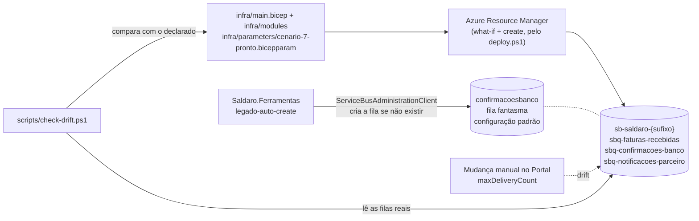

# Leitura 3.7 — "A fila fantasma": Bicep, what-if e detecção de drift

> **Version-anchor:** Q4-2026 · **Tipo:** guia de leitura prática, para fazer em casa depois da aula (uma noite, cerca de 1h30) · **Estado inicial:** `./scripts/deploy.ps1 -Cenario 7` · **Estado pronto:** `./scripts/deploy.ps1 -Cenario 7 -Pronto` (drift zero)
>
> Empresa, pessoas, números e incidentes são fictícios; qualquer semelhança é coincidência. Os serviços, os comportamentos e os limites citados são reais e foram conferidos no Microsoft Learn em 2026-10-14. Os resultados de referência dos passos vêm do primeiro deploy real do kit, também em 2026-10-14 (Flex Consumption, Brazil South); os seus vão variar um pouco.

> **CUSTO E FREE TRIAL**
> | Item | Valor |
> |------|-------|
> | Custo mensal (se deixar o ambiente ligado) | ~R$ 60 (quase tudo é o Service Bus Standard: US$ 10/mês) |
> | Custo real deste guia (subir, praticar e apagar na mesma noite) | ~R$ 1 (deployments e what-if não custam nada) |
> | Compatível com Azure Free Trial (US$ 200)? | **Sim** |
> | Base dos valores | Preços de lista da Microsoft para Brazil South consultados em 2026-10-14, convertidos a ~R$ 5,50/US$ e arredondados; confira na calculadora no dia |
>
> **Regra de ouro:** apague o Resource Group (`rg-saldaro-lab`) assim que terminar, com `./scripts/limpar.ps1`. O Service Bus Standard cobra por hora (~R$ 0,07/h) mesmo sem tráfego.

## Tabela de Recursos

O kit é criado pelo `deploy.ps1` a partir do Bicep em `infra/`. A fila `confirmacoesbanco` é criada pelo "worker legado" e apagada por você neste guia; ela é justamente o que **não** deveria existir.

| Recurso | Tipo | SKU / Tier | Custo estimado (mensal, se ficar ligado) |
|---------|------|------------|------------------------------------------|
| `rg-saldaro-lab` | Resource Group | — | Gratuito |
| `sb-saldaro-<sufixo>` (filas `sbq-faturas-recebidas`, `sbq-confirmacoes-banco`, `sbq-notificacoes-parceiro`), `disableLocalAuth = true` | Service Bus namespace | Standard | ~R$ 55 (US$ 10 de base, com 13 milhões de operações incluídas) |
| `confirmacoesbanco` (a fila fantasma, temporária) | Service Bus queue | — | Incluída no namespace |
| `func-saldaro-hub-<sufixo>` e plano `asp-saldaro-hub-<sufixo>` | Function App (o hub), identidade system-assigned | Flex Consumption (FC1) | ~R$ 0 dentro da franquia mensal |
| `func-saldaro-banco-<sufixo>` e plano `asp-saldaro-banco-<sufixo>` | Function App (banco parceiro simulado) | Flex Consumption (FC1) | ~R$ 0 |
| `apim-saldaro-<sufixo>` | API Management | Consumption | ~R$ 0 (1 milhão de chamadas/mês grátis) |
| `stsaldaro<sufixo>` | Storage Account | Standard LRS | centavos |
| `kv-saldaro-<sufixo>` (segredos `WebhookSecret` e `BancoApiKey`) | Key Vault, autorização RBAC | Standard | centavos |
| `evgt-saldaro-faturas-<sufixo>` | Event Grid custom topic | Basic | ~R$ 0 |
| `log-saldaro-<sufixo>` / `appi-saldaro-<sufixo>` | Log Analytics / Application Insights | Pay-as-you-go | ~R$ 0 (5 GB/mês grátis) |

> **Custo total estimado:** ~R$ 60/mês se ficar ligado; ~R$ 1 se você subir, praticar e apagar na mesma noite.

---

## O incidente

Numa auditoria, a Saldaro descobriu que a fila declarada no Bicep, com DLQ depois de três tentativas e detecção de duplicatas, não recebia nada. Um worker legado "criava a fila se não existisse" ao subir, com um nome ligeiramente diferente e a configuração padrão: dez tentativas, sem detecção de duplicatas. Durante dois meses as mensagens passaram por uma fila que não existia no código de infraestrutura, e todo o desenho de DLQ era decorativo.

Na mesma semana, uma mudança de contrato foi implantada no produtor antes do consumidor e encheu a DLQ de mensagens "inválidas" que estavam certas.

## O que você vai provar

Ao final deste guia (critério de feito):

1. `scripts/check-drift.ps1` detecta a fila fantasma `confirmacoesbanco` (extra) e o `maxDeliveryCount` alterado à mão (divergente), saindo com código 1.
2. Depois do conserto, `check-drift.ps1` sai com código 0 (drift zero) e o what-if não aponta recurso nenhum a criar nem a apagar.
3. Você sabe de onde vem o poder de criar filas e como tirá-lo de uma identidade de aplicação. Ele vem do `Azure Service Bus Data Owner` e, para quem é Owner da assinatura, do próprio Owner. Com uma identidade sem nenhum dos dois, o `legado-auto-create` falha alto, com 401.
4. Você planejou o campo `moeda` com o consumidor indo para produção antes do produtor, e viu a DLQ encher quando a ordem é invertida.

## Pré-requisitos

- Lab 0 feito: VS Code, .NET 10 SDK, Azure CLI com Bicep e PowerShell 7 (`pwsh`) instalados, e `az login` feito numa assinatura que você controla (o Free Trial serve).
- Repositório da aula clonado; todos os comandos rodam na raiz do repositório.
- Ter feito ou lido o guia 3.5: o estado inicial deste guia é o `cenario-5-pronto` (identidade gerenciada e `disableLocalAuth`).
- O `deploy.ps1` atribui ao seu usuário `Azure Service Bus Data Owner` no namespace; neste guia você vai trocar isso temporariamente. Se você é Owner da assinatura, e no Free Trial você é, leia o Passo 4.4 antes: o Owner também dá o poder de criar filas.

## Diagrama da arquitetura



---

## Parte 1 — Estado inicial

### Passo 1.1 — Suba o cenário 7

```powershell
./scripts/deploy.ps1 -Cenario 7
```

O estado inicial do cenário 7 é o `cenario-5-pronto`: os incidentes ao vivo consertados e o hub já sem segredos (guia 3.5). O `cenario-7-pronto` tem os **mesmos** parâmetros: aqui, "pronto" quer dizer drift zero, não uma configuração nova. Costuma levar de 10 a 20 minutos (no primeiro deploy real do kit, vindo do cenário 6, 6,8 minutos).

### Passo 1.2 — Carregue as variáveis do ambiente

```powershell
$cfg  = Get-Content ./scripts/.env.local | ConvertFrom-StringData
$rg   = $cfg.SALDARO_RG
$sb   = $cfg.SALDARO_SB_NAMESPACE
$fqdn = $cfg.SALDARO_SB_FQDN
```

### Passo 1.3 — Tire a fotografia de partida

```powershell
./scripts/check-drift.ps1
"código de saída: $LASTEXITCODE"
```

Resultado esperado: `Sem drift: o namespace está exatamente como o Bicep declara.` e código de saída **0**. O script lista as filas e as propriedades reais do namespace e compara com o que o Bicep declarou no último deployment bem-sucedido do lab (os outputs `filasDeclaradas` e `namespaceDeclarado`).

### Passo 1.4 — Leia o Bicep como quem vai depender dele

Você não precisa escrever Bicep neste guia, mas precisa saber onde cada decisão mora:

```powershell
# Onde as filas e as propriedades que importam estão declaradas
Get-ChildItem ./infra -Recurse -Filter *.bicep | Select-String -Pattern 'maxDeliveryCount|requiresSession|requiresDuplicateDetection' | Select-Object Path, LineNumber, Line

# Onde ficam os role assignments (e os nomes guid(...) que os tornam idempotentes)
Get-ChildItem ./infra -Recurse -Filter *.bicep | Select-String -Pattern 'roleAssignments|guid\(' | Select-Object Path, LineNumber

# Onde os toggles dos cenários viram configuração
Get-ChildItem ./infra -Recurse -Filter *.bicep | Select-String -Pattern 'rateLimit|identidadeGerenciada|heartbeat|alertas' | Select-Object Path, LineNumber
```

Anote três coisas: em que módulo está o namespace com as filas; como o `rate-limit` do 3.1, as roles do 3.5 e os alertas do 3.6 dependem dos toggles; e de onde saem os nomes `guid(...)` dos role assignments. A documentação de RBAC recomenda exatamente isso: um nome determinístico, montado a partir do escopo, do principal e da role, para o redeploy não falhar nem duplicar.

---

## Parte 2 — Sintomas: a fila que não existe no código

### Passo 2.1 — Suba o worker legado

```powershell
dotnet run --project "./03_Aplicações/Saldaro.Ferramentas" -- legado-auto-create --namespace $fqdn --mensagens 20
```

A ferramenta faz o que o worker da história fazia: usa o `ServiceBusAdministrationClient` para criar a fila `confirmacoesbanco` (sem hífens, configuração padrão) se ela não existir, e envia 20 mensagens para ela. Ela se autentica com `DefaultAzureCredential`, ou seja, com o seu `az login`. Funciona porque você tem o poder de gerenciar o namespace: o `Azure Service Bus Data Owner` que o deploy dá ao aluno e, se você é Owner da assinatura, também o Owner (Passo 4.4). No primeiro deploy real do kit, levou 36 s, com o build.

> **Fato verificado:** criar e consultar entidades pelo cliente de administração exige o direito **Manage** no namespace; com Microsoft Entra ID, a role de dados que dá esse direito é a `Azure Service Bus Data Owner` (amostra oficial do SDK de .NET e tabela de direitos da documentação de SAS: "Create a queue" e "Get queue exists or not" pedem Manage). O Passo 4.4 mostra o outro caminho, o do plano de controle.

### Passo 2.2 — Compare as duas filas no Portal

1. Abra o namespace `sb-saldaro-<sufixo>` → **Queues**. A `confirmacoesbanco` aparece ao lado da `sbq-confirmacoes-banco`.
2. Compare as propriedades:

| Propriedade | `sbq-confirmacoes-banco` (Bicep) | `confirmacoesbanco` (fantasma) |
|-------------|-----------------------------------|--------------------------------|
| Max delivery count | 3 | 10 (padrão) |
| Duplicate detection | ligada, janela de 10 minutos | desligada |
| Sessions | ligadas | desligadas |
| Mensagens | as do fluxo real | as 20 do worker legado |

3. Abra a `confirmacoesbanco` → **Service Bus Explorer** (em **Settings**, autenticação **Microsoft Entra ID**, por causa do `disableLocalAuth`) → **Peek Mode** → **Peek from start**. As mensagens estão lá, fora de todo o desenho de DLQ, sessão e duplicata.

### Passo 2.3 — Faça o "conserto rápido" que alguém sempre faz

Mude o **Max delivery count** da `sbq-confirmacoes-banco` de 3 para 10, "só até o pico passar". No Portal: fila `sbq-confirmacoes-banco` → **Settings** → **Properties** → **Max delivery count** = `10` → **Save changes**. Ou pela CLI:

```powershell
az servicebus queue update -g $rg --namespace-name $sb -n sbq-confirmacoes-banco --max-delivery-count 10 -o none
```

### Passo 2.4 — Rode o detector

```powershell
./scripts/check-drift.ps1
"código de saída: $LASTEXITCODE"
```

Resultado esperado: uma tabela com as colunas **Situação**, **Entidade**, **Propriedade**, **Declarado (Bicep)** e **Real**, em que a `confirmacoesbanco` aparece como **extra** e a `sbq-confirmacoes-banco` como **divergente** no `maxDeliveryCount` (declarado 3, real 10); a linha `DRIFT: 1 divergente, 1 extra.`; e o código de saída **1**. Um pipeline que rode isso toda noite falharia de manhã cedo, e não dois meses depois, numa auditoria. No primeiro deploy real do kit, saiu exatamente assim.

Logo abaixo da tabela, a dica do script manda rodar de novo o deploy "do mesmo estado" e usa o nome do último deployment. Depois do Passo 1.1, esse nome é `-Cenario 5 -Pronto`, que no 3.7 é o mesmo estado do `-Cenario 7`.

### Passo 2.5 — Quem criou a fila?

A criação pelo SDK usa o endpoint do próprio namespace, não passa pelo Azure Resource Manager; não conte com o Activity Log do Resource Group para achar o culpado. Quem registra `Create Queue` (com o chamador `ServiceBus Client`) são os logs operacionais do namespace, categoria `OperationalLogs`, que precisam de um diagnostic setting; no kit eles não estão ligados. Anote isso para as lições.

---

## Parte 3 — Hipóteses

| Hipótese | Como testar | Resultado esperado |
|----------|-------------|--------------------|
| O Bicep está errado | Releia a declaração da `sbq-confirmacoes-banco` (Passo 1.4) | Descartada: o Bicep declara a fila certa |
| Alguém mudou uma propriedade à mão | `check-drift.ps1` aponta divergência no `maxDeliveryCount` | **Confirmada** |
| Uma aplicação cria entidades por conta própria | A identidade que roda o worker tem o poder de gerenciar o namespace (`Data Owner` ou, no plano de controle, `Owner`) | **Confirmada** |
| O what-if já mostraria tudo isso | Leia o what-if do Passo 4.1 | Em parte: só o formato completo aponta a propriedade que vai mudar na fila **declarada**, e nenhum dos dois formatos aponta a fila extra |

---

## Parte 4 — Conserto

### Passo 4.1 — Leia o what-if e reaplique o Bicep

```powershell
./scripts/deploy.ps1 -Cenario 7 -Pronto
```

O `deploy.ps1` roda `az deployment group what-if` antes do `create`, no formato `ResourceIdOnly`: só a lista de recursos, sem valores (os app settings do baseline têm segredos). Nesse formato, o what-if **não compara propriedades**:

- recurso novo aparece com `+` (Create);
- recurso que vai sair aparece com `-` (Delete);
- todo recurso que já existe aparece com `!` (Deploy), mude ou não.

No primeiro deploy real do kit, a lista deu `Resource changes: 49 to deploy`, com a `sbq-confirmacoes-banco` entre os `!` como todas as outras, apesar do `maxDeliveryCount` alterado à mão. Nessa lista, confira duas coisas:

- **Nenhum `+` nem `-`:** o deploy não vai criar nem apagar nada.
- **Nada sobre a `confirmacoesbanco`:** no modo incremental, o que existe e não está declarado não aparece, e o deploy não apaga.

Para ver a mudança propriedade a propriedade, rode o what-if completo à mão **antes** deste passo, com a receita "What-if avulso" do `infra/README.md` e o arquivo `infra/parameters/cenario-7-pronto.bicepparam`. No bloco da `sbq-confirmacoes-banco` aparece `~ properties.maxDeliveryCount: 10 => 3`: o deploy vai devolver o valor declarado e desfazer o "conserto rápido", porque o Bicep é a fonte de verdade.

O mesmo what-if completo marca como modificados (`~`) muitos recursos que não mudaram de verdade. No primeiro deploy real do kit, foram 25 (`Resource changes: 25 to modify`): os dois Function Apps, o APIM, o Event Grid, o Application Insights, o Storage, os role assignments e as próprias filas. Nas filas, entram linhas `-` para propriedades que o Service Bus preenche com o valor padrão e o Bicep não declara, como `autoDeleteOnIdle` e `maxSizeInMegabytes`: o deploy não as apaga. A lista do ruído, com o porquê de cada item, está no `infra/README.md`.

Não projete nem cole essa saída: no formato completo, o what-if pode exibir valores de app settings.

No primeiro deploy real do kit, este `-Cenario 7 -Pronto` levou 6 minutos.

> **Fato verificado no Microsoft Learn:** o what-if não avalia funções como `listKeys()` nem referências a parâmetros `@secure()`, e a própria documentação avisa que o resultado pode ter "falsos positivos (ruído)". Por isso, "sem alterações" não quer dizer lista vazia. Na lista do `deploy.ps1`, quer dizer nenhum `+` nem `-`. No what-if completo, quer dizer nenhum `~` com valor antigo e novo que você não saiba explicar. Para rodar só o what-if, sem o `create`, use `./scripts/deploy.ps1 -Cenario 7 -Pronto -SomenteValidar` (a mesma lista de recursos, sem criar nem mudar nada) ou a receita completa do `infra/README.md`.

### Passo 4.2 — Rode o detector de novo

```powershell
./scripts/check-drift.ps1
"código de saída: $LASTEXITCODE"
```

A divergência sumiu, mas a `confirmacoesbanco` continua como **extra** e o código ainda é **1** (no primeiro deploy real do kit, `DRIFT: 1 extra.`). É por isso que o kit tem o `check-drift.ps1` além do what-if: um compara o declarado com o que vai mudar; o outro faz o inventário do que existe.

### Passo 4.3 — Decida o destino das mensagens e apague a fantasma

Na história, as mensagens da fila fantasma eram confirmações de pagamento de verdade, e o destino certo seria drená-las para a `sbq-confirmacoes-banco`. Não é um copiar e colar: a fila certa exige `SessionId`, deduplica por `MessageId` dentro da janela e tem outro `maxDeliveryCount`, então cada mensagem precisa ir para lá como uma cópia nova, com as propriedades que o fluxo espera. No laboratório, as 20 mensagens são de teste. Espie uma delas no Service Bus Explorer e apague a fila:

```powershell
az servicebus queue delete -g $rg --namespace-name $sb -n confirmacoesbanco
./scripts/check-drift.ps1
"código de saída: $LASTEXITCODE"
```

Resultado esperado: `Sem drift: o namespace está exatamente como o Bicep declara.` e código de saída **0**. No primeiro deploy real do kit, a fila fantasma ainda tinha as 20 mensagens quando foi apagada.

### Passo 4.4 — Faça o próximo auto-create falhar alto

A identidade do hub já tem só Sender, Receiver e a leitura de gerenciamento (`Reader`) no namespace desde o guia 3.5: nada que crie fila. Mas o worker legado roda com a **sua** identidade, e ela tem dois caminhos para criar filas:

- o `Azure Service Bus Data Owner` que o deploy dá ao aluno, que traz o direito **Manage**;
- se você é Owner (ou Contributor) da assinatura ou do Resource Group, as permissões do plano de controle, que o Service Bus também aceita no gerenciamento de entidades.

Para simular a identidade de uma aplicação com privilégio mínimo, troque as suas roles no namespace temporariamente:

```powershell
$nsId = az servicebus namespace show -g $rg -n $sb --query id -o tsv
$eu   = az ad signed-in-user show --query id -o tsv

az role assignment delete --assignee $eu --role "Azure Service Bus Data Owner" --scope $nsId
az role assignment create --assignee-object-id $eu --assignee-principal-type User --role "Azure Service Bus Data Sender" --scope $nsId -o none
az role assignment create --assignee-object-id $eu --assignee-principal-type User --role "Azure Service Bus Data Receiver" --scope $nsId -o none
```

A mudança pode levar até 10 minutos para valer (documentação de RBAC); `az logout` e `az login` ajudam a renovar o token. Depois, rode o worker legado de novo:

```powershell
dotnet run --project "./03_Aplicações/Saldaro.Ferramentas" -- legado-auto-create --namespace $fqdn --mensagens 20
```

**Se você não é Owner nem Contributor** (por exemplo, uma conta de laboratório só com as roles do kit), o resultado esperado é este: a ferramenta para com `ERRO 401 (Unauthorized): a identidade não tem o direito Manage no namespace ...`, sai com código **3** (acesso negado; a linha `Detalhe` traz a mensagem do próprio Service Bus), e a fila fantasma não nasce. A falha acontece já na consulta de existência da fila, que também exige `Manage`.

**Se você é Owner da assinatura, e no Free Trial você é, a fila nasce assim mesmo.** No primeiro deploy real do kit, a conta era Owner da assinatura e tinha só Sender e Receiver no namespace. O worker legado criou a `confirmacoesbanco` 2, 13 e 30 minutos depois da troca, então não é atraso de propagação. É a lição do passo, na prática: privilégio mínimo não é só tirar a role de dados. A identidade de uma aplicação também não pode ter Owner nem Contributor no escopo do namespace. Apague a fila que nasceu:

```powershell
az servicebus queue delete -g $rg --namespace-name $sb -n confirmacoesbanco
```

Agora restaure o seu acesso. O redeploy recria o seu `Data Owner` (o Bicep atribui as roles do aluno a partir do `principalIdAluno`), e você remove as duas roles manuais:

```powershell
./scripts/deploy.ps1 -Cenario 7 -Pronto -SemPublicar
az role assignment delete --assignee $eu --role "Azure Service Bus Data Sender" --scope $nsId
az role assignment delete --assignee $eu --role "Azure Service Bus Data Receiver" --scope $nsId
./scripts/check-drift.ps1
"código de saída: $LASTEXITCODE"
```

O `-SemPublicar` pula a publicação do código dos apps: só a infraestrutura importa aqui. Resultado esperado: código de saída **0** (no primeiro deploy real do kit, o `-SemPublicar` levou 3,1 minutos).

> **Não recrie o `Data Owner` à mão.** O Bicep dá a cada role assignment um nome `guid(escopo, principal, role)`. Uma atribuição feita à mão, com o mesmo principal, a mesma role e o mesmo escopo, ganha outro nome, e o próximo deploy falha com `RoleAssignmentExists: The role assignment already exists`. Foi o que o primeiro deploy real do kit mostrou. Se acontecer, apague a atribuição manual (`az role assignment delete --assignee $eu --role "Azure Service Bus Data Owner" --scope $nsId`) e rode o deploy de novo.

---

## Parte 5 — Contrato: o campo `moeda`, consumidor antes do produtor

### Passo 5.1 — A mudança

A Saldaro vai emitir faturas em dólar para empresas exportadoras. O ERP passará a mandar `moeda`, e o hub precisa carregar o campo na mensagem de `sbq-faturas-recebidas`, que hoje é `{ faturaId, clienteId, valor, vencimento, pagadorCnpj, referenciaErp, callbackUrl, caos }`. A pergunta não é "como adicionar um campo", e sim "em que ordem cada lado vai para produção".

### Passo 5.2 — Leia o leitor de hoje

Ache onde o hub lê essa mensagem:

```powershell
Get-ChildItem ./03_Aplicações/Saldaro.Hub -Recurse -Filter *.cs | Select-String -Pattern 'referenciaErp' | Select-Object Path, LineNumber
```

O tipo da mensagem é o `FaturaRecebidaMensagem`, em `Aplicacao/Mensagens.cs`; quem a lê é o `EmitirCobranca` (`Functions/EmitirCobranca.cs`), com as opções de JSON de `Dominio/Json.cs`. Abra os três e responda:

- **Campo desconhecido:** o desserializador ignora? O `System.Text.Json` ignora campos que não conhece por padrão (`UnmappedMemberHandling` = `Skip`), a menos que alguém configure `Disallow`. Se o hub ignora, ele é um **leitor tolerante** a campos novos.
- **Tipo errado:** o que acontece se um campo conhecido vier com outro tipo? É o que transformou o `valor` "1.250,00" em `SchemaInvalida` no Incidente 3: tolerante a campos novos, estrito com tipos.
- **O perigo do tolerante:** um `"moeda": "USD"` ignorado em silêncio é uma fatura em dólar cobrada como se fosse em real. Tolerante não é o mesmo que correto: um campo que muda o **significado** da mensagem precisa ser entendido pelo consumidor **antes** de o produtor começar a mandá-lo.

### Passo 5.3 — Veja a ordem invertida encher a DLQ

O Incidente 3 já era um problema de contrato: quem mudou o formato do `valor` foi o banco parceiro, o **produtor** do evento de confirmação, numa atualização de API, antes de o hub, o **consumidor**, estar pronto. Repita em pequena escala:

```powershell
./scripts/erp-simulado.ps1 -Faturas 3 -Cliente cliente-a -Caos "valorComVirgula=true"
./scripts/triagem-dlq.ps1
```

A triagem mostra as mensagens na DLQ de `sbq-confirmacoes-banco`, agrupadas pelo motivo `SchemaInvalida`. Para o banco, elas estavam certas: era o contrato novo dele. Limpe:

```powershell
./scripts/triagem-dlq.ps1 -Reprocessar
```

### Passo 5.4 — Planeje o `moeda` com o consumidor primeiro

Preencha o plano. A primeira linha já vai como exemplo:

| Ordem | O que vai para produção | O que precisa ser verdade antes | Como verificar |
|-------|-------------------------|---------------------------------|----------------|
| 1 | Consumidores de `sbq-faturas-recebidas` (o `EmitirCobranca`) aceitam `moeda` opcional: ausente vale `BRL`; uma moeda que ainda não suportam vai para a DLQ com motivo explícito, em vez de ser ignorada | Testes com a mensagem antiga (sem `moeda`) e com a nova | DLQ vazia e nenhuma exceção nova depois do deploy |
| 2 | | | |
| 3 | | | |
| 4 | | | |

Pistas para as outras linhas: o produtor (`PostFatura`) começa a gravar e enviar `moeda`; o banco parceiro precisa aceitar cobranças em outra moeda (é uma negociação, não um deploy); só depois que todos os produtores mandam o campo ele pode virar obrigatório. E a regra de ouro: se a mudança for incompatível (trocar o tipo ou o significado de um campo que já existe), não reaproveite o canal; crie uma versão nova da mensagem ou uma fila nova.

### Passo 5.5 (opcional) — Implemente numa branch do seu fork

```csharp
// ILUSTRATIVO: o tipo real é o FaturaRecebidaMensagem, em 03_Aplicações/Saldaro.Hub/Aplicacao/Mensagens.cs.
public sealed record FaturaRecebidaMensagem(
    string FaturaId, string ClienteId, decimal Valor, string? Vencimento,
    string? PagadorCnpj, string? ReferenciaErp, string? CallbackUrl, string? Caos)
{
    public string Moeda { get; init; } = "BRL";   // ausente = BRL: a mensagem antiga continua válida
}
```

Escreva os testes com as duas versões da mensagem em `03_Aplicações/Saldaro.Hub.Tests`, publique com `./scripts/deploy.ps1 -Cenario 7 -Pronto` (ele publica o código da sua máquina) e só então mude o produtor.

---

## Parte 6 — Prova

### Passo 6.1 — What-if limpo

```powershell
./scripts/deploy.ps1 -Cenario 7 -Pronto -SomenteValidar
```

O `-SomenteValidar` compila o Bicep e roda o mesmo what-if do deploy, sem criar, mudar ou publicar nada. Resultado esperado: todos os recursos com `!` (Deploy), **nenhum `+` nem `-`**, e nada sobre a `confirmacoesbanco`. No primeiro deploy real do kit, levou menos de 1 minuto e deu `Resource changes: 49 to deploy`, com os 49 recursos em `!`. Como o Passo 4.1 mostrou, esse formato lista todo recurso que já existe, mude ou não. A lista limpa diz que o deploy não vai criar nem apagar nada; quem prova o drift zero das filas é o `check-drift.ps1` com código 0 (Passo 4.4). Se quiser a prova propriedade a propriedade, rode o what-if completo do `infra/README.md`: o bloco da `sbq-confirmacoes-banco` não tem mais a linha do `maxDeliveryCount`.

### Passo 6.2 — Marque o critério de feito

- [ ] `check-drift.ps1` detectou a fila `confirmacoesbanco` (extra) e o `maxDeliveryCount` alterado (divergente), com código 1 (Passo 2.4).
- [ ] Depois do conserto, `check-drift.ps1` saiu com código 0, e o what-if não mostrou recurso a criar nem a apagar (Passos 4.4 e 6.1).
- [ ] Sem o `Data Owner`, o `legado-auto-create` falhou com 401. Se você é Owner da assinatura, vale o contrário: você viu a fila nascer mesmo assim e sabe explicar por quê (Passo 4.4).
- [ ] O plano do campo `moeda` tem o consumidor antes do produtor, e você viu a DLQ encher com a ordem invertida (Passos 5.3 e 5.4).

Prints sugeridos para o seu registro: as duas saídas do `check-drift.ps1` (código 1 e código 0), o 401 do worker legado (ou, se você é Owner, a fila nascendo sem o `Data Owner`) e o seu plano preenchido.

---

## Post-mortem de cinco linhas

Copie `templates/post-mortem.md` e preencha, sem culpados:

1. **O que aconteceu**
2. **Impacto**
3. **Causa raiz**
4. **O que consertamos**
5. **O que impede de repetir**

Dica para a causa raiz: "o worker criou a fila errada" é o gatilho. A causa é a combinação de uma identidade de aplicação com poder de criar entidades e de nenhuma verificação entre o que o código de infraestrutura declara e o que existe de fato.

## Lições para produção

- **O Bicep é a fonte de verdade.** Mudança feita à mão no Portal é drift: ou vira pull request, ou é desfeita pelo próximo deploy.
- **What-if antes de todo deploy**, num pipeline com aprovação (por exemplo, `az deployment group create --confirm-with-what-if` localmente, ou o what-if publicado no pull request). Conheça o ruído do seu template para não ignorar a linha que importa.
- **What-if não substitui inventário.** No modo incremental, o que não está declarado não aparece como mudança; um `check-drift` agendado (toda noite, por exemplo) fecha essa lacuna.
- **Aplicação nunca cria entidade.** Sender e Receiver para os apps; criar e mudar filas é papel da identidade do pipeline de infraestrutura. Para a escala do Service Bus trigger, um role customizado de leitura (`Microsoft.ServiceBus/namespaces/*/read`), não `Data Owner` (guia 3.5).
- **Privilégio mínimo inclui o plano de controle.** O Service Bus aceita as permissões do plano de controle no gerenciamento de entidades. No primeiro deploy real do kit, uma conta Owner da assinatura, sem o `Data Owner`, continuou criando filas pelo cliente de administração. Identidade de aplicação não tem Owner nem Contributor no escopo do namespace.
- **Propriedades imutáveis** (`requiresSession`, `requiresDuplicateDetection`) não mudam num redeploy: drene, recrie ou versione o canal (Incidente 2).
- **Role assignments com nome `guid(escopo, principal, role)`** tornam o redeploy idempotente.
- **Ligue os `OperationalLogs` do namespace** (diagnostic setting) para saber quem criou, mudou ou apagou cada entidade.
- **Drift não é só fila:** app settings como `AzureWebJobs.<função>.Disabled` (Desafio 3.6), roles e alertas criados à mão também são.
- **Contratos evoluem com leitor tolerante, consumidor primeiro e rejeição explícita:** nunca mude o significado de um campo existente; acrescente campos opcionais com valor padrão; para mudança incompatível, versione a mensagem ou o canal.
- **Recriar o ambiente tem armadilhas de nome:** Key Vault (7 dias) e APIM (48 horas) apagados ficam em soft-delete e reservam o nome; o `limpar.ps1` purga os dois.

## Troubleshooting

| Problema | Causa provável | Solução |
|----------|----------------|---------|
| O `legado-auto-create` falha com 401 já na primeira execução | O seu usuário não tem `Azure Service Bus Data Owner` (deploy sem as roles do aluno) e não é Owner nem Contributor da assinatura | Rode `./scripts/deploy.ps1 -Cenario 7` de novo e confira as roles em **Access control (IAM)** do namespace |
| O deploy falha com `RoleAssignmentExists` | Uma role assignment criada à mão, com o mesmo principal, a mesma role e o mesmo escopo de uma que o Bicep declara (por exemplo, o `Data Owner` restaurado à mão no Passo 4.4) | Apague a atribuição manual (`az role assignment delete --assignee $eu --role "<role>" --scope $nsId`) e rode o deploy de novo; o Bicep recria a dele |
| Depois da troca de roles, o `legado-auto-create` ainda cria a fila | Primeiro suspeito: você é Owner (ou Contributor) da assinatura ou do Resource Group, e o Service Bus aceita essas permissões do plano de controle no gerenciamento de entidades (no primeiro deploy real do kit, a fila nasceu 30 minutos depois da troca). Depois: propagação de RBAC, `Data Owner` herdado de outro escopo ou outra credencial em uso | Se for o Owner, é o comportamento esperado (Passo 4.4): apague a fila e siga. Senão, espere até 10 minutos e faça `az logout` e `az login`; liste com `az role assignment list --assignee $eu --all --query "[?contains(roleDefinitionName,'Service Bus')]" -o table`; confira se não há variáveis `AZURE_CLIENT_ID`/`AZURE_TENANT_ID` no terminal (o `DefaultAzureCredential` as usaria) |
| `check-drift.ps1` sai com 1 num ambiente recém-criado | Sobrou a `confirmacoesbanco`, a `sbq-rajada` do guia 3.8 ou uma mudança manual | Leia o relatório: ele diz o que está extra, faltante ou divergente |
| O what-if do `deploy.ps1` mostra todos os recursos com `!` | Formato `ResourceIdOnly`: ele não compara propriedades, e todo recurso que já existe aparece como Deploy | Esperado (Passo 4.1): confira só que não há `+` nem `-`; para ver propriedades, use o what-if completo do `infra/README.md` |
| O what-if completo mostra muitas alterações | Ruído conhecido: uns 25 recursos marcados como `~` sem mudança real (Function Apps, APIM, Event Grid, Application Insights, Storage, role assignments e as filas, com linhas `-` para propriedades de valor padrão) | Procure o `~` com valor antigo e novo, como `maxDeliveryCount: 10 => 3`; a lista do ruído está no `infra/README.md` |
| O deploy falha dizendo que `requiresSession` não pode ser alterado | Propriedade imutável numa fila existente | Veja o Incidente 2: drene, apague a fila e redeploy |
| `az role assignment delete` diz que não encontrou atribuição | Nome da role ou escopo digitados de outro jeito | Liste antes com `az role assignment list --assignee $eu --scope $nsId -o table` |
| O Service Bus Explorer mostra "Unauthorized" depois da troca de roles | Propagação de RBAC (até 10 minutos) ou o Explorer autenticando por **Access Key** com `disableLocalAuth` | Espere; em **Settings** do Explorer, use **Microsoft Entra ID** (Sender e Receiver bastam para peek, envio e recebimento); se precisar, restaure o `Data Owner` (fim do Passo 4.4) |
| `deploy.ps1` falha dizendo que o nome do APIM está em uso | APIM apagado pelo Portal fica em soft-delete por 48 horas com o nome reservado | `./scripts/limpar.ps1 -Sufixo <sufixo>` purga a sobra (ou `az apim deletedservice purge --location brazilsouth --service-name apim-saldaro-<sufixo>`); ou use outro `-Sufixo` |

## Limpeza

```powershell
./scripts/limpar.ps1
```

O script apaga o `rg-saldaro-lab`, purga o Key Vault e o APIM, que ficam em soft-delete com o nome reservado, e apaga o `scripts/.env.local`. Atribuições de role com escopo no namespace somem junto com ele. Pelo Portal, o equivalente é **Resource groups** → `rg-saldaro-lab` → **Delete resource group**, digitar o nome e confirmar.

> **Atenção:** se apagar pelo Portal, o Key Vault (7 dias) e o APIM (48 horas) ficam em soft-delete e reservam os nomes `kv-saldaro-<sufixo>` e `apim-saldaro-<sufixo>`; rode `./scripts/limpar.ps1 -Sufixo <sufixo>` depois para purgar as sobras, ou use outro sufixo.
>
> **Custo se esquecer ligado:** ~R$ 1,80 por dia, quase todo do Service Bus Standard.

## O que fazer a seguir

- **Leitura 3.8:** `01_Aulas/Leitura_3.8_Premium_vs_Standard_Guia.md`. A decisão de tier também vira código e ADR.
- **Desafio extra:** um workflow do GitHub Actions que rode o what-if em cada pull request que mexa em `infra/` e o `check-drift.ps1` toda noite, falhando o job quando o código de saída for 1.
- **Revisite o Desafio 3.6:** inclua os settings `AzureWebJobs.*.Disabled` na sua checagem de drift.
