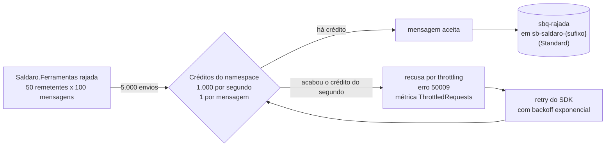

# Leitura 3.8 — "Premium ou Standard?": custo, throughput e isolamento com números na mesa

> **Version-anchor:** Q4-2026 · **Tipo:** exercício de decisão, para fazer em casa depois da aula (uma noite, cerca de 1h30). **Não provisiona Premium.** · **Estado:** qualquer ambiente do kit de pé; se não houver, `./scripts/deploy.ps1 -Cenario 7 -Pronto` · **Entrega:** planilha de custo, matriz de decisão e um ADR de uma página
>
> Empresa, pessoas, números e incidentes são fictícios; qualquer semelhança é coincidência. Os limites, os comportamentos e os preços citados são reais e foram conferidos no Microsoft Learn e na tabela de preços da Microsoft em 2026-10-14. Os resultados de referência da rajada vêm do primeiro deploy real do kit, também em 2026-10-14 (Brazil South); os seus vão variar um pouco.

> **CUSTO E FREE TRIAL**
> | Item | Valor |
> |------|-------|
> | Custo mensal (se deixar o ambiente ligado) | ~R$ 60 (quase tudo é o Service Bus Standard: US$ 10/mês) |
> | Custo real deste guia (subir, praticar e apagar na mesma noite) | ~R$ 1 |
> | Compatível com Azure Free Trial (US$ 200)? | **Sim**, porque o guia **não cria** o Premium |
> | O que o Premium custaria | 1 messaging unit = ~US$ 0,93/h (~R$ 5,10/h, ~R$ 3.700/mês). Ligado no Free Trial, consumiria os US$ 200 em cerca de 9 dias |
> | Base dos valores | Preços de lista da Microsoft para Brazil South consultados em 2026-10-14, convertidos a ~R$ 5,50/US$ e arredondados; confira na calculadora no dia |
>
> **Regra de ouro:** apague a fila `sbq-rajada` assim que terminar o teste e o Resource Group (`rg-saldaro-lab`) ao fim do guia, com `./scripts/limpar.ps1`.

## Tabela de Recursos

O kit é criado pelo `deploy.ps1` a partir do Bicep em `infra/`. Este guia só cria (e apaga) uma fila descartável.

| Recurso | Tipo | SKU / Tier | Custo estimado (mensal, se ficar ligado) |
|---------|------|------------|------------------------------------------|
| `rg-saldaro-lab` | Resource Group | — | Gratuito |
| `sb-saldaro-<sufixo>` | Service Bus namespace | Standard | ~R$ 55 (US$ 10 de base, com 13 milhões de operações incluídas) |
| `sbq-rajada` (criada e apagada neste guia) | Service Bus queue | — | Incluída no namespace |
| Demais recursos do kit (`func-saldaro-hub-<sufixo>`, `func-saldaro-banco-<sufixo>`, `apim-saldaro-<sufixo>`, `stsaldaro<sufixo>`, `kv-saldaro-<sufixo>`, `evgt-saldaro-faturas-<sufixo>`, `log-saldaro-<sufixo>`, `appi-saldaro-<sufixo>`) | — | Flex Consumption, Consumption, Standard LRS, Standard, Basic, Pay-as-you-go | ~R$ 0 a centavos dentro das franquias |
| Service Bus **Premium** | **Não é criado** | 1 messaging unit | ~R$ 3.700/mês (US$ 0,9275 por MU por hora) |

> **Custo total estimado:** ~R$ 60/mês se ficar ligado; ~R$ 1 se você subir, praticar e apagar na mesma noite.

---

## O incidente

Reunião de orçamento. A segurança exige Private Endpoint no Service Bus, que só existe no Premium. A diretoria recusa o custo. A operação lembra que, no pico do dia 10, o namespace Standard devolveu o erro 50009 por alguns minutos. Alguém pergunta: "se formos para o Premium e não der certo, dá para voltar?". Outra pessoa sugere orquestrar tudo em Logic Apps, até ouvir o custo por ação. Ninguém tem números na mesa.

Este guia é a lição de casa que faltou antes da reunião.

## O que você vai entregar

1. **Planilha de custo em R$** para dois cenários de volume (400 mil e 2 milhões de cobranças por mês), Standard × Premium.
2. **Print ou consulta de `ThrottledRequests`** durante a rajada, se o throttling acontecer, com a explicação do 50009 nas suas palavras.
3. **Matriz de decisão Standard × Premium** preenchida.
4. **ADR de uma página** a partir de `templates/adr.md`: contexto, decisão, consequências e três gatilhos objetivos que forçariam o Premium.
5. **Lista de alternativas de segurança sem Premium**, cada uma com a sua limitação.

## Pré-requisitos

- Um ambiente do kit de pé e `az login` feito; o seu usuário tem `Azure Service Bus Data Owner` no namespace (o `deploy.ps1` atribui).
- .NET 10 SDK (a rajada roda com `dotnet run`) e PowerShell 7 (`pwsh`).
- Ter lido os guias 3.1 (rate limit no APIM), 3.5 (identidade e `disableLocalAuth`) e 3.7 (Bicep e drift): a decisão usa os três.
- A [calculadora de preços do Azure](https://azure.microsoft.com/pricing/calculator/) aberta em outra aba.

## Diagrama



---

## Parte 1 — Os fatos e os preços de partida

### Passo 1.1 — Garanta um ambiente e carregue as variáveis

Se não tiver nenhum ambiente do kit de pé:

```powershell
./scripts/deploy.ps1 -Cenario 7 -Pronto
```

Qualquer cenário serve: o exercício só precisa do namespace. O `cenario-7-pronto` é sugerido porque é o estado pronto do último cenário com deploy (identidade gerenciada, `disableLocalAuth` e drift zero), que é a base do ADR.

```powershell
$cfg  = Get-Content ./scripts/.env.local | ConvertFrom-StringData
$rg   = $cfg.SALDARO_RG
$sb   = $cfg.SALDARO_SB_NAMESPACE
$fqdn = $cfg.SALDARO_SB_FQDN
```

### Passo 1.2 — Os fatos (conferidos no Microsoft Learn em 2026-10-14)

| Tema | Standard | Premium |
|------|----------|---------|
| Modelo | Multitenant, recursos compartilhados; "throughput variável", "latência variável" | Recursos dedicados (CPU e memória) em messaging units de 1, 2, 4, 8 ou 16; desempenho previsível |
| Throttling | Por créditos: **1.000 por segundo por namespace**; 1 crédito por mensagem em operações de dados (send, receive, peek), 10 por operação de gerência, e 1 por **avaliação de filtro** em tópicos | Só pelos limites dos recursos alocados (métricas de CPU e memória) |
| Erro ao estourar | "The request was terminated because the entity is being throttled. Error code: 50009. Please wait 2 seconds and try again." | Throttled Requests quando os recursos não dão conta |
| Perda de dados no throttling | Não: o pedido não foi aceito, e o retry padrão dos SDKs, com backoff exponencial, tenta de novo | Idem |
| Tamanho de mensagem | Até 256 KB | Até 100 MB |
| Private Endpoint e service endpoints | **Não** | Sim |
| Firewall de IP | Sim, mas configurável só por CLI, ARM/Bicep, PowerShell ou REST (o Portal só mostra para o Premium) e **sem** a exceção de serviços confiáveis | Sim, com a exceção de serviços confiáveis |
| Chave gerenciada pelo cliente (CMK), Geo-Replication, JMS 2.0 | Não | Sim |
| Cobrança | Base de US$ 10/mês com 13 milhões de operações incluídas, mais as excedentes | Por messaging unit por hora, pela maior quantidade alocada em cada hora; conexões não são cobradas |
| Migração | Ferramenta Standard → Premium no lugar: o nome DNS antigo passa a apontar para o Premium (cerca de 5 minutos de indisponibilidade), as entidades são copiadas, as mensagens **não** são copiadas (é preciso drenar o Standard) e o **RBAC não é migrado** | A ferramenta **não faz downgrade**: voltar ao Standard é migração manual |

### Passo 1.3 — Os preços de lista (Brazil South, US$, 2026-10-14)

| Item | Preço |
|------|-------|
| Service Bus Standard, base | US$ 10/mês (US$ 0,0134/h), com 13 milhões de operações incluídas |
| Standard, operações de 13 a 100 milhões | US$ 0,80 por milhão |
| Standard, operações de 100 milhões a 2,5 bilhões | US$ 0,50 por milhão |
| Standard, operações acima de 2,5 bilhões | US$ 0,20 por milhão |
| Standard, brokered connections | 1.000 incluídas; depois ~US$ 0,03 por conexão por mês |
| Service Bus Premium | US$ 0,9275 por messaging unit por hora (~US$ 677/mês por MU) |
| Logic Apps Consumption, ação built-in | 4.000 por mês grátis; depois US$ 0,000032 por ação |
| Logic Apps Consumption, ação de conector Standard | US$ 0,000135 por ação |
| Logic Apps Consumption, ação de conector Enterprise | US$ 0,001 por ação |

> **Regra de cobrança do Standard (página de preços):** um send ou receive de mensagem de até 64 KB é uma operação; uma leitura com lock seguida de complete conta como **duas**; renovar o lock é mais uma; cada entrega a uma subscription de tópico conta separado; operações de gerência também contam.

---

## Parte 2 — Sintomas: quanto o namespace aguenta

### Passo 2.1 — Crie a fila descartável

```powershell
az servicebus queue create -g $rg --namespace-name $sb -n sbq-rajada -o none
```

Configuração padrão, sem sessions: é só um alvo para a rajada. Enquanto ela existir, o `check-drift.ps1` do guia 3.7 vai acusá-la como extra; por isso o Passo 2.6 a apaga.

### Passo 2.2 — Abra as métricas antes de disparar

1. No namespace `sb-saldaro-<sufixo>` → **Monitoring** → **Metrics**.
2. Adicione **Throttled Requests**, **Incoming Messages** e **Server Errors**, todas com agregação **Sum**; granularidade de 1 minuto; intervalo dos últimos 30 minutos.
3. Opcional: **Apply splitting** por `EntityName` para separar a `sbq-rajada` do resto.

### Passo 2.3 — Dispare a rajada

```powershell
dotnet run --project "./03_Aplicações/Saldaro.Ferramentas" -- rajada --namespace $fqdn --fila sbq-rajada --remetentes 50 --mensagens 100
```

São 50 remetentes concorrentes com 100 mensagens cada: 5.000 mensagens, 5.000 créditos. Se elas saírem em menos de 5 segundos, a demanda passa de 1.000 créditos por segundo e o namespace começa a recusar. A ferramenta se autentica com o seu `az login` (`DefaultAzureCredential`), o que funciona mesmo com `disableLocalAuth`; enviar exige só `Azure Service Bus Data Sender`. Antes de medir, ela manda 1 mensagem de aquecimento (abre a conexão e confirma que a fila existe). E ela recusa as filas do hub (`sbq-faturas-recebidas`, `sbq-confirmacoes-banco`, `sbq-notificacoes-parceiro`), com código de saída 2: os workers consumiriam as mensagens de teste.

### Passo 2.4 — Leia o que aconteceu

Espere de 1 a 3 minutos (as métricas são agregadas por minuto) e olhe o gráfico:

- **Incoming Messages** deve somar pelo menos 5.001 mensagens: as 5.000 da rajada, a de aquecimento e mais uma para cada retentativa do SDK que repetiu um envio já aceito (veja o resultado de referência abaixo). A métrica atrasa: se a soma vier bem abaixo disso logo depois da rajada, espere alguns minutos e olhe um intervalo de 1 hora, filtrado pela dimensão `EntityName` = `sbq-rajada`.
- **Throttled Requests** maior que zero significa que o 50009 aconteceu: alguns pedidos foram recusados, o SDK esperou com backoff exponencial e tentou de novo. Confira no resumo que a ferramenta imprime no fim: a linha **Retentativas do SDK** mostra quantas vezes o SDK recebeu `ServiceBusy` (o erro 50009) e repetiu, e, em **outras**, as retentativas por qualquer outro motivo; **Falhas definitivas** precisa ficar em 0. Com 0, nada se perdeu; os envios só demoraram mais. Se não ficar, o throttling durou mais que as 3 retentativas da ferramenta (backoff de cerca de 0,8 s, 1,6 s e 3,2 s), e ela sai com código 1: é o caso que o retry sozinho não cobre.
- Durante o throttling, a contagem de mensagens da fila pode aparecer como **0** no Portal: o serviço devolve só as informações estáticas da entidade quando a própria consulta é recusada. É comportamento documentado, não perda de mensagem.

**Resultado de referência.** No primeiro deploy real do kit, a rajada de 50 × 100 mandou as 5.000 mensagens em 13,1 s (~381 mensagens por segundo), sem throttling: **Throttled Requests** e **Server Errors** ficaram em 0. Mas a fila terminou com **5.051** mensagens, e não 5.001. A linha **Retentativas do SDK** explicou a diferença: nenhuma `ServiceBusy` e 50 em **outras**, todas `ServiceCommunicationProblem`, um erro de comunicação do lado do cliente. Nessas 50, o envio original já tinha valido; o SDK não soube disso e mandou de novo, e a `sbq-rajada`, criada sem detecção de duplicatas, guardou as duas cópias. A conta fecha: 5.000 da rajada + 1 de aquecimento + 50 cópias = 5.051. **Incoming Messages**, filtrada por `EntityName` = `sbq-rajada` num intervalo de 1 hora, deu os mesmos 5.051; com uma janela curta, logo depois da rajada, tinha mostrado só 53.

É o "pelo menos uma vez" do Incidente 2, agora do lado de quem envia: sem detecção de duplicatas, o retry do remetente gera cópias. A ferramenta põe um `MessageId` fixo em cada mensagem (`rajada-{execucao}-{remetente}-{sequencia}`, em `ComandoRajada.cs`); numa fila com detecção de duplicatas, como a `sbq-confirmacoes-banco` depois do Incidente 2, as cópias com o mesmo `MessageId` seriam descartadas dentro da janela. Sem ela, quem consome precisa ser idempotente.

Tire o print do gráfico com **Throttled Requests** (entrega 2).

### Passo 2.5 — Se não houve throttling

É comum: uma máquina só, numa conexão doméstica, pode não chegar a 1.000 mensagens por segundo (no primeiro deploy real do kit, foram ~381 por segundo, Passo 2.4). Tente uma vez maior:

```powershell
dotnet run --project "./03_Aplicações/Saldaro.Ferramentas" -- rajada --namespace $fqdn --fila sbq-rajada --remetentes 100 --mensagens 200
```

Se mesmo assim **Throttled Requests** ficar em zero, registre isso na entrega como um dado: "de uma máquina, com N remetentes, não alcancei o limite do namespace". Também é um número na mesa.

### Passo 2.6 — Apague a fila descartável

```powershell
az servicebus queue delete -g $rg --namespace-name $sb -n sbq-rajada
```

As mensagens vão junto com a fila.

---

## Parte 3 — Hipóteses: cada frase da reunião contra um número

| Frase da reunião | O número | Veredito |
|------------------|----------|----------|
| "O Standard não aguenta o nosso pico" | Pico de 30 faturas/s × ~8 créditos por fatura (Passo 4.2) = ~240 créditos/s, cerca de 24% do limite de 1.000/s; a rajada sintética, com 50 remetentes numa máquina só, chegou a ~381 mensagens/s sem estourar (Passo 2.4) | **Ainda não.** Vira gatilho de revisão, com métrica |
| "O custo de operações vai explodir" | 400 mil faturas × 12 operações = 4,8 milhões, abaixo dos 13 milhões incluídos (Passo 4.1) | **Falso** no volume de hoje |
| "Segurança exige Private Endpoint" | Private Endpoint só existe no Premium | **Verdadeiro, se o requisito for literalmente Private Endpoint.** Pergunte qual risco ele mitiga: se é o endpoint público aberto a qualquer origem, o Network Security Perimeter do Passo 4.4 o restringe no Standard; se é ter IP privado, só o Premium resolve |
| "Se der errado, a gente volta" | A ferramenta de migração não faz downgrade | **Falso:** voltar é migração manual, com drenagem |
| "Vamos orquestrar tudo em Logic Apps" | Custo por ação × ações por fatura × volume (Passo 4.6) | **Só** para baixo volume e aprovação humana |

---

## Parte 4 — Conserto: a decisão com números

### Passo 4.1 — Monte a planilha de custo

Operações faturáveis por fatura no fluxo do kit (caminho feliz, sem retries, duplicatas nem renovação de lock):

| Etapa | Operações |
|-------|-----------|
| `PostFatura` envia para `sbq-faturas-recebidas` | 1 |
| `EmitirCobranca` recebe com lock e completa | 2 |
| `WebhookBanco` envia `cobranca.registrada` e `cobranca.paga` para `sbq-confirmacoes-banco` | 2 |
| O worker de confirmação recebe e completa as duas | 4 |
| O Event Grid entrega o `FaturaBaixada` em `sbq-notificacoes-parceiro` | 1 |
| `NotificarParceiro` recebe e completa | 2 |
| **Total por fatura** | **12** |

Uma calculadora para conferir as contas (ilustrativa, não faz parte do kit; preços do Passo 1.3):

```powershell
# ILUSTRATIVO: custo mensal do Service Bus, Standard x Premium, em US$ e R$.
function Get-CustoServiceBus([double]$FaturasMes, [double]$OpsPorFatura = 12, [int]$UnidadesPremium = 1, [double]$Cotacao = 5.5) {
    $milhoes   = $FaturasMes * $OpsPorFatura / 1e6
    $excedente = [math]::Max(0, [math]::Min($milhoes, 100) - 13) * 0.80 +
                 [math]::Max(0, [math]::Min($milhoes, 2500) - 100) * 0.50 +
                 [math]::Max(0, $milhoes - 2500) * 0.20
    $standard  = 10 + $excedente
    $premium   = 0.9275 * 730 * $UnidadesPremium
    [pscustomobject]@{
        FaturasMes       = $FaturasMes
        OperacoesMilhoes = [math]::Round($milhoes, 1)
        StandardUSD      = [math]::Round($standard, 2)
        StandardBRL      = [math]::Round($standard * $Cotacao, 0)
        PremiumUSD       = [math]::Round($premium, 0)
        PremiumBRL       = [math]::Round($premium * $Cotacao, 0)
    }
}
400000, 2000000 | ForEach-Object { Get-CustoServiceBus -FaturasMes $_ } | Format-Table -AutoSize
```

Resultado esperado (arredondado):

| Cenário | Operações/mês | Standard | Premium (1 MU) |
|---------|---------------|----------|----------------|
| A: 400 mil faturas/mês | 4,8 milhões | US$ 10,00 (~R$ 55) | US$ 677 (~R$ 3.724) |
| B: 2 milhões de faturas/mês | 24 milhões | US$ 18,80 (~R$ 103) | US$ 677 (~R$ 3.724) |
| B com 50% de folga (18 operações por fatura) | 36 milhões | US$ 28,40 (~R$ 156) | US$ 677 (~R$ 3.724) |

Complete a sua planilha com uma linha de folga para retries e duplicatas (ou meça: a métrica **Incoming Requests** do namespace num dia normal dá o número real) e com a linha de 2 MUs, se a segurança pedir capacidade de reserva. A conclusão salta da tabela: o Premium nunca é escolhido por custo de operação; ele é escolhido por isolamento, rede, tamanho de mensagem ou previsibilidade.

### Passo 4.2 — Monte o modelo de créditos (throughput)

| Item | Conta |
|------|-------|
| Créditos por fatura (só envios e recebimentos: 4 + 4) | ~8 |
| Pico de lote de ERP | 30 faturas/s |
| Demanda no pico | 30 × 8 = ~240 créditos/s, cerca de 24% de 1.000 |
| E se as notificações passassem por um tópico com 20 subscriptions filtradas (uma por ERP)? | Cada notificação custa 1 envio + 20 avaliações de filtro = ~21 créditos; 30/s × 21 = ~630 créditos/s só no tópico. Somando o resto do fluxo, a Saldaro sairia de ~24% para mais de 80% do limite de 1.000 |

O segundo cenário é o motivo de tópicos com muitos filtros pedirem cuidado no Standard: os filtros multiplicam créditos. E um detalhe que engana: enviar em lote reduz o número de requisições, mas não o de créditos, que é de 1 por mensagem.

### Passo 4.3 — Preencha a matriz de decisão

Dê um peso (1 a 3) a cada critério para a Saldaro de hoje e anote a evidência:

| Critério | Peso | Standard | Premium | Evidência |
|----------|------|----------|---------|-----------|
| Throughput previsível no pico | | Créditos compartilhados, 1.000/s | Dedicado, escala por MU | Passos 2.4 e 4.2 |
| Latência previsível | | Variável | Previsível | Tabela do Passo 1.2 |
| Tamanho de mensagem | | 256 KB | 100 MB | As faturas do kit têm poucos KB |
| Private Endpoint | | Não | Sim | Exigência da segurança |
| Isolamento por cliente (bulkhead) | | Um namespace Standard por cliente grande (US$ 10/mês cada, cada um com os próprios 1.000 créditos/s) | Isola a Saldaro dos outros inquilinos do Azure, não as empresas clientes entre si (um namespace Premium por cliente custaria ~R$ 3.700 cada) | |
| Geo-Replication / recuperação de desastre | | Não | Sim | |
| Custo mensal | | ~R$ 55 a 156 | ~R$ 3.700 por MU | Passo 4.1 |
| Reversibilidade | | Migra para o Premium quando quiser | Sem downgrade | Passo 1.2 |

### Passo 4.4 — Liste a segurança possível sem Premium

| Alternativa | O que resolve | Limitação |
|-------------|---------------|-----------|
| Identidade gerenciada + `disableLocalAuth` (feito no guia 3.5) | Acaba com chave SAS vazada ou esquecida | Exige RBAC bem desenhado |
| Azure Policy "Service Bus namespaces should have local authentication methods disabled" | Impede que alguém volte a ligar a SAS | — |
| RBAC com escopo por fila e sem `Data Owner` em apps (guias 3.5 e 3.7) | Limita o estrago de uma identidade comprometida | Mais atribuições para manter (no Bicep) |
| Firewall de IP no Standard | Restringe de onde se conecta ao namespace | **Não tem a exceção de serviços confiáveis:** bloquearia a entrega do Event Grid para `sbq-notificacoes-parceiro`; o Functions não tem IP de saída fixo sem integração de VNet com NAT Gateway (custo à parte); e no Standard ele só se configura por CLI, ARM/Bicep, PowerShell ou REST |
| Network Security Perimeter (NSP) | Restringe o endpoint público do namespace: no modo **Enforced**, só entra o tráfego de dentro do perímetro e o que uma regra de entrada permite (por assinatura ou por IP), com logs de acesso para auditoria. Está em GA para o Service Bus, sem exigir Premium | **Não dá IP privado:** o namespace continua no endpoint público, só que filtrado. O suporte do Event Grid ao NSP ainda está em preview, então, só com recursos em GA, o tópico `evgt-saldaro-faturas-<sufixo>` fica fora do perímetro: **teste a entrega do Event Grid para `sbq-notificacoes-parceiro` com o perímetro em modo Enforced antes de recomendar.** Regras de entrada por assinatura recusam SAS, o que combina com o `disableLocalAuth` do guia 3.5 |
| Private Endpoint | Tira o namespace da internet | **Só no Premium** |

> **Fato verificado no Microsoft Learn:** o [Network Security Perimeter](https://learn.microsoft.com/en-us/azure/private-link/network-security-perimeter-concepts) está em GA, e a lista de recursos suportados traz o Azure Service Bus como "Generally Available" e o Event Grid como "Public Preview". O Azure Architecture Center, no cenário [Use a Message Broker and Events to Integrate Enterprise Systems](https://learn.microsoft.com/en-us/azure/architecture/example-scenario/integration/queues-events), recomenda: *"If your Service Bus namespace runs on Standard tier and doesn't use private endpoints, use Azure Network Security Perimeter for `Microsoft.ServiceBus/namespaces` to reduce public endpoint exposure by using explicit inbound access rules."* A documentação do NSP aconselha começar no modo **Transition**, o padrão, para entender os acessos que já existem, e só depois passar ao **Enforced**.

> **Atenção:** firewall de IP no Standard **não** é um "conserto rápido" para a Saldaro. Ele é uma opção, com as limitações acima explícitas no ADR: ligá-lo hoje derrubaria a notificação dos parceiros, que chega ao Service Bus pelo Event Grid.

### Passo 4.5 — Escreva o plano de reversibilidade

Se um gatilho do ADR disparar, a migração Standard → Premium tem custos que precisam estar no plano, não na surpresa:

- O nome DNS do Standard passa a apontar para o Premium (a connection string antiga continua valendo), com cerca de 5 minutos de indisponibilidade.
- As mensagens não são copiadas: é preciso drenar o Standard pelo nome pós-migração.
- O **RBAC não é migrado**: com identidade gerenciada (guia 3.5), as role assignments do hub, do Event Grid e das pessoas precisam ser recriadas no namespace novo. Com o Bicep (guia 3.7), é um redeploy; sem ele, é uma noite de cliques.
- Assinaturas do Event Grid que apontam para o namespace pelo ID do Azure Resource Manager precisam ser atualizadas.
- E não há volta automática.

### Passo 4.6 — Uma linha sobre Logic Apps

Faça a conta para o fluxo principal: se cada fatura passasse por um workflow com, digamos, 7 ações built-in e 3 ações de conector Standard, seriam 400 mil × 7 × US$ 0,000032 + 400 mil × 3 × US$ 0,000135, cerca de US$ 90 + US$ 162 = ~US$ 250 por mês (~R$ 1.400), só de ações. Numa aprovação humana com dezenas de execuções por dia, como a da Disciplina 04, são centavos. Escreva no ADR em que lado da conta cada uso da Saldaro cai.

### Passo 4.7 — Escreva o ADR

Copie `templates/adr.md` para um arquivo seu (numa branch do seu fork ou fora da pasta do kit) e preencha em uma página:

- **Contexto:** os números das Partes 2 e 4 (planilha, créditos, matriz) e a exigência da segurança.
- **Decisão:** por exemplo, "Service Bus Standard com identidade gerenciada, `disableLocalAuth`, RBAC mínimo e Azure Policy agora; firewall de IP avaliado com as limitações do Passo 4.4; Premium quando um dos gatilhos abaixo disparar". A decisão é sua: escreva a que os seus números sustentam.
- **Consequências:** o que a Saldaro aceita ao decidir assim (latência variável, sem Private Endpoint, risco de 50009 em rajadas) e o que ganha (custo, simplicidade, reversibilidade).
- **Três gatilhos objetivos para o Premium**, mensuráveis e com responsável. Exemplos para você adaptar:
  1. **Throttled Requests** maior que zero em dois picos seguidos (dias 5 a 10) ou demanda estimada acima de 60% dos 1.000 créditos por segundo por 5 minutos.
  2. Exigência formal de Private Endpoint aprovada pelo comitê de segurança, sem alternativa aceita.
  3. Necessidade de mensagens acima de 256 KB, de Geo-Replication com RPO definido ou de latência do broker previsível em contrato com cliente.

---

## Parte 5 — Prova

- [ ] A planilha tem os dois cenários de volume, Standard × Premium, em R$ (Passo 4.1).
- [ ] Há um print de **Throttled Requests** da rajada, ou o registro de que ela não ocorreu com N remetentes, e a explicação do 50009 (Parte 2).
- [ ] A matriz de decisão está preenchida, com pesos e evidências (Passo 4.3).
- [ ] O ADR tem contexto, decisão, consequências e três gatilhos objetivos (Passo 4.7).
- [ ] A lista de alternativas de segurança sem Premium tem a limitação de cada uma, inclusive a do firewall de IP (Passo 4.4).
- [ ] A fila `sbq-rajada` foi apagada (Passo 2.6) e nenhum Premium foi criado.

---

## Post-mortem de cinco linhas

O "incidente" aqui foi uma decisão sem números. Copie `templates/post-mortem.md` e preencha, sem culpados:

1. **O que aconteceu**
2. **Impacto**
3. **Causa raiz**
4. **O que consertamos**
5. **O que impede de repetir**

Dica: a causa raiz não é "a diretoria não quis pagar" nem "a segurança exagerou". É a ausência de um modelo de capacidade e custo e de gatilhos combinados antes da reunião.

## Lições para produção

- **Decida com um modelo de capacidade:** operações por transação, créditos por transação, pico e folga. Meça com as métricas do namespace antes de estimar.
- **Premium é para isolamento, rede, tamanho e previsibilidade**, não para economizar operações.
- **Bulkhead barato no Standard:** um namespace por cliente grande isola os créditos de cada um por US$ 10/mês.
- **Filtros de tópico multiplicam créditos**; lote reduz requisições, não créditos.
- **Throttling é comportamento esperado:** o retry padrão do SDK resolve picos curtos sem perda; o problema é quando ele vira rotina.
- **Retry de envio pode duplicar.** Um erro de comunicação depois de o broker aceitar a mensagem faz o SDK mandar de novo. Com `MessageId` estável e detecção de duplicatas, a cópia some dentro da janela; sem isso, o consumidor precisa ser idempotente (Incidente 2).
- **Não existe downgrade.** A migração Standard → Premium não leva o RBAC nem as mensagens; tenha o Bicep pronto e o plano de drenagem escrito.
- **Segurança em camadas:** identidade e `disableLocalAuth` primeiro; para restringir o endpoint público no Standard, o NSP (depois de testar a entrega do Event Grid em modo Enforced) ou o firewall de IP (só com a limitação dos serviços confiáveis resolvida); Private Endpoint quando o requisito for rede privada de verdade.
- **Logic Apps cobra por ação:** compensa para baixo volume e fluxos com gente no meio; no fluxo principal de alto volume, Functions.

## Troubleshooting

| Problema | Causa provável | Solução |
|----------|----------------|---------|
| A rajada falha com 401 (código de saída 3) | Sem `Azure Service Bus Data Owner` (ou Sender) no namespace, ou `az login` expirado | `az login`; confira as roles em **Access control (IAM)** do namespace; redeploy restaura as roles do aluno |
| `a rajada usa uma fila descartável (ex.: sbq-rajada), nunca ...` (código de saída 2) | `--fila` apontando para uma fila do hub | Use `--fila sbq-rajada`, criada no Passo 2.1 |
| A `sbq-rajada` já existia | Ficou de uma execução anterior | O `az servicebus queue create` é idempotente (reaplica a configuração padrão): siga, e apague no Passo 2.6 |
| **Throttled Requests** sempre zero | Uma máquina só não alcança 1.000 mensagens/s | Passo 2.5; registre o dado |
| O gráfico de métricas vazio, ou com bem menos que 5.001, logo depois da rajada | As métricas são agregadas por minuto e chegam com atraso (no primeiro deploy real do kit, uma janela curta logo depois da rajada mostrou 53 de 5.051) | Espere alguns minutos e olhe um intervalo de 1 hora, filtrado por `EntityName` = `sbq-rajada` |
| A fila tem mais de 5.001 mensagens | Retentativas do SDK por erro de comunicação (em **outras** no resumo, como `ServiceCommunicationProblem`) repetiram envios que já tinham valido, e a `sbq-rajada` não tem detecção de duplicatas | Esperado: é o "pelo menos uma vez" do Passo 2.4. Confira que **Falhas definitivas** ficou em 0 |
| A fila mostra 0 mensagens durante a rajada | Comportamento documentado sob throttling | Espere o fim da rajada e consulte de novo |
| `QuotaExceeded` na rajada | A fila padrão tem 1 GB e você mandou rajadas grandes repetidas | Apague a `sbq-rajada` (Passo 2.6) e recomece |
| `check-drift.ps1` acusa `sbq-rajada` | A fila não foi apagada | Passo 2.6 |
| A primeira execução de `dotnet run` demora | Ele compila o projeto antes de rodar | Normal; as seguintes são rápidas |

## Limpeza

```powershell
az servicebus queue delete -g $rg --namespace-name $sb -n sbq-rajada   # se ainda existir
./scripts/limpar.ps1
```

O `limpar.ps1` apaga o `rg-saldaro-lab`, purga o Key Vault e o APIM, que ficam em soft-delete com o nome reservado, e apaga o `scripts/.env.local`. Pelo Portal, o equivalente é **Resource groups** → `rg-saldaro-lab` → **Delete resource group**, digitar o nome e confirmar.

> **Atenção:** se apagar pelo Portal, o Key Vault (7 dias) e o APIM (48 horas) ficam em soft-delete e reservam os nomes `kv-saldaro-<sufixo>` e `apim-saldaro-<sufixo>`; rode `./scripts/limpar.ps1 -Sufixo <sufixo>` depois para purgar as sobras (ou `az apim deletedservice purge --location brazilsouth --service-name apim-saldaro-<sufixo>`), ou use outro sufixo.
>
> **Custo se esquecer ligado:** ~R$ 1,80 por dia, quase todo do Service Bus Standard.

## O que fazer a seguir

- **Leitura 3.1:** `01_Aulas/Leitura_3.1_RateLimit_Guia.md`. A outra ponta do mesmo problema: o rate limit de quem oferece a API, com 429, `Retry-After` e uma chave por parceiro.
- **Leitura 3.5:** `01_Aulas/Leitura_3.5_ManagedIdentity_Guia.md`. A primeira linha da sua lista de segurança sem Premium.
- **Leitura 3.7:** `01_Aulas/Leitura_3.7_Bicep_Drift_Guia.md`. Se o ADR mandar migrar, é o Bicep que recria as roles que a migração não leva.
- **Desafio extra:** transforme os seus três gatilhos em alertas de verdade (métrica **Throttled Requests**, por exemplo), versionados no Bicep, como no Desafio 3.6.
