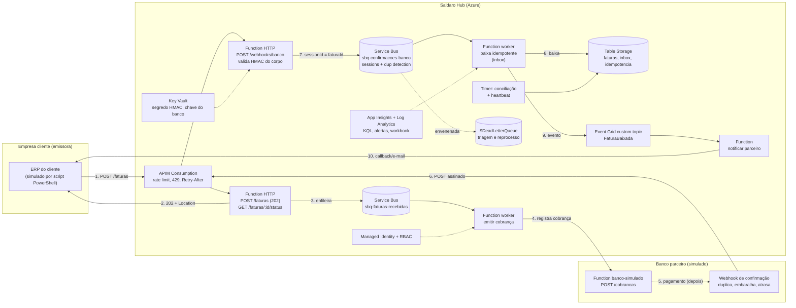
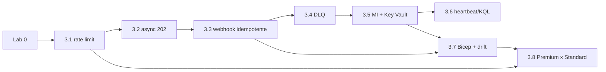

# Briefing: aula hands-on "Integração e Mensageria no Azure", cenários de um hub de pagamentos B2B

| Campo | Valor |
|---|---|
| Status | v0.3: a proposta inicial, ajustada em 2026-10-14 aos refinamentos do contrato do kit (`docs/research/2026-10-13-contrato-do-kit.md`, Atualizações 1 e 2) e às decisões que o professor confirmou na mesma data (seção 7); onde os dois divergirem, vale o contrato. Os guias de lab estão em `01_Aulas/` |
| Data | 2026-10-13 (ajustes em 2026-10-14) |
| Version-anchor | Q4-2026 (só serviços Azure em GA) |
| Público | Pós-graduação (TFTEC + Anhanguera); alunos que já cursaram a Disciplina 04 (40h) |
| Formato | 1 encontro **ao vivo** de ~4h (seção 4) |
| Stack | .NET 10 isolated (C#) + Bicep + PowerShell 7 (seção 5) |
| Empresa fictícia | Saldaro Pagamentos S.A. ("Saldaro Hub"), ver seção 1 |
| Confidencialidade | Tudo aqui é ficção inspirada em experiência de campo em projetos de consultoria da TFTEC; regras na seção 8 |
| Moeda | Custos em R$ assumindo ~R$ 5,50/US$ e preços de lista da Microsoft (confirmar na calculadora na data da aula) |

## 0. Resumo em seis linhas

1. A aula é uma sequência de **incidentes fictícios** num hub de cobrança B2B; cada lab começa com "o que quebrou" e termina com uma prova verificável de que foi consertado.
2. **Fio condutor**: a jornada de uma cobrança (ERP do cliente → hub → banco → webhook → baixa → notificação), com um "banco simulado" que o aluno controla (latência, duplicação, desordem, assinatura inválida).
3. **Catálogo**: Lab 0 de fundação + 8 cenários (rate limit, 202 assíncrono, webhook idempotente, DLQ, Managed Identity + Key Vault, heartbeat/KQL, Bicep/drift, Premium × Standard), ordenados do mais simples ao mais complexo.
4. **Formato decidido**: 1 encontro ao vivo de 4h, "Dia de incidente", com o trio central (timeout → duplicata → envenenada), Lab 0 feito em casa e o cenário de observabilidade como desafio; a série de 3 encontros fica documentada como alternativa.
5. **Stack decidida**: Azure Functions em .NET 10 isolated (C#), infraestrutura em Bicep com PowerShell 7, Portal para observar e para os poucos cliques que são a lição.
6. **Custo por aluno**: ~R$ 2 a 3 no Free Trial, da véspera (Lab 0 em casa) ao fim do encontro, se o Resource Group for apagado ao fim; pior caso (tudo ligado 30 dias) ~R$ 60 a 70, bem abaixo do crédito de US$ 200 (estimativas do kit em `README.md` e `infra/README.md`).

## 1. Empresa fictícia

### 1.1 Candidatos de nome

| Nome | Por que funciona | Risco / observação |
|---|---|---|
| **Saldaro Pagamentos S.A.** ("Saldaro Hub") | "Saldaro" vem de "saldar" (quitar a dívida); palavra inventada, sem acento, cabe em nomes de recurso (`rg-saldaro-*`, `stsaldaro*`); soa como fintech brasileira sem imitar nenhuma | Checagem de marca de 2026-10-14 sem achados no ramo: INPI (classes 36, 42 e 9), CNPJ, listas do Pix e do STR e web |
| Ponte Pagamentos | Evoca o papel de ponte entre ERPs e bancos; curto; sem acento | "Ponte" é termo técnico de integração (bridge), pode confundir em aula; há pedido de marca parecido no ramo |
| Lastro Cobranças | Vocabulário financeiro, distintivo | Há empresa real do ramo com esse nome; descartado |

**Decisão**: **Saldaro Pagamentos S.A.**, com a marca "Saldaro Hub" para a plataforma, escolhida pelo professor em 2026-10-14 depois da checagem de marca: o nome inicial, uma palavra comum, tinha marcas em vigor com o mesmo radical no ramo de cobrança e de pagamentos (ADR 0004). Em todo material, o aviso: "empresa, pessoas, números e incidentes são fictícios; qualquer semelhança é coincidência".

### 1.2 O negócio em um parágrafo

A Saldaro é um hub de cobrança B2B: cerca de 300 **empresas clientes** (distribuidoras, indústrias, SaaS, operadores logísticos) usam a Saldaro para cobrar seus próprios clientes pessoa jurídica (os **pagadores**). O ERP da empresa cliente envia a **fatura** (valor, vencimento, pagador, referência interna) pela API do hub ou por arquivo em lote, no caso de ERPs legados. O hub registra uma **cobrança** junto a um **banco parceiro** (boleto registrado ou cobrança Pix com QR dinâmico), recebe do banco um **webhook de confirmação** quando o pagador paga, faz a **baixa** da fatura (total ou parcial), roda a **conciliação** diária comparando o que o banco diz que recebeu com o que o hub baixou, e **notifica o parceiro** (o ERP da empresa cliente, por callback HTTP ou e-mail). Volumes plausíveis: ~400 mil cobranças/mês, ~20 ERPs distintos, 2 a 3 bancos parceiros, picos nos dias 5–10 e nos últimos três dias úteis do mês, chegando a ~30 faturas/s quando um ERP envia lote. Uma fatura pode ter mais de uma cobrança ao longo da vida (reemissão após vencimento, troca de banco), mas só uma baixa válida. A "Saldaro 1.0" (o legado da história) é um monólito com banco relacional usado como fila e um worker único de polling; a aula constrói a "Saldaro 2.0" no Azure e cada cenário conserta uma herança do legado.

## 2. Fio condutor: a jornada de uma cobrança

### 2.1 Diagrama

### 2.2 A jornada em dez passos

1. O ERP envia `POST /faturas` pelo APIM, que aplica rate limit por empresa cliente (3.1: uma subscription por empresa cliente, porque no tier Consumption o limite só conta por subscription).
2. A API valida, grava `status = recebida` e responde **202 Accepted** com `Location` do status (3.2).
3. A fatura entra em `sbq-faturas-recebidas`; a fila absorve rajadas de lote.
4. O worker "emitir cobrança" chama o banco simulado, que devolve o id da cobrança (boleto/QR). A latência do banco é controlável.
5. Tempo depois, o banco simulado "recebe o pagamento" e dispara o webhook, possivelmente duas vezes, fora de ordem ou com assinatura inválida (3.3).
6. O webhook passa pelo APIM e chega à Function, que valida o HMAC do corpo e o timestamp.
7. A confirmação entra em `sbq-confirmacoes-banco` com `MessageId = idEvento` (dup detection) e `SessionId = faturaId` (ordem por fatura).
8. O worker de baixa processa uma vez só (tabela inbox) e muda o estado da fatura; mensagens inválidas vão à DLQ com motivo (3.4).
9. A baixa publica `FaturaBaixada` no Event Grid, que entrega na fila `sbq-notificacoes-parceiro`; a Function de notificação chama o ERP por callback HTTP (o e-mail por Logic Apps fica como extensão opcional, fora do kit).
10. Um timer de conciliação roda periodicamente e emite heartbeat; a ausência dele dispara alerta (3.6). Tudo isso sem segredos em app settings (3.5) e descrito em Bicep (3.7).

### 2.3 Onde cada serviço entra

| Serviço | Papel no fio condutor | Cenários |
|---|---|---|
| API Management (Consumption) | Porta de entrada: rate limit por cliente, 429 + Retry-After, 202 passthrough, logs | 3.1, 3.2, 3.8 |
| Azure Functions (Flex Consumption, .NET 10 isolated) | API HTTP, workers de fila, webhook, notificação, timer de conciliação, banco simulado | todos |
| Service Bus (Standard) | `sbq-faturas-recebidas`, `sbq-confirmacoes-banco` (sessions, dup detection, DLQ), mensagens agendadas para retry | 3.2, 3.3, 3.4, 3.7, 3.8 |
| Event Grid (custom topic) | `FaturaBaixada` → notificação de parceiro; system topic do Key Vault (segredo próximo de expirar) | 3.5, fio condutor |
| Table Storage | `faturas`, `inbox`, `idempotencia` e `conciliacao` (hub); `cobrancas` (banco simulado) | 3.2, 3.3, 3.6 |
| Key Vault + Managed Identity | Segredo HMAC do webhook, chave da API do banco, RBAC em vez de connection string | 3.5, 3.7 |
| Application Insights + Log Analytics | KQL, heartbeat, alertas (log e métrica), workbook | 3.4, 3.6, 3.8 |
| Logic Apps (opcional) | E-mail de alerta de segredo expirando ou de notificação ao parceiro | 3.5, 3.8 (decisão de custo) |
| Bicep + PowerShell | Toda a infra (`deploy.ps1 -Cenario N`), detecção de drift, role assignments | Lab 0, 3.7 |

### 2.4 Tabela de recursos com nomes fixos (proposta)

`<sufixo>` = 4 a 6 letras minúsculas ou dígitos, escolhidos pelo aluno ou gerados pelo `deploy.ps1` (os nomes de Service Bus, Key Vault, Storage, APIM e Function App são globais). Os nomes exatos estão no contrato do kit, seção 2.

| Recurso | Nome | Tier | Observação |
|---|---|---|---|
| Resource Group | `rg-saldaro-lab` | — | Apagado ao fim do encontro |
| Service Bus namespace | `sb-saldaro-<sufixo>` | Standard | `disableLocalAuth: true` a partir do 3.5 |
| Filas | `sbq-faturas-recebidas`, `sbq-confirmacoes-banco`, `sbq-notificacoes-parceiro` | — | lock 1 min; `sbq-confirmacoes-banco`: sessions e dup detection (janela de 10 min) a partir do 3.3, `maxDeliveryCount` 10 no baseline e 3 a partir do 3.4 |
| Planos | `asp-saldaro-hub-<sufixo>`, `asp-saldaro-banco-<sufixo>` | Flex Consumption (FC1) ou Windows Consumption (Y1) | Um por app; 512 MB por instância no Flex |
| Function App (hub) | `func-saldaro-hub-<sufixo>` | Flex Consumption | API + workers + timer; MI system-assigned; até 10 instâncias por grupo de escala |
| Function App (banco) | `func-saldaro-banco-<sufixo>` | Flex Consumption | Simulador com "botões de caos" por query string; até 5 instâncias |
| Storage | `stsaldaro<sufixo>` | Standard LRS | Tabelas `faturas`, `inbox`, `idempotencia`, `conciliacao` e `cobrancas`; fila `banco-pagamentos`; containers de deploy do Flex |
| APIM | `apim-saldaro-<sufixo>` | Consumption | Sem custo fixo; 1 M chamadas/mês grátis; APIs `saldaro` e `saldaro-webhooks` |
| Key Vault | `kv-saldaro-<sufixo>` | Standard | RBAC (não access policies); soft-delete exige nome novo ou purge ao recriar; purge protection desligada no lab; segredos só a partir do 3.5 |
| Event Grid topic | `evgt-saldaro-faturas-<sufixo>` | — | Esquema CloudEvents 1.0 (como na D04); entrega na `sbq-notificacoes-parceiro` com a identidade do tópico |
| App Insights / Log Analytics | `appi-saldaro-<sufixo>` / `log-saldaro-<sufixo>` | — | Sampling desligado no lab |
| Infra como código | `infra/main.bicep`, `infra/modules/*.bicep`, `scripts/deploy.ps1` | — | Saídas do Bicep geram a tabela de recursos do guia |

### 2.5 Kit de lab (artefatos que precisam existir antes do encontro)

- **Banco simulado** (`func-saldaro-banco-<sufixo>`): `POST /cobrancas` registra a cobrança, enfileira os webhooks e só então espera `latencia` segundos para devolver `{ idCobranca, linhaDigitavel, qrCode }`; os webhooks assinados (`X-Saldaro-Signature: sha256=<hmac>`, `X-Saldaro-Timestamp`) saem a partir da resposta. Botões de caos: `latencia`, `atrasoWebhook`, `duplicar`, `embaralhar`, `assinatura=invalida`, `valorComVirgula`, `falhaTransiente` (faixas e efeitos no contrato, seção 6, e no README do banco). Fluxo genérico de cobrança com QR dinâmico; não reproduz a API de nenhum banco real.
- **ERP simulado** (`scripts/erp-simulado.ps1`): gera faturas com CNPJs de teste (dígitos verificadores válidos por algoritmo) a N faturas por minuto (`-ReqPorMin`), com ou sem backoff, por uma de duas empresas clientes (`cliente-a`, `cliente-b`), e grava relatório e CSV com uma linha por fatura.
- **Ferramentas**: o console `Saldaro.Ferramentas` (triagem da DLQ, worker legado do 3.7 e rajada do 3.8), com o atalho `scripts/triagem-dlq.ps1`; `scripts/check-drift.ps1`, `scripts/smoke-test.ps1`, pasta `kql/` com consultas prontas, templates de ADR e de post-mortem de uma página. Os arquivos `.http` para VS Code ficaram fora do kit.
- **Baseline intencionalmente ingênuo** (Lab 0): endpoint síncrono, connection strings com `RootManageSharedAccessKey`, fila sem sessions/dup detection, sem alertas; cada cenário conserta uma dessas heranças.
- **Estados prontos** (`deploy.ps1 -Cenario N -Pronto`): para quem travar ao vivo pular para o cenário seguinte sem ficar para trás.

## 3. Catálogo de cenários hands-on

### 3.0 Visão geral

| # | Cenário | Lacuna da D04 | Padrão principal | Custo | Duração | Depende de |
|---|---|---|---|---|---|---|
| Lab 0 | Fundação: Saldaro 2.0 em 20 minutos | IaC zero | — | ~R$ 1 | 30 min | — |
| 3.1 | O parceiro que não dormia (rate limit) | Throttling/429/backoff com teto | Throttling + Retry | ~R$ 0 | 40 min | Lab 0 |
| 3.2 | O timeout de sexta às 18h (202 assíncrono) | Async request-reply | Asynchronous Request-Reply | ~R$ 1 | 50 min | 3.1 |
| 3.3 | O webhook que chegou duas vezes (idempotência) | Idempotência/inbox, sessions, HMAC | Idempotent Receiver + Resequencer | ~R$ 2 | 60–75 min | 3.2 |
| 3.4 | A mensagem que ninguém conseguia processar (DLQ) | DLQ/envenenada/reprocesso, scheduled | Dead Letter Channel + Retry | ~R$ 1 | 45–60 min | 3.3 |
| 3.5 | O segredo que expirou às 3h (MI + Key Vault) | MI/Key Vault só como desafio | Federated Identity + External Config Store | ~R$ 1 | 45 min | 3.4 |
| 3.6 | O agendador que morreu em silêncio (heartbeat/KQL) | KQL/alertas superficial | Health Endpoint Monitoring + heartbeat | ~R$ 3–5 | 50 min | 3.2 (3.4) |
| 3.7 | A fila fantasma (Bicep + drift) | IaC, drift, contrato | IaC + Tolerant Reader | ~R$ 0 | 50 min | 3.3, 3.5 |
| 3.8 | Premium ou Standard? (decisão) | Tier/custo/isolamento | Bulkhead + Throttling | ~R$ 0 | 30–40 min | 3.1, 3.5, 3.7 |

### Lab 0: Fundação, "Saldaro 2.0 em 20 minutos"

- **O que é**: não é um incidente; é o `./scripts/deploy.ps1 -Cenario 0` que cria o RG inteiro via Bicep, publica as duas Function Apps do kit e faz um smoke test ponta a ponta (1 fatura → cobrança → webhook → baixa → notificação). No formato ao vivo, o aluno executa em casa antes do encontro e repete só o smoke test em aula.
- **Por que ingênuo de propósito**: endpoint síncrono, SAS key, fila sem sessions, sem alertas, worker único. O aluno vê a jornada funcionar "no dia de sol" e cada cenário mostra o dia de chuva.
- **Critério de feito**: o `smoke-test.ps1` vê a fatura chegar a `baixada` (ou `notificada`) em menos de 2 min; a tabela `faturas` tem a linha dela; no App Insights, a consulta pelo `faturaId` mostra os eventos de cada etapa. O `operation_Id` não serve de prova: ele não atravessa a fila de storage do banco nem o Event Grid.
- **Custo**: ~R$ 1 (Service Bus Standard ≈ R$ 0,07/h; APIM Consumption e Functions dentro da franquia). **Duração**: 30 min (APIM Consumption leva alguns minutos para ativar; criar primeiro).

### 3.1 (a) "O parceiro que não dormia": rate limit no APIM, 429 e retry com teto

- **Incidente**: Terça-feira, 2h10 da manhã. Um ERP recém-integrado reprocessou o mês inteiro e disparou 40 mil `POST /faturas` em seis minutos, com retry imediato a cada erro. O hub passou a devolver 500 para todo mundo, inclusive para as outras 299 empresas clientes. Nenhuma fatura se perdeu, mas a Saldaro descobriu que não tinha nenhum limite por cliente e que o "retry" do parceiro era uma metralhadora.
- **Lacuna da D04**: throttling, 429 e backoff com teto nunca praticados; isolamento por cliente (bulkhead) inexistente.
- **Serviços**: APIM Consumption (uma subscription por empresa cliente e a política `rate-limit`; `rate-limit-by-key` e `quota-by-key` não existem no tier Consumption), Functions, App Insights (logs do APIM).
- **O aluno constrói / quebra / conserta**:
  - Constrói: uma subscription por empresa cliente (`cliente-a`, `cliente-b`) e a política `rate-limit` de 60 chamadas/min por subscription no `POST /faturas`, resposta 429 com `Retry-After` (é o `cenario-1-pronto`); cliente ERP com backoff exponencial + jitter + teto (máx. 5 tentativas, espera máxima 30 s, honra `Retry-After` mas limitado ao teto).
  - Quebra: roda `erp-simulado.ps1 -ReqPorMin 300 -SemBackoff` para o cliente A enquanto o cliente B envia 10/min.
  - Conserta: observa que B nunca foi afetado (contador por cliente), reescreve o cliente A com backoff e discute o lado servidor: o hub, como cliente do banco, espalha seus próprios disparos ao longo do minuto por hash do cliente para não estourar o limite do parceiro.
- **Padrão**: Throttling, Retry (backoff + jitter + teto), Gateway Offloading (Cloud Design Patterns).
- **Critério de feito**: (1) cliente A recebe 429 com `Retry-After` a partir da 61ª chamada no minuto; (2) cliente B mantém 100% de 200/202 durante a inundação; (3) o script com backoff conclui 500 faturas sem nenhum 5xx e com no máximo 3 tentativas por chamada; (4) KQL em `requests`/logs do APIM mostra contagem de 429 por cliente.
- **Custo**: ~R$ 0. **Duração**: ~40 min. **Depende de**: Lab 0.
- **Armadilhas para o guia**: contadores do Consumption são aproximados (distribuídos); não usar APIM Developer (≈ US$ 50/mês e 45 min de provisionamento); sampling do App Insights esconde 429, desligar no lab.

### 3.2 (b) "O timeout de sexta às 18h": request-reply assíncrono (202 + status) com fila

- **Incidente**: Sexta-feira, 18h. O banco parceiro entrou em janela de manutenção e passou a responder em 40 a 90 segundos. O `POST /faturas` síncrono, que registrava a cobrança no banco antes de responder, começou a estourar o tempo limite; o ERP, sem resposta, reenviou, e a Saldaro registrou cobranças duplicadas no banco. Enquanto isso, o worker de polling da Saldaro 1.0, que lia a tabela de cobranças a cada poucos segundos, não dava conta da fila que se formou.
- **Lacuna da D04**: async request-reply (202 + polling/callback) não praticado; "banco relacional como fila com worker único" nunca discutido com números.
- **Serviços**: APIM, Functions (HTTP + Service Bus trigger), Service Bus `sbq-faturas-recebidas`, Table Storage `faturas` e `idempotencia`.
- **O aluno constrói / quebra / conserta**:
  - Constrói: `POST /faturas` responde 202 com `Location: /faturas/{id}/status` e `Retry-After: 5`; `GET .../status` responde 200 `{ status }` enquanto processa e 303 para `/faturas/{id}` quando conclui; worker consome a fila e chama o banco; chave de idempotência (`Idempotency-Key`) no POST para reenvio seguro.
  - Quebra: com o endpoint síncrono do Lab 0, manda uma fatura com `-Caos "latencia=45"` e `-MaxTentativas 2`: o APIM corta em 30 s (504), o ERP reenvia a mesma `referenciaErp`, o hub cria outra fatura e o banco registra outra cobrança (o banco grava antes de responder). O limite de 230 s do Functions é o teto da plataforma, citado mas não demonstrado.
  - Conserta: fluxo 202; enfileira 1.000 faturas em rajada e vê a fila absorver (queue-based load leveling) enquanto o banco "lento" é drenado no ritmo dele; opcional: callback ao ERP em vez de polling.
- **Padrão**: Asynchronous Request-Reply, Queue-Based Load Leveling (Cloud Design Patterns); Request-Reply + Correlation Identifier + Return Address (EIP).
- **Critério de feito**: (1) POST responde em < 500 ms com 202 mesmo com banco a 60 s; (2) polling mostra `recebida → cobranca-emitida`; (3) 1.000 faturas em rajada (`-Paralelismo 20`), zero 5xx no APIM e cada `referenciaErp` com uma fatura e uma cobrança (`kql/faturas-por-referencia-erp.kql` vazio; o banco simulado conta `quantidade = 1` por fatura); (4) reenviar o mesmo POST com a mesma `Idempotency-Key` devolve o mesmo id.
- **Custo**: ~R$ 1. **Duração**: ~50 min. **Depende de**: 3.1 (ou direto do Lab 0, no formato ao vivo).
- **Armadilhas**: 230 s é limite duro de HTTP no Functions independentemente de `functionTimeout`; endpoint de status precisa ser barato (point read na tabela); comparar no fim com o Durable da D04, que entrega 202 + `statusQueryGetUri` de graça; aqui foi feito à mão para entender o padrão.

### 3.3 (c) "O webhook que chegou duas vezes (e antes da hora)": idempotência, HMAC, sessions

- **Incidente**: Dia 10, 9h30, pico de vencimentos. Um timeout do lado do banco fez o parceiro reenviar 1.200 webhooks de confirmação: parte chegou duplicada, parte fora de ordem ("paga" antes de "cobrança registrada"). A Saldaro baixou faturas duas vezes, notificou os ERPs em dobro e, para piorar, aceitou uma confirmação forjada porque a "assinatura" era só o segredo copiado num header. Na investigação, descobriram que a API e o consumidor da fila processavam a mesma confirmação em paralelo porque não havia claim atômico.
- **Lacuna da D04**: idempotência e inbox só na teoria; sessions/FIFO e deferral nunca praticados; HMAC do corpo; dois consumidores na mesma mensagem.
- **Serviços**: Functions (HTTP webhook, Service Bus trigger com `IsSessionsEnabled = true`), Service Bus (dup detection, sessions, defer), Table Storage `inbox` (o segredo HMAC é app setting em texto até o 3.5, quando vira Key Vault reference).
- **O aluno constrói / quebra / conserta**:
  - Constrói: validação HMAC-SHA256 do corpo bruto (ler o stream antes de desserializar) com `X-Saldaro-Timestamp` e tolerância de 5 min, comparação em tempo constante (`CryptographicOperations.FixedTimeEquals`); envio com `MessageId = idEvento` e `SessionId = faturaId`; consumidor com tabela inbox (`PartitionKey = faturaId`, `RowKey = idEvento`) e máquina de estados tolerante a desordem; opcional avançado: `DeferMessageAsync` + `ReceiveDeferredMessageAsync` quando "paga" chega antes de "registrada".
  - Quebra: `duplicar=3;embaralhar=true` contra a versão ingênua, mais um POST forjado sem assinatura direto no webhook do APIM (aceito no baseline); tenta ligar **Enable sessions** na fila existente pelo Portal e descobre que a opção só existe na criação da fila (propriedade imutável).
  - Conserta: muda duas linhas no `.bicepparam` (`filaComSessions`, `filaDupDetection`), drena e recria a fila, liga o worker com sessão e prova que, sem sessions, as 4 chamadas concorrentes do worker (`maxConcurrentCalls = 4`, o papel de dois consumidores, sem escalar instâncias) disputam a mesma fatura e, com sessions, uma sessão tem um consumidor por vez.
- **Padrão**: Idempotent Receiver, Resequencer, Competing Consumers com sessões (EIP); inbox; assinatura de mensagem (HMAC).
- **Critério de feito**: (1) webhook com assinatura inválida → 401 e nada na fila; (2) 3 duplicatas do mesmo evento → 1 baixa, 1 notificação, 1 linha na inbox; (3) eventos da mesma fatura processados em ordem com o worker concorrente (o log mostra `SessionId` e `SequenceNumber`); (4) KQL retorna zero ocorrências de "baixa duplicada"; (5) o Bicep da fila tem as duas propriedades ligadas.
- **Custo**: ~R$ 2. **Duração**: 60–75 min (o mais longo). **Depende de**: 3.2.
- **Armadilhas**: dup detection só olha `MessageId`, dentro da janela (padrão 10 min, máximo 7 dias); fila com sessions rejeita envio sem `SessionId`; recriar fila apaga mensagens (drenar antes); opção A para encurtar o lab: a fila já nasce com sessions e dup detection no Lab 0 (recomendada a opção B acima, pela lição de imutabilidade).

### 3.4 (d) "A mensagem que ninguém conseguia processar": DLQ, triagem e reprocessamento controlado

- **Incidente**: Quarta-feira, 14h. O banco parceiro publicou uma atualização da API e passou a mandar o valor como texto com vírgula ("1.250,00"). O worker lançava exceção, o Service Bus reentregava e, após dez tentativas, a mensagem caía na DLQ, 3.800 vezes, com motivo genérico. No mesmo período, uma falha transiente do armazenamento também mandou mensagens boas para a mesma DLQ, misturadas. Ninguém sabia o que reprocessar e o que descartar, e reprocessar "tudo" baixaria faturas erradas.
- **Lacuna da D04**: DLQ e mensagem envenenada superficiais; `DeadLetterReason`; reprocessamento controlado; mensagens agendadas para retry com backoff; transiente × permanente.
- **Serviços**: Service Bus (DLQ, `DeadLetterReason`/`DeadLetterErrorDescription`, scheduled messages, `maxDeliveryCount`), Functions, Table Storage, Service Bus Explorer no Portal, alerta de métrica `DeadletteredMessages`.
- **O aluno constrói / quebra / conserta**:
  - Constrói: classificação de erro no worker: schema inválido → dead-letter imediato com `ServiceBusMessageActions.DeadLetterMessageAsync(message, deadLetterReason: "SchemaInvalida", deadLetterErrorDescription: ...)`; transiente → retry agendado (cópia com `ScheduledEnqueueTime = agora + 5 s × 2^n`, ou seja, 10, 20 e 40 s, e propriedade `tentativa`, completa a original) com teto → `TentativasEsgotadas`; `triagem-dlq.ps1` que faz peek na DLQ e agrupa por motivo; reprocessamento que corrige o payload e reenvia com `MessageId` novo + propriedade `reprocessadoDe`.
  - Quebra: duas rajadas separadas, 10 faturas com `valorComVirgula=true` e 20 com `falhaTransiente=50`, e observa a DLQ encher com `MaxDeliveryCountExceeded`, sem informação útil sobre a causa.
  - Conserta: motivos explícitos, retry agendado, triagem, reprocesso, DLQ vazia; extra: dead-letter do Event Grid para blob na notificação ao parceiro.
- **Padrão**: Dead Letter Channel + Invalid Message Channel (EIP); Retry com backoff via mensagens agendadas; Circuit Breaker como discussão (por que um breaker compartilhado entre clientes é um erro).
- **Critério de feito**: (1) mensagem com valor inválido vai à DLQ na primeira entrega com motivo `SchemaInvalida`; (2) falhas transientes são resolvidas pelo retry agendado (log mostra tentativas 1..3) e nunca chegam à DLQ; (3) a triagem lista a DLQ agrupada por motivo; (4) após reprocesso, todas as faturas corrigidas estão baixadas e a DLQ está vazia; (5) `maxDeliveryCount = 3` e lock coerente com o tempo de processamento no Bicep.
- **Custo**: ~R$ 1. **Duração**: 45–60 min. **Depende de**: 3.3.
- **Armadilhas**: no .NET isolated o settlement por mensagem exige `AutoCompleteMessages = false` e o parâmetro `ServiceBusMessageActions` no trigger (`Microsoft.Azure.Functions.Worker.Extensions.ServiceBus` 5.x); a ferramenta de triagem usa `ServiceBusReceiver` com `SubQueue.DeadLetter`; reenviar com o mesmo `MessageId` dentro da janela de dup detection é descartado em silêncio; a DLQ não tem TTL e conta no tamanho da fila.

### 3.5 (e) "O segredo que expirou às 3h": Managed Identity e Key Vault no lugar de connection string

- **Incidente**: Madrugada de domingo. O client secret usado pelo worker para falar com o Service Bus e a chave da API do banco, colada em app setting, expiraram dois anos depois de criadas pela pessoa que já não trabalha mais na empresa. Nada enfileirava, nada baixava, nada alertava. O chamado foi aberto às 8h40, pelo cliente.
- **Lacuna da D04**: todos os labs com `RootManageSharedAccessKey`; MI, Key Vault e Private Endpoint só como "desafio".
- **Serviços**: Managed Identity (system-assigned), RBAC (`Azure Service Bus Data Sender/Receiver`, `Key Vault Secrets User`, `Storage Table Data Contributor`), Key Vault (segredo com data de expiração), Key Vault references (`@Microsoft.KeyVault(VaultName=...;SecretName=...)`), Event Grid system topic do Key Vault (`SecretNearExpiry`, 30 dias antes; `SecretExpired`), Logic Apps opcional para o e-mail.
- **O aluno constrói / quebra / conserta**:
  - Constrói: troca `ServiceBusConnection` por `ServiceBusConnection__fullyQualifiedNamespace` + role assignments no Bicep com o menor privilégio possível para um app só (Sender + Receiver no namespace, nunca Data Owner; separar por fila exigiria um app por papel); `disableLocalAuth: true` no namespace; segredo HMAC e chave do banco no Key Vault com `exp`; assinatura do Event Grid que registra/avisa `SecretExpired` e `SecretNewVersionCreated`.
  - Quebra: no baseline, regenera a SAS key "às 3h" e vê o worker morrer com 401; cria um segredo com expiração em 5 min e vê o evento chegar.
  - Conserta: com MI, regenera as chaves de novo e nada quebra; rotaciona o segredo HMAC criando nova versão e vê a app pegar a nova (comportamento de refresh da Key Vault reference).
- **Padrão**: Federated Identity ("zero segredos"), External Configuration Store, rotação de segredos, privilégio mínimo.
- **Critério de feito**: (1) `az servicebus namespace show` mostra `disableLocalAuth: true` e a app funciona; (2) `az functionapp config appsettings list` não contém nenhuma connection string nem chave; (3) regenerar SAS keys gera zero `exceptions`; (4) evento do Key Vault recebido e registrado; (5) role assignments no Bicep, nenhum "Data Owner" em app.
- **Custo**: ~R$ 1. **Duração**: ~45 min. **Depende de**: 3.4 (qualquer consumidor de fila já existente).
- **Armadilhas**: propagação de RBAC leva até alguns minutos; com `disableLocalAuth` o Service Bus Explorer do Portal exige que o usuário do aluno tenha `Azure Service Bus Data Owner`; usar RBAC do Key Vault (não access policies); a storage do host do Functions por identidade exige três roles de Storage; o kit mantém o `AzureWebJobsStorage` com connection string, como compromisso explícito e documentado (contrato, seção 5.2).

### 3.6 (f) "O agendador que morreu em silêncio": heartbeat, KQL, alerta por ausência de sinal, dashboard

- **Incidente**: O timer da conciliação diária parou depois de uma reciclagem da instância. Como o "próximo horário" era avançado antes de o trabalho concluir, nada parecia atrasado, e os painéis mostravam zero erros, porque não havia nada rodando. Levou meses para alguém notar, numa auditoria. Noutro dia, uma falha transiente no armazenamento no começo da manhã só foi percebida por um humano depois do almoço, porque só existiam alertas de erro, e o erro já tinha passado.
- **Lacuna da D04**: KQL e alertas superficiais; alerta por ausência de sinal; correlação por `operation_Id`; dashboard; lease/watchdog.
- **Serviços**: App Insights (`customEvents`, `requests`, `dependencies`, `exceptions`), Log Analytics (KQL), Azure Monitor (alerta de pesquisa de log "zero resultados", alerta de métrica `DeadletteredMessages` e `ActiveMessages` do Service Bus), Action Group (e-mail), Workbook, Timer trigger.
- **O aluno constrói / quebra / conserta**:
  - Constrói: timer `Conciliacao` (a cada 5 min no lab) que emite `conciliacao.heartbeat` **ao concluir com sucesso** (não ao começar: a lição do "próximo horário"); KQL `customEvents | where name == "conciliacao.heartbeat" | summarize max(timestamp)`; alerta "0 resultados nos últimos 15 min" → e-mail; KQL para achar a primeira exceção transiente e juntar com `requests` por `operation_Id`; workbook opcional, criado pelo aluno, com faturas/h, cobranças, confirmações, baixas, profundidade da DLQ, p95 do POST, último heartbeat; opcional: lease com `ultimaExecucao` em tabela como watchdog.
  - Quebra: desabilita o timer (`AzureWebJobs.Conciliacao.Disabled = true`, com o C maiúsculo do nome da Function; o próximo `deploy.ps1` reaplica a lista de app settings e apaga esse setting) e espera o alerta; injeta `falhaTransiente=50` e acha o erro por KQL em menos de 2 min.
  - Conserta: alertas versionados em Bicep + runbook de uma página ("quando este alerta dispara, faça isto").
- **Padrão**: Health Endpoint Monitoring (Cloud Design Patterns); heartbeat / dead man's switch; Wire Tap e Control Bus (EIP); Correlation Identifier.
- **Critério de feito**: (1) e-mail de alerta chega de 15 a 25 min depois de desabilitar o timer (janela de 15 min, avaliação a cada 5 min e ingestão de 2 a 5 min) e o alerta resolve sozinho ao reabilitar; (2) a consulta KQL retorna a primeira falha transiente com `operation_Id`, id da fatura e tempo até detecção < 5 min; (3) alerta de métrica dispara ao injetar uma mensagem envenenada (reaproveita o 3.4); (4) opcional: workbook salvo no RG ou exportado como JSON (o kit não cria workbook).
- **Custo**: ~R$ 3–5 (alerta de log ≈ US$ 0,50–1,50/mês por regra conforme frequência; alerta de métrica ≈ US$ 0,10/mês; ingestão dentro dos 5 GB/mês grátis). **Duração**: ~50 min. **Depende de**: 3.2 (tráfego); 3.4 para o alerta de DLQ.
- **Armadilhas**: latência de ingestão de 2 a 5 min atrasa alertas de log; sampling desligado; `timestamp` × `TimeGenerated` em workspace-based; confirmação de e-mail do Action Group.

### 3.7 (g) "A fila fantasma": Bicep para namespace/filas/tópicos e detecção de drift

- **Incidente**: Numa auditoria, descobriram que a fila declarada no Bicep com DLQ após 3 tentativas e dup detection não recebia nada: um worker legado "criava a fila se não existisse" ao subir, com nome ligeiramente diferente e configuração padrão (10 tentativas, sem dup detection). Durante dois meses as mensagens passaram por uma fila que não existia no código de infraestrutura, e todo o desenho de DLQ era decorativo. Na mesma semana, uma mudança de contrato foi implantada no produtor antes do consumidor e encheu a DLQ de mensagens "inválidas" que estavam certas.
- **Lacuna da D04**: IaC zero; drift; imutabilidade de propriedades; ordem de deploy consumidor-antes-do-produtor; versionamento de schema.
- **Serviços**: Bicep (namespace, filas, tópico, role assignments, Function Apps, Key Vault, alertas), Azure CLI/PowerShell (`az deployment group what-if`, `az servicebus queue list`), `ServiceBusAdministrationClient` (o "auto-create" do legado), GitHub Actions como desafio.
- **O aluno constrói / quebra / conserta**:
  - Constrói: lê `infra/main.bicep` (módulos, parâmetros, saídas e o `sufixo` que deixa únicos os nomes globais); roda `what-if` antes de cada deploy; `check-drift.ps1` compara filas existentes com as declaradas e reporta extra/faltante/propriedade divergente.
  - Quebra: sobe o "worker legado" do kit, que cria `confirmacoesbanco` via SDK; altera `maxDeliveryCount` no Portal "na mão".
  - Conserta: aponta o worker para a fila do Bicep, apaga a fantasma, tira da identidade da app qualquer direito de criar entidades (Receiver/Sender em vez de Owner) para que um futuro auto-create falhe alto; exercício de contrato: planeja o campo `moeda` na mensagem de fatura com o consumidor (tolerant reader) indo para produção antes do produtor, e vê a DLQ encher quando a ordem é invertida (a quebra de contrato do `valorComVirgula`); implantar o `moeda` é opcional, numa branch do fork do aluno, porque o kit não traz esse campo.
- **Padrão**: Infrastructure as Code; paridade de ambientes; Tolerant Reader e deploy consumidor-primeiro; política por privilégio mínimo.
- **Critério de feito**: (1) logo depois de um deploy, o `what-if` só mostra o ruído conhecido (app settings, segredos e políticas do APIM, que o ARM não compara) e o `check-drift.ps1` sai com 0; (2) `check-drift.ps1` detecta a fila fantasma e a alteração manual; (3) após o conserto, drift zero e o worker legado falha com 401 ao tentar criar fila; (4) mudança de contrato (`moeda`) planejada consumidor-primeiro, com a DLQ enchendo quando a ordem é invertida (ajustado em 2026-10-14: o kit não traz o campo `moeda`, e implantar fica opcional); (5) alertas, role assignments e políticas do APIM dos cenários anteriores vivem no Bicep.
- **Custo**: ~R$ 0 (deployments não custam). **Duração**: ~50 min. **Depende de**: 3.3 (fila), 3.5 (roles).
- **Armadilhas**: Bicep não altera propriedade imutável de fila (erro no redeploy → apagar ou renomear, "versionar o canal"); Key Vault com soft-delete exige purge ou nome novo ao recriar o RG; role assignment com nome `guid(...)` para ser idempotente; APIM Consumption demora alguns minutos no primeiro deploy.

### 3.8 (h) "Premium ou Standard?": decisão de custo, throughput e isolamento

- **Incidente**: Reunião de orçamento. Segurança exige Private Endpoint no Service Bus (só existe no Premium, ≈ US$ 0,93/h por messaging unit, algo como R$ 3.500–4.000/mês); a diretoria recusa o custo; operação lembra que, no pico do dia 10, o namespace Standard devolveu erro 50009 (throttling por créditos) por alguns minutos; alguém pergunta "se formos para Premium e não der certo, dá para voltar?"; e outro sugere orquestrar tudo em Logic Apps até ouvir o custo por ação. Ninguém tem números na mesa.
- **Lacuna da D04**: tier/custo nunca decidido com números; throttling do Standard (1.000 créditos/s por namespace, 1 crédito por mensagem, 1 por avaliação de filtro de tópico, 10 por operação de gerência); isolamento; rede (hub-spoke, WAF, Private Link) só como desafio.
- **Serviços**: Service Bus Standard × Premium (calculadora de preços), métricas `ThrottledRequests`, `ServerErrors`, `IncomingMessages`; teoria: Private Link, firewall de IP, serviços confiáveis, integração de VNet do Flex Consumption; preços de Logic Apps.
- **O aluno constrói / quebra / conserta** (exercício de decisão; não provisiona Premium):
  - Constrói: teste de rajada numa fila do Standard (50 remetentes × 100 mensagens) e a conta de como os filtros de tópico multiplicam créditos (ajustado em 2026-10-14: o kit só tem filas, então o tópico com filtros entra na conta, sem ser criado) observando `ThrottledRequests` e o retry do SDK; planilha com 400 mil cobranças/mês, pico de 30/s, operações por cobrança (send, receive, complete, filtros) versus os ~13 milhões de operações incluídos no Standard; matriz de decisão (throughput previsível, latência, tamanho de mensagem 256 KB × 100 MB, Private Endpoint, isolamento por cliente, Geo-DR) e o fato de não haver downgrade in-place (existe ferramenta Standard → Premium; a volta é migração manual).
  - Quebra: nada destrutivo; mostra na calculadora o que uma hora de Premium custaria no Free Trial e por que o lab não cria.
  - Conserta: escreve um ADR de uma página ("Standard com MI e `disableLocalAuth` agora, sem firewall de IP, que no Standard não tem exceção de serviços confiáveis e bloquearia a entrega do Event Grid; gatilhos objetivos para revisar Premium") e uma linha sobre quando Logic Apps compensa (baixo volume, aprovação humana) e quando não.
- **Padrão**: Bulkhead (isolamento por cliente/namespace), Throttling, Queue-Based Load Leveling; pilar de otimização de custo do Well-Architected.
- **Critério de feito**: (1) planilha preenchida com custo mensal em R$ para dois cenários de volume; (2) ADR com contexto, decisão, consequências e três gatilhos que forçariam Premium; (3) print ou KQL de `ThrottledRequests` durante a rajada (se ocorrer) com explicação do 50009; (4) lista de alternativas de segurança sem Premium.
- **Custo**: ~R$ 0. **Duração**: 30–40 min. **Depende de**: 3.1, 3.5, 3.7.
- **Armadilhas**: a rajada pode não atingir 1.000 créditos/s a partir de uma máquina só; o guia deve tratar o throttling como "se acontecer" e ter prints de referência; mencionar que Logic Apps na D04 foi usado para aprovação por e-mail, que é exatamente o caso em que ele compensa.

## 4. Formato

### 4.1 Decisão: 1 encontro ao vivo de 4h, "Dia de incidente"

| Horário | Bloco | Conteúdo |
|---|---|---|
| 0:00–0:15 | Abertura | A história da Saldaro, regras do dia (Free Trial, limpeza), revisão relâmpago da D04 (slides) |
| 0:15–0:30 | Lab 0 (pré-provisionado em casa) | Smoke test ponta a ponta; quem não fez em casa roda `deploy.ps1 -Cenario 0` (não existe `cenario-0-pronto`; `-Pronto` no cenário 0 é aceito e dá no mesmo) |
| 0:30–1:20 | Incidente 1 | Cenário 3.2: timeout → 202 + status + fila |
| 1:20–1:30 | Pausa | |
| 1:30–2:45 | Incidente 2 | Cenário 3.3: webhook duplicado e fora de ordem → HMAC, dup detection, sessions, inbox |
| 2:45–3:35 | Incidente 3 | Cenário 3.4: mensagem envenenada → DLQ com motivo, retry agendado, triagem, reprocesso |
| 3:35–3:55 | Fechamento | Post-mortem coletivo (template de cinco linhas), desafio para casa (3.6) e guias de leitura (3.1, 3.5, 3.7, 3.8) |
| 3:55–4:00 | Limpeza | `Delete resource group` ao vivo, todos juntos |

- **Pré-requisitos antes do encontro**: Lab 0 executado em casa (30 min), APIM Consumption já ativo, conta com Free Trial ou sandbox em que o aluno seja Owner (o deploy cria role assignments), VS Code + .NET 10 SDK + Azure CLI com Bicep + PowerShell 7 + Git. O Azure Functions Core Tools é opcional: o deploy publica com `dotnet publish` + `config-zip`.
- **Plano B ao vivo**: cada cenário tem um "estado pronto" (`deploy.ps1 -Cenario N -Pronto`) para quem travar pular ao próximo; prints de referência de cada prova para quando o Azure não cooperar; o professor roda o fluxo numa assinatura própria como demonstração enquanto a turma acompanha.
- **Prós**: um único slot; os três cenários contam uma história completa de mensageria; custo perto de zero. **Contras**: 4h com três labs é apertado (na D04, 11 guias em 40h deram ~3,5h por guia incluindo teoria); segurança, IaC e observabilidade ficam como leitura e desafio.

### 4.2 Alternativa documentada: série de 3 encontros de 4h, "Uma semana na Saldaro"

| Encontro | Tema | Conteúdo (4h) | Desafio para casa |
|---|---|---|---|
| 1 | A API sob pressão | Narrativa + revisão de EIP/Service Bus + Lab 0 + 3.1 + 3.2 + retro | Callback ao ERP em vez de polling |
| 2 | A baixa que não pode errar | Redeploy do baseline + 3.3 + 3.4 + retro | Deferral de mensagens fora de ordem; alerta de DLQ |
| 3 | Operar sem segredos e sem surpresas | Redeploy + 3.5 + 3.6 + 3.7 + 3.8 como discussão final | GitHub Actions com `what-if` em PR e drift noturno |

Prós: cada cenário com o tempo que merece; o Bicep recria o ambiente em minutos; narrativa semanal. Contras: três agendas; exige o kit sólido antes do primeiro encontro.

### 4.3 Template de guia (evolução do formato da D04)

Manter: caixa de custo em reais no topo, tabela de recursos, diagrama Mermaid, "Passo N.M", tabela de troubleshooting, limpeza do RG, "O que fazer a seguir". Acrescentar, nesta ordem: **Incidente** (a história), **Sintomas** (o que observar quebrado, com prints de referência), **Hipóteses** (passo diagnóstico com KQL/Explorer), **Conserto**, **Prova** (critério de feito), **Post-mortem de cinco linhas** escrito pelo aluno (sem culpados) e **Lições para produção**.

### 4.4 Encaixe no Free Trial

Crédito de US$ 200 por 30 dias. Custos recorrentes do lab: Service Bus Standard ≈ R$ 0,07/h (≈ R$ 55/mês se esquecido ligado), alertas ≈ R$ 5–10/mês, Storage e Key Vault centavos, APIM Consumption sem custo fixo (1 M chamadas/mês grátis), Functions e Event Grid dentro da franquia, Log Analytics 5 GB/mês grátis. **Evitar**: APIM Developer, Service Bus Premium, Functions Premium (EP1), Logic Apps Standard. Pré-checagem antes do encontro: `az functionapp list-flexconsumption-locations` para confirmar Flex Consumption em Brazil South (se não, Consumption Windows, legado mas GA) e a cota regional de memória do Flex na assinatura de trial.

## 5. Stack

**Decisão do professor: Azure Functions em .NET isolated (C#), infraestrutura em Bicep, comandos em PowerShell 7.** A aula usa a **versão 10 LTS** do .NET, confirmada pelo professor em 2026-10-14: o .NET 8 (escolha inicial) sai de suporte no Azure Functions em 10/11/2026, antes do fim do `Version-anchor` Q4-2026; o modelo isolated e o código são os mesmos, muda só o target.

Por que .NET: é a stack mais realista para o setor de pagamentos e o trigger de Service Bus em .NET isolated é o mais completo (settlement com motivo via `ServiceBusMessageActions`, sessões com `IsSessionsEnabled`, lote, `ServiceBusSessionMessageActions`). O custo é a troca de linguagem em relação à D04 (Node.js): o aluno recebe o código pronto e o lab não pede escrever C# do zero, só ler, ajustar valores e publicar; cada alteração de código exige `dotnet publish` + `az functionapp deployment source config-zip` (o `deploy.ps1` faz os dois; é um ciclo lento em aula, por isso os consertos vêm prontos atrás de toggles de app setting e cada cenário tem estado pronto).

**O que muda em relação à D04**: (1) cada guia começa com `./scripts/deploy.ps1 -Cenario N` em vez de dezenas de cliques; (2) código publicado pelo `deploy.ps1` com `dotnet publish` + `config-zip`, sem Core Tools (o Flex Consumption, plano recomendado pela Microsoft, não tem edição no Portal); (3) tabela de recursos gerada das saídas do Bicep; (4) troubleshooting ganha erros de IaC (nome global em uso, purge de Key Vault, propagação de RBAC) e de build; (5) pré-requisitos de máquina: VS Code, .NET 10 SDK, Azure CLI com Bicep e PowerShell 7; o Functions Core Tools é opcional. O Portal continua presente para **observar** (Service Bus Explorer, métricas, alertas, workbooks) e nos poucos passos em que clicar é a lição (a caixa desabilitada do "requires session").

## 6. Glossário inicial (estilo CONTEXT.md)

Glossário de partida. A versão vigente, com as escolhas de termo já feitas (por exemplo, a baixa sem parcial), é o `CONTEXT.md` na raiz.

| Termo | Definição | Sinônimos a evitar |
|---|---|---|
| Empresa cliente (emissora) | Empresa que contrata a Saldaro e emite faturas para seus pagadores | "tenant" (reservar ao contexto técnico), "usuário", "conta" |
| Pagador | Pessoa jurídica que deve pagar a fatura; não é cliente da Saldaro | "sacado" (jargão de boleto), "cliente final" |
| Parceiro | Banco ou ERP integrado ao hub por API ou webhook | "fornecedor", "integração" (é o canal, não a entidade) |
| Fatura | Documento de cobrança emitido pela empresa cliente para um pagador (valor, vencimento, referência do ERP); entidade raiz do hub | "invoice", "título" (ambíguo), "nota fiscal" (outro documento) |
| Cobrança | Instrumento de recebimento gerado junto a um banco para uma fatura (boleto registrado ou cobrança Pix); 1 fatura → 1..n cobranças | "boleto" como termo geral, "pedido" |
| Baixa | Registro de que a fatura foi paga, total ou parcialmente, a partir de uma confirmação bancária; operação idempotente | "liquidação", "settlement", "fechar fatura" |
| Conciliação | Comparação periódica entre confirmações do banco e baixas do hub para achar divergências | "reconciliação", "batimento" |
| Webhook de confirmação | Chamada HTTP que o banco faz ao hub informando pagamento, assinada com HMAC do corpo | "callback" (reservar ao retorno para o ERP), "notificação" (é o que o hub envia) |
| Idempotência | Propriedade de uma operação produzir o mesmo resultado quando repetida com a mesma chave (`Idempotency-Key`, `MessageId`, id do evento do banco) | "deduplicação" (é um mecanismo), "retry seguro" |
| Mensagem envenenada | Mensagem que falha de forma permanente a cada tentativa (schema ou regra inválidos) e deve sair do fluxo com motivo registrado | "mensagem com erro" (inclui transientes), "poison" em texto pt-BR |
| DLQ (fila de mensagens mortas) | Subfila `$DeadLetterQueue` onde o Service Bus guarda mensagens envenenadas ou com tentativas esgotadas, com `DeadLetterReason` | "fila de erro", "quarentena" (só para fila própria de triagem) |
| Request-reply assíncrono | Padrão em que a API responde 202 Accepted com endereço de status e o processamento segue em fila | "fire and forget" (não há status), "assíncrono" sem qualificador |
| Heartbeat | Sinal periódico que um processo emite ao concluir seu ciclo; a ausência gera alerta (dead man's switch) | "health check" (é consultado, não emitido), "ping" |
| Drift de IaC | Divergência entre o que o Bicep declara e o que existe na assinatura: recurso extra, faltante ou com propriedade alterada | "desvio", "diferença de configuração" |
| Sessão (Service Bus) | Agrupamento de mensagens por `SessionId` (aqui, o id da fatura) que garante ordem e um consumidor por vez por grupo | "partição" (conceito do Event Hubs), "FIFO global" |

## 7. Perguntas em aberto para o planejamento (`wayfinder`)

Decisões que o professor confirmou em 2026-10-14: o nome Saldaro Pagamentos S.A.; o .NET 10; o rate limit por subscription key no 3.1; o baseline síncrono que não cancela a chamada ao banco; os termos do `CONTEXT.md`; o repositório privado e sem licença por ora; e a pasta do Blob para os entregáveis, `TFTEC - Pós Graduação/01_Disciplinas/Disciplina 04 - Integração e Mensageria/10_Aula Hands-on/`.

1. Os alunos usam Free Trial próprio ou assinatura/sandbox da TFTEC? Isso define Flex Consumption, role assignments em Entra ID e a cota regional.
2. Pré-requisitos de máquina do aluno (VS Code, .NET 10 SDK, Azure CLI, Core Tools, Bicep, PowerShell 7) ou tudo via Cloud Shell?
3. Nome da empresa fictícia aprovado? Quem faz a checagem de marca (INPI + busca) antes de usar em público? **Respondida (2026-10-14):** a checagem foi feita na mesma data; o nome inicial tinha marcas do ramo com o mesmo radical, e o professor escolheu "Saldaro Pagamentos S.A." (ADR 0004).
4. Grau de referência à origem real nos materiais públicos: "inspirado em projetos de consultoria da TFTEC" ou nem isso?
5. A Saldaro 2.0 pode nascer do "Portal B2B" da D04 (reaproveitar o fluxo de 6 activities como "emitir cobrança") ou deve ser um projeto novo do zero?
6. Haverá entrega avaliada (post-mortems, ADR do 3.8, repositório com Bicep) ou só prática orientada?
7. Em que pasta do Blob da pós os entregáveis (PPTX, PDF, guias) serão publicados? **Respondida (2026-10-14):** `TFTEC - Pós Graduação/01_Disciplinas/Disciplina 04 - Integração e Mensageria/10_Aula Hands-on/`.
8. Data do encontro e janela de pré-provisionamento (Lab 0 em casa; APIM criado na véspera).

## 8. Regras de confidencialidade para tudo que for versionado

- Nunca nomear o cliente real nem pessoas, e-mails, domínios, IDs de assinatura/tenant, números de chamado, nomes de recursos reais ou valores de contrato.
- Números de negócio (volumes, custos, prazos) sempre plausíveis e arredondados, nunca os reais; a única referência numérica pública é o preço de lista da Microsoft.
- Incidentes reescritos como ficção: datas, horários, setor da empresa cliente, nomes de sistemas e produtos trocados; títulos de chamados nunca citados literalmente.
- Nenhum trecho de código, log, print de tela, Bicep ou política de APIM vindo de ambiente real; tudo escrito do zero para a Saldaro.
- Prints só do ambiente de lab com o sufixo do aluno; mascarar subscription id, tenant id e e-mails.
- Dados de teste gerados (CNPJs, chaves Pix, contas) e nunca dados reais de pagadores.
- Antes de cada commit: varredura pela lista de termos proibidos (`pwsh ./scripts/varredura-termos.ps1`, que imprime só contagens); a lista fica fora do repositório.
- A pasta `docs/research/` (incluindo este arquivo) segue as mesmas regras; não existe "rascunho interno" versionado.

## Anexo A: matriz lacunas da D04 × cenários

| Lacuna da D04 | 3.1 | 3.2 | 3.3 | 3.4 | 3.5 | 3.6 | 3.7 | 3.8 |
|---|---|---|---|---|---|---|---|---|
| B2B com ERP/parceiro e webhook | x | x | x | | | | x | |
| Idempotência / inbox / compensação | | x | x | x | | | | |
| DLQ, envenenada, reprocessamento | | | | x | | x | | |
| Sessions / scheduled / deferred | | | x | x | | | | |
| Managed Identity / Key Vault | | | x | | x | | x | |
| IaC (Bicep) e drift | L0 | | x | | x | x | x | |
| KQL, alertas, dashboard | x | | | x | | x | | x |
| Async request-reply (202) | | x | | | | | | |
| Versionamento de schema / onboarding | | | | | | | x | |
| Decisão de tier, custo, isolamento, rede | x | | | | x | | | x |
| Testes de carga / contrato | x | x | | | | | x | x |

## Anexo B: fatos verificados em 2026-10-13 (fontes)

- .NET 8 e .NET 9 saem de suporte no Azure Functions em 10/11/2026; .NET 10 (LTS) até 14/11/2028: [Migrate .NET apps to the isolated worker model](https://learn.microsoft.com/en-us/azure/azure-functions/migrate-dotnet-to-isolated-model).
- Consumption é plano legado; Flex Consumption é o recomendado (Linux, sem edição no Portal); limite de 230 s para resposta HTTP; Linux Consumption se aposenta em 30/09/2028: [Azure Functions scale and hosting](https://learn.microsoft.com/en-us/azure/azure-functions/functions-scale).
- Throttling do Standard: 1.000 créditos/s por namespace, 1 crédito por mensagem, 1 por avaliação de filtro, 10 por operação de gerência, erro 50009: [Azure Service Bus throttling](https://learn.microsoft.com/en-us/azure/service-bus-messaging/service-bus-throttling).
- Standard inclui ~13 M operações/mês no custo-base por hora; Premium cobra por messaging unit por hora (preços exatos só na calculadora): [Service Bus pricing](https://azure.microsoft.com/en-us/pricing/details/service-bus/); APIM Consumption inclui 1 M chamadas/mês: [API Management pricing](https://azure.microsoft.com/en-us/pricing/details/api-management/).
- Eventos do Key Vault no Event Grid: `SecretNearExpiry` (30 dias antes), `SecretExpired`, `SecretNewVersionCreated`: [Azure Key Vault as Event Grid source](https://learn.microsoft.com/en-us/azure/event-grid/event-schema-key-vault).
- Conta gratuita: US$ 200 por 30 dias + serviços gratuitos por 12 meses: [Azure free account](https://azure.microsoft.com/en-us/free/).
- Lista de regiões do Flex Consumption: `az functionapp list-flexconsumption-locations`: [Flex Consumption how-to](https://learn.microsoft.com/en-ie/azure/azure-functions/flex-consumption-how-to).
- Confirmado na produção do kit (2026-10-13 e 14): o hub compila com `Microsoft.Azure.Functions.Worker.Extensions.ServiceBus` 5.24.0 e usa `ServiceBusMessageActions.DeadLetterMessageAsync` com motivo e descrição; o Flex Consumption existe em `brazilsouth` com `dotnet-isolated` 10 (`az functionapp list-flexconsumption-runtimes`); `rate-limit-by-key` não existe no APIM Consumption, e `rate-limit` conta só por subscription ([API Management policy reference](https://learn.microsoft.com/en-us/azure/api-management/api-management-policies)); o firewall de IP do Service Bus Standard não tem exceção de serviços confiáveis ([Configure IP firewall rules for Azure Service Bus](https://learn.microsoft.com/en-us/azure/service-bus-messaging/service-bus-ip-filtering)).
- A confirmar no primeiro deploy real, numa assinatura Sponsorship da TFTEC: tempos reais e os demais pontos de `docs/research/2026-10-14-checklist-primeiro-deploy.md`. A cota do Flex da Free Trial fica para conferir numa Free Trial de verdade.
